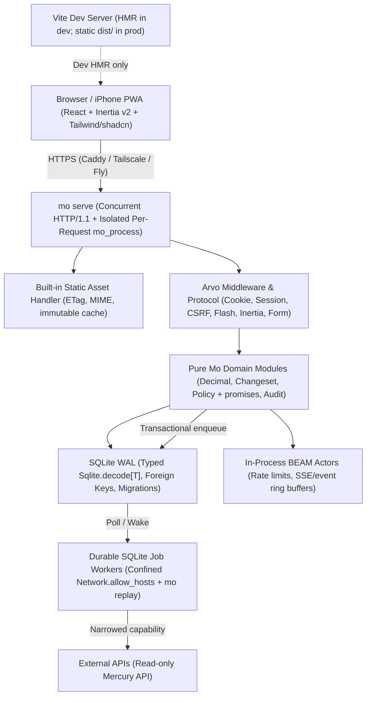

# Arvo: A Calm, Batteries-Included Web Framework for Mo

> **Named after Arvo Pärt** — *tintinnabuli* for web software: two clear voices in harmony (pure, compiler-verified domain logic and thin, capability-confined web edges), zero clutter, every piece earning its place.

**Companion Spec:** [arvo-spec.md](arvo-spec.md)  
**Status:** Settled decisions locked in (`2026-11-21`): unified budget model (envelopes + paycheck bills/safe-to-spend) and app-level login (2-email allowlist + encrypted cookie sessions over HTTPS). Ready for Phase 1 execution on `main`.  
**Database Target:** SQLite-first (WAL mode, single-binary deployment; PostgreSQL adapter deferred until needed).  
**Frontend Target:** Inertia v2 + React + TypeScript + Vite + Tailwind CSS v4 + shadcn/ui (no Node server in production).  
**Crucible App #1:** A unified daily-driver personal household budget web app combining `robertguss/hearth-budget` (monthly envelopes, carryover, card reserves, CSV import, Mercury sync) with `household-finance` (app-level auth, biweekly paycheck bills, one-tap "I just paid this" `in_flight`, Safe-to-Spend breakdown, audit log + undo).  
**Packaging Strategy:** Prototype `Arvo.*` modules inside `mo` (`lib/arvo/*.mo`, loaded on `use`) first; extract to a standalone repository once `mo.toml` package resolution lands.

---

## 1. Architecture Overview

One compiled Mo binary serves static Vite assets, Inertia pages, typed JSON APIs, SQLite WAL storage, supervised in-process actors, and capability-confined background jobs—with zero Redis, zero Ruby/BEAM release overhead, and no Node runtime in production.



### Core Design Rules

1. **No macros, no hidden magic.** Mo deliberately has no macros and no user-defined abilities ([docs/reference/README.md](../reference/README.md)). Arvo achieves Ash/Phoenix-level ergonomics through compiler-checked `api` blocks, compiler-derived `Json` and `Sqlite` row decoding, composable pure-Mo modules, and an optional scaffolder CLI written in Mo.
2. **Keep the C runtime minimal and framework-agnostic.** Only true OS/compiler primitives go into Mo's C codebase (`Crypto`, HTTP server primitives, typed SQLite decoding, `Date`, background job runner). All web-framework abstractions (`Cookie`, `Session`, `Csrf`, `Inertia`, `Changeset`, `Migrations`, `Audit`, `WebTest`) live in pure Mo.
3. **Every feature is earned by the budget app.** No speculative Rails features (no ORM query-builder DSL, no WebSockets/LiveView, no server-side template engine beyond the tiny Inertia root shell, no public package registry).

---

## 2. Layer 1: Minimal Mo Runtime & Compiler Additions (C Core)

These additions close the exact gaps verified across `src/tools/api-server.c`, `src/check/apis.c`, `src/host/sqlite.c`, `src/host/random.c`, and `src/check/load.c`.

### 2.1 `Crypto` + CSPRNG + Encoding (`Bytes`)
Mo already links OpenSSL `libcrypto` (`src/host/tls.c`) and ships internal SHA-256 (`src/base/sha256.c`), while `Random` is non-cryptographic `xoshiro256**`.

- **Pure primitives (`src/base/prims.def`, `lib/crypto.mo`):**
  - `Crypto.sha256(bytes: Bytes) : Bytes`
  - `Crypto.hmac_sha256(key: Bytes, data: Bytes) : Bytes`
  - `Crypto.constant_time_eq?(a: Bytes, b: Bytes) : Bool` (`CRYPTO_memcmp`)
  - `Crypto.seal(key: Bytes, nonce: Bytes, plaintext: Bytes, aad: Bytes) : Result(Bytes, CryptoError)` and `Crypto.open(...)` (`AES-256-GCM` via OpenSSL EVP)
  - `Crypto.hash_password(password: Text, salt: Bytes) : Result(Text, CryptoError)` and `Crypto.verify_password(password: Text, encoded: Text) : Bool` (OpenSSL `EVP_PBE_scrypt` with safe defaults, or Argon2id when OpenSSL 3.2+ supports it)
  - `Bytes.to_hex`, `Bytes.from_hex`, `Bytes.to_base64url`, `Bytes.from_base64url`
- **CSPRNG capability (`src/base/hostops.def`):**
  - `SecureRandom` capability (`rng.bytes(count)` backed by OpenSSL `RAND_bytes`), with deterministic `SecureRandom.seeded(seed)` fake for `mo test` so session tokens, CSRF tokens, and salts remain 100% deterministic in tests.

### 2.2 `api ... end` & `mo serve` Web Upgrades
- **Cross-module route handlers (`src/check/apis.c`):** Allow qualified imported functions (`get "/bills/:id" Bills.show`) and `scope "/prefix" ... end` blocks inside `api ... end` so large apps stay modular instead of putting every route in `Main`.
- **Static asset serving:** Add a declarative `static "/assets" from "public/assets"` clause in `api` blocks, served directly by `src/tools/api-server.c` with symlink-confined path resolution, MIME detection, `HEAD` support, `ETag` / `If-None-Match` (`304`), and `Cache-Control: public, max-age=31536000, immutable` for hashed Vite assets.
- **Browser HTTP completeness ([lib/api.mo](../../lib/api.mo)):**
  - `res.add_header(name, value)` (appends without clobbering prior headers—essential for multiple `Set-Cookie` headers).
  - `Api.redirect_see_other(location)` (`303 See Other`, required by Inertia after `PUT`/`PATCH`/`DELETE`).
  - `Option(Principal)` route parameter binding: if `auth` succeeds, passes `Some(user)`; if unauthenticated, passes `None` instead of short-circuiting to `401` (needed for login pages, public health/landing routes, and Inertia shared auth state).
  - Multi-value request header helper `req.headers_named(name)` (matching `Http.Response.headers_named`).
- **Dev & production server ergonomics (`src/tools/api-server.c`):**
  - `--bind HOST` (default `127.0.0.1`, allows `0.0.0.0` in containers) and `--workers N` (configurable above current fixed `8`).
  - HTTP/1.1 `Connection: keep-alive` with bounded idle timeout + max requests per connection.
  - Structured single-line request logs (`METHOD /path STATUS DURATION_MS`).
  - **`mo serve --watch`**: watches `.mo` files, recompiles in milliseconds, and gracefully restarts the server on save (paired with `vite` dev server for sub-second full-stack feedback).

### 2.3 Typed `Sqlite` Ergonomics
- **Compiler-derived row decoding (`Sqlite.decode[T](rows)` / `Sqlite.decode_one[T](rows)`):** Reuses the exact struct-field metadata `Json` already generates, mapping SQL column names to Mo struct fields (`Int`, `Decimal`, `Float`, `Text`, `Bool`, `Bytes`, `Time`, `Option(T)`, and JSON-stored `T: Json`) and returning `Result(List(T), SqliteDecodeError)`. Eliminates every `cell_str(row, 0)` helper.
- **Connection defaults & write metadata (`src/host/sqlite.c`):**
  - Enable `PRAGMA foreign_keys = ON;` in `configure_connection` (for both real and fake DBs).
  - Add `db.execute(sql, params) : Result(Sqlite.ExecResult, SqliteError)` returning `ExecResult(changes: Int, last_insert_rowid: Int)`.
  - Reuse a per-worker pooled `sqlite3*` handle in `api-server.c` instead of reopening the DB file and checking `sqlite_schema` on every HTTP request.
  - Clean transaction helper (`Sqlite.with_transaction` or `db.begin_immediate` / `commit` / `rollback`) designed around Mo's rule that anonymous functions cannot capture capabilities ([docs/reference/README.md](../reference/README.md)).

### 2.4 Calendar `Date` Module (`lib/date.mo`, pure Mo)
Pure Gregorian calendar value type `Date` (years 1..9999) with `Order`, `Hash`, `Equal`, `Text`, and `Json` (ISO `YYYY-MM-DD`):
- `Date.from_ymd`, `Date.parse_iso`, `Date.from_time_utc`, `Date.to_iso`
- `add_days`, `add_months` (clamping month-end safely for `due_day: 31` → Feb 28/29), `days_between`, `days_in_month`, `weekday`, `first_of_month`, `end_of_month`, `year_month` (`"2026-11"`), `short_label`.

### 2.5 Durable Capability-Confined Background Jobs (Phase 4)
Because Mo `actor`s are pure state machines without external capabilities (`src/vm/service.c`), background work with I/O needs a dedicated worker runner in `mo serve`:
- Declared cleanly in `api ... end`:
  ```mo
  job "mercury.sync" MercurySync.run every 15.minutes
  job "alerts.check" Alerts.evaluate every 1.hour
  ```
- Backed by an `_arvo_jobs` SQLite table (enqueued transactionally alongside domain writes, just like Oban / Solid Queue).
- `mo serve` polls/wakes worker slots, executes each job in an isolated `mo_process` with its declared (and narrowed!) capabilities, retries with exponential backoff on `Error` or defect, and records failure artifacts replayable with `mo replay`.

### 2.6 Package Extraction Hook (Phase 4, `src/check/load.c`)
Minimal `mo.toml` supporting local path and pinned Git dependencies (`[dependencies] arvo = { path = "../arvo" }`), allowing `lib/arvo/` to graduate out of `mo` into `github.com/robertguss/arvo` cleanly.

---

## 3. Layer 2: The Arvo Framework (`lib/arvo/*.mo`, Pure Mo)

Because `src/check/load.c` already walks subdirectories in `lib/`, Arvo modules live under `lib/arvo/` and load on demand via `use Arvo.*` with zero compile cost for non-web programs.

| Module | Responsibility |
| --- | --- |
| `Arvo.Cookie` | Parse `Cookie` request headers; build `Set-Cookie` headers (`HttpOnly`, `Secure`, `SameSite=Lax`, `Path=/`, `Max-Age`). |
| `Arvo.Session` | `AES-256-GCM` encrypted cookies + SQLite-backed revocable sessions (`arvo_sessions`), rotation on login, idle & absolute expiry. |
| `Arvo.Csrf` | Double-submit `XSRF-TOKEN` cookie + `X-XSRF-TOKEN` header check (matches `@inertiajs/react` / Axios defaults automatically). |
| `Arvo.Flash` | One-hop flash notices and validation error bags carried cleanly across `303` redirects. |
| `Arvo.Form` | `application/x-www-form-urlencoded` and bounded `multipart/form-data` parsers (for CSV statement uploads). |
| `Arvo.Inertia` | Complete Inertia v2 server protocol: `X-Inertia` detection, `X-Inertia-Version` → `409` + `X-Inertia-Location`, initial HTML shell with Vite dev HMR or prod `manifest.json`, partial reloads (`X-Inertia-Partial-Data`), shared props, `303` redirects, typed `Inertia.render`. |
| `Arvo.Changeset` | Ash/Ecto-style validation accumulator returning `Map(Text, List(Text))` errors that wire straight into Inertia `useForm().errors`. |
| `Arvo.Audit` | AshPaperTrail-style `Audit.record(db, actor, action, entity, before, after, reason, undo_payload, now)` using compiler-derived `Json` + optimistic concurrency `version` helper. |
| `Arvo.Migrations` | Ordered `.sql` migration runner tracked in `_arvo_migrations` (runs idempotently at startup and inside `Sqlite.in_memory()` tests). |
| `Arvo.Auth` | Password hashing/verification (`Crypto`), allowlist check, session issuance/revocation, login/logout helpers, and an `Api.auth` adapter returning `Result(Principal, AuthError)`. |
| `Arvo.WebTest` | Stateful test client wrapping `ApiTest.send`: tracks cookies across requests, injects CSRF tokens, submits Inertia requests, and asserts component names, typed props, flashes, and `303` redirects in milliseconds. |

---

## 4. Layer 3: Crucible #1 — Daily-Driver Household Budget App

Combining the best of **`robertguss/hearth-budget`** (proven daily envelope budgeting) and **`household-finance`** (reliable phone access, paycheck bill clarity, audit/undo):

### Core Product Scope (v1 Daily Driver)
1. **Reliable Two-Person Phone Access (Improves on Hearth's Tailscale-only limitation):**
   - Two-email allowlist + password/session cookie login (encrypted `HttpOnly; Secure; SameSite=Lax`) behind standard HTTPS (Caddy / Fly / exe.dev) + installable iPhone PWA manifest. *(Still supports loopback + Tailscale Serve if you prefer keeping it tailnet-only.)*
2. **Envelope Budget & Accounts (Carried over from `hearth-budget`):**
   - Server-authoritative exact `Decimal` math (never floats; integer-cent precision with `promise` checks).
   - Monthly allocations, automatic unspent carryover, grouped categories with persistent ordering, monthly & save-by-date targets, and "Cover overspending" move-money flow.
   - Manual checking & credit-card accounts with automatic card-payment reserve envelopes, linked payoff plans, and cleared-statement reconciliation.
   - RFC 4180 CSV import with preview-before-commit validation and ID-based deduplication.
3. **Paycheck Clarity & "Did You Pay X?" Elimination (Carried over from `household-finance`):**
   - Biweekly pay-period schedule + recurring bill checklist (`due` → `in_flight` → `paid` / `skipped` / `overdue`).
   - One-tap **"I just paid this"** (`in_flight`, attributed to whoever tapped it) so neither of you double-pays a bill.
   - **Safe-to-Spend this paycheck** card with tap-to-expand glass-box breakdown of every term.
4. **Trust, Concurrency & Undo (Ash-inspired):**
   - Optimistic concurrency (`version` check on edits).
   - Every write (by you, your wife, Mercury sync, or MCP) logs an `events` row with before/after JSON and supports one-tap **Undo**.
   - Domain invariants (`safe_to_spend` conservation, envelope zero-sum moves, reconcile gate, access control) verified automatically by `mo test` `promise`s.
5. **Phase 4 Additions (Once v1 Is Used Daily):**
   - Scheduled 15-minute **read-only Mercury sync** job confined to `network.allow_hosts(["api.mercury.com:443"])` (pending→posted identity preservation, fail-closed anomaly detection, conservative envelope suggestions).
   - Authenticated **MCP endpoint** exposing the budget's domain tools to Claude Code.

### Frontend Stack
- **React 19 + TypeScript + Vite + Tailwind CSS v4 + shadcn/ui + `@inertiajs/react` v2**, preserving the phone-first visual design and layouts from `hearth-budget` and `household-finance`, with zero client-side API wrapper boilerplate (`src/api.ts` disappears—pages receive typed props directly from Mo via Inertia).

---

## 5. Phased Execution Plan & Verification Gates

> [!IMPORTANT]
> Every phase lands via focused PRs against `main`, keeping `ci/check.sh` green at every step.

### Phase 1: Mo Runtime Web Primitives (in `mo`)
- **Deliverables:**
  1. `Crypto` primitives + `SecureRandom` capability + `Bytes` hex/base64url (+ Lean `MoCore` / C tests & fakes).
  2. `api` block upgrades: cross-module handlers (`Module.fn`), `scope`, `static` directory serving, `Option(Principal)`, `add_header`, `redirect_see_other` (`303`), `--bind`, `--workers`, HTTP/1.1 keep-alive, `mo serve --watch`.
  3. `Sqlite.decode[T]`, `PRAGMA foreign_keys = ON`, `db.execute` (`changes`/`last_insert_rowid`), per-worker connection reuse.
  4. `lib/date.mo` Gregorian calendar module.
- **Exit Gate:** Full `CI=1 bash ci/check.sh` green (GCC, Clang, ASan/UBSan, TSan, `fuzz_api_server`, Lean `MoCore`), plus a working minimal Inertia hello-world smoke test.

### Phase 2: Arvo Core Prototype (`lib/arvo/` in `mo`)
- **Deliverables:**
  1. `Arvo.Cookie`, `Arvo.Session`, `Arvo.Csrf`, `Arvo.Flash`, `Arvo.Form`, `Arvo.Inertia`, `Arvo.Changeset`, `Arvo.Migrations`, `Arvo.Audit`, `Arvo.Auth`, `Arvo.WebTest`.
  2. Minimal Vite + React + TypeScript + Tailwind + shadcn/ui + `@inertiajs/react` starter template verifying dev HMR (`mo serve --watch` + `vite`) and single-binary prod build (`vite build` → `mo serve`).
- **Exit Gate:** Every `Arvo.*` module passes `mo test` (including `promise` checks and `WebTest` end-to-end session/CSRF/Inertia/upload scenarios).

### Phase 3: Crucible #1 — Daily-Driver Budget App v1
- **Deliverables:**
  1. SQLite migrations + pure Mo domain layer (`Money`/`Decimal`, `Envelopes`, `Accounts`, `CardReserves`, `PayPeriods`, `Bills`, `SafeToSpend`, `CsvImport`, `Undo`) with ported golden tests from both `hearth-budget` and `household-finance` plus `promise` invariants.
  2. Arvo routes, policies, audit log, and phone-first Inertia + React/shadcn screens (Sign-In, Home/Safe-to-Spend, Envelopes/Move-Money, Bills Checklist, Accounts/Activity/Reconcile, CSV Import, Audit/Undo, Settings).
  3. Full `WebTest` route/auth/policy matrix + Playwright phone viewport smoke tests + single-binary systemd/Caddy deployment guide.
- **Exit Gate:** Usable side-by-side against `hearth-budget` on real phones with zero manual workarounds.

### Phase 4: Background Jobs, Mercury Sync & Extraction
- **Deliverables:**
  1. Durable SQLite job queue + scheduled worker runner in `mo serve` with capability confinement and `mo replay`.
  2. Read-only Mercury sync job (`network.allow_hosts(["api.mercury.com:443"])`) + fixture tests ported from `hearth-budget`/`household-finance`, plus authenticated MCP tools.
  3. Minimal `mo.toml` path/git dependency loader in `src/check/load.c`, extracting `lib/arvo/` into a clean standalone `robertguss/arvo` repository and writing a tiny `arvo gen` scaffolder based on the real patterns proven in Phase 3.
- **Exit Gate:** Budget app runs cleanly importing `arvo` via `mo.toml`, Mercury syncs reliably on schedule, and `mo` core stays lean.
