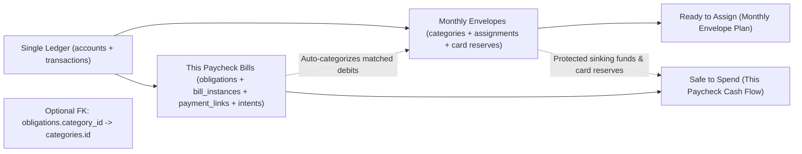

# Arvo Technical Spec & Unified Household Budget Schema

Companion implementation spec to [arvo-plan.md](arvo-plan.md).  
Everything here is written against Mo’s actual language rules ([docs/reference/README.md](../reference/README.md)) and reconciles `robertguss/hearth-budget` with `household-finance` onto a single SQLite ledger with zero double-counting.

---

## Part 1: Exact Phase 1 Mo Runtime & Compiler API Spec

### 1.1 `Crypto`, `SecureRandom`, and `Bytes` Encoding

Backed by OpenSSL `libcrypto` (already linked for `src/host/tls.c`). Pure cryptographic transforms live in `src/base/prims.def` + `lib/crypto.mo`; OS entropy (`RAND_bytes`) is an explicit capability in `src/base/hostops.def` so tests stay 100% deterministic.

```mo
## Pure primitives (use Crypto)
enum CryptoError
  InvalidKeyLength(expected: Int, got: Int)
  InvalidNonceLength(expected: Int, got: Int)
  InvalidSaltLength(got: Int)
  DecryptionFailed
  EncodingFailed(reason: Text)
end

## Pure digests, MACs, constant-time compare, AEAD (AES-256-GCM), and password hashing (scrypt)
Crypto.sha256(data: Bytes) : Bytes
Crypto.hmac_sha256(key: Bytes, data: Bytes) : Bytes
Crypto.constant_time_eq?(a: Bytes, b: Bytes) : Bool
Crypto.seal(key: Bytes, nonce: Bytes, plaintext: Bytes, aad: Bytes) : Result(Bytes, CryptoError)
Crypto.open(key: Bytes, nonce: Bytes, ciphertext: Bytes, aad: Bytes) : Result(Bytes, CryptoError)
Crypto.hash_password(password: Text, salt: Bytes) : Result(Text, CryptoError)
Crypto.verify_password(password: Text, encoded: Text) : Bool

## Encoding primitives on Bytes
bytes.to_hex : Text
Bytes.from_hex(text: Text) : Option(Bytes)
bytes.to_base64url : Text
Bytes.from_base64url(text: Text) : Option(Bytes)

## Capability (listed on `main` or injected into `api` route/auth handlers)
## Real: OpenSSL RAND_bytes. Fake (spec-only): deterministic SHA-256 counter stream from seed.
SecureRandom.bytes(rng: SecureRandom, count: Int) : Bytes   # bug if count < 0 or count > 65536
SecureRandom.seeded(seed: Int) : SecureRandom                # spec-only fake for mo test
```

**Design & verification notes:**
- **Zero hand-rolled crypto:** Every cryptographic algorithm is a thin C wrapper over OpenSSL 3 `libcrypto` (already linked via `-lssl -lcrypto` in `Makefile`)—never re-implemented in C or in Mo bytecode (avoiding both interpreter timing side-channels and KDF slowness).
- `Crypto.seal` / `Crypto.open` wrap `EVP_aes_256_gcm()` (32-byte key, 12-byte nonce, 16-byte tag verified before releasing plaintext, returning `DecryptionFailed` on any mismatch). `Arvo.Session` always draws a fresh 12-byte nonce from `SecureRandom` per `seal` and binds cookie name/purpose in `aad`.
- `Crypto.hash_password` wraps `EVP_PBE_scrypt` (available on OpenSSL 3.0+ across both Linux 3.0.13 and macOS Homebrew OpenSSL 3; Argon2id requires 3.2+), encoding parameters + salt + digest in self-describing PHC format (`$scrypt$ln=15,r=8,p=1$<b64salt>$<b64hash>`) and checking with `CRYPTO_memcmp`.
- C wrappers call `OPENSSL_cleanse` on temporary key/password/plaintext buffers and clear OpenSSL's error queue per call.
- **Verification gate for PR 1:** Official NIST/RFC test vectors (FIPS 180-4 SHA-256, RFC 4231 HMAC-SHA256, NIST SP 800-38D AES-256-GCM including bit-flip/AAD/truncation rejections, RFC 7914 scrypt, RFC 4648 base64url/hex), cross-check against Python `hashlib`/`hmac`, plus ASan/UBSan/TSan and a `fuzz_crypto.c` target hammering `open`, `verify_password`, and decoders.
- In `api` blocks, `SecureRandom` joins `api_cap_order` in `src/check/apis.c` and `ApiTest.send` synthesizes a deterministic `SecureRandom.seeded(0)` unless the test supplies one.

---

### 1.2 `api ... end` & `mo serve` Upgrades

#### Declarative `api` block additions (`src/check/apis.c`)
```mo
api
  port 8080
  sqlite db from "budget.sqlite"
  static "/assets" from "public/assets"
  auth Member via AuthRoutes.authenticate

  get  "/login"                AuthRoutes.show_login
  post "/login"                AuthRoutes.post_login
  post "/logout"               AuthRoutes.post_logout

  scope "/bills"
    get  ""                    BillRoutes.index
    get  "/:id"                BillRoutes.show
    post "/:id/in-flight"      BillRoutes.mark_in_flight
    post "/:id/elsewhere"      BillRoutes.mark_elsewhere
    post "/:id/skip"           BillRoutes.skip
  end

  status Unauthenticated = 401
  status Forbidden       = 403
  status NotFound(_)     = 404
  status Conflict(_)     = 409
end
```

1. **Qualified cross-module handlers:** `resolve_route_fn` accepts either a local `fn` or an imported `Module.fn` (still non-generic, non-overloaded, statically checked in `src/check/apis.c`).
2. **`scope "/prefix" ... end`:** Pure compile-time prefix concatenation (`scope "/bills"` + `""` → `"/bills"`, `"/:id"` → `"/bills/:id"`). Nestable up to 8 levels; duplicate `(method, shape)` checks run on the flattened path.
3. **`static "/prefix" from "rel/dir"`:** Up to 8 static mounts per `api` block. Served directly in `src/tools/api-server.c` before VM dispatch using `openat2`/`RealFiles`-style confinement (zero `..` traversal, no symlink escape). Sets MIME type (`.js`, `.css`, `.svg`, `.png`, `.woff2`, `.json`, `.webmanifest`, `.ico`, `.html`), `ETag` (size + mtime), `304 Not Modified` on `If-None-Match`, `HEAD` support, and `Cache-Control: public, max-age=31536000, immutable` for fingerprinted assets.
4. **Optional auth (`Option(Principal)`):** A route handler taking `user: Option(Member)` calls `authenticate`; `Ok(m)` passes `Some(m)`, while `Error(_)` passes `None` instead of returning an error response. Required auth (`user: Member`) keeps existing short-circuit behavior.
5. **`lib/api.mo` additions:**
   - `res.add_header(name: Text, value: Text) : Response` (appends; never replaces existing `Set-Cookie` headers).
   - `req.headers_named(name: Text) : List(Text)` (case-insensitive multi-header lookup).
   - `Api.redirect_see_other(location: Text) : Response` (`303 See Other`).
   - `Api.redirect_with(status: Int, location: Text) : Response` (`301`/`302`/`303`/`307`/`308`).
6. **`mo serve` CLI & server upgrades (`src/tools/api-server.c`):**
   - `--bind HOST` (default `127.0.0.1`, accepts `0.0.0.0` or IPv4 literal).
   - `--workers N` (default `8`, range `1..64`).
   - HTTP/1.1 keep-alive (bounded 15s idle timeout, max 100 requests per connection).
   - `--watch`: polls `.mo` module tree every 250ms, recompiles into a fresh `mo_image`, swaps listener cleanly on compile success (printing diagnostics without crashing the watcher on compile error).

---

### 1.3 `Sqlite` Web Ergonomics

1. **Connection defaults (`src/host/sqlite.c`):**
   - Enable `PRAGMA foreign_keys = ON;` in `configure_connection` for both real and fake DBs.
   - Reuse a per-worker `sqlite3*` pool keyed by `(worker, path)` in `api-server.c` (closing cleanly on worker shutdown or if a request leaves an open transaction, rolling back before returning to the pool!).
2. **Write metadata (`src/base/hostops.def`):**
   ```mo
   struct Sqlite.ExecResult
     changes: Int
     last_insert_rowid: Int
   end

   db.execute(statement: Text, values: List(Sqlite.Value)) : Result(Sqlite.ExecResult, SqliteError)
   ```
   *(Existing `db.run` stays untouched for full backwards compatibility.)*
3. **Compiler-derived typed row decoding (`Sqlite.decode[T]`):**
   Reuses the exact struct-field reflection mechanism built for `Json.decode[T]`:
   ```mo
   enum SqliteDecodeError
     MissingColumn(name: Text)
     TypeMismatch(column: Text, expected: Text, got: Text)
     InvalidValue(column: Text, reason: Text)
     ExpectedOneRow(got: Int)
   end

   Sqlite.decode[T](rows: Sqlite.Rows) : Result(List(T), SqliteDecodeError)
   Sqlite.decode_one[T](rows: Sqlite.Rows) : Result(T, SqliteDecodeError)
   Sqlite.decode_optional[T](rows: Sqlite.Rows) : Result(Option(T), SqliteDecodeError)
   ```
   **Column mapping rules (matched by exact SQL column name to `struct` field name):**
   - `Int` ↔ `Sqlite.Integer`
   - `Bool` ↔ `Sqlite.Integer(0 | 1)`
   - `Float` ↔ `Sqlite.Real` or `Sqlite.Integer`
   - `Text` ↔ `Sqlite.String`
   - `Bytes` ↔ `Sqlite.Blob`
   - `Decimal` ↔ `Sqlite.String` (`to_decimal`)
   - `Time` ↔ `Sqlite.String` (`Time.parse`, RFC 3339 `TEXT`) and `Date` ↔ ISO `YYYY-MM-DD` `TEXT`
   - `Option(T)` ↔ `Sqlite.Null` → `None`, otherwise decodes `T`
   - Any nested `struct`/`enum` with `Json` ↔ `Sqlite.String` parsed via `Json.decode[T]`
4. **Transactions under Mo’s closure-capability rule ([docs/reference/README.md](../reference/README.md)):**
   Because anonymous functions cannot capture capabilities from an outer scope, passing an explicit capability record `C` solves transactions cleanly with zero language changes:
   ```mo
   ## Runs `work(db, ctx)` inside `BEGIN IMMEDIATE ... COMMIT`, rolling back on any `Error(e)`.
   fn Sqlite.transaction(
     db: Sqlite.Database,
     ctx: C,
     work: fn(Sqlite.Database, C) : Result(T, E),
     on_sql: fn(SqliteError) : E
   ) : Result(T, E)
   ```
   If the worker `mo_process` defects (`stop` / out-of-work) mid-transaction, `api-server.c` automatically issues `ROLLBACK` before releasing the pooled SQLite connection.

---

### 1.4 Calendar `Date` (`lib/date.mo`, pure Mo)

```mo
module Date
expose Date, Weekday(..), from_ymd, parse_iso, from_time_utc, to_iso,
  year, month, day, year_month, weekday, days_in_month,
  add_days, add_months, days_between, first_of_month, end_of_month, short_label

## Opaque validated Gregorian date (years 1..9999); exposes Order, Hash, Equal, Text, Json ("YYYY-MM-DD").
struct Date ... end

enum Weekday
  Monday
  Tuesday
  Wednesday
  Thursday
  Friday
  Saturday
  Sunday
end
```
- `add_months(Date(2026, 1, 31), 1)` clamps safely to `Date(2026, 2, 28)` (critical for recurring bills with `due_day: 31`!).
- Custom `to_json` / `from_json` serializes as `"2026-11-21"` so `Date` works seamlessly in `api` params, Inertia props, and `Sqlite.decode[T]`.

---

## Part 2: Arvo Pure-Mo Framework API (`lib/arvo/*.mo`)

Every module lives in `lib/arvo/` (loaded on `use Arvo.*`) and relies only on Mo's standard capabilities + Phase 1 primitives.

### Key Module Signatures

```mo
## Arvo.Cookie
struct CookieOptions
  path: Text
  max_age: Option(Int)
  http_only?: Bool
  secure?: Bool
  same_site: SameSite  # Lax | Strict | NoneSite
end

Arvo.Cookie.parse(req: Api.Request) : Map(Text, Text)
Arvo.Cookie.get(req: Api.Request, name: Text) : Option(Text)
Arvo.Cookie.set(res: Api.Response, name: Text, value: Text, opts: CookieOptions) : Api.Response
Arvo.Cookie.clear(res: Api.Response, name: Text, path: Text) : Api.Response

## Arvo.Session (AEAD cookie + revocable `arvo_sessions` SQLite row)
struct Session
  id: Text
  member_id: Text
  csrf_token: Text
  expires_at: Time
end

Arvo.Session.create(db: Sqlite.Database, rng: SecureRandom, clock: Clock, key: Bytes, member_id: Text)
  : Result((Session, Text), SessionError)
Arvo.Session.load(req: Api.Request, db: Sqlite.Database, clock: Clock, key: Bytes)
  : Result(Option(Session), SessionError)
Arvo.Session.revoke(db: Sqlite.Database, session_id: Text) : Result(Unit, SqliteError)

## Arvo.Csrf (compatible with @inertiajs/react XSRF-TOKEN convention)
Arvo.Csrf.verify(req: Api.Request, session: Session) : Bool
Arvo.Csrf.attach_cookie(res: Api.Response, session: Session, secure?: Bool) : Api.Response

## Arvo.Changeset (Ash/Ecto validation accumulator -> Inertia form errors)
struct Changeset(T)
  data: T
  errors: Map(Text, List(Text))
end

Arvo.Changeset.new(data: T) : Changeset(T)
Arvo.Changeset.check(cs: Changeset(T), field: Text, ok?: Bool, message: Text) : Changeset(T)
Arvo.Changeset.require_non_empty(cs: Changeset(T), field: Text, value: Text) : Changeset(T)
Arvo.Changeset.valid?(cs: Changeset(T)) : Bool
Arvo.Changeset.finish(cs: Changeset(T)) : Result(T, Map(Text, List(Text)))

## Arvo.Inertia (Inertia v2 protocol + Vite dev/prod shell)
struct InertiaConfig
  app_title: Text
  version: Text           # SHA-256 of Vite manifest.json (or "dev")
  vite_dev_url: Option(Text)  # Some("http://127.0.0.1:5173") in dev, None in prod
  entry_js: Text          # e.g. "src/main.tsx"
  entry_css: List(Text)
end

Arvo.Inertia.request?(req: Api.Request) : Bool
Arvo.Inertia.render(
  req: Api.Request,
  cfg: InertiaConfig,
  component: Text,
  props: Map(Text, Json),
  shared: Map(Text, Json)
) : Api.Response
Arvo.Inertia.redirect(location: Text) : Api.Response             # 303 See Other
Arvo.Inertia.validation_error(req: Api.Request, errors: Map(Text, List(Text))) : Api.Response
Arvo.Inertia.version_mismatch?(req: Api.Request, cfg: InertiaConfig) : Option(Api.Response) # 409 + X-Inertia-Location

## Arvo.Migrations & Arvo.Audit
Arvo.Migrations.run(db: Sqlite.Database, clock: Clock, scripts: List((Int, Text, Text))) : Result(Int, SqliteError)
Arvo.Audit.record(
  db: Sqlite.Database,
  rng: SecureRandom,
  clock: Clock,
  actor: Text,
  action: Text,
  entity_table: Text,
  entity_id: Text,
  before: Option(Json),
  after: Option(Json),
  reason: Option(Text),
  undo: Option(Json)
) : Result(Text, SqliteError)
```

---

## Part 3: Unified Budget Domain Model (Zero Double-Counting)

### 3.1 How Envelopes and Paycheck Bills Harmonize

Both views read **one single ledger** (`accounts` + `transactions`), eliminating all data duplication:



#### The Two Glass-Box Numbers (Always Derived, Never Stored)

All money is stored in SQLite as **signed `INTEGER` cents** (debits negative, credits positive, matching both `hearth-budget` and `household-finance`) and wrapped in Mo’s opaque `Money` / exact `Decimal` domain functions—floats never touch money.

1. **Ready to Assign (Envelope Plan — from `hearth-budget`):**
   `Ready to Assign = Operating Cash Balance - sum(Positive Envelope Balances incl. Card Payment Reserves)`
   - Every checking/cash inflow increases `Ready to Assign`.
   - Assigning dollars to a category moves them from `Ready to Assign` into that category (`assignments(category_id, month)`).
   - **Carryover vs. Paycheck Cap (unified `categories` replaces separate `buckets`):**
     - `mode = 'carryover'` (default): Hearth’s classic envelope—unspent balance rolls forward across months (`available(m) = carryover(m-1) + assigned(m) + activity(m)`).
     - `mode = 'paycheck_cap'`: `household-finance`’s spending bucket—fixed standing cap per pay period (with optional per-period override), spent/left computed on read, zero rollover upkeep.
   - **Credit card payment reserve (exact Hearth rule):** When a purchase of `-$50.00` is categorized into `Groceries` on a credit card account, `$50.00` automatically shifts from `Groceries` available into the card’s linked `payment_category_id` reserve envelope so the payment cash is always set aside.
   - **Move Money ("Cover overspending"):** Atomically subtracts `amount` from source category’s assignment and adds `amount` to destination category’s assignment in the same month (`sum` invariant = 0).

2. **Safe to Spend This Paycheck (Cash Flow — from `household-finance`):**
   `Safe to Spend = Operating Posted Balance - Pending Operating Debits - Open In-Flight Bill Marks (net) - Unpaid Bills Due This Paycheck (net) - Unbilled Card Reserves (optional) - Extra Debt - Buffer`
   - **Zero double-counting rules (enforced by pure domain code + `promise` tests):**
     1. **Bills vs. Envelopes:** Safe-to-Spend subtracts unpaid paycheck bills (not non-bill envelopes like Groceries/Dining—those are what you *spend* Safe-to-Spend on!). Below the big Safe-to-Spend number, the expandable breakdown shows how much is currently earmarked in spending envelopes vs. unassigned cushion.
     2. **In-Flight Marks vs. Bank Debits:** Exact `household-finance` `safe_to_spend.rs` netting—an open `"I just paid this"` mark (`payment_intents`) is reduced by any active `payment_links` or pending match proposals on the same `bill_instance`, clamped at `0`.
     3. **Card Payment Reserve vs. Card Bill:** If a credit card has BOTH a bill due this paycheck (`obligations.account_id = card.id`) AND new spending sitting in its `payment_category_id` reserve, Safe-to-Spend never subtracts both for the same dollars: `unbilled_reserve = max(0, card_payment_reserve - this_period_card_bill_owed)`.
     4. **Confidence Status (`Confident | Warning | Blocked`):** Exact `household-finance` trust model—flags stale Mercury sync (`> 2h` when Mercury is enabled), ledger tie-out mismatch, unknown bill amount, or quarantined/returned bank rows so you always know whether to trust the number.
   - **Auto-link bridge:** When a Mercury debit (or manual/CSV transaction) links to a `bill_instance` whose `obligation` has a `category_id`:
     - If `obligation.account_id` is a credit card, the transaction links as a card payment transfer into that card’s `payment_category_id`.
     - Otherwise, if the transaction is uncategorized, it automatically receives `obligation.category_id` (preserving any explicit manual user category).

---

### 3.2 Unified SQLite Schema (`migrations/0001_init.sql`)

All tables use `STRICT`, `PRAGMA foreign_keys = ON`, ULID primary keys (`TEXT`), `INTEGER` cents, RFC 3339 UTC `TEXT` timestamps, ISO `YYYY-MM-DD` local dates, and optimistic concurrency `version` columns on mutable domain rows.

```sql
-- 1. Auth & Sessions (Arvo app-level login, 2-person allowlist)
CREATE TABLE members (
  id TEXT PRIMARY KEY,
  email TEXT NOT NULL UNIQUE,
  password_hash TEXT NOT NULL,
  display_name TEXT NOT NULL,
  role TEXT NOT NULL CHECK (role IN ('owner', 'member')),
  usual_payer_alias TEXT,
  active INTEGER NOT NULL DEFAULT 1 CHECK (active IN (0, 1)),
  created_at TEXT NOT NULL
) STRICT;

CREATE TABLE arvo_sessions (
  id TEXT PRIMARY KEY,
  member_id TEXT NOT NULL REFERENCES members (id),
  token_hash TEXT NOT NULL UNIQUE,
  csrf_token TEXT NOT NULL,
  expires_at TEXT NOT NULL,
  last_seen_at TEXT NOT NULL,
  created_at TEXT NOT NULL
) STRICT;
CREATE INDEX arvo_sessions_by_member ON arvo_sessions (member_id);

-- 2. Household Settings & Global Revision
CREATE TABLE settings (
  id INTEGER PRIMARY KEY CHECK (id = 1),
  timezone TEXT NOT NULL DEFAULT 'America/New_York',
  pay_anchor_date TEXT,                          -- ISO YYYY-MM-DD payday anchor
  pay_cadence_days INTEGER NOT NULL DEFAULT 14 CHECK (pay_cadence_days >= 1),
  buffer_cents INTEGER NOT NULL DEFAULT 0 CHECK (buffer_cents >= 0),
  default_lead_days INTEGER NOT NULL DEFAULT 2 CHECK (default_lead_days >= 0),
  planned_extra_debt_cents INTEGER NOT NULL DEFAULT 0 CHECK (planned_extra_debt_cents >= 0),
  include_card_reserves_in_sts INTEGER NOT NULL DEFAULT 1 CHECK (include_card_reserves_in_sts IN (0, 1)),
  revision INTEGER NOT NULL DEFAULT 0 CHECK (revision >= 0),
  version INTEGER NOT NULL DEFAULT 1
) STRICT;

-- 3. Envelope Budget Structure (Unified Hearth Envelopes + Paycheck Caps)
CREATE TABLE category_groups (
  id TEXT PRIMARY KEY,
  name TEXT NOT NULL,
  position INTEGER NOT NULL,
  version INTEGER NOT NULL DEFAULT 1,
  created_at TEXT NOT NULL
) STRICT;

CREATE TABLE categories (
  id TEXT PRIMARY KEY,
  group_id TEXT NOT NULL REFERENCES category_groups (id),
  name TEXT NOT NULL,
  icon TEXT NOT NULL DEFAULT 'folder',
  position INTEGER NOT NULL,
  mode TEXT NOT NULL DEFAULT 'carryover' CHECK (mode IN ('carryover', 'paycheck_cap', 'card_reserve')),
  target_cents INTEGER CHECK (target_cents >= 0),
  target_kind TEXT NOT NULL DEFAULT '' CHECK (target_kind IN ('', 'monthly', 'by_date', 'per_paycheck')),
  deadline_date TEXT,                            -- ISO YYYY-MM-DD for by_date targets
  retired_on TEXT,
  version INTEGER NOT NULL DEFAULT 1,
  created_at TEXT NOT NULL
) STRICT;
CREATE INDEX categories_by_group ON categories (group_id, position);

CREATE TABLE monthly_assignments (
  category_id TEXT NOT NULL REFERENCES categories (id),
  month TEXT NOT NULL CHECK (length(month) = 7), -- YYYY-MM
  amount_cents INTEGER NOT NULL,
  updated_at TEXT NOT NULL,
  PRIMARY KEY (category_id, month)
) STRICT;

CREATE TABLE period_cap_overrides (
  category_id TEXT NOT NULL REFERENCES categories (id),
  period_start TEXT NOT NULL,                    -- ISO YYYY-MM-DD
  amount_cents INTEGER NOT NULL CHECK (amount_cents >= 0),
  PRIMARY KEY (category_id, period_start)
) STRICT;

CREATE TABLE category_rules (
  id TEXT PRIMARY KEY,
  kind TEXT NOT NULL CHECK (kind IN ('merchant', 'mercury_category')),
  match_key TEXT NOT NULL,
  category_id TEXT REFERENCES categories (id),   -- NULL = explicitly "Not spending"
  created_at TEXT NOT NULL,
  UNIQUE (kind, match_key)
) STRICT;

-- 4. Single Ledger: Accounts & Transactions
CREATE TABLE accounts (
  id TEXT PRIMARY KEY,
  name TEXT NOT NULL,
  kind TEXT NOT NULL CHECK (kind IN ('checking', 'savings', 'credit', 'loan')),
  source TEXT NOT NULL CHECK (source IN ('manual', 'mercury')),
  external_id TEXT UNIQUE,
  last_four TEXT NOT NULL DEFAULT '',
  counts_toward_sts INTEGER NOT NULL DEFAULT 0 CHECK (counts_toward_sts IN (0, 1)),
  opening_cents INTEGER NOT NULL,
  opening_date TEXT NOT NULL,
  payment_category_id TEXT REFERENCES categories (id),
  bank_balance_cents INTEGER,
  bank_available_cents INTEGER,
  bank_as_of TEXT,
  reconciled_at TEXT,
  ledger_ties_out INTEGER NOT NULL DEFAULT 1 CHECK (ledger_ties_out IN (0, 1)),
  version INTEGER NOT NULL DEFAULT 1,
  created_at TEXT NOT NULL
) STRICT;

CREATE TABLE transactions (
  id TEXT PRIMARY KEY,
  account_id TEXT NOT NULL REFERENCES accounts (id),
  local_date TEXT NOT NULL,                      -- ISO YYYY-MM-DD
  posted_at TEXT,
  payee TEXT NOT NULL,
  amount_cents INTEGER NOT NULL,                 -- signed: debits < 0, inflows > 0
  category_id TEXT REFERENCES categories (id),
  status TEXT NOT NULL CHECK (status IN ('pending', 'posted', 'canceled', 'nonposting', 'quarantined')),
  provider_status TEXT NOT NULL DEFAULT '',
  reviewed INTEGER NOT NULL DEFAULT 0 CHECK (reviewed IN (0, 1)),
  reconciled INTEGER NOT NULL DEFAULT 0 CHECK (reconciled IN (0, 1)),
  note TEXT NOT NULL DEFAULT '',
  import_id TEXT,
  transfer_id TEXT,
  mercury_category TEXT NOT NULL DEFAULT '',
  problem TEXT CHECK (problem IN ('quarantined', 'frozen', 'stale_pending')),
  version INTEGER NOT NULL DEFAULT 1,
  changed_by TEXT,
  created_at TEXT NOT NULL,
  UNIQUE (account_id, import_id)
) STRICT;
CREATE INDEX transactions_by_date ON transactions (local_date);
CREATE INDEX transactions_by_account_status ON transactions (account_id, status);
CREATE INDEX transactions_by_category ON transactions (category_id);

CREATE TABLE transaction_aliases (
  account_id TEXT NOT NULL REFERENCES accounts (id),
  external_id TEXT NOT NULL,
  transaction_id TEXT NOT NULL REFERENCES transactions (id),
  PRIMARY KEY (account_id, external_id)
) STRICT;

-- 5. Paycheck Obligations, Bill Checklist & Payment Matching
CREATE TABLE obligations (
  id TEXT PRIMARY KEY,
  name TEXT NOT NULL,
  kind TEXT NOT NULL CHECK (kind IN ('card', 'loan', 'medical', 'fixed')),
  category_id TEXT REFERENCES categories (id),   -- Unifies bill with its envelope!
  account_id TEXT REFERENCES accounts (id),      -- Optional link for credit cards / loans
  amount_cents INTEGER,                          -- NULL when unknown
  due_day INTEGER CHECK (due_day >= 1 AND due_day <= 31),
  recurrence TEXT NOT NULL DEFAULT 'monthly' CHECK (recurrence IN ('monthly', 'biweekly', 'quarterly', 'annual', 'once')),
  autopay INTEGER NOT NULL DEFAULT 0 CHECK (autopay IN (0, 1)),
  paid_from TEXT NOT NULL DEFAULT 'mercury' CHECK (paid_from IN ('mercury', 'card', 'other')),
  usual_payer TEXT NOT NULL DEFAULT 'either',
  lead_days INTEGER,
  match_patterns_json TEXT NOT NULL DEFAULT '[]',
  tolerance_cents INTEGER NOT NULL DEFAULT 0 CHECK (tolerance_cents >= 0),
  balance_cents INTEGER,
  apr_bps INTEGER CHECK (apr_bps >= 0 AND apr_bps <= 100000),
  status TEXT NOT NULL DEFAULT 'active' CHECK (status IN ('active', 'dormant', 'paid_off')),
  notes TEXT NOT NULL DEFAULT '',
  version INTEGER NOT NULL DEFAULT 1,
  created_at TEXT NOT NULL
) STRICT;

CREATE TABLE pay_periods (
  id TEXT PRIMARY KEY,
  start_date TEXT NOT NULL UNIQUE,               -- ISO YYYY-MM-DD payday
  end_date TEXT NOT NULL,                        -- Exclusive end date
  created_at TEXT NOT NULL
) STRICT;

CREATE TABLE bill_instances (
  id TEXT PRIMARY KEY,
  obligation_id TEXT NOT NULL REFERENCES obligations (id),
  cycle_key TEXT NOT NULL,
  due_date TEXT NOT NULL,
  pay_by_date TEXT NOT NULL,
  period_id TEXT NOT NULL REFERENCES pay_periods (id),
  planned_amount_cents INTEGER,
  amount_override_cents INTEGER,
  status TEXT NOT NULL CHECK (status IN ('due', 'processing', 'in_flight', 'paid', 'paid_elsewhere', 'skipped')),
  handled_by TEXT,
  skip_reason TEXT,
  version INTEGER NOT NULL DEFAULT 1,
  created_at TEXT NOT NULL,
  UNIQUE (obligation_id, cycle_key)
) STRICT;
CREATE INDEX bill_instances_by_period ON bill_instances (period_id);
CREATE INDEX bill_instances_by_status_due ON bill_instances (status, due_date);

CREATE TABLE payment_links (
  id TEXT PRIMARY KEY,
  instance_id TEXT NOT NULL REFERENCES bill_instances (id),
  transaction_id TEXT REFERENCES transactions (id),
  obligation_id TEXT NOT NULL REFERENCES obligations (id),
  amount_cents INTEGER NOT NULL CHECK (amount_cents > 0),
  state TEXT NOT NULL CHECK (state IN ('provisional', 'settled')),
  source TEXT NOT NULL CHECK (source IN ('mercury_txn', 'manual_txn', 'member_attestation')),
  matched_by TEXT NOT NULL,
  active INTEGER NOT NULL DEFAULT 1 CHECK (active IN (0, 1)),
  created_at TEXT NOT NULL
) STRICT;
CREATE INDEX payment_links_by_instance ON payment_links (instance_id);
CREATE INDEX payment_links_by_txn ON payment_links (transaction_id);

CREATE TABLE payment_intents (
  id TEXT PRIMARY KEY,
  instance_id TEXT NOT NULL REFERENCES bill_instances (id),
  member_id TEXT NOT NULL REFERENCES members (id),
  kind TEXT NOT NULL CHECK (kind IN ('in_flight', 'elsewhere')),
  amount_cents INTEGER,
  note TEXT NOT NULL DEFAULT '',
  status TEXT NOT NULL CHECK (status IN ('open', 'consumed', 'closed', 'cancelled')),
  link_id TEXT REFERENCES payment_links (id),
  created_at TEXT NOT NULL
) STRICT;
CREATE INDEX payment_intents_by_instance ON payment_intents (instance_id);

CREATE TABLE match_suppressions (
  transaction_id TEXT NOT NULL REFERENCES transactions (id),
  obligation_id TEXT NOT NULL REFERENCES obligations (id),
  created_at TEXT NOT NULL,
  PRIMARY KEY (transaction_id, obligation_id)
) STRICT;

-- 6. Audit Log, Undo, Sync Health & Durable Background Jobs
CREATE TABLE events (
  id TEXT PRIMARY KEY,
  actor TEXT NOT NULL,
  action TEXT NOT NULL,
  entity_table TEXT NOT NULL,
  entity_id TEXT NOT NULL,
  before_json TEXT,
  after_json TEXT,
  reason TEXT,
  undo_json TEXT,
  undoes_event_id TEXT REFERENCES events (id),
  created_at TEXT NOT NULL
) STRICT;
CREATE INDEX events_by_created ON events (created_at DESC);

CREATE TABLE sync_runs (
  id TEXT PRIMARY KEY,
  status TEXT NOT NULL CHECK (status IN ('committed', 'failed')),
  trigger_kind TEXT NOT NULL CHECK (trigger_kind IN ('cron', 'manual')),
  started_at TEXT NOT NULL,
  finished_at TEXT NOT NULL,
  error_text TEXT,
  summary_json TEXT
) STRICT;

CREATE TABLE arvo_jobs (
  id TEXT PRIMARY KEY,
  kind TEXT NOT NULL,
  payload_json TEXT NOT NULL,
  status TEXT NOT NULL CHECK (status IN ('queued', 'running', 'succeeded', 'failed')),
  attempts INTEGER NOT NULL DEFAULT 0,
  max_attempts INTEGER NOT NULL DEFAULT 5,
  run_at TEXT NOT NULL,
  last_error TEXT,
  created_at TEXT NOT NULL,
  updated_at TEXT NOT NULL
) STRICT;
CREATE INDEX arvo_jobs_due ON arvo_jobs (status, run_at);
```

---

### 3.3 Key Domain `promise` Invariants (Checked Automatically by `mo test`)

These are the exact high-value correctness guarantees Mo will property-test on every run:

1. **Zero-Sum Move Money:** Moving `amount > 0` between envelopes `a` and `b` leaves `total_assigned` unchanged (`after_total == before_total`) and changes `a` by `-amount` and `b` by `+amount`.
2. **Safe-to-Spend Term Conservation:** `result.amount_cents == result.terms.map(fn(t) t.amount_cents end).sum` for every generated input (matching `household-finance`'s `safe_to_spend.rs`).
3. **No Double-Counting Open Marks:** Adding an active `payment_link` of `k` cents to an open `in_flight` bill reduces the `InFlightPayment` term by `min(owed, k)` and never lets the bill subtract more than `max(planned, linked)`.
4. **Bill State Machine Exhaustiveness:** `BillState.transition(from, cause, to)` only permits valid arrows from `household-finance`'s `bill_state.rs`; `derive` never returns `Paid` without a settled link meeting `planned - tolerance`.
5. **Reconcile Gate:** `opening_cents + sum(posted) == closing_cents` to the exact cent; any nonzero discrepancy returns `Error(ReconcileMismatch(diff_cents: ...))` and commits zero writes.
6. **Authorization Policies:** `Policy.can_manage_members?(actor)` is true iff `actor.role == Owner`; `Policy.can_write?(actor)` requires `actor.active?`; unauthenticated callers receive `401` on every non-login route (verified by the `WebTest` route matrix).

---

### 3.4 Inertia Screen & Route Map (React + Vite + Tailwind + shadcn/ui)

| Route | Inertia Component | Primary Purpose (Phone-First) |
| --- | --- | --- |
| `GET /login` | `Auth/Login` | Email + password login (2-person allowlist, CSRF + encrypted session cookie). |
| `GET /` | `Home/Index` | **Glance screen (<10s on iPhone):** Big Safe-to-Spend number + expandable breakdown, confidence banner, This Paycheck bills (`due`/`in_flight`/`paid`) with one-tap **"I just paid this"**, paycheck spending caps progress bars, overspent envelope alerts. |
| `GET /budget` | `Budget/Index` | **Hearth Envelope Board:** Month picker, Ready to Assign header, drag-and-drop / menu-reordered category groups, targets, inline assign, **"Cover overspending"** Move Money modal with shortfall prefilled. |
| `GET /bills/:id` | `Bills/Show` | Bill detail: status timeline, mark `in_flight` / `paid_elsewhere` / `skip`, edit planned amount, linked transactions, undo last action. |
| `GET /accounts` | `Accounts/Index` | Checking + credit card accounts (balances, cleared vs. pending, card payment reserves, debt payoff projections, Reconcile modal, Transfer / Record as card payment). |
| `GET /activity` | `Activity/Index` | Unified transaction ledger (categorize, review, link to bill, filter by account/unreviewed) + CSV Import preview-and-commit flow. |
| `GET /audit` | `Audit/Index` | Full household audit trail (`events` feed showing who changed what—Robert, wife, Mercury, MCP) with one-tap **Undo**. |
| `GET /settings` | `Settings/Index` | Payday anchor, buffer, obligations editor, category auto-rules, Mercury sync status + manual "Sync now", backup download (owner only). |

**Mutation routes (all return `303 See Other` + flash, or validation error bags for Inertia `useForm`):**
- `POST /login`, `POST /logout`
- `POST /budget/assign`, `POST /budget/move`, `POST /budget/groups`, `POST /budget/categories`, `PATCH /budget/categories/:id`, `POST /budget/reorder`
- `POST /bills/:id/in-flight`, `POST /bills/:id/elsewhere`, `POST /bills/:id/skip`, `PATCH /bills/:id/amount`
- `POST /accounts`, `POST /accounts/:id/reconcile`, `POST /transactions`, `PATCH /transactions/:id`, `DELETE /transactions/:id`, `POST /transactions/:id/card-payment`
- `POST /imports/csv/preview`, `POST /imports/csv/commit`
- `POST /audit/:id/undo`
- `PATCH /settings`, `POST /obligations`, `PATCH /obligations/:id`, `POST /sync/now`

---

## Part 4: Exact Execution Sequence

1. **PR 1 (`mo`): Design Docs + `Crypto` + `SecureRandom` + `Bytes` hex/base64url + `lib/date.mo`**
   - Thin OpenSSL 3 `libcrypto` C wrappers in `src/prim/crypto.c` / `src/prim/text.c` / `src/host/random.c`, `lib/crypto.mo`, `lib/date.mo`, Lean `MoCore` parity, official NIST/RFC vectors, Python cross-check, and `fuzz_crypto.c`.
2. **PR 2 (`mo`): `api` & `mo serve` web upgrades + `Sqlite.decode[T]` & `db.execute`**
   - Cross-module route handlers, `scope`, `static`, `Option(Principal)`, `add_header`, `303`, `--bind`, `--workers`, keep-alive, `--watch`, `PRAGMA foreign_keys = ON`, per-worker SQLite pooling, `Sqlite.decode[T]`.
3. **PR 3 (`mo`): Arvo prototype (`lib/arvo/*.mo`) + Inertia/Vite starter smoke test**
   - Full `Arvo.*` suite + `Arvo.WebTest` + verified dev HMR and prod single-binary static build.
4. **PR 4 (Budget App v1 repo): Unified Budget App (Envelopes + Paycheck Bills + App Login + Inertia PWA)**
   - Port golden tests & migrations, build domain + Arvo routes + phone-first React/shadcn screens, deploy for daily use.
5. **PR 5 (`mo` + Budget App): Durable `arvo_jobs` runner + Read-only Mercury sync + MCP + `mo.toml` extraction of `arvo`**.
