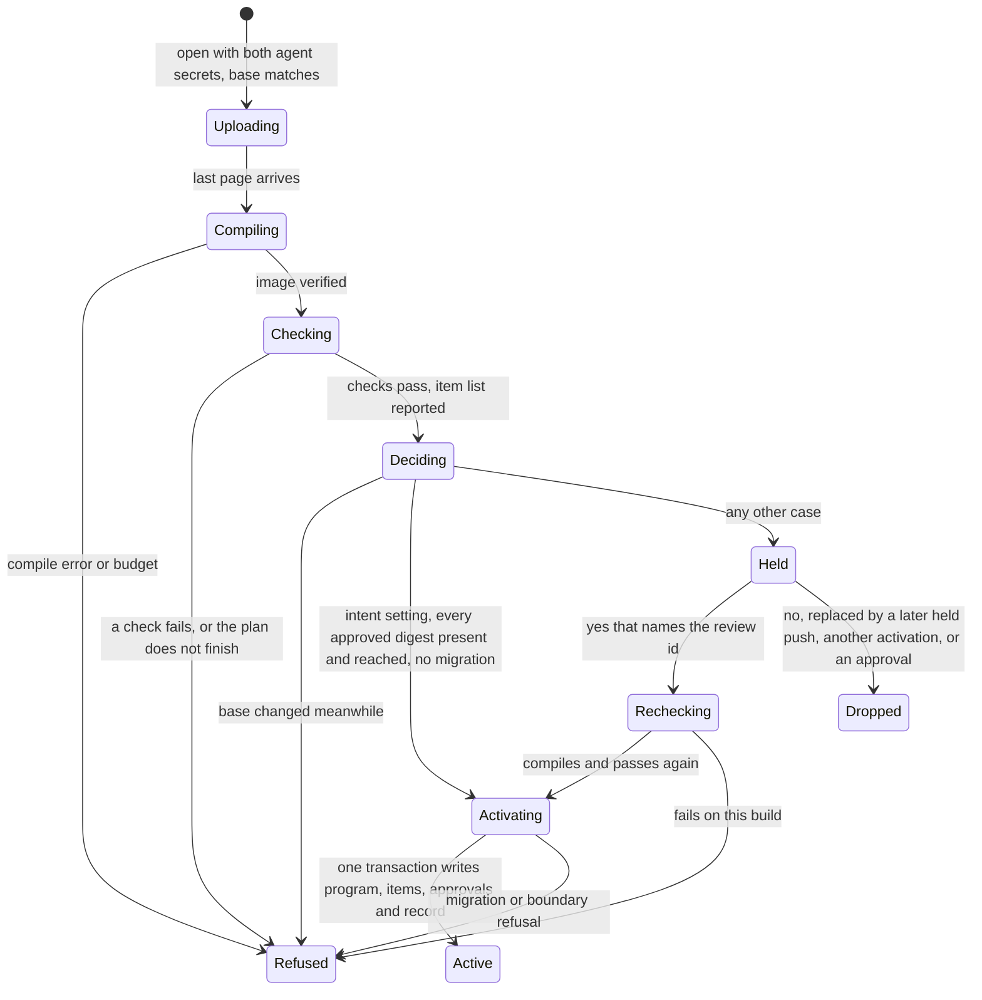

# Intent and the review door

Status: approved by Robert on 2026-11-13 as Phase 6's design. Nothing here is
implemented yet. The feasibility evidence, with its commands and raw
outputs, is in [the preflight](../../learnability/phase6/preflight/README.md).
[Whole-program upgrades](upgrades.md) remains the contract this extends; where
the two differ, this document describes the change.

A running service accepts a change without a person only when everything Robert
approved is still present and still holds. Every change that touches approved
intent, and every change that migrates stored state, waits for him. Approved
intent is promises and example rows. Tests stay the agent's to change.

## Service promises

A promise can be about a whole service. It is written inside the `service`
block, after `token`, and comes in two kinds.

```mo
service
  state Queue = JobQueue.empty
  tools submit, lease, heartbeat, acknowledge, fail, list, stats
  every 1.minute expire
  token from env "QUEUE_TOKEN"

  promise "no job is ever lost"
    ids(before).all?(fn(id) ids(after).contains?(id) end)
    allows before: one_job, after: one_job, now: t0
    forbids before: one_job, after: JobQueue.empty, now: t0
  end

  promise "a submitted job is in the queue, ready" on submit
    reply is Ok(id) implies ready?(after, id)
    allows before: JobQueue.empty, payload: "x", reply: Ok(1), after: one_job, now: t0
    forbids before: JobQueue.empty, payload: "x", reply: Ok(1), after: JobQueue.empty, now: t0
  end
end
```

- **A step promise** (`promise "..."`) must hold across every step: a tool call,
  a clock advance with the timer firings it causes, or a crash with its restart.
  Its body sees `before`, the state before the step; `after`, the state after it;
  and `now`, the clock when the step ran. Both states have the declared state
  type. For a crash and restart, `before` is the state at the crash and `after`
  is the state after recovery and the restart's startup ticks.
- **A tool promise** (`promise "..." on TOOL`) must hold after every call to that
  tool which replied. It sees `before`, `after` and `now`, the tool's arguments
  after state and time by their parameter names, and `reply`, the value the
  caller receives: `R` for a tool returning `(State, R)` or a read-only `R`, and
  `Result(R, E)` for one returning `Result((State, R), E)`. A tool that does not
  reply, because its handler failed or the service was down, is not checked.

Every name a body uses must be given a value by each anchor, as for a function
promise, and anchors stay mandatory: at least one `allows` and one `forbids`.
A tool parameter named `before`, `after`, `now` or `reply`, `on` naming
anything other than one of the block's tools, or a service promise outside a
`service` block, is E0107. A service has at most 64 service promises
(`MO_LIMIT_SERVICE_PROMISES`), E1109 beyond that. A promise on a function that
takes a `Simulation` stays E1400.

### How `mo test` checks them

Service promises ride on the recovery check's generated sequences
(`src/tools/recovery.c`): the same tool calls with values reused from earlier
replies, clock advances, and crashes with restarts, at most 64 steps and 8
restarts a sequence. After each step every step promise runs, and after each
replied call every tool promise on that tool runs. State reaches the body
through the saved-value codec, as replies already do. A body that is false
fails the sequence with the promise's own outcome. Shrinking deletes steps and
simplifies arguments as it does for recovery, and keeps a shorter sequence only
when the same promise fails on the same line. The report numbers the steps,
names the promise and its false line, and shows the states before and after the
failing step. The prototype shows the result on a planted fault that only a
restart exposes:

```
failed Main.service.recovery  faulty/main.mo:15:1
  sequences: 1
  1. advance 0.000001s  0 timer firings
  2. submit("")  replied 1, committed
  3. crash
  4. restart  recovered the same state  broke Main.guarantee_no_job_lost
  state before step 3: Queue(jobs: {1: Job(id: 1, payload: "", attempts: 0, state: Ready)}, next_id: 2)
  state after step 4: Queue(jobs: {}, next_id: 2)
```

Today's recovery check passes that program, because it compares states before
the startup ticks run.

Each service promise is listed and selected as `Module.service.promise.N`, in
source order. A promise is a predicate over plain values, so Lean's evaluator,
which runs no `Simulation` operation, still compares with the VM on every body.

**Lowering.** A service promise lowers to an ordinary spec function over its
named values that returns the number of its first false line, or 0. Mo Core's
metadata check refuses a promise function without a subject
(`src/core/metadata.c:247`, `formal/MoCore/Metadata.lean:63`), while the bytecode
verifier already accepts one (`src/bytecode/validate.c:650`). Lowering to a
plain spec function keeps Core, Lean, the bytecode and the verifier unchanged;
the tools keep each service promise's sentence, lines and anchors in their own
table, beside the image.

### A fixed plan

A verdict comes from a plan fixed by counts and by seeds derived from names,
never from how far a clock let the search get. Today every search also stops at
`--seconds`, 2 by default, and on this project's development host the recovery
check reaches 173 of its 200 sequences in those 2 seconds and reports a pass.

A service's sequences run to the end of their plan: `--calls` sequences, 200 by
default, each seeded from the service's name and its ordinal. `--seconds` no
longer cuts them short, and under plain `mo test` nothing else does: shrinking
is bounded by its 200 runs, and each service promise body runs under the
service's work budget, `MO_LIMIT_SERVICE_WORK`, so a body that runs past it
stops that promise and is reported with its sequence. Function promises and
examples keep today's behaviour under plain `mo test`. `mo test --strength` and
the door's check child run the door's plan (Limits) for every item, so a wrong
version that the strength record counts as killed is one the door refuses. A
run of theirs that cannot finish its plan, because a limit stopped it, is E1432,
"the plan did not finish", and is never a pass.

### Reference text

Section 12.2's paragraph "A promise about many steps … is a promise on the
function that takes one step" is replaced by:

> A promise about a whole service is written in its `service` block, after
> `token`. A step promise holds across every step the service takes: a tool call,
> a clock advance, or a crash and restart. Its body reads `before`, `after` and
> `now`. A tool promise, `promise "…" on submit`, holds after every call to that
> tool that replied, and also reads the tool's arguments by name and `reply`,
> what the caller received. Anchors give each of those names a value. `mo test`
> checks service promises on the recovery check's generated sequences (section
> 12.5) and reports a failure as a short sequence that still fails.

Section 11.5's clause order gains "then zero or more service promises", section
12.4's sentence on deferred service promises is removed, and section 12.5 says
that its sequences also check the service's promises, that a service's plan
runs to its end, and that `--seconds` does not apply to it. The grammar's
`service` rule gains `promise` items with an optional `"on" name`. Robert
approves this text in this document; the reference changes with the code.

## Intent items and their identity

An intent item is one promise, one service promise, or one example row. A table
of examples is one function's rows shown together; the checker keeps no table
(`src/check/program.c`). Display names such as `JobQueue.fail.promise.2`
renumber when an item is inserted above them and are never identities.

An item's identity is a content digest: SHA-256 over a version byte, its owner
(the function or service it is about), its kind, its own canonical text, and the
sorted set of name and canonical text of every declaration it reads. The walk
follows every function, constant, constructor and user type the item's body,
anchors or row refer to, then what those declarations read, as
`src/check/recursion.c` walks bodies. It leaves out the item's subject, its
signature and its body, at every depth, and stops at library modules. A digest
nests no other digest, so helpers that call each other are harmless.

Canonical text is a declaration formatted on its own by `mo format`'s printer,
after removing its comments, blank lines and any promise or example blocks it
carries. Comments and layout are therefore not content; an item's sentence is.
In the prototype a comment added inside `JobQueue.release` and a layout-only
edit each changed no digest, while raw bytes changed one each.

The task queue's 19 items, measured by the identity prototype:

| A change to | Items whose digest changes |
| --- | --- |
| Any handler in `main.mo` | 0 |
| An item's own subject's body | 0 of that subject's items |
| `fail`, `release`, `leased_job` or `put` | 1: the third `jobs` example row, which calls `fail` |
| `max_attempts` | 2 |
| A test value builder such as `holding` | 15 |
| `t0` | 16 |
| `Job`, `JobState` or `Queue` | 19 |

The third `jobs` row moves, unchanged, to `fail`'s examples when the task
queue's intent is strengthened, so fixes to `fail`'s logic stop waiting.
Everything else stays: a builder or a type changes what anchors mean.

Known limits of the identity: an example row passes arguments by position, so a
reorder of two parameters of one type that updates every call except the example
rows leaves a row's text and digest unchanged and changes which case it checks;
when the row still passes, the change activates. A change to a library module or the toolchain can
change what an item means with its digest unchanged.

## Promise strength

[Promise strength](promise-strength.md) is amended for this phase: the measured
unit is the whole program, a wrong version is a set of replacement
implementations for named declarations, and half of each frozen set is held
back from the session that strengthens the intent. Strength runs use the door's
plan.

## Approvals, the review setting and the store

Approvals live in the data folder, in tables added beside Phase 5's:

| Table | Holds |
| --- | --- |
| `items` | Each active and retained program's item list: digest, owner, kind, display name, reach, digest version |
| `approvals` | Approved digests, each with the approval-set version that wrote it and how: first approval, or the review id of a yes |
| `review` | One row: the review setting and the approval-set version |
| `pending` | At most one held upgrade: review id, base and candidate digests, migration name, approval-set version, the intent difference, the bundle |
| `decisions` | The review record, one row per decision |

The approval-set version increases with every write to `approvals`. An
activation retires the approvals whose digest the new program lacks.

The review setting is `everything` or `intent`. A service starts on
`everything`, and only Robert changes it. Under `everything` every upgrade waits
for him. Under `intent` an upgrade whose candidate carries every approved digest
of the active program, and which names no migration, activates without a
person; any other upgrade waits. A candidate carries an approved digest only
when the item's owner is still called from one of the service's tools, timers
or its state initializer, so a handler that stops calling an approved function
waits like a removed item.

The review record keeps every decision: activated without a person, held,
replaced, made stale, answered yes or no, refused after a yes, a checked
restart, a change of setting, a first approval, and a folder conversion. Each
row has its time, the base and candidate digests, the review id when there is
one, the setting, and whether `intent` would have activated the upgrade without
a person. That last field is the evidence for Robert's verdict on the setting,
so no row is ever dropped. The record holds at most 65,536 rows
(`MO_LIMIT_REVIEW_RECORDS`); a full record refuses every further push and
checked restart with E1437, and only a fresh data folder, which is Robert's to
start, accepts upgrades again. The live stage is expected to use hundreds.

These tables make the store version 3, in the same one-way way Phase 5 made
version 2: `src/host/store.c` matches tables by exact SQL and v0.2 refuses a
newer `user_version`. v0.3 converts a version-2 folder when it first serves it,
in one transaction: review setting `everything`, nothing approved, the active
program's item list computed, and a conversion row in the record. v0.2 then
refuses the folder.

## The approval credential and Robert's client

Approval authority is a third bearer secret. `mo serve` reads it from the
environment variable named by `--approval-token-env NAME`, as it reads the
upgrade credential, and refuses to start when any two of the three secrets are
equal or when `--upgrade-token-env` is given without `--approval-token-env`
(E1434). No start option accepts live upgrades without the door. Its header is
`Mo-Approval-Authorization: Bearer VALUE`, 16 to 256 bytes. A request carries
the service token and at most one of the other two; a request carrying both is
refused with E1414. Header buffers are wiped as for the upgrade credential, and
anything that redacts the two existing secrets redacts the third.

Robert approves only from his own login on the service's host. There the
approval credential sits in a file of its own, readable by the service's account
and by Robert and by no one else. It never goes in the environment file that
clients copy, and it never exists on a machine where agents run.

Tools that need the service token and the approval credential:

| Tool | Does |
| --- | --- |
| `mo-intent-items` | Pages the active program's items: digest, display name, kind, approved or not, sentence, reach |
| `mo-intent-approve` | Approves listed digests of the active program, a first approval |
| `mo-review-setting` | Reads or sets the review setting |
| `mo-review-pending` | The pending review id, its intent difference and digests |
| `mo-review-source` | Pages the pending or the active source bundle, given the pending review id |
| `mo-review-answer` | Answers the pending upgrade, yes or no, naming its review id |

Robert's client is `mo review --url URL --token-env NAME --approval-token-env
NAME`, loopback only, like `mo push`:

- with no action it prints the pending upgrade's intent difference first, then
  writes the pending and active source trees under `--out DIR` for the code
  difference, and prints the review id;
- `--items` lists every item with its mark and reach;
- `--approve DIGEST…` approves items;
- `--setting everything|intent` changes the setting;
- `--yes ID` and `--no ID` answer the pending upgrade.

Before it offers a yes, the client recomputes the review id from what it was
shown and checks that each source tree it received hashes to the digest that id
binds. An agent that alternates two candidates cannot have Robert read one and
approve the other.

## What agents see

`mo-upgrade-status`, under the service token and the upgrade credential,
returns the pending review id, its state and the latest decision records,
without source. An agent with no host access learns a held push's fate there,
not by pushing again, which would replace the pending upgrade.

## The check child

The compile child (`src/host/compile.c`) lowers no promises or tests. A second
child, the same executable running `mo test --bundle FILE`, follows it:

1. **Listing mode** (`--list --json`) compiles the bundle and runs nothing. It
   reports the candidate's item list with digests. The door decides from this
   list for every program, so its input never comes from a process that has run
   candidate code.
2. **Check mode** runs every promise, service promise, example and test the
   bundle carries, under the door's plan, and reports only pass, fail or
   incomplete.

The door runs only what the pushed program carries: the modules its entry
imports. Tests in a module the served program does not import, such as the task
queue's `queue-tests.mo`, are the agent's to run; under the door, the service's
guarantees are service promises in its entry module.

The child gets no descriptor on the store, and the service's three secrets are
removed from its environment. The server polls it where it polls the compile
child, in `mo_protocol_upgrade_poll`, and the upload slot stays busy while it
runs. Its limits are under Limits. A failed check is E1433 and an unfinished
plan is E1432; both refuse the push and leave the old program serving. A first
start runs listing mode alone; a checked restart runs both.

## The decision

The door decides on the event loop after the checks return, from values read at
that moment: the active program's digest and items, the review setting and the
approval-set version. A base that changed meanwhile is the existing stale-base
refusal, E1416. The upgrade activates when the setting is `intent`, every
approved digest of the active program is among the candidate's items and its
owner is reached from the service, and the push names no migration. Otherwise
it is held. The intent difference marks an approved item whose owner is no
longer reached `not reached`. A later change of the setting
never decides an upgrade already held.



## Held upgrades and the review id

A held upgrade is stored under its review id: SHA-256 over the base digest, the
candidate digest, the migration name, the approval-set version and the intent
difference shown. The bundle and that binding go to the store, the upload slot
is released, and `mo push` exits 3 and prints `held` and the review id.

The intent difference lists each approved item the candidate lacks, with its
text and every declaration it reads, beside the candidate's items on the same
owner that the active program lacks, marked `added`. Declarations an item reads
are shown with the item. The code difference comes after, from the two source
trees.

A service holds one pending upgrade. A later held push replaces it, and any
activation or other write to `approvals` makes it stale; each is recorded. Robert's answer names the
review id; the service recomputes it and acts only on an exact match, otherwise
it replies E1435 with the current review id and changes nothing. With nothing
pending the answer is E1436.

- **Yes** compiles and checks the stored bundle again under the door's plan,
  then activates it at the next boundary through Phase 5's activation
  transaction. The same transaction approves every candidate item the review
  showed, edited and added, and retires the approved digests the candidate
  lacks. If the base or the approval-set version changed while it was
  rechecked, the upgrade is stale instead and the answer is recorded as refused
  after a yes.
- **No** drops the pending upgrade and records the answer.

A restart keeps the pending upgrade. An upgrade that activates without a person
leaves its added items unapproved until Robert approves them.

## The checked restart

`mo serve FILE --data DIR --upgrade [--migrate M] [--review ID]` goes through the
same decision. It runs the candidate's checks under the door's plan and refuses
a failed or unfinished run with E1433 or E1432. It then computes the same intent
difference. When the decision would hold a push, under either setting, it
prints the difference and the review id and refuses with E1435, unless
`--review` names that id. It always writes a decision row and drops a pending upgrade as stale.
The review id here shows that the operator saw the change; it is no authority
check, since a shell on the host is the stated limit.

## Codes

| Code | Meaning |
| --- | --- |
| E0107 | A service promise names a tool parameter `before`, `after`, `now` or `reply`, its `on` names no tool of the block, or it sits outside a `service` block |
| E1109 | More than 64 service promises in one service |
| E1432 | The plan did not finish: a strength run, or the door's checks |
| E1433 | The door's checks failed; the report names the failing item |
| E1434 | `mo serve` has the upgrade credential without the approval credential, or two secrets are equal |
| E1435 | The review id does not match the pending upgrade, or a checked restart that would be held names no matching `--review`; the reply gives the current one |
| E1436 | No upgrade is pending |
| E1437 | The review record is full |

Each code gets an errors fixture. `mo push` exit 3 means held; 0, 1 and 2 keep
their meanings.

## Limits

Measured on an exe.dev VM like the task queue's former host (8 vCPUs of an AMD
EPYC 9554P, 31 GiB), on the debug build the task queue was deployed with
(`learnability/phase6/preflight/timing/out/timing.txt`):

| The task queue's checks | Wall | CPU | Peak RSS |
| --- | --- | --- | --- |
| `mo check` | 0.08–0.15 s | 0.07–0.12 s | 28 MB |
| 200 sequences, no service promises | 2.7–2.9 s | 2.7–2.9 s | 28 MB |
| 200 sequences, three service promises | 3.0–3.1 s | 3.0–3.1 s | 28 MB |
| 1,000 sequences, no service promises | 14.5–16.2 s | 14.5–15.9 s | 28 MB |
| 1,000 sequences, three service promises | 16.0–16.2 s | 15.9–16.1 s | 28 MB |
| `queue-tests.mo`, not imported by `main.mo`, so outside the door | 65.2 s | 65.1 s | 37 MB |

Declared:

| Name | Value | Basis |
| --- | --- | --- |
| `MO_DOOR_PLAN_INPUTS` | 200 inputs per function promise | Today's default |
| `MO_DOOR_PLAN_SEQUENCES` | 1,000 sequences per service | Five times today's default: the door checks the same sequences on every push, so the size of that fixed set is its only coverage |
| `MO_LIMIT_CHECK_MEMORY` | 1 GiB address space | As the compile child; peak was 28 MB |
| `MO_LIMIT_CHECK_CPU_SECONDS` | 120 | 7.4 times the slowest check the door runs (1,000 sequences) |
| `MO_LIMIT_CHECK_WALL_US` | 180 seconds | 11 times the slowest check the door runs; with the compile child's 15 seconds it stays far inside the 600 seconds after which `mo push` gives up (`MO_LIMIT_FETCH_US`) |
| `MO_LIMIT_SERVICE_PROMISES` | 64 per service | About 0.5 ms per promise per sequence here |
| `MO_LIMIT_REVIEW_RECORDS` | 65,536 rows | The live stage is expected to use hundreds |

Plain `mo test` keeps 200 sequences by default; `--calls 1000` reproduces the
door's plan for a service. A slower host does not weaken a verdict: a plan that
does not finish inside the limits is E1432, never a pass. The limits are
measured again on the live service's host before it serves anything.

The proof on the task queue runs each planted change once under each setting,
since the plan is deterministic: 10 fixes that leave approved intent unchanged,
10 changes that edit or remove approved items, and every counted frozen wrong
version. At about 20 seconds a run that is well under an hour, run by hand.

## Access in the live stage

A service behind the door runs on its own host. Agents reach it only through its
endpoint, over an SSH account that may forward the service port and do nothing
else. They have no shell on the host and no access to its data folder.
Restarting the service on a new program, and starting it in a fresh data
folder, are Robert's alone. Through the endpoint an agent can read the live
views, push, read the door's state, fetch, and replay or query a fetched export
with the same `mo` build and the deployed source. `mo history`, replay and
query on the data folder, failure reports in the journal, and anything after a
supervisor stop need the host, and so need Robert. The agent guide states this
rule for every service behind the door.

## What the lock does not protect against

- A shell on the service's host, or write access to its data folder, is
  approval authority as well as upgrade authority. Mo has no operating-system
  confinement.
- The check child runs candidate code on the host under limits, not in a
  sandbox. A memory-safety defect in the compiler or the VM that pushed source
  can reach is a way around the door without a shell.
- A change to a library module or to the toolchain can change what an approved
  item means while its digest stays the same.
- The door checks the same generated sequences on every push, so a defect
  outside them passes every time.
- A reorder of same-typed parameters can change what a positional example row
  checks without changing its digest (Intent items).
- A handler that still calls an approved function but ignores or undoes its
  result keeps the item reached and its digest unchanged. Service promises over
  the service's state are what catch that.
- Tests are not approved intent; an agent can change them freely.

## Models and proof obligations

- `models/Swap.tla` gains hold, replace, yes, no and stale, with two invariants:
  no candidate that changes approved intent activates without a yes that names
  it, and a yes activates only the candidate it names. Each invariant gets a
  negative-control configuration that must violate it. The nightly does not run
  the `models` group, so it runs by hand when the door is built and at the close.
- `ci/check_kill_loop.py`'s variant table gains planted changes of three kinds:
  fixes that leave approved intent unchanged, changes that edit or remove it,
  and frozen wrong versions that leave it unchanged. Each declares its expected
  outcome under both settings and is run through real `mo serve`, `mo push` and
  `mo review`. Every change of the second kind waits; under `intent` no change of
  the first kind does; every wrong version the strength record counts as killed
  is refused. A build with the decision bypassed must fail the run.
- The version-3 store, the review id and the approval tools get unit tests, an
  errors fixture per code, and fuzz seeds for every new reader.

## Decisions settled with Robert

Recorded on 2026-11-13, each with the evidence it was put with:

- He approves only from his own login on the service host.
- His yes approves the edited and the added items the review showed. To keep
  an addition unapproved he answers no.
- v0.3 converts a version-2 folder on first serve, on `everything` with nothing
  approved.
- Half of each frozen set of wrong versions is held back from the strengthening
  session.
- The door runs only the checks the pushed program carries.
- An item's digest leaves out its subject's signature as well as its body.
- Comments and layout are not content.
- Exactly one task queue item is reshaped: the third `jobs` example row moves to
  `fail`.
- Service promises are written in the `service` block, as step promises and
  tool promises.
- The door's plan is 1,000 sequences and 200 inputs; the check child's limits
  are 1 GiB, 120 CPU seconds and 180 seconds; each planted change runs once per
  setting; the limits are measured again on the live host before it serves.
- From the code review, kept on 2026-11-13: an approved item counts as carried
  only while the service still calls its owner; any write to approvals makes a
  held upgrade stale, including during the recheck after a yes; and the checked
  restart refuses whatever the door would hold, under either setting, unless
  `--review` names its id.
