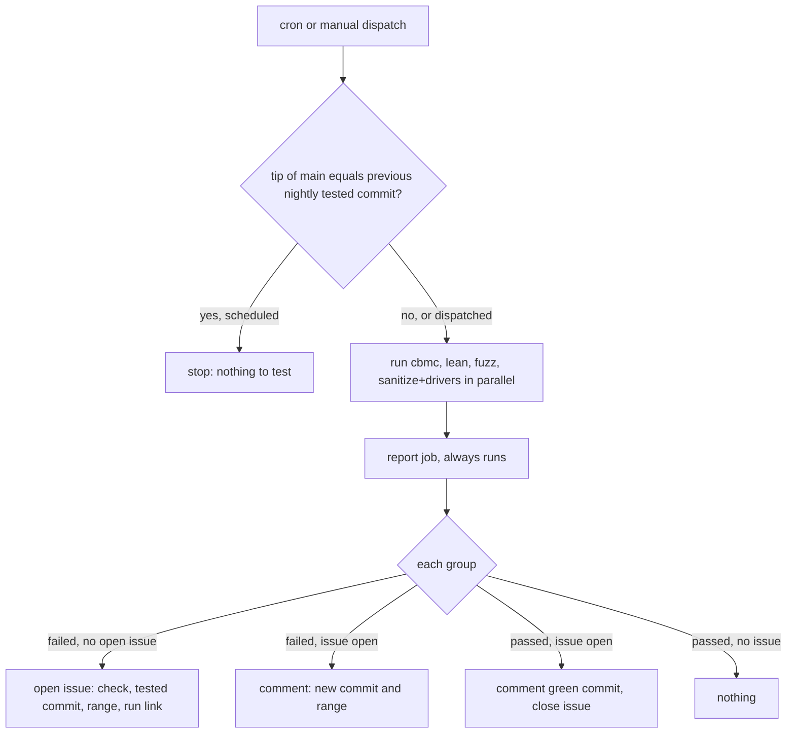

# Two-Tier CI Gate - Plan

## Goal Capsule

- **Objective:** While Mo is experimental, an agent's pull request gets a merge decision within about six minutes, and fixing a failure costs one more fast run instead of another 15–22 minutes.
- **Means:** Split CI into a fast blocking gate on each pull request and a nightly tier for the slow checks, whose failures are filed as GitHub issues (KTD1, KTD4, KTD5).
- **Product authority:** Robert. The Product Contract below wins on behavior; the Planning Contract wins on mechanism. How useful qgate is to Mo is a separate, later brainstorm and not active scope; this plan changes only what qgate's push stage runs.
- **Open blockers:** none.
- **Stop conditions:** stop and report if the hosted `check` status can no longer be the single required status, or if a slow group cannot run on a GitHub-hosted runner within its job limit.
- **Execution profile:** CI configuration, shell scripts and documentation; no C, Lean or Mo source changes. The branch `ci-two-tier-gate` is stacked on pull request #154 (`ce-setup-qgate-0.5.0`), which this work builds on.
- **Finishing:** an agent implements and opens the pull request; Robert approves the merge.

---

## Product Contract

### Summary

Each pull request is gated by a fast hosted run of the checks that have actually caught failures.
CBMC, Lean, long fuzzing and the sanitizers move to a nightly run against `main`, and a red night files a task.
The local pre-push hook shrinks to qgate's own checks plus a quick build and unit tests.

### Problem Frame

Agents write code faster than CI clears it.
A hosted run takes 15–22 minutes from start to finish, with outliers near 30, and CBMC alone takes about 21 minutes whenever it runs.
A failure sends the fix through the whole run again.
The local pre-push hook runs five groups (`gcc clang sanitize static drivers`) before every push and stalls the terminal.

The checks are sized for a project with users, and Mo has none yet, so a broken `main` costs little.
Across 143 hosted runs from 2026-10-16 to 2026-10-22, only drivers (8 failures in 124 runs) and gcc (1 in 124) ever failed.
cbmc (0 in 40), lean (0 in 45), and sanitize, fuzz, static and clang (0 in 124 each) never did.

That record has limits.
Six days is short, and the push hook stopped some failures before they reached hosted CI.
`docs/status/agent-mistakes.md` also records earlier static drift (clang-format, module-boundary includes) in #81, #85, #111 and #121.

### Requirements

**Pull request gate**

- R1. The status that blocks a merge depends only on the fast groups: gcc (build and unit tests), clang, static and drivers.
- R2. A typical pull request gets its blocking result within about six minutes of the run starting.
- R3. A docs-only pull request still runs no groups.
- R4. Pushes to `main` run the same fast groups as a pull request, not the full set.

**Nightly tier**

- R5. CBMC, Lean, long fuzzing and the sanitizers run once a night against the tip of `main`, alongside the existing nightly Core differential run.
- R6. A night on which `main` has not changed since the last completed nightly run skips the slow groups.
- R7. A failing nightly check files one tracked task naming the check, the tested commit, the commit range since its last green night, and a link to the log.
- R8. A check that fails again while its task is open updates that task instead of filing another.
- R9. The existing nightly Core differential run files and updates tasks on failure the same way (per R7, R8).

**Local push hook**

- R10. The pre-push hook runs qgate's own checks plus a build and the unit tests on the developer's machine, in about two minutes or less.
- R11. A docs-only push skips the build and unit tests.

**Policy and documentation**

- R12. The merge rules agents read describe the new gate and no longer require a full `ci/check.sh` run before merging: `ci/orb/README.md` "Merge verification", the "Checks" section of `.github/pull_request_template.md`, and the CI and qgate paragraphs of `AGENTS.md`.
- R13. The strict per-pull-request gate stays documented as a restorable setting, with its trigger: Mo gains outside users or real applications.
- R14. No check group is deleted: the fast groups run on every pull request and push to `main`, and the slow groups run nightly per R5.

### Key Decisions

- A fast hosted gate, not a local-only gate or the same checks made faster. (session-settled: user-directed — chosen over a local-only gate, which reopens the made-up-evidence problem in `docs/status/agent-mistakes.md` row 10 and tests macOS rather than Linux, and over keeping every check per pull request with caching and splitting: Mo is experimental and a broken `main` is cheap.)
- Slow checks run nightly. (session-settled: user-directed — chosen over running them on each push to `main` and over running them report-only on pull requests: fewest runner minutes; the cost is that a failure covers a day of merges and may need bisecting.)
  - Conflict note: `.github/workflows/check.yml` states the repository is public, so hosted runners cost no Actions minutes; "fewest runner minutes" carries no cost here. The decision stands on fewer runs and one failure signal per day. Governs R5, R6.
- A nightly failure files a task and never blocks merging. (session-settled: user-directed — chosen over blocking merges until green, which brings the bottleneck back, and over a bare red status that nobody is obliged to notice.)
- The push hook keeps a quick local subset. (session-settled: user-directed — chosen over qgate checks alone and over mirroring the gate: it still catches macOS-only breaks such as the APFS file-name failure that Linux CI never saw.)
- clang stays in the pull request gate; sanitizers and fuzz smoke move to nightly. (session-settled: user-approved — clang runs in parallel in about 1.3 minutes so it adds no wall time, and `AGENTS.md` asks for both compilers; sanitizers and fuzz smoke would also add little time but move per the dialogue.)
- Pushes to `main` run only the fast gate. (session-settled: user-approved — the nightly run covers the slow groups, so repeating them per merge buys only finer blame.)

### Acceptance Examples

- AE1. **Covers R1, R2.** Given a pull request that changes `src/vm/`, when CI runs, the blocking status reports once gcc, clang, static and drivers finish, and CBMC does not run on the pull request.
- AE2. **Covers R6.** Given no merges since the last completed nightly run, the next night skips the slow groups and files nothing.
- AE3. **Covers R7, R8.** Given CBMC fails on Tuesday night and again on Wednesday night, exactly one open task exists, and Wednesday's run adds its commit and range to it.
- AE4. **Covers R3, R11.** Given a change only to `AGENTS.md`, no group runs on the pull request and the push hook skips the build.

### Success Criteria

- Over the first week, the median time from a pull request run starting to its blocking result is six minutes or less, down from 15–22.
- A fix after a gate failure costs one fast run.
- Over the first two weeks, every red nightly run has a matching task by the next morning.

### How This Work Fits Together

<!-- ce-section: work-relationships -->

This plan covers where and when Mo's CI checks run and what blocks a merge. The breakdown below is the current understanding, not a committed roadmap.

- Evaluating qgate in Mo: which of its parts (commit gate, push gate, CI report job, Claude Code hook) earn their keep, and what Mo teaches about qgate as a product.
  - Shares the push hook with this plan: R10 and R11 decide what the push stage runs; the qgate evaluation decides whether and how qgate runs it.
  - Can proceed independently of this plan otherwise.

### Scope Boundaries

- Evaluating qgate (which parts earn their keep, its Claude Code hook blocking read-only `jq` and `awk` commands) is a separate brainstorm.
- Speeding up individual checks (splitting CBMC across jobs, build caching, rerunning only failed groups) is deferred; revisit if R2 is missed.
- No check's content is weakened or deleted (per R14).
- The CI orb runner and its scripts keep working as an optional runner.
- Tightening the gate automatically when Mo gains users is out; R13 is a documented manual switch.

### Dependencies / Assumptions

- The six-day failure record is a good enough guide for choosing the gate; revisit if a nightly-only group starts catching regressions every week.
- Drivers needs a full build of `mo` and the test programs, so it sets the gate's time.
- Runner minutes are not a constraint today.

### Sources

- `.github/workflows/check.yml`: the `check` aggregate job, group selection for pull requests and pushes, and `cancel-in-progress` concurrency.
- `.github/workflows/differential.yml`: the existing nightly Core differential run (cron 03:17 UTC, 20 shards).
- `ci/ci_groups.sh`, `ci/docs_only.sh`, `ci/orb/README.md` ("Merge verification"), `ci/orb/nightly.sh` (full run with 300-second fuzzing, not scheduled in the repo).
- `qgate.toml`: the push-stage `check` tool.
- `docs/status/agent-mistakes.md`: rows 9 and 10.
- Hosted run data, 2026-10-16 to 2026-10-22, from `gh run list` and `gh run view` on `check.yml`.

- Product Contract preservation: unchanged, except the Outstanding Questions were resolved into KTD2, KTD4, KTD5, KTD6 and KTD9 and removed, and a conflict note was added to the nightly Key Decision.

---

## Planning Contract

### Key Technical Decisions

- KTD1. `ci/ci_groups.sh` owns both tier lists: it prints `[]` for a docs-only change, the fast groups `gcc clang static drivers` otherwise, and the slow groups `cbmc lean fuzz sanitize` when asked for the nightly tier. `check.yml` and the new nightly workflow both read it, and `ci/test_ci_groups.sh` checks that the two lists together equal `ci/check.sh`'s groups minus `qgate`. Governs R1, R4, R5, R14. (session-settled: user-approved — chosen over the full set on every main push: the nightly run covers the slow groups.)
- KTD2. The CBMC input detection in `ci/ci_groups.sh` is deleted, since no pull request runs CBMC any more; its cases in `ci/test_ci_groups.sh` go with it.
- KTD3. Run alone, the `drivers` group builds and checks only the debug executables for gcc and clang. When the `sanitize` group runs in the same invocation, `drivers` keeps checking the sanitize builds as it does today, so the nightly sanitizer job runs `sanitize drivers` together. Governs R1, R5.
- KTD4. Fast-gate jobs install only what their group needs: no CBMC, no Lean toolchain or Lean caches, and Bison only for `static`. `.agents/setup` gains a way to install less, and the full install stays the default for the orb, the nightly workflow and local setup. A wrong guess fails loudly, because `ci/check.sh` treats a missing tool as a failure under `CI=1`. Governs R2.
- KTD5. The slow tier runs in a new `.github/workflows/nightly.yml`, separate from `differential.yml`, on its own cron and by manual dispatch. A first job compares the tip of `main` with the commit the previous nightly run tested and skips the rest when they match, unless the run was dispatched by hand. `differential.yml` keeps running every night, since it draws fresh seeds even when `main` is unchanged. Governs R5, R6. (session-settled: user-directed — chosen over per-merge runs on `main` and report-only pull request runs.)
- KTD6. Failures are filed as GitHub issues labelled `nightly`, one open issue per check, titled by the check name. A new script `ci/nightly.sh` holds the logic both workflows call: create the issue on a first failure, comment on a repeat failure, and comment and close it when the check passes again. The commit range is "since the previous nightly run's tested commit", which equals "since last green" for a newly failing check, and later failures add their own range to the same issue. It uses the `gh` command line, as `ci/orb/run.sh` already does, with `issues: write` and `actions: read` granted to those workflows only. Governs R7, R8, R9. (session-settled: user-directed — chosen over blocking merges and over a bare red status.)
- KTD7. The pre-push hook's `check` tool runs `bash ci/check.sh gcc` (build and unit tests) instead of five groups, keeping its existing `MO_QGATE_SKIP_CHECK` and docs-only skips. This changes a qgate tool, which qgate reports as loosening; the pull request says so. Governs R10, R11. (session-settled: user-directed — chosen over qgate checks only and over mirroring the gate.)
- KTD8. `ci/orb/README.md` is the only place that lists which groups run in each tier and how to restore the strict gate. `AGENTS.md`, `README.md`, the pull request template and the skills each state the merge rule in one sentence (a pull request merges on a green hosted `check` covering the fast groups) and link to `ci/orb/README.md` for the rest. Governs R12, R13.
- KTD9. `docs/plans/*.md` joins the docs-only list in `ci/docs_only.sh`, since no check reads plans. Issues are not mirrored into Notion in this work.

### High-Level Technical Design

Where each check group runs after this change:

| Group | Pull request and push to `main` (blocking) | Nightly (files issues) | Local pre-push |
|---|---|---|---|
| gcc | yes | no | yes |
| clang | yes | no | no |
| static | yes | no | no |
| drivers | yes, debug builds only | yes, with sanitize builds | no |
| sanitize | no | yes | no |
| fuzz | no | yes, 300 s per target | no |
| lean | no | yes | no |
| cbmc | no | yes | no |
| Core differential | no | yes, every night | no |

The nightly run, as directional guidance:

### Assumptions

- On `ubuntu-24.04` runners the compilers, `make` and Python 3 are preinstalled, so the gcc, clang and drivers jobs need no `apt-get` step at all. U3 confirms this from the job logs.
- `gh run list` on the nightly workflow returns the previous run's tested commit to the first job with `actions: read`.

---

## Implementation Units

### U1. Gate selection from one list

**Goal:** Pull requests and pushes to `main` run only the fast groups, and both tier lists live in `ci/ci_groups.sh`.

**Requirements:** R1, R3, R4, R14; KTD1, KTD2, KTD9.

**Dependencies:** none.

**Files:**
- `ci/ci_groups.sh`
- `ci/test_ci_groups.sh`
- `ci/docs_only.sh`
- `ci/test_docs_only.sh`
- `.github/workflows/check.yml`

**Approach:**
1. `ci/ci_groups.sh` prints `[]` for docs-only, the fast list otherwise, and the slow list for the nightly tier; the CBMC input detection and its compiler probe are removed (KTD2).
2. `check.yml`'s `changes` job uses `ci/ci_groups.sh` for pull requests and pushes to `main`, passing the pushed range so a docs-only push to `main` also skips. A manual run has no range and runs the four fast groups.
3. The header comments in `check.yml` and `ci/ci_groups.sh` describe the two tiers and point to `ci/orb/README.md`.
4. `ci/docs_only.sh` adds `docs/plans/*.md` (KTD9).

**Patterns to follow:** the existing `ci/test_ci_groups.sh` table of file sets and expected JSON, and its parity check against `ci/check.sh`.

**Test scenarios:**
- Covers AE4. A change to `AGENTS.md` alone prints `[]`.
- A change to `src/vm/vm.c` prints exactly the four fast groups.
- A change to `cbmc/` or `Makefile` prints the four fast groups, with no `cbmc`.
- The nightly list is exactly `cbmc lean fuzz sanitize`.
- Parity: fast and nightly lists together equal `ci/check.sh`'s groups minus `qgate`, with no group in both.
- `docs/plans/2026-10-22-1510-refactor-ci-two-tier-gate-plan.md` alone is docs-only; `.github/workflows/check.yml` stays not docs-only.

**Verification:** `ci/test_ci_groups.sh` and `ci/test_docs_only.sh` pass inside the `static` group, and this pull request's own hosted run shows only gcc, clang, static and drivers.

### U2. Drivers without sanitizer builds when run alone

**Goal:** The `drivers` group in the gate stops building and checking sanitizer executables.

**Requirements:** R1, R2, R5; KTD3.

**Dependencies:** none.

**Files:**
- `ci/check.sh`

**Approach:**
1. When `drivers` runs without `sanitize` in the same invocation, it builds only the gcc and clang debug executables.
2. When `sanitize` runs in the same invocation, behavior is unchanged: `drivers` checks every build that exists.
3. The usage text and comments name this difference.

**Execution note:** configuration of a check runner; prove it by running the group, not with a new unit test.

**Test expectation:** none -- the drivers checks themselves are the test; a run of `ci/check.sh drivers` that builds no `build/*/sanitize/` tree and passes, and a run of `ci/check.sh sanitize drivers` that checks the sanitize builds, are the proof.

**Verification:** after `ci/check.sh drivers` from a clean tree, no `build/*/sanitize/` directory exists and the group passes; the hosted drivers job's check step is no slower than its current median of about four minutes.

### U3. Light install for the gate jobs

**Goal:** Gate jobs spend seconds, not minutes, installing tools.

**Requirements:** R2; KTD4.

**Dependencies:** U1.

**Files:**
- `.agents/setup`
- `.github/workflows/check.yml`

**Approach:**
1. `.agents/setup` accepts the groups it is preparing for and installs only what they need; with no groups it installs everything, as today.
2. `check.yml`'s group jobs pass their group, and the Lean toolchain and build caches run only for a `lean` job (none in the gate).
3. Packages the runner image already has are not reinstalled, so a gate job that needs nothing new never runs `apt-get update`.

**Patterns to follow:** the existing `install_missing` helper in `.agents/setup`.

**Test expectation:** none -- toolchain setup; the hosted run is the proof.

**Verification:** on this pull request's hosted run, every gate job's install step takes under 60 seconds and `ci/check.sh` reports no missing tool; a run of `.agents/setup` with no arguments still installs CBMC and Lean.

### U4. Nightly workflow and issue filing

**Goal:** The slow groups run each night `main` changed, and every failing check has exactly one open GitHub issue.

**Requirements:** R5, R6, R7, R8, R9, R14; KTD3, KTD5, KTD6.

**Dependencies:** U1, U2.

**Files:**
- `.github/workflows/nightly.yml` (new)
- `.github/workflows/differential.yml`
- `ci/nightly.sh` (new)
- `ci/test_nightly.sh` (new)
- `ci/check.sh`

**Approach:**
1. `ci/nightly.sh` has two commands: one decides whether `main` moved since the commit tested by the previous nightly run on `main` (runs dispatched from other branches are ignored) and prints that commit; the other takes a check name, its result, the tested commit, the previous commit and the run link, and creates, comments on or closes the check's `nightly` issue per KTD6.
   - The report command acts only on two kinds of result: `success` comments the green commit and closes an open issue; `failure`, `cancelled` and `timed_out` file or update one. `skipped` does nothing, so a night with no new commits never closes an issue.
   - It creates the `nightly` label if it is missing before filing, and when a `gh` call fails it prints a workflow warning annotation, so a filing failure shows on the run's summary page instead of only in its log.
2. `nightly.yml` runs on a cron away from `differential.yml`'s 03:17 UTC and on manual dispatch. Its first job runs the decide command; the matrix job runs each slow group from `ci/ci_groups.sh` with `CI=1`, the `sanitize` entry running `sanitize drivers` (KTD3) and the `fuzz` entry with `FUZZ_SECONDS=300`; a final job that always runs calls the report command once per group.
   - Each slow group gets its own job timeout instead of `check.yml`'s 30 minutes: about 180 minutes for `fuzz` (23 targets at 300 s each run one after another, about two hours), about 90 for `cbmc`, and about 60 for `lean` and `sanitize drivers`.
3. `differential.yml` gains the same final report job for the check name `differential`, treating any failed shard as a failure, and keeps its every-night schedule and fresh seeds.
4. Only these two workflows get `issues: write` and `actions: read`; `check.yml` stays `contents: read`.
5. `ci/check.sh`'s `static` group runs `ci/test_nightly.sh` next to the other `ci/test_*.sh` scripts.

**Execution note:** write `ci/test_nightly.sh` first, with a fake `gh` on `PATH` that records its arguments and replays canned issue lists; GitHub only runs a new scheduled workflow from the default branch, so this test is the only proof before merge.

**Patterns to follow:** `ci/orb/run.sh`'s `gh api` comment step, including warning rather than failing when GitHub is unreachable; `ci/test_ci_groups.sh` for a plain shell test with `CHECK`-style messages.

**Test scenarios:**
- Covers AE2. When the tip of `main` equals the previous run's tested commit, the decide command reports "skip".
- When they differ, it reports "run" and prints the previous commit.
- When there is no previous run, it reports "run" and the report uses the tip alone as the range.
- Covers AE3. A failure with no open issue for that check creates one whose body names the check, the tested commit, the range and the run link.
- Covers AE3. A failure with an open issue for that check adds a comment and creates nothing.
- A pass with an open issue comments the green commit and closes the issue.
- A pass with no open issue calls `gh` for nothing beyond the lookup.
- An open issue for a different check is left alone.
- When `gh` fails, the report command prints a warning annotation and exits 0, so a filing failure never turns the night red on its own but is visible on the run's summary page.
- Covers AE2. A `skipped` result with an open issue for that check leaves the issue open and calls `gh` for nothing else.
- A `cancelled` or `timed_out` result is filed like a failure.
- When the previous nightly run on another branch is newer than the last one on `main`, the decide command uses the one on `main`.

**Verification:** `ci/test_nightly.sh` passes in `static`; after merge, a manual dispatch of `nightly.yml` runs all four slow groups, and a second dispatch with no new commits still runs (manual runs never skip).

### U5. Quick local pre-push check

**Goal:** A push from the developer's machine runs the build and unit tests only.

**Requirements:** R10, R11; KTD7.

**Dependencies:** none.

**Files:**
- `qgate.toml`

**Approach:**
1. The push-stage `check` tool runs `bash ci/check.sh gcc` where it ran five groups, keeping both skip branches.
2. The comment above the tool describes the new split and points to `ci/orb/README.md`.

**Test expectation:** none -- hook configuration; a real push is the proof.

**Verification:** a push of a code change runs only the gcc group and finishes in about two minutes on the developer's Mac; a push of a docs-only change prints the docs-only skip.

### U6. Policy and documentation

**Goal:** Every document an agent reads states the two-tier gate, and the strict gate stays restorable.

**Requirements:** R12, R13; KTD8.

**Dependencies:** U1, U4, U5.

**Files:**
- `ci/orb/README.md`
- `AGENTS.md`
- `README.md`
- `docs/design/implementation.md`
- `docs/design/architecture.md`
- `.github/pull_request_template.md`
- `.agents/skills/ship-task/SKILL.md`
- `.agents/skills/test-change/SKILL.md`
- `.agents/skills/review-change/SKILL.md`
- `.agents/skills/correct/SKILL.md`

**Approach:**
1. `ci/orb/README.md` replaces "Merge verification" with the two-tier rule: a pull request merges on a green hosted `check`; the nightly tier, its issues and how to act on them; the orb's `nightly.sh` as an optional runner. A new section, "Restoring the strict gate", names the lists to widen and the trigger in R13.
2. `AGENTS.md` (CI and merging, qgate paragraph, the `ci/check.sh` command comment) and `README.md` describe what runs where and cite `ci/orb/README.md`.
3. `docs/design/implementation.md` (its "CI" section and "everything CI runs" lines) and `docs/design/architecture.md` section 11 stop saying every gate runs before merge, and cite `ci/orb/README.md`.
4. The pull request template's "Checks" section asks for the hosted `check` result plus any groups run locally for the change.
5. The four skills drop "`bash ci/check.sh` passes" as a done condition in favour of the hosted `check` status plus the groups the change touches.

**Test expectation:** none -- documentation; `ci/check_cli.py`'s guide claims read only `docs/agent-guide.md`, which this work does not change.

**Verification:** a search of the repo for "full `CI=1 bash ci/check.sh`" and "everything CI runs" finds no statement that the full suite gates a merge.

---

## Verification Contract

- `CI=1 bash ci/check.sh static` passes locally or in CI: it runs `ci/test_ci_groups.sh`, `ci/test_docs_only.sh` and `ci/test_nightly.sh`.
- `bash ci/check.sh gcc clang drivers` passes, and `bash ci/check.sh sanitize drivers` passes.
- This pull request's hosted `check` runs exactly gcc, clang, static and drivers, each install step is under 60 seconds, and the run finishes in about six minutes or less.
- The qgate push hook on the developer's Mac runs only the gcc group.
- After merge: one manual dispatch of `nightly.yml` completes all four slow groups and files nothing when they pass.
- No C, Lean or Mo source changes, so `make format-check`, the CBMC proofs and the Lean build are unaffected; the first nightly run confirms the slow groups still pass.

---

## Definition of Done

- Every unit's Verification holds, and the Verification Contract passes.
- The pull request body follows `.github/pull_request_template.md`, states that the qgate push-stage tool changed (a loosening), and names the post-merge nightly dispatch as the one check that cannot run before merge.
- No dead code from abandoned attempts remains: the CBMC input detection is gone rather than disabled, and no unused setup modes or workflow steps are left behind.

---
