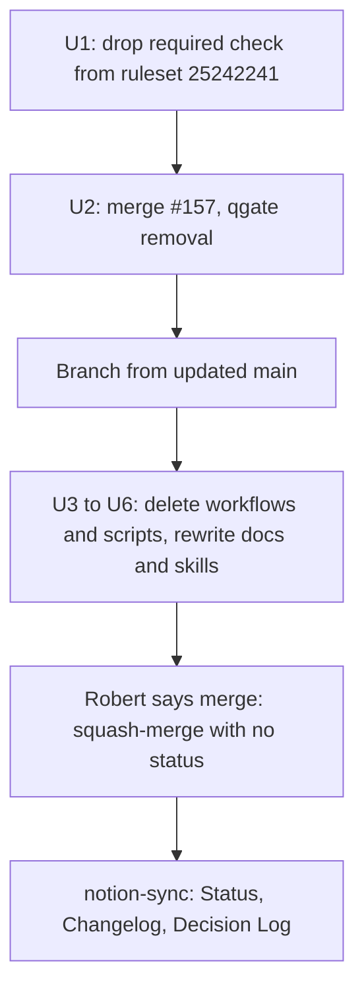

# Turn Off Hosted CI - Plan

## Goal Capsule

- **Objective:** Robert and the agents can merge a Mo pull request as soon as the work is done, with no Mo workflow running on it, queueing it, or blocking the merge.
- **Means:** drop the required `check` rule from the main ruleset, then delete the three GitHub Actions workflows and the scripts that exist only to serve them, and rewrite the agent guidance that waits on them (KTD1 to KTD5).
- **Product authority:** Robert. The Product Contract wins on behavior; the Planning Contract wins on mechanism.
- **Stop conditions:** stop and report if the ruleset cannot be edited from the agent's credentials, or if removing a script makes a local `ci/check.sh` group fail for a reason other than the removed step.
- **Execution profile:** GitHub settings, CI configuration, shell scripts and documentation. No C, Lean or Mo source changes.
- **Who finishes:** an agent makes the ruleset change, merges #157, opens one pull request for U3 to U6, and merges it once Robert says so; then runs `notion-sync`.

---

## Product Contract

### Summary

Mo stops running CI on GitHub. No workflow runs on a pull request, a push to `main`, or a schedule, and `main` no longer requires a `check` status to merge. `ci/check.sh` stays as the local test runner, agents build and run the unit tests locally before opening a pull request, and the docs and skills stop telling anyone to wait for or report hosted CI.

### Problem Frame

Hosted CI has been the slowest step in Mo's agent workflow. Before #156, a pull request's `check` took 11 to 29 minutes, with `cbmc` alone up to 22 minutes. #156 cut a pull request's `check` to about 2 minutes by moving the slow groups to a nightly run. The required status still blocks merges, though, and there is no way around it: the ruleset has no bypass actors, so on 22 Oct #157 could not merge, even with `--admin`, once its run was cancelled. Robert decided the gate costs more than it buys at this stage and wants it gone.

The cost is real and accepted: once this lands, the slow groups (`cbmc`, `lean`, `sanitize`, long `fuzz`) and the nightly 100,000-program VM-against-Lean comparison run nowhere unless someone runs them by hand.

### Requirements

**GitHub**

- R1. No GitHub Actions workflow runs in the repository: none on a pull request, a push to `main`, a schedule, or a manual dispatch.
- R2. A pull request into `main` can merge with no status check reported, and force-pushes to `main` stay blocked.

**Local tooling**

- R3. `bash ci/check.sh` and each of its groups still run locally as before, apart from the removed workflow-only steps.
- R4. The scripts that only served the workflows are gone, and nothing in the repository still calls them.

**Agent guidance**

- R5. No agent-facing or design document, skill or script comment tells anyone to wait for, read, or report a hosted `check` status, a nightly run, or a `nightly` issue, or claims that hosted CI or a nightly run enforces, runs or gates anything. The slow checks are described as by-hand runs.
- R6. Before opening a pull request, an agent builds and runs the unit tests locally (`bash ci/check.sh gcc`) and reports the result in the pull request; other groups are optional.
- R7. `docs/status/agent-mistakes.md` no longer claims hosted CI enforces any row.

### Key Decisions

- **Remove hosted CI entirely, not just the slow parts.** (session-settled: user-directed — chosen over keeping the 2-minute fast `check` gate that #156 left: Robert saw the post-#156 timings and kept the full removal.) Governs R1, R2.
- **Delete the workflow files rather than keep them for manual runs.** (session-settled: user-approved — chosen over keeping `workflow_dispatch` versions: nothing to maintain, and `git revert` restores them.) Governs R1, R4.
- **Keep the ruleset's force-push block.** (session-settled: user-approved — chosen over deleting the whole ruleset: it costs nothing and protects `main`'s history.) Governs R2.
- **Agents still run `bash ci/check.sh gcc` before a pull request.** (session-settled: user-approved — chosen over running nothing: a few minutes catches a broken build.) Governs R6.

### Scope Boundaries

- `ci/check.sh`'s groups, the Makefile, the tests, fuzz targets, the CBMC proofs and Mo Core in Lean are unchanged. Only the three workflow-only steps leave the `static` group.
- `ci/orb/` stays. It runs only when someone asks for it and uses no GitHub Actions; its README loses the two-tier and strict-gate sections.
- Dated records stay as written: `docs/plans/2026-10-22-1510-refactor-ci-two-tier-gate-plan.md` and the dated verification notes under `docs/status/`.
- Considered and not built: a local pre-push hook that runs a group. It would put back the wait this plan removes. A regression that reaches `main` because no hook ran would change this call.
- Considered and not built: turning off Actions in the repository settings. With no workflow files there is nothing to run, and the setting would add a second place to undo.
- The Socket Security GitHub App stays installed. Its checks are not required and finish in seconds. Uninstalling it is a GitHub settings change Robert can make himself.

---

## Planning Contract

### Key Technical Decisions

- KTD1. **Change the ruleset first, then merge #157, then the deletion PR.** The ruleset has no bypass actors, so a pull request that deletes `check.yml` can never report the required `check` and could never merge. #157 deletes `qgate.toml`, the last caller of `ci/docs_only.sh` outside the workflows, so it has to land before the scripts go.
- KTD2. **Edit ruleset 25242241 in place.** Remove its `required_status_checks` rule and keep `non_fast_forward`, through the GitHub rulesets API. The ruleset keeps its name and history, and putting the gate back means re-adding one rule. (session-settled: user-approved — chosen over deleting the ruleset: keeps the force-push block.) Governs R2.
- KTD3. **Delete the workflow-only scripts with their tests and their `static` steps.** That means `ci/ci_groups.sh`, `ci/docs_only.sh`, `ci/nightly.sh`, `ci/test_ci_groups.sh`, `ci/test_docs_only.sh`, `ci/test_nightly.sh`, and the three `ci/check.sh` steps that call those tests. Without the workflows, each script has no caller or only tests itself. Keeping them would leave a docs-only allow-list and a tier list with no consumer. Governs R4.
- KTD4. **The merge rule becomes plain prose.** A pull request merges when Robert says so, after the local `bash ci/check.sh gcc` run its body reports. Agents may still merge docs-only pull requests without review, as before. The rule lives once, in AGENTS.md "CI and merging", renamed "Checks and merging"; the skills and `ci/orb/README.md` cite it rather than restating it. Governs R5, R6.
- KTD5. **Mark ledger rows unenforced; don't delete them.** Rows 3, 4 and 10 of `docs/status/agent-mistakes.md` keep their history, and their enforcement column changes to say hosted CI is gone. The ledger exists to show what still guards each mistake, and this change removes a guard. Governs R7.

### High-Level Technical Design

The order is forced by the ruleset (KTD1):

### Risks

| Risk | Effect | Handling |
| --- | --- | --- |
| The slow groups run nowhere automatically | A CBMC, Lean, sanitizer or fuzz regression reaches `main` unseen | Accepted (Problem Frame). `docs/design/implementation.md` says how to run them by hand |
| clang and `static` stop running on every PR | Warning, format or include drift lands, especially from macOS sessions that use clang | Accepted. R6 asks only for `gcc`; agents may run more |
| Ruleset edit sent with the wrong body | Could drop the force-push rule too | U1 reads the ruleset back and checks that exactly `non_fast_forward` remains |
| Stale "CI pending" or "check" text on the Notion hub | The hub contradicts the repo | `notion-sync` after the merge rewrites the Status callout, and U5 drops the skill's `check` lookups |

---

## Implementation Units

### U1. Drop the required check from the main ruleset

- **Goal:** `main` accepts a merge with no status check.
- **Requirements:** R2; KTD1, KTD2.
- **Dependencies:** none.
- **Files:** none (GitHub setting on `robertguss/mo`, ruleset 25242241 "main: require check").
- **Approach:** update the ruleset through the rulesets API so its rules are only `non_fast_forward`; keep its target (`~DEFAULT_BRANCH`) and enforcement (`active`).
- **Test expectation:** none -- a repository setting, verified by reading it back.
- **Verification:** reading the ruleset back shows one rule, `non_fast_forward`, and the effective rules for `main` (`gh api repos/robertguss/mo/rules/branches/main`) list only `non_fast_forward`. `main` has no classic branch protection (checked 22 Oct). #157 reports as mergeable. Its branch still has `check.yml` until U3, so a `check` run may still start on it; cancel that run, since it no longer gates anything.

### U2. Merge #157

- **Goal:** qgate is off `main` before the scripts it calls are deleted.
- **Requirements:** R4; KTD1.
- **Dependencies:** U1.
- **Files:** none (merges `remove-qgate`).
- **Approach:** squash-merge #157 as it stands. If `main` moved since its last rebase, rebase it first and keep its qgate-only diff.
- **Test expectation:** none -- the change was tested on its own branch.
- **Verification:** `main` has no `qgate.toml`, and `git grep -i qgate` matches only dated plan docs.

### U3. Delete the workflows and the workflow-only scripts

- **Goal:** nothing runs on GitHub, and `ci/check.sh` no longer calls the removed scripts.
- **Requirements:** R1, R3, R4; KTD3.
- **Dependencies:** U2.
- **Files:**
  - Delete: `.github/workflows/check.yml`, `.github/workflows/nightly.yml`, `.github/workflows/differential.yml`, `ci/ci_groups.sh`, `ci/docs_only.sh`, `ci/nightly.sh`, `ci/test_ci_groups.sh`, `ci/test_docs_only.sh`, `ci/test_nightly.sh`.
  - Modify: `ci/check.sh`.
- **Approach:**
  1. Delete the files listed above.
  2. In `ci/check.sh`, remove the three `static` steps that ran the deleted tests (docs-only, CI tiers, nightly bookkeeping).
  3. Rewrite `ci/check.sh`'s header comment so it describes a local runner: no "CI runs the fast groups", no "so CI can run the groups as parallel jobs". Keep the `CI=1` note as "set `CI=1` to make a missing tool an error".
  4. Reword the comment that says "as the nightly run does".
- **Patterns to follow:** the step style already in `ci/check.sh`'s `static` group.
- **Test scenarios:**
  - `bash ci/check.sh static` runs grammar, deps, library map, frozen tasks, Wilson tests, format-check and tidy, and never mentions `docs_only`, `ci_groups` or `nightly`.
  - `bash ci/check.sh gcc` builds and passes.
  - `bash ci/check.sh nope` still exits 64 and lists the same eight groups.
- **Verification:** the three scenarios hold, and `.github/` holds only `pull_request_template.md`. Docs still naming the deleted scripts are U4's and U5's to fix; U5's verification checks none remain.

### U4. Rewrite the repository docs

- **Goal:** the project docs describe local checks only.
- **Requirements:** R5, R6; KTD4.
- **Dependencies:** U3.
- **Files:** `AGENTS.md`, `README.md`, `Makefile`, `.github/pull_request_template.md`, `ci/orb/README.md`, `docs/design/implementation.md`, `docs/design/architecture.md`, `.agents/setup`, `ci/check_core_generated.py`, `ci/check_core_differential.py`, `tests/differential/README.md`.
- **Approach:**
  1. `AGENTS.md`: rename "CI and merging" to "Checks and merging", replace its hosted-CI paragraphs with KTD4's rule, and drop "or changes CI state" from the `notion-sync` line under Workflow. Change "CI builds with both gcc and clang" and "CI pins clang-format 14.0.6" to say what to run locally. Keep the note that `docs/agent-guide.md`, `docs/reference/README.md` and `docs/design/library.md` are embedded or checked by the build, reworded as "run `bash ci/check.sh drivers static` after editing them".
  2. `README.md`: drop "CI's two tiers are in `ci/orb/README.md`". `Makefile`: its header comment drops "CI runs ci/check.sh".
  3. Pull request template, "Checks": ask for the local `bash ci/check.sh gcc` result plus any other group run, and for what was not run.
  4. `ci/orb/README.md`: delete "The two tiers", "Restoring the strict gate" and the nightly-workflow part of "Nightly fuzzing". Point "Merge verification" at AGENTS.md. Keep the orb's own sections and the clang-format 14 install.
  5. `docs/design/implementation.md`: reword conditions 1 and 2 (sanitizers, fuzzing) and the "CI" section so they name `bash ci/check.sh sanitize` and `fuzz` as by-hand runs, not nightly jobs.
  6. `docs/design/architecture.md`: in the differential section and section 11's testing text, drop the nightly workflow. The 100,000-program comparison the nightly ran, or a larger one, becomes a by-hand `ci/check_core_differential.py` run.
  7. `.agents/setup`, `ci/check_core_generated.py`, `ci/check_core_differential.py`, `tests/differential/README.md`: comment wording only. Replace "nightly" and "CI job" with "a by-hand run".
- **Test expectation:** none -- prose; U3's `static` run covers the build-embedded docs, which this unit does not change.
- **Verification:** outside dated docs, `git grep -n -i -E 'hosted|nightly|check\.yml|required .check|green .check'` finds nothing that describes current behavior.

### U5. Rewrite the agent skills

- **Goal:** no skill waits for, reads, or reports a hosted status.
- **Requirements:** R5, R6; KTD4.
- **Dependencies:** U4.
- **Files:** `.agents/skills/ship-task/SKILL.md`, `.agents/skills/review-change/SKILL.md`, `.agents/skills/test-change/SKILL.md`, `.agents/skills/correct/SKILL.md`, `.agents/skills/notion-sync/SKILL.md`. Edit `.agents/` only; the `.claude/skills/` entries are symlinks to it.
- **Approach:**
  1. `ship-task`: "Done" becomes "the PR is open with its local `gcc` result in the body". Drop "green pull request" from the description and the "checks are green again" step.
  2. `review-change`: drop "CI already proves formatting, warnings, module includes and the library map". The reviewer runs `bash ci/check.sh static` when the change touches what it checks, and otherwise says it was not run. Drop the hosted-`check` merge line.
  3. `test-change`: the gate is `bash ci/check.sh gcc`, plus any group the change reaches. "Reading a red gate" covers local output only. Keep the clang-format 14.0.6 pin note as a local caveat.
  4. `correct`: evidence comes from fix-up commits and review threads, not red `check` runs. "A CI check" becomes "a check in a `ci/check.sh` group".
  5. `notion-sync`: stop reading each PR's `check` result and drop "CI state" as a trigger. The Status page's CI callout describes the local-only setup.
- **Test expectation:** none -- skill prose.
- **Verification:** a grep of `.agents/skills` for `hosted`, `check` status, `nightly` and `green` finds no instruction to wait on or report hosted CI. Outside dated plan and status docs, `git grep` for `ci_groups`, `docs_only`, `ci/nightly`, `test_nightly` and `.github/workflows` finds nothing.

### U6. Update the agent-mistakes ledger

- **Goal:** the ledger shows which rows lost their guard.
- **Requirements:** R7; KTD5.
- **Dependencies:** U4.
- **Files:** `docs/status/agent-mistakes.md`.
- **Approach:** rows 3 and 10 change from hosted `check` to "prose only (hosted CI removed 22 Oct)". Row 4's enforcement becomes "nothing (hosted CI removed 22 Oct)", and its text drops the ruleset requiring `check`. Add one line under the table saying hosted CI was removed on Robert's decision, so these rows now depend on local runs.
- **Test expectation:** none -- ledger prose.
- **Verification:** no row names hosted CI or the required `check` as its enforcement.

---

## Verification Contract

| What | How | Applies to |
| --- | --- | --- |
| Ruleset | Read ruleset 25242241 back: one rule, `non_fast_forward`, enforcement `active` | U1 |
| Local runner | `bash ci/check.sh gcc` and `bash ci/check.sh static` pass, the second with clang-format 14.0.6 and clang-tidy installed or their skips named | U3 |
| Group list | `bash ci/check.sh nope` exits 64 listing the eight groups | U3 |
| No dangling references | `git grep` for the deleted script names and `.github/workflows` matches only dated docs | U5 (after U3 to U5) |
| No hosted-CI instructions | grep from U4 and U5 | U4, U5, U6 |
| Merge without a status | The U3 to U6 pull request merges with no `check` reported, and `gh run list` shows no run for it or for its merge to `main` | All |

## Definition of Done

- U1 to U6 are done, each meeting its Verification.
- No workflow file exists, and no Actions run starts after the final merge.
- This pull request's body reports the local `gcc` and `static` results, since it edits the `static` group, and names what was not run. Later pull requests follow R6 (`gcc` only).
- No half-edited doc, commented-out step or stray script is left in the diff.
- After the merge, `notion-sync` has run. The Status page's CI callout describes the local-only setup, the Changelog lists #157 and this pull request, and the Decision Log has Robert's decision in his words: "I want to disable the checks, CI, etc in this repo because it is really slowing down progress as it takes way too long."
