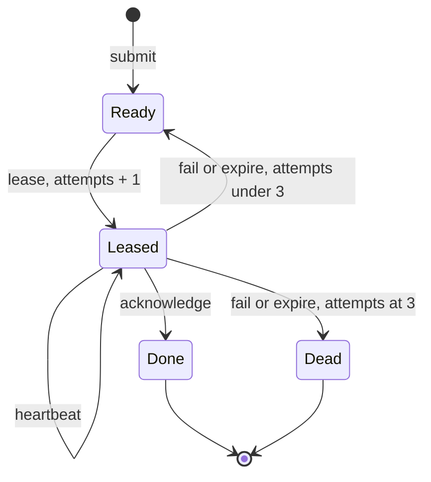

# Task-Queue Service - Plan

## Goal Capsule

- **Objective:** An agent that knows only the MCP tool list can submit, lease, renew, finish and give back tasks through Mo's own queue, and the program is ready to deploy as it stands.
- **Means:** A `mo serve` service in `services/task-queue/` over a service-owned copy of the job queue (KTD1), with its tool surface settled before any saved data exists (KTD3).
- **Authority:** `docs/reference/README.md`, then `docs/design/services.md`, then this plan. Where this plan departs from the section 5 sketch, this plan wins and U4 corrects the sketch.
- **Stop conditions:** Stop and report if the work needs a change to `src/`, `lib/` or `runtime/`, or a change to job-queue logic. Also stop if `use Main` from a sibling entry is refused (KTD4).
- **Execution profile:** One PR, four units, in order.
- **Finishing:** The implementer opens the PR following the repo's PR template. Robert reviews and merges it.

---

## Product Contract

### Summary

Add `services/task-queue/`: a six-tool MCP service, its own `job-queue.mo`, simulation tests and one loopback check. The service refuses payloads it could not deliver and job counts it could not hold. Each tool's description carries everything an agent needs to use it.

### Problem Frame

Phase 3 has the runtime but no service. The first open item in `docs/ROADMAP.md` is the queue itself, and the deployment and week-long-run items both wait on it.

The usual cost of getting a tool surface wrong is low. Here it is high: `mo serve` refuses saved data after any change to the compiled program, and there is no migration (`docs/agent-guide.md`, Run a service). Once real tasks are in the queue, correcting a tool, a description or a limit means a fresh data folder, with tasks moved by hand through the old program's tools.

Agents are the only users, and the tool list is all they see. `initialize` returns no instructions, inputs have no per-field descriptions, and tools have no annotations. The section 5 sketch has one-line descriptions, does not compile as written, and has three gaps that research confirmed against the code:

- Nothing can read the queue, so a dead job is invisible.
- `submit` accepts payloads `lease` can never deliver.
- A runaway `submit` loop can fill the saved state, after which no update works on that data folder.

### Requirements

**Tools**

- R1. The service offers `submit`, `lease`, `heartbeat`, `acknowledge`, `fail` and `list`, with a one-minute `expire` timer and the token from `QUEUE_TOKEN`.
- R2. `lease` holds a job for 30 minutes. `heartbeat`, `acknowledge` and `fail` follow D307 and keep the job queue's semantics, including three attempts before Dead.
- R3. `list` shows every job in any state with its full payload, pages through all of them, can filter by state, and changes nothing.
- R4. Listing by state finds dead jobs without paging through finished ones, and `limit: 1` at the right cursor looks up a single job.

**Limits**

- R5. `submit` refuses a payload over 2,048 bytes with an application error stating the limit and the size received.
- R6. `submit` refuses once the queue holds 5,000 jobs, with an application error stating the limit. Every other tool keeps working at that point.
- R7. Invalid `list` arguments return an application error, never a handler failure, so they cannot count toward a supervised stop.

**What agents are told**

- R8. Each tool's description stands alone. Across the six it states the wire facts, how to carry `id` and `attempts` forward, heartbeat cadence, what is safe to retry, and the limits.
- R9. `heartbeat`, `acknowledge` and `fail` tell the agent to answer `NotLeased` by looking the job up with `list`, and what each result means (F2).
- R10. The description of `lease` lists what to do for each runtime error, including never repeating `handler_failed`, `work_limit` or `memory_limit`.

**Proof**

- R11. Simulation tests prove the tool contracts, crash recovery, lease expiry and the limits.
- R12. One `drivers` check runs the real program over loopback and proves wire shapes, the size limit on delivery, and that an accepted job survives `kill -9`.

### Key Decisions

- **`list` is a sixth tool.** Governs R3, R4. (session-settled: user-approved — chosen over shipping only the sketch's five tools: without it nobody can see done or dead jobs, and after a program change only state a tool returns can be carried over.)
- **A retried `submit` after a lost reply makes a second job.** Governs R1, R8. (session-settled: user-approved — chosen over duplicate detection: `tests/service-simulation/main.mo` pins this behaviour, and the description tells agents to check `list` first.)
- **Payloads stop at 2,048 bytes.** Governs R5. (session-settled: user-approved — chosen over accepting whatever the request body allows: a larger payload can be accepted and never delivered. Longer tasks become a short brief saying where the rest is.)
- **The queue stops accepting at 5,000 jobs.** Governs R6. (session-settled: user-approved — chosen over relying on the saved-state limit: a refused `submit` is visible and leaves the queue working, while reaching that limit stops every update on that data folder.)
- **No failure reason or holder is recorded.** Governs R1. (session-settled: user-approved — chosen over a per-job history in state: reasons go in the PR or task notes.)

### Key Flows

- F1. A job's normal path
  - **Trigger:** A coordinator has a ready task.
  - **Steps:** `submit` returns an id. A worker's `lease` returns the job. The worker keeps `id` and `attempts`, calls `heartbeat` while working, then `acknowledge`.
  - **Outcome:** `list` shows the job Done.
  - **Covered by:** R1, R2, R8
- F2. A worker gets `NotLeased`
  - **Trigger:** `heartbeat`, `acknowledge` or `fail` returns `NotLeased`.
  - **Steps:** The worker calls `list` with `after: id - 1`, `limit: 1` and no state filter, then compares the row with its own `attempt`.
  - **Outcome:** See AE1.
  - **Covered by:** R3, R4, R9
- F3. A job dies
  - **Trigger:** The third attempt fails or expires. Nothing is notified.
  - **Steps:** A coordinator lists Dead jobs, then re-submits the payload or tells a person.
  - **Outcome:** Re-submitting makes a new job with a new id. The old record stays Dead.
  - **Covered by:** R2, R4, R8

### Acceptance Examples

- AE1. Reading `NotLeased`
  - **Covers:** R9
  - **Given** a worker holding attempt 2 of job 7, **when** `list` shows Done with attempts 2, **then** its earlier `acknowledge` landed and its reply was lost: treat as success.
  - **Given** the same worker, **when** `list` shows Ready, or Leased, with attempts 2, **then** its lease ran out: stop, the job is going back or already has.
  - **Given** the same worker, **when** `list` shows Dead with attempts 2 or more, **then** stop and report.
  - **Given** the same worker, **when** `list` shows attempts 3 in any other state, **then** a later attempt owns the job: stop and do not acknowledge.
- AE2. Size limits
  - **Covers:** R5, R12
  - **Given** a 2,048-byte payload of the costliest bytes to escape, **when** it is submitted, leased and listed with `limit: 1`, **then** it arrives whole, even with the largest request id.
  - **Given** a 2,049-byte payload, **when** it is submitted, **then** the error states 2,048 and 2,049 and no job is added.

### Scope Boundaries

Considered and not built:

- **Notification of dead jobs, or a grace period after outages.** Handlers are pure and the protocol is request and response, so `list` is the signal. An outage over 30 minutes spends attempts, which is how a dead worker's task comes back. A later plan could revisit this if the week-long run loses a job that way.
- **Failure reasons and worker identity.** See Key Decisions. Revisit if a dead job in the week-long run can't be diagnosed.
- **Cancel, release without spending an attempt, requeue in place, and purging Done jobs.** These need new queue logic. Purging is what will eventually lift the job limit; the limit is far above the week-long run's scale.
- **Reply shapes for `heartbeat`, `acknowledge` and `fail` beyond `Unit`.** The sketch's replies stay, because a worker that needs more calls `list`.
- **Variable lease length.** `heartbeat` is fixed at 30 minutes in the job queue.
- **A check comparing the two `job-queue.mo` files.** See KTD1.

#### Deferred to Follow-Up Work

Carry these into the deployment item:

- Run a pinned tree of binary, `lib/` and source from one commit. The image key covers the whole program, and a rebuilt `mo` with a changed `lib/` or code generation is likely to be refused as well (not traced end to end).
- `RestartPreventExitStatus` covers 69 only, so E1409's exit 1 needs a runbook line.
- `mo serve` allows only `127.0.0.1:PORT` and `localhost:PORT`, so a proxied `Host` may get 421. Test this early.
- Whether agent clients speak protocol version `2025-11-25` is unproven, since repo tests all use hand-built HTTP.
- The runbook should say that idle service still writes (every `expire` tick and every `lease` that returns None is logged), and that after any outage someone should list Dead and Leased jobs.

---

## Planning Contract

### Key Technical Decisions

- KTD1. **The service owns its `job-queue.mo`.** `services/task-queue/job-queue.mo` starts as `examples/job-queue.mo` plus one exposed reader, and `examples/` is not touched. No check compares the two, because a comparison would make every sample edit a service edit, which is the coupling this avoids. A logic fix in one needs making by hand in the other. (session-settled: user-directed — chosen over moving the file and linking `examples/job-queue.mo` to it: a symlink is too fragile.) The loader leaves no one-file route without a symlink short of putting the service in `examples/`: `use` finds files only under the entry's root (`src/check/load.c`), and a link out of the root is E1101.
- KTD2. **The entry is `module Main`.** `module TaskQueue` in `main.mo` is E0035. Imports are `use JobQueue{Queue, Job, QueueError}`, because a plain `use` gives only qualified names (reference 10.3).
- KTD3. **Everything that freezes ships in this PR.** Spec code, debug spans, tool names, descriptions and limits are all in the image key (`LEARNINGS.md`, MO-182). After deployment they cost a new data folder, which is why R5, R6 and the descriptions are not deferred.
- KTD4. **Simulation tests live in a sibling entry.** `services/task-queue/queue-tests.mo` does `use Main`, so a later test edit cannot change the served program. (session-settled: user-approved — chosen over tests inside `main.mo`.) No fixture does this outside a cycle error; `tests/errors/e0036/other.mo` shows `use Main` resolves, and only cycles are refused. If it fails, stop and report: tests in `main.mo` would freeze with the service.
- KTD5. **`list` takes three required arguments and returns a record.** MCP arguments are all required, so there are no optional parameters. It takes `filter`, `after` and `limit`. `after` is an exclusive id cursor, stable because ids are never reused and jobs are never removed. The reply is `Page` with `jobs`, `next` (`Option(Int)`) and `now`, so an agent can read `until` without trusting its own clock. The result must not be a tuple starting with state, or it becomes an update (reference 11.5).
- KTD6. **`list` refuses bad arguments and caps `limit` at 100.** `after < 0` or `limit` outside 1 to 100 returns an application error. A page of 100 can still exceed the reply limit. That gives a harmless `response_limit`, and the agent lowers `limit`, which always ends because `limit: 1` fits (KTD7).
- KTD7. **2,048 bytes is checked with `payload.byte_count`.** It fits whatever the bytes are: the reply carries the payload twice, costing at most 13 bytes per input byte, plus envelope, inside 32 KiB. The size is checked before the count, and the count uses the reader.
- KTD8. **The reader is `jobs(queue) : List(Job)`.** `Queue` stays opaque. `expose Queue(..)` is rejected because promise generators would then build arbitrary queues. A shadow list in the wrapper is rejected because it would reimplement `expire`. Job order is id order: maps keep insertion order (reference 3) and ids only rise.
- KTD9. **The loopback check is a new `ci/check_task_queue.py` with a small local client.** `Served` in `ci/check_cli.py` can't be imported because that file has no main guard, and the script stays out of a file many PRs touch. Expiry stays in Simulation, because `mo serve` has no fake clock and the real program's lease is 30 minutes.

### High-Level Technical Design

Job lifecycle, unchanged from the job queue. `list` reads every state.



Tool surface, as directional guidance. Final names of local types are the implementer's call.

| Tool | Arguments after state and time | Success | Application errors | Updates state |
| --- | --- | --- | --- | --- |
| `submit` | `payload` | id | size, full | yes |
| `lease` | none | `Option(Job)` | `BadLease` | yes |
| `heartbeat` | `id`, `attempt` | `Unit` | `NoSuchJob`, `NotLeased`, `BadLease` | yes |
| `acknowledge` | `id`, `attempt` | `Unit` | `NoSuchJob`, `NotLeased` | yes |
| `fail` | `id`, `attempt` | `Unit` | `NoSuchJob`, `NotLeased` | yes |
| `list` | `filter`, `after`, `limit` | `Page` | bad page | no |

`expire` is a timer, not a tool. `filter` is a local enum of any-state, Ready, Leased, Done and Dead, because the job queue's `JobState` carries `until`.

### Output Structure

```text
services/task-queue/
  main.mo          the service: module Main, six tools, the timer, limits
  job-queue.mo     the service-owned queue: the sample plus jobs(queue)
  queue-tests.mo   simulation tests, a separate test entry
ci/
  check_task_queue.py   the loopback check
```

### Risks

- **Budgets at the job limit are estimates.** `lease`, `expire` and `list` walk every job, and every update re-encodes the whole state, so a full-size fill costs roughly 25 GiB of encoding (estimate). The suite's fill uses short payloads to stay fast. U2's one-off full-size run measures the worst case and records it in the PR. If that run fails, stop and report the measurements, because lowering the limit changes a decision already made.
- **Several wire shapes have no existing test on these types.** Nested `Job` and `JobState`, `Time` with a real clock, and the literal `tools/list` body are first tested by U3, so U3 asserts whole values and records any surprise.
- **Each tool must fit one catalog page.** Server start refuses a tool whose page exceeds 32 KiB (`runtime/mcp.mo`, `prepare`). Long descriptions spend that budget, and the six together may need more than one page, so the U3 client follows `nextCursor`.

---

## Implementation Units

### U1. The service-owned job queue

- **Goal:** A `job-queue.mo` the service can load and read.
- **Requirements:** R3; KTD1, KTD8
- **Dependencies:** none
- **Files:**
  - Create: `services/task-queue/job-queue.mo`
- **Approach:**
  - Copy `examples/job-queue.mo` and add `jobs` to the `expose` line.
  - Add the reader with an `examples` block, which is this unit's test.
  - Change no existing logic, promise or test.
- **Patterns to follow:** The `examples` blocks already in that file.
- **Test scenarios:**
  - `jobs(empty)` is an empty list.
  - `jobs` of a two-job queue returns both in id order, with their states.
  - After `fail` on the first job, it keeps its position in `jobs`.
- **Verification:** `mo test services/task-queue/job-queue.mo` passes its existing 20 results plus the new ones.

### U2. The service and its simulation tests

- **Goal:** The six tools, the timer, the limits and the descriptions, proven by simulation.
- **Requirements:** R1 to R11; KTD2 to KTD7
- **Dependencies:** U1
- **Files:**
  - Create: `services/task-queue/main.mo`
  - Create: `services/task-queue/queue-tests.mo`
- **Approach:**
  - Write the wrappers from the section 5 sketch with the corrections in KTD2 and `_now` for unused parameters.
  - Add local error types, the filter, `Page`, and named constants for 2,048, 5,000, 100 and 30 minutes.
  - Treat the `##` comments as a deliverable. Multi-line comments reach clients joined with newlines. Say that `Int` is a JSON string, and use the wording from R8 to R10.
  - Keep each description under 4,096 characters with its must-follow rules first, because Claude Code cuts longer descriptions on tools that load upfront.
  - Put the full runtime-error list in `lease`. Each other tool repeats one line: never repeat `handler_failed`, `work_limit` or `memory_limit`. An agent may have loaded only that one tool.
  - `submit`'s description and its full error say that the limit counts every job ever submitted, including Done and Dead, and never falls, so retrying cannot help and the agent should tell a person.
  - `submit`'s description says that HTTP 413 means the request body passed 16 KiB, so the payload never reached the service and must be shortened. R5's application error covers every payload that reaches the handler.
  - Run `mo format` on all three files before writing the tests' expectations.
- **Execution note:** Implement test-first, and see each limit test fail before adding its guard (ledger class 6).
- **Patterns to follow:** `tests/service-simulation/` for wrappers and recovery, and `tests/lower-source/service-simulation/main.mo` for ticks.
- **Test scenarios:**
  - Covers F1. Submit, lease, heartbeat and acknowledge one job; `list` shows it Done with attempts 1.
  - `lease` on an empty queue is `None` and changes nothing visible.
  - Heartbeat at 29 minutes, then advance 29 more: the lease still holds. Advance past its end: `acknowledge` is `NotLeased`.
  - Covers F3. Three `fail` calls end in Dead, and a further `lease` is `None`.
  - Covers F3. Three expiries through ticks alone end in Dead with attempts 3.
  - Re-submitting a dead job's payload makes a new id, and the dead record stays.
  - Covers AE1. Each row of the example reached by a real sequence, decided from `list` output: repeated `acknowledge`, expiry then late `acknowledge`, late worker against a newer attempt, and last-attempt expiry.
  - Covers AE2. A payload of exactly 2,048 bytes is accepted. One of 2,049 is refused with both numbers, and `list` shows no new job.
  - Paging: 25 jobs read at `limit: 10` appear exactly once, in order, with `next` set until the last page, and `after` past the end gives an empty page with `next` as `None`.
  - Filter: with Ready, Leased, Done and Dead jobs present, each filter returns only its own, and paging across a filter skips the rest.
  - `limit` of 0, -1 and 101, and `after` of -1, each return the application error, and the service's failure count does not advance: 15 such calls in a row leave it running.
  - `list` leaves state alone: the next `lease` returns the job it would have.
  - Crash and restart keep submitted, leased and dead jobs, and `list` agrees before and after.
  - Crash, advance 31 minutes, restart: the lease is gone, `heartbeat` is `NotLeased`, attempts are unchanged. On attempt 3 the job is Dead.
  - An accepted `lease` whose reply is ignored: after 30 minutes the job is Ready with attempts 1, and the next `lease` returns it with attempts 2.
  - Fill to 5,000 jobs with short payloads: the next `submit` is refused as full and says retrying cannot help, and `lease`, `heartbeat`, `acknowledge`, `fail`, an `expire` tick and `list` still succeed.
- **Verification:**
  - `mo check` and `mo test` pass on `queue-tests.mo` with a nonzero result count that includes `JobQueue` and `QueueTests`. `main.mo` carries no examples, promises or tests.
  - One temporary run of the fill at 2,048-byte payloads passes, and its timings and budget use are in the PR body.

### U3. The loopback check

- **Goal:** The real program, served over HTTP, behaves as agents are told.
- **Requirements:** R1, R5, R8, R12; KTD9
- **Dependencies:** U2
- **Files:**
  - Create: `ci/check_task_queue.py`
  - Modify: `ci/check.sh`, `Makefile`, `tests/test_format.c`
- **Approach:**
  - Register the script with a `later` line next to `ci/check_simulation.py` in the `drivers` group.
  - The script runs `mo test --json` on `queue-tests.mo` and asserts an exact result count, because nothing else runs these tests.
  - It then serves `main.mo` on port 0 with a temporary `DIR`.
  - Add `services/task-queue/*.mo` to `GRAMMAR_CHECK` in the `Makefile` and to the fixed-point list in `tests/test_format.c`.
- **Patterns to follow:** `ci/check_simulation.py` for shape and exact counts, and `serve_command` in `ci/check_cli.py` for the HTTP exchange.
- **Test scenarios:**
  - `initialize`, then `tools/list` following any `nextCursor`, gives exactly the six tools with their exact input schemas and nonempty descriptions of at most 4,096 characters.
  - Covers F1. The whole path over the wire, asserting whole `structuredContent` values, including `Int` as a string and `Some` and `None` forms.
  - An application error has `isError` true with `kind` and `case`.
  - Covers AE2. The worst-case 2,048-byte payload round-trips through `lease` and `list` with `limit: 1`, using a maximum-length request id. 2,049 is refused.
  - A request body over 16 KiB gets HTTP 413, and `list` shows no new job.
  - A page too large for one reply returns `response_limit`, then succeeds with a lower `limit`.
  - A wrong token gets 401 and no reply data, as the negative control.
  - `kill -9` after an accepted `submit`, restart on the same `DIR`: the job is listed and can be leased. This is the ROADMAP's loopback proof.
- **Verification:** `bash ci/check.sh drivers` runs the new check and passes; removing the payload guard makes it fail.

### U4. Docs and status

- **Goal:** The docs say what was built.
- **Requirements:** All; KTD1
- **Dependencies:** U3
- **Files:**
  - Modify: `docs/design/services.md`, `docs/ROADMAP.md`, `LEARNINGS.md`
- **Approach:**
  - In `docs/design/services.md`, replace the section 5 sketch with the real program and correct section 3's line that Phase 3 wraps the module unchanged. State that the service owns its copy.
  - In `docs/ROADMAP.md`, tick the item and update the count in the Now paragraph.
  - In `LEARNINGS.md`, record the size-limit reasoning and that spec code is in the image key.
- **Test expectation:** none -- documentation only; `docs/agent-guide.md` is not changed because no `mo` command changes.
- **Verification:** No file still says the sketch's `module TaskQueue` or that the service uses the sample unchanged.

---

## Verification Contract

| Gate | How | Applies to |
| --- | --- | --- |
| Build and unit tests | `bash ci/check.sh gcc`, last line in the PR body | Every change, per `AGENTS.md` |
| The new check and format fixed points | `bash ci/check.sh drivers`, named in the PR body | This PR adds a `drivers` check and a `.mo` tree |
| Grammar | `make grammar CC=gcc`, named in the PR body | U3's `GRAMMAR_CHECK` edit |
| One test file while working | `make -j8 build/gcc/debug/tests/test_format.test.run CC=gcc` | U3's `tests/test_format.c` edit |
| Cold read | One fresh agent gets only the `tools/list` output, with no repo, and scenarios for a lost acknowledge, `NotLeased`, `handler_failed` and a dead job. Wrong choices are description bugs. | Before the PR is marked ready; record the result in the PR body |

The `static` group is not needed, because this PR does not edit `docs/agent-guide.md`, `docs/reference/README.md` or `docs/design/library.md`; the Grammar row covers the one `static` check this PR changes. Long checks follow `AGENTS.md`, Waiting on checks.

## Definition of Done

| Scope | Done when |
| --- | --- |
| U1 | The reader exists, existing results still pass, and `examples/` has no diff |
| U2 | Every scenario passes, and each limit test was seen failing before its guard |
| U3 | The check is in `drivers`, passes, and fails when a guard is removed |
| U4 | The roadmap item is ticked and `services.md` matches the program |
| Whole PR | `main.mo` and `job-queue.mo` are formatted, the cold read is recorded, the PR body says what departs from the sketch and why, and no abandoned-attempt code remains in the diff |

---

## Deferred / Open Questions

These entries are review items left for the author. They do not block implementation.

### From 2026-11-02 review

- **A worker that holds a lease across a wait loses it, and nothing says what ends a task** — Requirements on leases and tool descriptions (P2, adversarial, confidence 75)

  A thread acts only between steps, so it cannot heartbeat inside a blocking call or after its turn ends, and a PR can wait hours for review. A thread that holds its lease across that wait loses it within 30 minutes, another thread repeats the task, and three such losses make the job Dead. The wording freezes with the program, so this should be settled before U2 writes the descriptions. Default if unanswered: a task ends at hand-off, when the PR opens. The description of `acknowledge` says so, and the description of `lease` says never to hold a lease while waiting on a person. The cold read gains a waiting-on-review scenario.

- **The payload limit's requirement overstates what an agent gets for very large payloads** — Requirements, the 2,048-byte limit (P2, feasibility, confidence 75)

  A payload large enough to push the request body past 16 KiB gets HTTP 413 with an empty body from the transport, before the service's own refusal can run, so the requirement cannot hold for every oversized payload. The descriptions and the check already cover this; only the requirement's wording is out of date.

  Change: Scope the requirement to requests that reach the handler, and say a body over 16 KiB gets HTTP 413 with an empty body.
