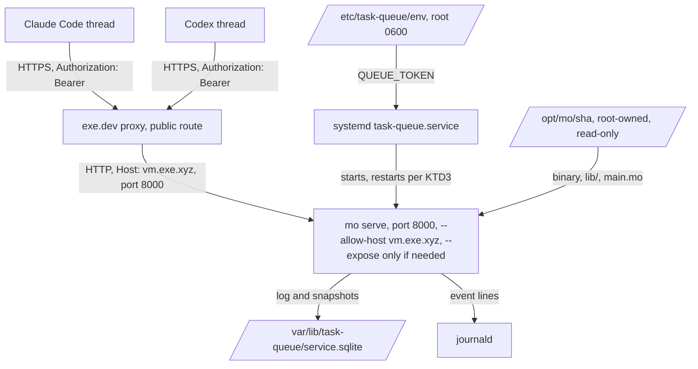
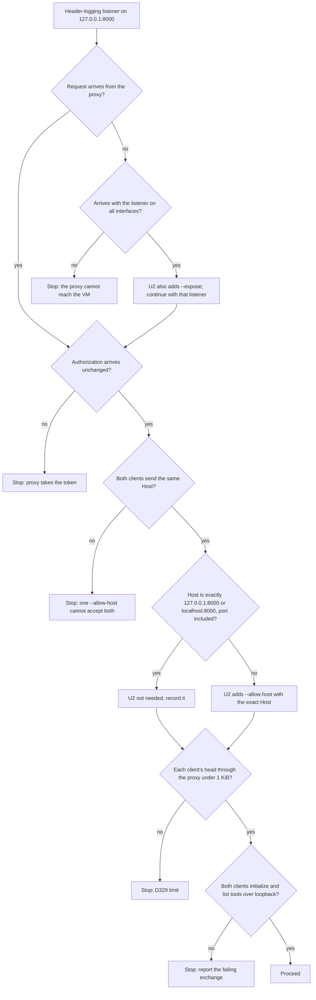

# Deploy the Task Queue on an exe.dev VM - Plan

## Goal Capsule

- **Objective:** Agent threads reach Mo's task queue at a stable HTTPS address with one client config line, and the queue runs unattended: it comes back after a crash and stays down where a person can see it after a supervised stop. That is what the week-long run needs before it can start.
- **Means:** A pinned build under systemd on a dedicated exe.dev VM, behind the public exe.dev proxy (KTD2, KTD3), plus a `mo serve` flag so the proxied Host is accepted (KTD1), and a second so it listens beyond loopback if the probe shows the proxy needs that (KTD8).
- **Authority:** `docs/reference/README.md`, then `docs/design/services.md` and `docs/agent-guide.md`, then this plan.
- **Stop conditions:** Stop and ask Robert if any of these turns out true:
  - the proxy reaches the VM on neither loopback nor all interfaces (KTD8);
  - the proxy strips, replaces or rejects a non-exe.dev `Authorization: Bearer` header on a public route;
  - Claude Code and Codex reach `mo serve` with different Host values, which one `--allow-host` cannot both accept (KTD1);
  - a real client's request head, as received through the proxy, is over 1 KiB (`MO_LIMIT_MCP_HEADER_BYTES`, frozen by D329);
  - Claude Code or Codex cannot initialize and list tools against `mo serve`;
  - the work needs a change to `runtime/`, `lib/`, the queue program or any limit.
- **Execution profile:** Three PRs in order: the `mo serve` flag (code), then the runbook and deployment record (docs-only), then the 48-hour result and the roadmap tick (docs-only).
- **Finishing:** The implementer opens each PR from the repo's PR template. Robert reviews and merges PR1. PR2 and PR3 are Markdown only, so agents may merge them (AGENTS.md, Checks and merging). Robert does the exe.dev account steps listed under Dependencies.

---

## Product Contract

### Summary

Add `mo serve --allow-host NAME` so a proxied request's Host is accepted, plus `--expose` only if the proxy cannot reach a loopback listener. Then deploy the merged task queue as a hardened systemd unit on a dedicated exe.dev VM, from a root-owned pinned tree, behind a public proxy route guarded by Mo's own token. Write a one-page runbook with the Claude Code and Codex client lines, drill the restart policy, and record a 48-hour idle run before ticking the roadmap item.

### Problem Frame

Phase 3 ends with a week-long run in which every agent thread leases its work from Mo's own queue (`docs/ROADMAP.md`, `docs/design/services.md` section 10). The queue program is written and tested, but only over loopback on a development checkout. A development checkout cannot host it, because `mo serve` reads `lib/` from the build tree and any edit there refuses the saved data (`LEARNINGS.md`, image key entries).

Three facts make a plain `mo serve` behind the proxy fail as it stands:

- `mo serve` accepts only `Host: 127.0.0.1:PORT` or `localhost:PORT` and answers anything else with 421 (`src/tools/serve.c`, `runtime/http-policy.mo`). exe.dev's docs tell Vite and Next.js users to allow-list `vmname.exe.xyz`, which suggests the proxy forwards the public name.
- An exe.dev route is private by default and wants a browser login, which neither agent client can do.
- A restart policy keyed only on exit 69 would loop on exit 1. E1409 refuses saved data, and restarting cannot change that.

The task-queue plan deferred these items here: the pinned tree, the exit-1 runbook line, the 421 risk, unproven client protocol support, idle writes, and checking Dead and Leased jobs after an outage (`docs/plans/2026-11-02-0039-feat-task-queue-service-plan.md`, Deferred to Follow-Up Work).

### Requirements

**Running unattended**

- R1. The queue runs on a dedicated exe.dev VM from a pinned tree of one `main` commit (binary, `lib/` and service source). The tree sits outside any working checkout and nothing can edit it.
- R2. systemd restarts the queue after a crash, meaning death by signal or exit 70. It leaves the queue down after exit 69, exit 1, exit 2 and a deliberate `systemctl stop`. The queue starts at boot.
- R3. The access token lives only in a root-only environment file on the VM and in each client's environment. It never appears in the unit, the repo, logs or a client's stored config.

**Reachable by agents**

- R4. `https://<vm>.exe.xyz/mcp` reaches the queue through a public exe.dev route, and Mo's bearer token is the only gate.
- R5. A Claude Code thread and a Codex thread each connect with one config line that names the token by environment variable, then list the seven tools and call `stats`.
- R6. `mo serve --allow-host NAME` accepts requests whose Host is `NAME`, in addition to the loopback authorities. It never changes which saved data a program recovers.

**Operated by a person or an agent**

- R7. `docs/ops/task-queue.md` is a one-page runbook covering:
  - install and pinning;
  - start, stop and status;
  - reading the journal;
  - a health call;
  - what to do for each exit status;
  - the after-outage check of Dead and Leased jobs;
  - why an idle queue still writes;
  - the never-edit-the-tree rule and the upgrade path;
  - token rotation;
  - the two client lines.
- R8. The restart policy is drilled on the VM and recorded in `docs/status/phase3-run.md`: a kill, a supervised stop, a startup refusal and a deliberate stop.
- R9. The queue runs 48 hours idle with no restart. The result is recorded in `docs/status/phase3-run.md` and the roadmap item is ticked.

### Key Decisions

- **Public route, guarded by Mo's token.** This keeps the service independent of exe.dev's proxy (D264, `docs/design/services.md` section 7). Governs R4. (session-settled: user-approved — chosen over a private route with an exe.dev token on every client: clients would carry two credentials and the service would depend on the proxy.)
- **A dedicated VM for the queue.** Rebuilds, check runs and reboots on the development VM `aurora-but-gold` cannot touch the 48-hour or week-long runs. Governs R1. (session-settled: user-approved — chosen over the development VM: shared load and reboots there would reset the idle and week-long clocks.)
- **Claude Code and Codex are the clients.** T3 threads run both. Governs R5. (session-settled: user-approved — chosen over Claude Code only.)

### Acceptance Examples

- AE1. Restart policy
  - **Covers:** R2, R8
  - **Given** the queue runs under its unit, **when** its main process gets SIGKILL, **then** systemd starts it again, `NRestarts` is 1, and a job submitted before the kill is still listed.
  - **Given** a drill unit with the same restart settings serving a program whose tool always stops, **when** enough failures reach the supervisor's stop, **then** the process exits 69, the unit stays failed and `NRestarts` stays 0.
  - **Given** the drill unit with `QUEUE_TOKEN` unset, **when** it starts, **then** it exits 1 with E1409 once and is not restarted.
  - **Given** the queue runs, **when** a person runs `systemctl stop`, **then** it exits 0 and stays stopped.
- AE2. Proxied Host
  - **Covers:** R6
  - **Given** `--allow-host queue.example`, **when** a request carries `Host: queue.example`, **then** it is served. **When** it carries `Host: other.example`, **then** it gets 421.
  - **Given** data written by a run with `--allow-host`, **when** the same program starts on it without the flag, **then** it recovers with no E1409.

### Scope Boundaries

Considered and not built:

- **Alerting when the queue stops.** A stopped queue fails every agent's next tool call right away, in the thread that made it, so the stop is seen without a monitor. Revisit if the week-long run finds a stop nobody noticed for over an hour.
- **Accepting the token from a second header.** It is needed only if the proxy takes `Authorization`, which is also a stop condition.
- **A local reverse proxy that rewrites Host.** It adds a moving part to the restart and recovery story (KTD1).
- **A release (`-O2`) build target or a real `mo --version`.** The debug build is fast enough for a rate-limited queue of at most 5,000 jobs. The commit SHA in the tree's path identifies the build.
- **Backups beyond exe.dev's streamed disk snapshot,** and log compaction. Revisit if the week-long run's data folder grows enough to matter.
- **The week-long run** and **the poll loop spinning when file descriptors run out.** These are the next roadmap items.

---

## Planning Contract

### Key Technical Decisions

- KTD1. **One `--allow-host NAME` flag, not a Host-rewriting proxy.** `mo serve` already takes a list of authorities (`mo_protocol_server_new` in `src/tools/serve.c`), so the flag adds one entry. The name avoids `--host`, which in Vite and Next.js means the bind address. Authorities are not in the image key (`src/bytecode/image.c`, MO-182), so the flag never refuses saved data. The value is validated by the existing `HttpAuthority.check`, so a malformed value is refused at startup as E1409 "the server configuration was refused", exit 1. A port-less name means port 80 (`runtime/http-authority.mo`), which matches a Host the proxy sends without a port. (session-settled: user-approved — chosen over a local reverse proxy that rewrites Host: one more process to supervise and pin.)
- KTD2. **A system unit running as a dedicated `taskqueue` user, over a root-owned tree.**
  - The pinned tree is a fresh clone of one `main` commit at `/opt/mo/<sha>`, built in place with the existing gcc debug build. `ci/embed_docs.py` resolves the `lib/` path at build time, so the tree must not move after building.
  - Once built, the tree is owned by root and read-only, so no agent or user on the VM can edit `lib/`.
  - The data folder `/var/lib/task-queue` is created once by hand, owned by `taskqueue`, mode 0700. It is not a `StateDirectory=`, because systemd would quietly recreate a deleted folder as an empty queue, and `mo serve` refuses to create one for exactly that reason.
  - Hardening: `ProtectSystem=strict` with `ReadWritePaths=` for the data folder, plus `PrivateTmp=yes` (SQLite needs a temporary folder), `ProtectHome=yes` and `NoNewPrivileges=yes`.
- KTD3. **Restart policy by exit status.** The table below owns the policy. `Restart=on-failure` with `RestartPreventExitStatus=1 2 69`, `RestartSec=5s`, and a start limit of 5 starts in 600 seconds, set in `[Unit]`. `TimeoutStopSec=40s` covers the server's drain of about 25 seconds. `ExecStart` runs `mo` directly, with no wrapper script, so the exit status reaches systemd unchanged.

  | How it ends | Restart? | Why |
  | --- | --- | --- |
  | Death by signal (SIGKILL, SIGSEGV) | yes | a crash; saved data is intact |
  | Exit 70 | yes | any other death, including a store stop (`docs/design/services.md`, MO-161) |
  | Exit 69 | no | the supervisor stopped it; a person must look |
  | Exit 1 | no | E1409 or program errors; restarting cannot help |
  | Exit 2 | no | a command mistake in the unit |
  | Exit 0 | no | `systemctl stop` (SIGTERM) |

- KTD4. **The token comes from `EnvironmentFile=/etc/task-queue/env`, root-only, mode 0600.** systemd reads it before dropping privileges. `LoadCredential=` would need a wrapper to turn the credential into an environment variable, and a wrapper breaks KTD3. The token is about 43 random base64 characters, generated straight into the client's 0600 file and copied to `/etc/task-queue/env` without ever being printed, echoed, typed on a command line or pasted into a PR. Agent sessions keep transcripts, so a printed token is a leaked token. Install and rotation use the same procedure. The token's length fits the token grammar (`src/host/credentials.c`) and leaves most of the 1 KiB head for headers that the proxy and the clients add.
- KTD5. **Client lines name the variable, never the value.**
  - Claude Code: `claude mcp add --transport http --scope user` with the header single-quoted as `'Authorization: Bearer ${QUEUE_TOKEN}'`, so the stored config keeps the reference.
  - Codex: `codex mcp add` with `--bearer-token-env-var QUEUE_TOKEN`.
  - Each client machine keeps `QUEUE_TOKEN` in a mode-0600 file that the login shell sources.
  - Source: the docs research in Sources.
- KTD6. **Settle the proxy and client questions with a probe before writing code (U1).** The outcome decides whether U2 is needed and whether any stop condition applies, and every check is a few minutes on the new VM. The probe uses a throwaway token and a header-logging listener on the shared port. It also tests the clients against a loopback `mo serve` on `aurora-but-gold`, where both clients are installed.
- KTD7. **The roadmap tick waits for a later docs-only PR.** A 48-hour check cannot finish inside the PR that ships the runbook, and AGENTS.md lets agents merge Markdown-only PRs. (session-settled: user-approved — chosen over holding the runbook PR open for 48 hours.)
- KTD8. **`mo serve --expose` listens on all interfaces, built only if U1 shows the proxy cannot reach loopback.** The services design requires explicit consent before `mo serve` listens beyond loopback (`docs/design/services.md`, MO-160 listener). Robert gave that consent for the dedicated VM, and the flag is the per-run consent. The host listener already supports it (`mo_listener_config.address` and `expose`, tested in `tests/test_listener.c`). The bearer token still guards every request. The token then crosses exe.dev's network between the proxy and the VM in plain HTTP, the same as any backend behind that proxy. Without `--expose`, `mo serve` behaves exactly as before. (session-settled: user-directed — chosen over stopping after the probe to ask: consent was given up front, so PR1 carries both flags and no second code PR is needed.)

### High-Level Technical Design

Request path and supervision once deployed:

Probe gates in U1, each answered before PR1 is written:

### Assumptions

- The implementer has a shell on the queue VM with sudo, given by Robert. That can be SSH from `aurora-but-gold` or a session run on the queue VM.
- The task-queue branch (`task-queue-service`) merges to `main` before PR2 starts. The pinned tree must be a `main` commit that holds both the queue and `--allow-host`.

### Dependencies

Robert's exe.dev account steps. The implementer prepares the exact commands and asks before each one:

- Create the VM.
- Point the proxy at port 8000 with `share port`.
- Make the route public with `share set-public`, which publishes it.
- After the drills, confirm the 48-hour window may start.

### Risks

| Risk | Mitigation |
| --- | --- |
| The proxy's Host carries a port, or differs between clients | U1 logs the exact Host from both clients through the proxy, and the unit's `--allow-host` copies it verbatim. Different Hosts from the two clients is a stop condition |
| Claude Code's newer runtime probes with `server/discover` and protocol 2026-07-28 first | `mo serve` answers any non-`initialize` request with the wrong version with 400 and a JSON-RPC error (`runtime/mcp-transport.mo`), which the client treats as "fall back to `initialize`". U1 confirms this with the installed client |
| Codex asks for protocol `2025-06-18` in `initialize` | `initialize` accepts any version string and answers `2025-11-25` (`runtime/mcp-rpc.mo`). U1 confirms that Codex goes on to use it |
| Claude Code blanks some credential-looking variables in headers | U1 checks the server receives a non-empty bearer from `${QUEUE_TOKEN}` |
| A reboot or a manual restart during the 48 hours | U5 checks the boot list, `NRestarts`, the main PID and the start time together. Any of them changing restarts the 48-hour window |
| A later `mo` upgrade on the VM refuses the saved data | The runbook says to leave the tree alone and links the agent guide's procedure for moving to a new data folder |

### Sources

- `docs/design/services.md`: sections 3, 7 and 8, and MO-161 for the flags, exit statuses and event lines.
- `docs/agent-guide.md`: Run a service, and Recover from a stop.
- `LEARNINGS.md`: the image key entries (`lib/`, debug spans, MO-182), the stop-signal ordering, and the D329 header limit.
- `ci/check_task_queue.py`: the pattern for starting the service and calling MCP (headers, pacing, SIGTERM exit 0).
- exe.dev: https://exe.dev/docs/proxy.md (port routing, `X-Forwarded-*`, private by default), https://exe.dev/docs/https-tokens-for-vms.md (`Authorization: Bearer` is a deprecated exe.dev token path), https://exe.dev/docs/faq/nextjs-and-friends.md (allow-listing `vmname.exe.xyz`). The docs say nothing on the Host value or idle stops. They do not say whether the proxy reaches a loopback-only server, but the FAQ starts Next.js and Vite on `0.0.0.0`, which suggests it may not.
- systemd 255: `systemd.service(5)` and `systemd.unit(5)` for `Restart=`, `RestartPreventExitStatus=`, `StartLimitIntervalSec=` and `NRestarts`.
- Claude Code: https://code.claude.com/docs/en/mcp (header env expansion, scopes, credential-variable blanking). Codex: https://learn.chatgpt.com/docs/config-file/config-reference (`bearer_token_env_var`). Client protocol behaviour was read from the MCP TypeScript SDK and `openai/codex` source, not from docs, and U1 confirms it.

---

## Implementation Units

### PR1: Accept a proxied Host in mo serve

Waits on: the task-queue PR, merge order only. Both edit `docs/design/services.md`. U1 also needs the queue VM from Dependencies before it can start.

### U1. Probe the proxy and the clients

- **Goal:** Before any code changes, settle the exact `--allow-host` value and every stop condition a header log and a loopback session can answer. U2's verification covers the full exchange through the proxy.
- **Requirements:** R4, R5, R6
- **Dependencies:** The VM and its public route on port 8000 (Dependencies).
- **Files:** `LEARNINGS.md` (one entry for what the proxy forwards and how each client negotiates).
- **Approach:**
  1. On the queue VM, run a throwaway listener on 127.0.0.1:8000 that logs the raw request head and its size, and answers 404. If no request reaches it, run it again on all interfaces (KTD8). Send requests through `https://<vm>.exe.xyz/mcp` with curl, then with each client configured against that URL and a throwaway token.
  2. Record the Host, the `X-Forwarded-*` headers, whether `Authorization` arrives byte for byte, any `Origin`, and each client's head size.
  3. On `aurora-but-gold`, serve the task queue over loopback on a temporary data folder. Connect Claude Code (default runtime) and Codex with the KTD5 lines pointed at `http://127.0.0.1:PORT/mcp`. Confirm each lists seven tools and calls `stats`.
  4. Apply the U1 gates in the High-Level Technical Design. Put the findings in the PR1 description and the `LEARNINGS.md` entry. Never record the throwaway token.
- **Execution note:** This is an environment probe. Its evidence is the logged heads and the client sessions, not a test file.
- **Test expectation:** none -- this unit writes no product code. Its result decides whether U2 runs, with what value, and whether it adds `--expose`.
- **Verification:** Every gate has a recorded answer. Either the plan continues to U2 with the exact Host string and a yes or no on `--expose`, or the work stops on a named stop condition.

### U2. Add `mo serve --allow-host NAME`, and `--expose` if U1 needs it

- **Goal:** `mo serve` accepts one extra authority given on the command line (R6, KTD1). If U1 found loopback unreachable, it can also listen on all interfaces (KTD8).
- **Requirements:** R4, R6
- **Dependencies:** U1, which must find a Host other than loopback. `--expose` is built only if U1's listener was reached only on all interfaces.
- **Files:**
  - `src/tools/cli.c`, `src/tools/tools.h` (parse the flag, store it)
  - `src/tools/serve.c` (third authority entry; with `--expose`, the listener's address and exposure)
  - `tests/test_cli.c`, `tests/test_protocol_server.c`, `tests/test_listener.c` (only with `--expose`)
  - `ci/check_cli.py` (the `flags` table, serve mistakes, `serve_command`, `serve_guide`)
  - `fuzz/corpus/fuzz_cli/` (one seed using the flag)
  - `docs/agent-guide.md` (Run a service), `docs/reference/README.md` (the `mo serve` synopsis), `tests/conformance/reference.tsv` (refreshed from the reference)
  - `docs/design/services.md` (MO-161: "The flags are only `--port` and `--data`")
- **Approach:**
  1. Add the flag to the positional flag table in `cli.c`. It takes an operand, is allowed only with `serve`, and may appear once. `--emit=` moves to the next index.
  2. In `serve.c`, append the value to the authorities array when it is present. The listening line stays as it is: it still names 127.0.0.1, because that is where the server listens.
  3. Only if U1 needs it: add `--expose`, which takes no operand, is allowed only with `serve`, may appear once, and sets the listener to `0.0.0.0` with exposure on. The listening line keeps naming 127.0.0.1, which stays reachable, so the drivers that parse it need no change.
  4. Update the guide sentences pinned in `serve_guide` (including "It takes no address flag." if `--expose` lands) and the synopsis in both embedded docs in the same commit.
- **Patterns to follow:** `--port` and `--data` handling in `cli.c`. The `Host: elsewhere.example` 421 check in `ci/check_cli.py` `serve_command`. The authority cases in `tests/test_protocol_server.c`.
- **Test scenarios:**
  - Covers AE2. With `--allow-host queue.example`, `initialize` with `Host: queue.example` returns 200.
  - Covers AE2. With the flag, `Host: other.example` still returns 421, which is the negative control.
  - With the flag, `Host: 127.0.0.1:PORT` and `Host: localhost:PORT` are still served.
  - `--allow-host queue.example:8000` serves `Host: queue.example:8000` and refuses `Host: queue.example` with 421.
  - `--allow-host queue.example` refuses `Host: queue.example:443` with 421. This pins port-less as port 80.
  - Covers AE2. Data written by a run with `--allow-host` recovers in a run without it, and the reverse, with no E1409.
  - `--allow-host 'bad host'` exits 1 with E1409 "the server configuration was refused" and opens no listener.
  - `--allow-host` with no operand, given twice, or given to `mo run` exits 2 with the CLI's refusal text.
  - The guide's new sentence is checked by `serve_guide`.
  - Only with `--expose`: the server answers on a non-loopback address of the machine, a request through 127.0.0.1 is still served, and a run without the flag refuses a connection on the non-loopback address.
  - Only with `--expose`: given twice, or given to `mo run`, it exits 2 with the CLI's refusal text.
- **Verification:** The new tests fail before the change and pass after. `mo serve` without the flag behaves byte for byte as before. Before PR1 is marked ready, the PR1 build runs on the queue VM behind the public route with `--allow-host <observed Host>`, a throwaway data folder and a throwaway token. Both clients connect through the public URL, list the seven tools and call `stats`. U1's listener sees only each client's first request, so this is the first check of the later request heads and the full exchange. A 431 or 413, or a failed exchange, is the matching stop condition. The result goes in the PR1 body.

### PR2: Runbook, deployment and drills

Waits on: PR1 and the task-queue PR, both needed before this group can start. The pinned tree is a `main` commit that holds both.

### U3. Write the unit and the runbook

- **Goal:** One page that installs, runs, checks and recovers the queue (R7), with the unit file embedded in it.
- **Requirements:** R1, R2, R3, R5, R7
- **Dependencies:** PR1 merged.
- **Files:** `docs/ops/task-queue.md` (new).
- **Approach:**
  1. Embed the full `task-queue.service` text from KTD2 and KTD3 in the runbook, so PR2 stays Markdown only.
  2. Keep each section short and imperative: install the pinned tree (KTD2), the token (KTD4), start, stop and status, the journal (`journalctl -o cat -u task-queue`, matching `^mo serve: failure:`), a health call (`stats` with curl), and one action per exit status (KTD3 table, linking the agent guide's Recover from a stop).
  3. Add these notes:
     - the after-outage check: `list` Dead and Leased jobs;
     - why an idle queue still writes: every `expire` tick and every empty `lease` is logged;
     - the empty `service.sqlite` left by a kill during the very first start;
     - token rotation: edit the env file, restart, update clients;
     - the KTD5 client lines.
  4. Include the drill unit and the always-stopping drill program used by U4, so the drill can be rerun after any unit edit.
- **Patterns to follow:** `ci/orb/README.md` for the shape of an ops note. `docs/agent-guide.md` for exit-status wording.
- **Test expectation:** none -- documentation. U4 runs every command in it.
- **Verification:** Every runbook command was run as written in U4. The page holds no token and no machine-specific secret.

### U4. Deploy, drill and connect

- **Goal:** The queue runs from the runbook as written, and its restart policy and client lines are proven (R1 to R5, R8).
- **Requirements:** R1, R2, R3, R4, R5, R8
- **Dependencies:** U3.
- **Files:** `docs/status/phase3-run.md` (new; a Deployment section with the pinned SHA, the unit's settings and the drill results), `docs/ops/task-queue.md` (fixes found while following it), `docs/design/services.md` (section 3: point to the runbook), `LEARNINGS.md` (anything the deployment taught).
- **Approach:**
  1. Follow the runbook on the queue VM.
  2. Run the AE1 drills, the exit-69 and exit-1 cases on the drill unit, which has its own data folder and port.
  3. Connect one Claude Code thread and one Codex thread on `aurora-but-gold` through the public URL.
  4. Lease and acknowledge every job the drills submitted to the real queue, so `stats` shows nothing Ready or Leased, and record their ids in `docs/status/phase3-run.md` as drill jobs. The queue never removes jobs, and a Ready drill job would be the first task an agent leases in the week-long run.
  5. Finish with `systemctl restart task-queue`, so the 48-hour window starts from a clean `NRestarts`.
- **Execution note:** Smoke-first. Every result is an observed command outcome, recorded in `docs/status/phase3-run.md`.
- **Test scenarios:**
  - Covers AE1. SIGKILL to the main PID: the unit is active again within `RestartSec`, `NRestarts` is 1, and a job submitted before the kill is listed after it.
  - Covers AE1. The drill unit's always-stopping tool, called until the supervisor stops it: exit 69, the unit failed, `NRestarts` 0, and a `mo serve: stop:` line in the journal.
  - Covers AE1. The drill unit with `QUEUE_TOKEN` unset: one E1409 start, exit 1, no restart.
  - Covers AE1. `systemctl stop task-queue`: exit 0, inactive, no restart. `systemctl start` brings back the same jobs.
  - Reboot the VM once: the queue is active after boot with its jobs.
  - Claude Code, configured with the KTD5 line through the public URL: `/mcp` shows the server connected and `stats` answers. `claude mcp get` shows `${QUEUE_TOKEN}`, not the value.
  - Codex, configured with the KTD5 line: it lists the tools and `stats` answers.
  - A request with a wrong token through the public URL gets 401.
  - The token is absent from the journal, the unit, both clients' stored config, shell history and the implementing session's transcript.
  - After the drill jobs are acknowledged, `stats` shows no Ready or Leased job.
- **Verification:** `docs/status/phase3-run.md` records each scenario's observed result and the pinned SHA. The queue is active with `NRestarts` 0 at the end.

### PR3: Record the 48-hour idle check

Waits on: PR2 merged and the U4 deployment live, both needed before this group can start. The 48 hours run from U4's last restart.

### U5. Check 48 idle hours and tick the roadmap

- **Goal:** Show that the deployed queue ran 48 hours without a restart, then close the roadmap item (R9).
- **Requirements:** R9
- **Dependencies:** U4, plus 48 hours.
- **Files:** `docs/status/phase3-run.md` (an Idle check section), `docs/ROADMAP.md` (tick the deployment item and update the Now count).
- **Approach:**
  1. "Idle" means no agent traffic other than one `stats` call at the start and one at the end.
  2. Pass needs all of these:
     - the unit has been active for at least 48 hours;
     - `NRestarts` is 0;
     - the main PID is unchanged;
     - `journalctl --list-boots` shows one boot spanning the window;
     - the journal has no `failure:`, `restart:` or `stop:` lines;
     - the final `stats` matches the first, apart from the clock.
  3. Any miss restarts the window and is recorded, not hidden.
- **Test expectation:** none -- this unit records an observation; the pass criteria above are the check.
- **Verification:** `docs/status/phase3-run.md` shows both `stats` replies, the timestamps, `NRestarts`, the PID and the boot list. The roadmap item is ticked.

---

## Verification Contract

| Gate | Applies to | Command or evidence |
| --- | --- | --- |
| Build and unit tests | PR1, PR2, PR3 | `bash ci/check.sh gcc`, run detached and waited on with `ci/wait-for-results`. Its last line goes in each PR body |
| Embedded docs and CLI goldens | PR1 (edits the guide and the reference) | `bash ci/check.sh sanitize drivers static` in one run, so `drivers` does not drive a stale sanitize `mo` (`docs/status/agent-mistakes.md`) |
| Conformance inventory | PR1 | `python3 ci/check_conformance.py --inventory` after the reference edit; review `tests/conformance/rules.tsv` row `13.4/1` |
| Second compiler | PR1 (C change) | `make CC=clang` builds with no warnings |
| Single test files while iterating | U2 | `make -j8 build/gcc/debug/tests/test_cli.test.run CC=gcc` and `test_protocol_server.test.run` |
| Probe evidence | U1 | Logged request heads and client sessions, summarized in the PR1 body |
| Proxy end-to-end | PR1, before it is marked ready | Both clients complete the exchange through the public URL against the PR1 build (U2 Verification) |
| Deployment evidence | U4, U5 | Observed results in `docs/status/phase3-run.md` |

---

## Definition of Done

- PR1 is merged with every U2 test scenario passing, and the guide, reference, design and conformance inventory agree on the new flag. If U1 found the Host already accepted, PR1 carries only the `LEARNINGS.md` entry and says so.
- The queue runs from `/opt/mo/<sha>` under `task-queue.service` on the dedicated VM. The runbook in `docs/ops/task-queue.md` was followed exactly as written to get it there.
- Every AE1 drill and client scenario has an observed result in `docs/status/phase3-run.md`.
- A 48-hour idle window passed the U5 criteria, and the roadmap item is ticked in PR3.
- No token appears in the repo, a PR, the journal, the unit, either client's stored config, shell history or an agent transcript.
- Cleanup: the probe listener, the drill unit and its data folder, the throwaway tokens and the temporary loopback data folders are removed from both VMs, and no abandoned code is left in PR1's diff.
