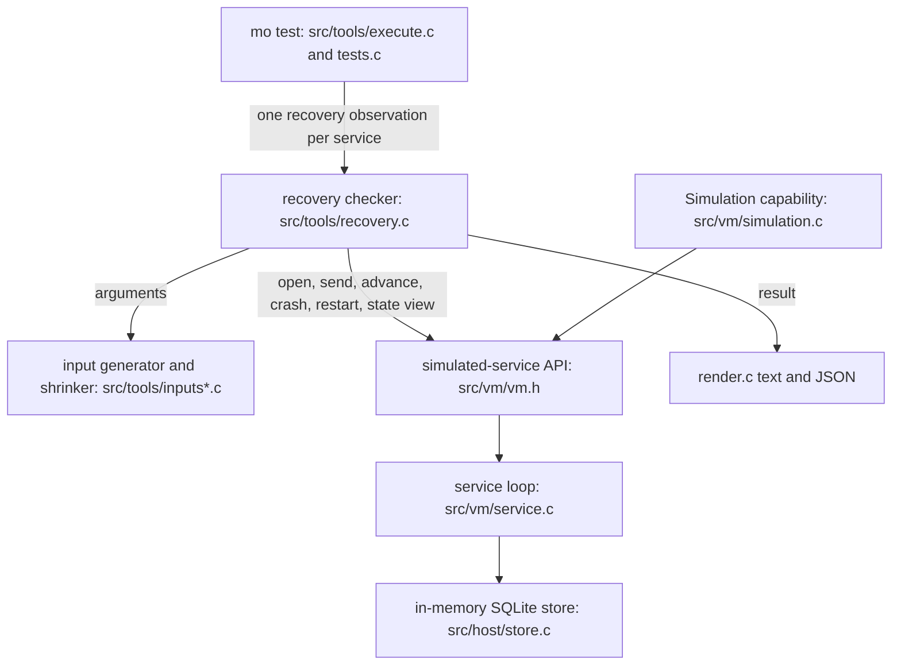
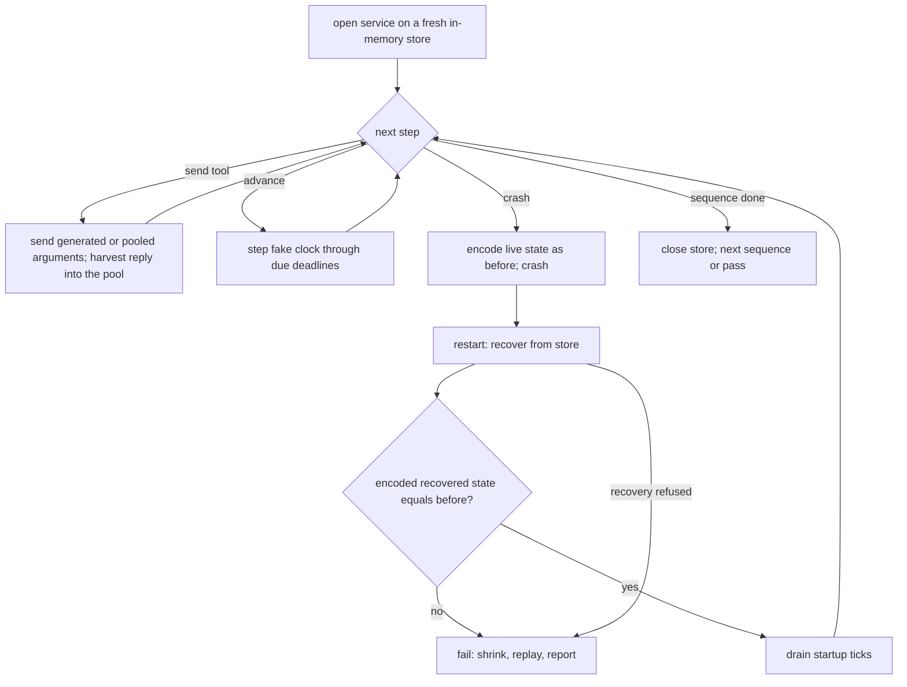

# Close Phase 3 on Recovery Checks, Not a Deployed Run - Plan

## Goal Capsule

- **Objective:** Phase 3 closes on evidence that a Mo service never loses committed state when its process dies. The evidence holds for every service, comes from runs on the development VM, and needs no deployed queue and no calendar wait.
- **Means:** An automatic crash-recovery check in `mo test` built on simulation generators (KTD1 to KTD7), plus a loop that SIGKILLs a real `mo serve` mid-write (KTD9). The `turnpike-ferret` deployment is torn down (KTD10).
- **Authority:** `docs/reference/README.md`, then `docs/design/services.md`, `docs/design/architecture.md` and `AGENTS.md` (the Working Agreement for claims about what Mo guarantees), then this plan. This plan replaces PR3 (U5, the 48-hour idle check) of `docs/plans/2026-11-02-1158-feat-deploy-task-queue-plan.md` and the week-long run in `docs/ROADMAP.md`.
- **Stop conditions:** Stop and report if any of these turns out true:
  - the oracle in KTD2 reports a mismatch on the unmodified runtime (a real recovery bug: record it, fix it in its own commit, and say so in the PR);
  - the recovery check still cannot compare at least one restart for `services/task-queue/main.mo` on the gcc debug build after the recovery-check default is raised as KTD6 allows;
  - the kill loop finds an answered update missing after a restart;
  - the work needs a change to a frozen limit, the bytecode format, Mo Core or `formal/`.
- **Execution profile:** One pull request (KTD11). Units U1 to U7, in order. U6 can be built at any point after U1.
- **Finishing:** The implementer opens the PR from the repo's template with `bash ci/check.sh gcc`'s last line, the `sanitize drivers static lean` run, the predictions and results (R10), and the exe.dev commands Robert runs for R14. Robert reviews and merges.
- **Open blockers:** None.

---

## Product Contract

Product Contract preservation: changed: R8 — scoped to process death, not machine or power loss, as the evidence supports (SIGKILL leaves the OS page cache intact). All other R, AE and Key Decision meaning and IDs unchanged.

### Summary

`mo test` gains a crash-recovery check that runs for every service with no new syntax. It generates sequences of tool calls, clock advances, crashes and restarts, and requires each recovered state to match an uninterrupted run of the committed messages. A kill loop on the development VM drives a real `mo serve` with real SQLite and kills it with SIGKILL at random moments. Phase 3 closes when both pass, and the exe.dev deployment comes down.

### Problem Frame

Phase 3's finish line was a calendar. The queue was deployed on `turnpike-ferret`, a 48-hour idle check started at 2026-11-02 13:18 UTC, and a week of agent threads leasing their tasks from it was to follow (`docs/design/services.md` section 10, D260). Most of what those runs exercise belongs to systemd, SQLite, the exe.dev proxy and the VM, not to Mo. A week is still a single sample of crash behaviour: one deliberate `kill -9`.

The week also assumed agents would take their work from the queue. Robert starts every thread himself and wants to stay in control, so leases made for the run would exist only to tick a box. The first real use from a T3 thread also failed: the T3 server process runs without `QUEUE_TOKEN`, so every thread it starts sends an empty bearer and gets a 401.

The claim Phase 3 needs splits in two. The queue's logic keeps every job, and that is already promised step by step in `services/task-queue/job-queue.mo` and checked on generated queues. The reference says to state it that way: a promise about many steps is a promise on the one-step function (`docs/reference/README.md` section 12.2). The other half is the runtime's claim: whatever was committed is what recovery rebuilds. Nothing checks that half across arbitrary sequences of messages and crashes. Simulation can crash and restart a service on its still-open store, but "Promise and generator support is deferred" for it (section 12). Crashes in simulation happen only between operations, on an in-memory store. A real crash can land mid-transaction on disk.

### Key Decisions

- **Phase 3 closes on evidence, not on time.** The idle check, the week-long run and any soak are dropped. Governs R11. (session-settled: user-directed — chosen over the week-long run and a shorter 48–72 hour real-use window: elapsed time proves little that a targeted crash check cannot.)
- **No dogfooding gate.** Agents do not take their tasks from the queue, and no worker pulls jobs on its own. Governs R11. (session-settled: user-directed — chosen over agent threads leasing from the queue and a scheduled worker: Robert starts threads and stays in control.)
- **Everything runs on the development VM.** Simulation and the kill loop need no deployment. Governs R7, R9. (session-settled: user-directed — chosen over a load-tested twin or the production queue on `turnpike-ferret`: the deployment was never needed to prove the claim.)
- **The runtime checks recovery automatically, with no new syntax.** Recovery is a property of the runtime, not of any one service, so every service gets the check without its author writing anything. The queue's logic stays covered by its existing step promises. Governs R1, R2, R4. (session-settled: user-approved — chosen over an author-written sequence promise, and over both: new syntax would contradict the rule that multi-step promises are one-step promises.)
- **Build simulation generators, not a hand-written seeded test.** The parked "simulation promise generators" item becomes the mechanism, so shrinking and reporting match `mo test`'s promises. Governs R2, R3. (session-settled: user-directed — chosen over a seeded random-sequence test written in Mo, which works today but serves one service and does not shrink.)
- **The kill loop covers what simulation cannot.** Real process death, mid-transaction on real SQLite over HTTP, judged by what a client saw. Governs R7, R8. (session-settled: user-directed — chosen over leaving mid-commit crashes to the C fault injection in `tests/test_service_store.c` alone.)
- **The deployment is torn down.** Its runbook and run record stay as history. Governs R14 to R16. (session-settled: user-approved — chosen over keeping the queue running with clients removed, and over fixing the T3 token so threads could reach it: nothing depends on it now.)

### Requirements

**Recovery check in `mo test`**

- R1. For every service in the program, `mo test` checks that after any generated sequence of tool calls, clock advances, crashes and restarts, the recovered state equals the state an uninterrupted run reaches from the same committed updates and timer firings.
- R2. Generated tool arguments can reuse values that earlier replies returned, as promise generation already pairs a value with its companion, so sequences reach deep states and not only refusals.
- R3. A failure reports a shrunk sequence that reproduces it, and the reported sequence reruns with the same result.
- R4. The check is listed, selected, reported and time-bounded like `mo test`'s other checks. A short design note fixes its name, report, counterexample format and budget before any code, because a Mo user sees it.
- R5. The check passes for `services/task-queue/main.mo`.
- R6. The check fails on a runtime deliberately broken to drop or duplicate a committed update on recovery. This is the negative control.

**Kill loop on the development VM**

- R7. A driver starts the task queue under `mo serve` over loopback with a real data folder, sends a seeded sequence of tool calls, kills the process with SIGKILL at random moments (mid-commit included), and restarts it on the same folder.
- R8. After every restart, the recovered queue reflects every update whose reply the driver received. Each update sent without a reply either applied in full or did not apply at all. The claim covers process death, not machine or power loss.
- R9. A short seeded run belongs to the `drivers` group. A long run is done by hand, and its seed range, kill count and result are recorded when Phase 3 closes.

**Claims and records**

- R10. Both checks follow the Working Agreement for claims about what Mo guarantees: predictions written before the runs, an independent check, and every failure kept in the record.
- R11. `docs/ROADMAP.md` ticks Phase 3 only when R5, R6 and R9 pass. It removes the deployment and week-long items with the reason. The file-descriptor poll-loop item moves to Later unless the kill loop reproduces it.
- R12. `docs/design/services.md` section 10 states the new finish line. The document no longer says the queue runs on an exe.dev VM (D258) or that deployment needs a 48-hour idle check (MO-163).
- R13. `docs/agent-guide.md` describes the recovery check if it changes what `mo test` prints, and `guide_claims` in `ci/check_cli.py` checks it.

**Teardown**

- R14. On `turnpike-ferret`, the queue unit is stopped and disabled, the public route is unpublished, and the VM is deleted or parked.
- R15. No client still points at the deployment. That covers the user-scope Claude Code `task-queue` entry, the Codex entry, `~/.config/task-queue/env.sh` and the line in `~/.zshenv` that sources it, so no thread tries to connect at startup.
- R16. `docs/ops/task-queue.md` and `docs/status/phase3-run.md` open by saying the deployment was retired, when, and why. The rest of each stays as the record.

### Acceptance Examples

- AE1. Recovery check holds and catches a broken runtime
  - **Covers R1, R5, R6.**
  - **Given** the task queue, **when** `mo test` runs, **then** its recovery check passes.
  - **Given** a runtime whose recovery skips the newest committed update, **when** `mo test` runs, **then** the check fails and reports a short sequence ending in a committed update, then a crash, then a restart.
- AE2. Sequences reach deep states
  - **Covers R2.**
  - **Given** the task queue's generated runs, **then** some sequence holds a Dead job, some sequence leases a job again after its lease expired, and some sequence acknowledges a job after a crash and restart.
- AE3. An update without a reply
  - **Covers R8.**
  - **Given** the driver sent `submit` and SIGKILL arrived before the reply, **when** the queue restarts, **then** the job exists exactly once or not at all, and the driver accepts either.
  - **Given** the driver received the `submit` reply, **when** the queue restarts, **then** the job exists with its payload.
  - **Given** the driver received an `acknowledge` reply, **when** the queue restarts, **then** that job is Done.

### Scope Boundaries

- Author-written sequence promises or any other new syntax for services.
- Agents using the queue as their task list, and any worker that leases jobs on its own.
- Fixing the duplicate job created when a client retries a `submit` that got no reply. It stays a documented hazard (reference section 11, "effect unknown").
- Changing the queue program or its tools. With no deployed data to protect, the surface is free to change later.
- Removing `mo serve --allow-host` or other code added for the deployment.
- Soak tests, idle checks, uptime targets and any other gate measured in elapsed time.
- Testing the exe.dev proxy and TLS path.
- Phase 4's design step, which comes next once Phase 3 closes.

Considered and not built:

- **Crashing inside a commit during `mo test`.** It would need a runtime fault hook, which `AGENTS.md` forbids. Mid-commit coverage stays with `tests/test_service_store.c` and the kill loop. Revisit if the kill loop finds a fault the C tests miss.
- **Fixing the zero-byte `service.sqlite` left by a SIGKILL during a data folder's very first start.** It loses no committed data, and the store refuses it loudly with E1409 (`src/host/store.c`). The kill loop never kills before the first `listening` line, and the limit is recorded in `LEARNINGS.md`. Revisit if a Phase 4 operator story needs unattended first starts.
- **Checking supervisor restarts (D308) as recovery.** They keep the in-memory state and never read the store, so there is nothing to recover. The check treats them as ordinary steps and does not claim to cover them.
- **A `--seed` flag for `mo test`.** Sequences are seeded from the check's name, like promise inputs, and the shrunk sequence is replayed before it is reported (KTD7). Revisit if two machines report different counterexamples for the same failure and that confuses a fix.

### Dependencies / Assumptions

- Robert does the exe.dev account steps for R14 (unpublish the route, delete or park the VM), and removes the Codex entry on his Mac for R15. The implementer prepares the exact commands in the PR body.
- The roadmap's rule that each phase begins with a design step for anything a Mo user would notice applies to R4's design note (U1).

### Sources

- `docs/reference/README.md` section 12: promises (12.2), generation of hidden types and their companions, the one-step rule for multi-step promises, and Simulation's start, send, advance, crash and restart. Generator support for Simulation is deferred there.
- `services/task-queue/job-queue.mo`: the step promises that keep every job. `services/task-queue/queue-tests.mo`: the existing hand-written simulation tests.
- `docs/design/services.md`: section 3 (D258), section 10 (D260), the MO-163 idle-check line, and the MO-159 notes on crash, restart and the duplicate job from a retry.
- `tests/test_service_store.c`: the MO-158 transaction and snapshot fault injection.
- `ci/check_task_queue.py`: the existing loopback driver the kill loop builds on. The `drivers` group runs it.
- `docs/status/phase3-run.md`: the deployment and drills being retired.

---

## Planning Contract

### Key Technical Decisions

- KTD1. **The checker drives the service loop through a public simulated-service API in `vm`, shared with the Simulation capability.** `src/vm/simulation.c`'s open, send, advance, crash and restart move behind a small public API in `src/vm/vm.h`, and the capability becomes a thin wrapper over it. The checker in `src/tools` calls the same API. One implementation keeps the check honest about what `Simulation` does, and the existing `store-faults` renames in the Makefile keep applying to it. The API adds two things the capability lacks: a view of the state after recovery and before the startup ticks run, and failures handed back to the caller. A failing timer handler, or a start or interval failure at open, comes back as an outcome instead of stopping. The Simulation wrapper keeps turning those outcomes into its existing bug reports (reference section 12: "Startup, timer, persistence and invalid-recovery failures stop the test"), and the checker classifies them by KTD5. Driving `mo_service_*` directly from `src/tools` was rejected: it would duplicate the fake clock, deadline stepping and reply copying, and the two copies would drift. Instantiates the Key Decision that governs R1, R2 and R4.
- KTD2. **The oracle is byte equality of the saved encoding, sampled just before each crash and just after recovery.** Before a crash, the checker encodes the live state with the saved-value codec. After `mo_service_open` returns, and before the startup ticks drain, it encodes the recovered state and compares the two. Simulation crashes only between operations, every commit passes through `saved_copy`, and the log stores messages that replay re-executes (`src/vm/service.c`, `persist` and `restore_record`). So the live state at a crash is exactly the state an uninterrupted run reaches from the committed messages, and this comparison is R1. Byte equality is stricter than Mo `==` (Map and Set keep insertion order, and Floats compare by bits). It is the same standard replay's checksum already applies. Timers due while the service was down are not replayed, and restart queues one startup tick per timer, matching `mo serve` (`start_timers`). The oracle samples before those ticks, so they never look like a mismatch. A crash-free shadow run was rejected: timer schedules diverge after the first restart, and folding committed messages through the handlers would re-implement `replacement`.
- KTD3. **Sequences are lists of steps generated per service, with arguments drawn from the existing input generator.** A step is one of: send a tool with arguments, advance the clock, or crash then restart.
  - Tool arguments come from `mo_inputs_init` over each tool's argument types, with no factories. Tool signatures cannot hold capabilities, function values or hidden types (E0103 to E0105), so no builders are needed.
  - Generated values stay inside the saved-value limits (depth 128 and the aggregate saved bytes), so the generator never causes an admission or copy refusal itself.
  - Advances are drawn from each timer's interval and its neighbours, from durations that cross whole multiples of it, and from random durations. Every advance stays under `MO_LIMIT_SIMULATION_TICKS`.
  - Each sequence ends in a crash and restart, and most hold two or more, because some recovery bugs only show at the commit after a restart (sequence numbers, snapshot pruning, a due snapshot finished at open).
  - Some sequences cross the snapshot boundary (`MO_LIMIT_SERVICE_SNAPSHOT_MESSAGES`, 100 commits) before a crash. A long advance over a timer does it cheaply. A service without a timer cannot reach the boundary within `MO_CLI_RECOVERY_STEPS`. Snapshot recovery is exercised through timer-driven sequences such as the task queue's, and U1's design note states this limit.
  - Search is deterministic: seeded from the check's name, like promise inputs.
- KTD4. **Reply values feed later arguments through a typed pool (R2).** After each successful reply, the checker walks the reply with the input walker (`src/tools/inputs-internal.h`) and copies its scalar and text leaves into a pool keyed by runtime type index. When it generates a tool's arguments, it often takes them from the pool. Values that came from one reply stay together and keep their order, so `id` and `attempt` from one `lease` reply arrive together at `acknowledge`. Pool entries are copied out of the service heap, because the service heap dies at a crash. In the reported sequence a reused value is printed as its literal value. Exact selection probabilities are an implementation detail.
- KTD5. **Outcome rules.** The table below owns them.

  | Event during a sequence | Outcome |
  | --- | --- |
  | Recovered state differs from the state before the crash | **Fail** (R1) |
  | Recovery refuses the store at any restart (saved invalid, replay work or memory limit) | **Fail** |
  | A tool returns an application error, or the handler fails (`ToolFailed`) | Ordinary step |
  | A timer handler fails | Ordinary step, counted as `mo serve` counts it |
  | The supervisor restarts the service, or stops it (D308) | Ordinary step. After a stop, the next step is a restart, compared against the state at the stop |
  | A send meets `ServiceDown` | Ordinary step |
  | The start value or an interval fails at the first open | The check reports it as **stopped** with the service's own failure, not as a recovery failure |
  | The deadline expires before any restart was compared | E1404 (KTD6) |

- KTD6. **Name, selection and budget.** Every service gets one check named `<Module>.service.recovery`. `service` is a keyword and can never be a function name, so the name cannot collide with an example, promise or test.
  - `mo test --list` lists it, and `--only` and `--module` select it like any other check.
  - A program whose only checks are recovery checks is no longer a command mistake.
  - It shares the per-check deadline (`--seconds`, 2 s by default). `--calls` caps the number of sequences. If 2 s compares no restart of the task queue on a gcc debug build, recovery checks may get a larger default of their own, recorded in U1's design note.
  - New named limits in `src/base/limits.h`: steps per sequence (`MO_CLI_RECOVERY_STEPS`, 64), restarts per sequence (`MO_CLI_RECOVERY_RESTARTS`, 8), the reply-value pool size (`MO_CLI_RECOVERY_POOL`, 64) and the shrink budget (`MO_CLI_RECOVERY_SHRINK_RUNS`, 200 runs on the same deadline). These are starting values, and U1's design note fixes the final ones.
  - A pass needs at least one compared restart. Otherwise the result is E1404, saying the deadline ended before the check compared a restart.
- KTD7. **Shrinking and the report.** A failing sequence shrinks in this order:
  1. Delete steps, keeping each crash paired with its restart.
  2. Shrink tool arguments with the existing input shrinker.
  3. Shorten advances.

  Each candidate reruns from a fresh in-memory store. A candidate whose reused value lost its source step falls back to that value's literal, so it stays well-formed. The shrunk sequence is replayed once more before reporting (R3). The text report lists numbered steps with literal arguments and each step's outcome, then shows both states at the failing restart. JSON carries the same as new fields on a result whose `kind` is `recovery`. `docs/design/architecture.md` section 10.2 already lets readers ignore unknown fields. A passing result prints no counts that depend on machine speed, so the goldens stay stable. JSON carries sequences run, restarts compared, commits replayed and snapshot crossings.
- KTD8. **The negative control is a compile-time-renamed build of the store loader, linked into a C test.** It follows the `store-faults` pattern in the `Makefile`: a renamed `mo_store_call` in `src/vm/service.c` whose log load drops the newest record, and a second variant that repeats it. The test runs the recovery checker on a small service with a non-idempotent updating tool (an `add` counter), so a duplicated record changes the state. This keeps runtime hooks out of the production `mo test`, as `AGENTS.md` requires. Only the drop mode tests the byte-equality oracle. Replay already refuses a repeated record (`restore_record` requires consecutive sequence numbers and checks each state checksum), so the duplicate mode tests KTD5's refusal row.
- KTD9. **The kill loop is a Python driver that imports the existing queue client.**
  - `ci/check_kill_loop.py` imports `Queue` from `ci/check_task_queue.py`.
  - It adds an "unknown" path for requests whose connection dies (refused, reset, or closed before a reply).
  - It classifies each call by the server's effect label: `none` means not applied, `applied` means applied, and a transport failure means unknown.
  - It paces calls under the 20-per-second rate limit.
  - Every `submit` payload is unique, and no `submit` is retried.
  - It never kills before the first `listening` line of a data folder's first start (see Scope Boundaries).
  - Kills land at random delays after a request is sent, and kills that leave `service.sqlite-journal` behind are counted as mid-commit.
  - After each restart, it reads every job with `list` and reconciles them against its model (R8, AE3).
  - Whether a kill lands mid-commit depends on wall-clock timing, not on the seed. The short run reports its mid-commit count without asserting it. The long run fails if its mid-commit count is zero.
  - The short run is fixed by seed and kill count and fits within a minute. The long run takes `--seed` and `--kills` and prints a summary line for `docs/status/phase3-run.md`. Rotating the data folder keeps long runs under the 5,000-job limit.
  - Lease expiry needs no real-time model: no run lasts 30 minutes per folder.
- KTD10. **The teardown splits by who can run it.** The implementer stops and disables `task-queue.service` on `turnpike-ferret` over SSH. Locally, they remove the user-scope Claude Code entry, the token file and its `~/.zshenv` line. They write the exe.dev commands and the Codex removal into the PR body for Robert. Deleting the VM and unpublishing the route are irreversible account actions, so they stay with Robert. Governs R14 and R15 through their Key Decision.
- KTD11. **One pull request.** The roadmap tick and the rewritten finish line are only true once both checks exist and pass. Splitting the docs from the code would leave `main` claiming a finish line that nothing checks. The reference and guide edits must also ship with the code that makes them true (`AGENTS.md`, Tests).

### High-Level Technical Design

Where the pieces sit. The checker is new and the shared API is lifted out of existing code. Everything below the API is unchanged:



One trial, as the checker runs it:



A sequence, as a grammar. This is directional, not a file format:

```text
sequence := step* crash-restart (step* crash-restart)*      -- at most MO_CLI_RECOVERY_STEPS steps
step     := send(tool, argument*) | advance(duration)
argument := generated value | pooled value from an earlier reply
```

### Assumptions

These are planning bets made without a user present. Each can be revised in review.

- The default 2-second budget compares several restarts of the task queue on a gcc debug build. If it compares none, KTD6's recovery-only default applies. The task queue gets slower as state grows (`LEARNINGS.md`: 5,000 jobs take about 90 s), but sequences of at most 64 steps stay small.
- Recovery checks add up to one deadline per service to every `mo test` run that holds a service. The drivers and goldens that run such programs get slower by about that much, which is acceptable.
- No existing service in the corpus fails the oracle on today's runtime. If one does, that is a real bug, and the stop condition applies.

### Risks

| Risk | Mitigation |
| --- | --- |
| Existing expectations break wherever `mo test` runs a program with a service: the module counter in `ci/check_task_queue.py`, `len(passed) == 9` in `ci/check_simulation.py`, the `(1, 8)` count in `ci/check_lower_source.py` `check_simulation_specs`, the goldens `tests/golden/tst-simulation-admission`, `service-read-only` and `service-bare-state`, and the "matches no examples, promises or tests" mistake text | U4 updates each one by hand to the new, correct output, never by regenerating. `check_lower_source.py` must skip recovery results when it hands result names to the Lean oracle, which does not model services |
| Tests that pass without testing (`docs/status/agent-mistakes.md` class 6) | KTD8's negative control, plus mutants of the oracle and the shrinker run by hand and recorded in the PR (R10) |
| Recovery coverage is shallow: random arguments mostly hit refusals | KTD4's pool, and U3's coverage test asserting AE2 on the task queue |
| A slow checker makes `mo test` feel slow for every service | The check shares the existing deadline (KTD6), and the steps and restarts limits bound one sequence |
| The kill loop is flaky under machine load | It judges outcomes only from what the client saw. Timing changes which outcomes occur, never which are accepted |
| A long kill-loop run exhausts disk or the job limit | KTD9 rotates data folders |

### Documentation Plan

- `docs/reference/README.md` section 12 (Simulation, and "Promise and generator support is deferred"): the recovery check, its name, what it compares, its budget and its outcomes. `tests/conformance/reference.tsv` refreshed, and `tests/conformance/rules.tsv` rows added for the new rules.
- `docs/design/services.md`: a "Recovery check" section (the U1 design note), the MO-159 "Promise generators ... are outside this change" line, section 3 without D258's deployment, the MO-163 idle-check line removed, and section 10 restated (R12).
- `docs/design/architecture.md` sections 10.1 and 10.2: the recovery generator and the `recovery` result kind.
- `docs/agent-guide.md`: what `mo test` now prints for a service. `guide_claims` in `ci/check_cli.py` checks it (R13).
- `docs/ROADMAP.md`, `docs/status/phase3-run.md`, `docs/ops/task-queue.md`, `LEARNINGS.md` (U7).

---

## Implementation Units

### U1. Write the recovery check's design note and reference text

- **Goal:** Fix what a Mo user sees before any code: the check's name, what it compares, its outcomes, its report and its budget (R4).
- **Requirements:** R1, R3, R4, R10
- **Dependencies:** None.
- **Files:**
  - `docs/design/services.md` (new "Recovery check" section; the MO-159 line about promise generators)
  - `docs/reference/README.md` (section 12, Simulation and generation)
  - `tests/conformance/reference.tsv`, `tests/conformance/rules.tsv`
  - `docs/status/phase3-run.md` (a "Predictions" section, written before any run)
- **Approach:**
  1. Write the design note from KTD2, KTD5, KTD6 and KTD7. State the limit values, the name, the outcome table, the text report's shape (a worked example on a tiny counter service) and the JSON fields.
  2. Write the reference rules: every service gets a recovery check, what it compares, and that it is selected and bounded like other checks. Replace "Promise and generator support is deferred" with what is now supported and what is still deferred (author-written sequence promises).
  3. Write the R10 predictions in `docs/status/phase3-run.md`: the expected task-queue outcome, the expected negative-control outcomes, and the expected kill-loop result. These go in before U3 to U6 run anything.
- **Patterns to follow:** The existing promise text in reference 12.2 and architecture 10.1. The MO-159 section of `docs/design/services.md` for design-note style.
- **Test expectation:** none -- documentation. U4's `guide_claims` and conformance checks cover the reference text once the code exists.
- **Verification:** The note fixes the check's name, the outcome table, the text and JSON report shapes, the counterexample format and the final limit values (R4, KTD5 to KTD7), and the reference reads as the authority U3 and U4 implement.

### U2. Lift Simulation's operations into a public simulated-service API

- **Goal:** One implementation of open, send, advance, crash and restart that both the Simulation capability and the checker use, plus a view of the recovered state before the startup ticks (KTD1).
- **Requirements:** R1
- **Dependencies:** U1.
- **Files:**
  - `src/vm/vm.h`, `src/vm/simulation.c` (and `src/vm/internal.h` if a helper moves)
  - `tests/test_service_store.c` (new cases next to `simulation_persistence`)
  - `Makefile` (only if the `store-faults` renames need the new entry points)
- **Approach:**
  1. Move the body of `struct simulation`'s operations behind public functions in `vm.h`. The capability's `mo_vm_simulate` keeps its exact behaviour and reports.
  2. Split `open_loop` so a caller can open, read the recovered state, and then drain the startup ticks.
  3. Return timer-handler failures and start or interval failures to the caller as outcomes (KTD1). The capability's wrapper turns them into its existing reports.
  4. Expose `mo_service_deadlines`'s firing count through the API, so an advance can be checked against `MO_LIMIT_SIMULATION_TICKS` by the caller.
  5. Run `make deps` to confirm `tools` reaches `vm` only through `vm/vm.h`.
- **Execution note:** Characterization first: `ci/check_simulation.py`, the `simulation_*` cases in `tests/test_service_store.c` and the simulation goldens must pass unchanged before and after the move.
- **Patterns to follow:** The public service API already in `src/vm/vm.h` (`mo_service_open`, `mo_service_state`). The `tests/service_compile.h` helper.
- **Test scenarios:**
  - Opening a counter service on a store that holds three committed `add`s exposes, before the startup ticks run, a state that encodes the same as the state after the third `add`.
  - The startup tick of a service with an `every` timer has not run when the recovered state is read, and has run after the drain.
  - Crash then restart through the API matches crash then restart through `Simulation` in Mo, for the same sequence, step for step.
  - An advance whose due firings exceed `MO_LIMIT_SIMULATION_TICKS` is refused before any handler runs, as today.
  - A timer that fails under the API comes back to the caller as an outcome. The same timer under `Simulation` in Mo still stops the test with the unchanged report.
  - The existing `simulation_admission`, `simulation_persistence` and `simulation_verifier` cases pass unchanged.
- **Verification:** No Simulation output changes anywhere in the corpus, and the new API serves U3 without reaching into `vm/internal.h`.

### U3. Generate recovery sequences and apply the oracle

- **Goal:** For one service, run deterministic generated sequences against the simulated-service API, compare every restart, and classify outcomes (R1, R2).
- **Requirements:** R1, R2, R5; AE2
- **Dependencies:** U2.
- **Files:**
  - `src/tools/recovery.c`, `src/tools/recovery.h` (new)
  - `src/base/limits.h` (KTD6's limits)
  - `tests/test_recovery.c` (new), `Makefile` (its test target)
- **Approach:**
  1. Build one input generator per tool from the service descriptor's argument types (KTD3).
  2. Generate steps under KTD3's rules, with reply harvesting into the pool (KTD4).
  3. Before every crash, encode the live state. After every restart, encode the recovered state before draining, and compare (KTD2).
  4. Classify every event by KTD5. Count sequences, restarts compared, commits replayed and snapshot crossings.
  5. Return a result the U4 integration renders. Shrinking is U4's.
- **Execution note:** Test-first. Start with the AE2 coverage test on the task queue and a hand-built mismatch fixture, then make them pass.
- **Technical design:** See the trial flowchart and grammar in High-Level Technical Design.
- **Patterns to follow:** `mo_test_promise`'s trial loop and deadline polling in `src/tools/promises.c`. `find_path` and companions in `src/tools/builders.c` for walking a reply by type index.
- **Test scenarios:**
  - Covers AE2. On `services/task-queue/main.mo`, the generated runs within the default budget include a sequence holding a Dead job, one that leases a job again after its lease expired, and one that acknowledges a job after a crash and restart.
  - On the task queue, at least one sequence crosses a snapshot boundary before a crash, and every restart compares equal.
  - A service with only read-only tools passes, and every restart compares equal to the start value.
  - A service whose tool fails on purpose (`stop` inside a handler) passes. Its `ToolFailed` steps and any supervisor restart are ordinary steps.
  - A service the supervisor stops (D308) passes: the restart after the stop compares against the state at the stop.
  - A service whose start value fails at the first open is reported as stopped with that failure, not as a recovery failure.
  - A program with two services gets two independent checks, and each opens its own store.
  - A tool whose argument type is recursive (a list of lists) never produces an argument past the saved depth limit, so no step is refused at copy-in.
  - Two runs of the same check produce the same sequences.
  - Every store opened by a trial is closed, so a long run never exceeds `MO_LIMIT_STORES`.
- **Verification:** The task queue passes with AE2's states reached, and the counters show restarts compared and snapshot crossings.

### U4. Shrink failures and wire recovery checks into `mo test`

- **Goal:** Recovery checks are listed, selected, run, shrunk and reported like `mo test`'s other checks (R3, R4).
- **Requirements:** R3, R4, R13
- **Dependencies:** U3.
- **Files:**
  - `src/tools/recovery.c` (shrinking), `src/tools/tests.h`, `src/tools/tests.c`, `src/tools/execute.c`, `src/tools/render.c`
  - `ci/check_cli.py` (a new `recovery_checks` section, the `promise_selection` cases, `guide_claims`)
  - `ci/check_simulation.py`, `ci/check_task_queue.py`, `ci/check_lower_source.py` (updated expectations)
  - `tests/golden/tst-simulation-admission/`, `tests/golden/service-read-only/`, `tests/golden/service-bare-state/` (expected output edited by hand)
  - `docs/agent-guide.md`, `docs/design/architecture.md` (sections 10.1 and 10.2)
- **Approach:**
  1. Add an observation shape that names a service, not a source spec. `bind_observations`, the selection code and the renderer handle it. The source span shown is the `service` block.
  2. Name, list and select it by KTD6. Programs whose only checks are recovery checks run.
  3. Shrink by KTD7, replay the shrunk sequence, then render the text and JSON report.
  4. Update every expectation in the Risks table by hand. `check_lower_source.py` skips `recovery` results before handing names to the Lean oracle.
- **Patterns to follow:** The promise result path in `src/tools/render.c` (`promise_result`), shrinking in `src/tools/promises.c`, and `ci/check_cli.py`'s `promise_shrinking` and `promise_selection` sections.
- **Test scenarios:**
  - `mo test --list` on the task queue lists `Main.service.recovery` beside the existing checks.
  - `mo test --only Main.service.recovery` runs only that check. `--module Main` includes it, and `--module QueueTests` does not.
  - A program with a service and no examples, promises or tests runs its recovery check and exits 0, where it used to exit 2.
  - With the deadline expired before the first restart is compared, the check reports E1404 "the deadline ended before the check compared a restart", not a pass. `--seconds` accepts only whole positive numbers, so this is a C test that links the existing deadline-clock rename (`mo_cli_deadline_clock`, as `tests/test_deadline.c` does).
  - A failing check, driven by U5's faulty build, prints numbered steps with literal arguments, each step's outcome, and both states, and exits 1.
  - The JSON result for a recovery check has `kind: "recovery"` and the counters. Promise and test results are unchanged.
  - A passing check's text output is identical across two runs and holds no counts.
  - The updated goldens and driver counts pass with the new results.
  - The guide's new sentence about recovery checks is checked by `guide_claims`.
- **Verification:** `bash ci/check.sh sanitize drivers static lean` passes in one run, and every changed expectation was edited by hand to the reference's behaviour.

### U5. Prove the check fails on a broken recovery

- **Goal:** The negative control: a runtime that drops or duplicates the newest committed update on recovery fails the check, with a short shrunk sequence (R6, AE1).
- **Requirements:** R6, R10; AE1
- **Dependencies:** U4.
- **Files:**
  - `Makefile` (a `recovery-faults` rename set for `src/vm/service.c`, following `store-faults`)
  - `tests/test_recovery_faults.c` (new)
- **Approach:**
  1. Build `src/vm/service.c` with `mo_store_call` renamed to a test double whose log load drops the newest record, or in a second mode repeats it (KTD8).
  2. Run the recovery checker on a counter service with a non-idempotent `add` tool, in each mode.
  3. By hand, mutate the oracle (compare nothing) and the shrinker (skip replay), confirm the test or the drivers catch each, and record the outcomes in the PR (R10).
- **Patterns to follow:** The `store-faults` and `service-faults` rules in the `Makefile`, and their tests in `tests/test_service_store.c` and `tests/test_service_runtime.c`.
- **Test scenarios:**
  - Covers AE1. Drop mode: the check fails, and the shrunk sequence is at most three steps: `add`, crash, restart.
  - Duplicate mode: the check fails because recovery refuses the store (saved invalid), with a shrunk sequence of `add`, crash, restart.
  - Covers AE1. With the unmodified `service.c`, the same counter service passes.
  - The shrunk sequence replays to the same failure.
- **Verification:** Both fault modes fail and the clean build passes, in the same test binary run.

### U6. Kill a real `mo serve` and check what the client saw

- **Goal:** A seeded driver that SIGKILLs the task queue under `mo serve` at random moments and checks R8 after every restart (R7, R8, R9).
- **Requirements:** R7, R8, R9; AE3
- **Dependencies:** U1 (predictions written). It does not need U2 to U5.
- **Files:**
  - `ci/check_kill_loop.py` (new)
  - `ci/check_task_queue.py` (only if `Queue` needs a hook for transport failures)
  - `ci/check.sh` (one `later` line in the `drivers` group)
- **Approach:**
  1. Follow KTD9 for the client model, pacing, kill timing and data folder rotation.
  2. Keep a model of every call: answered with its effect, or unknown.
  3. After every restart, read all jobs and reconcile them with the model, failing on any R8 violation with the seed and step printed.
  4. The `drivers` run uses a fixed seed and kill count. Long runs take `--seed`, `--kills` and `--keep` (keep the data folder after a failure).
- **Execution note:** Smoke-first. Get one kill and one reconcile right by hand before randomizing.
- **Patterns to follow:** `ci/check_task_queue.py`'s `Queue`, its restart-after-kill section, and its paging in `every_job`. `ci/check.sh`'s `later` lines for drivers.
- **Test scenarios:**
  - Covers AE3. A `submit` killed before its reply leaves the job present once or absent, and the driver accepts both.
  - Covers AE3. A `submit` whose reply arrived is present after the restart with its payload.
  - Covers AE3. An `acknowledge` whose reply arrived leaves the job Done after the restart.
  - A `lease` killed before its reply leaves at most one more job Leased than the model knows, and the driver finds it with `list` filtered to Leased.
  - A call answered `rate_limited` or `busy` counts as not applied.
  - The driver never kills before the first `listening` line of a fresh data folder.
  - The summary counts kills that left `service.sqlite-journal` behind. The short run prints the count without asserting it, and a long run with a count of zero fails.
  - A deliberately broken reconcile (dropping one answered `submit` from the model) makes the driver fail. This is checked once by hand and recorded in the PR.
- **Verification:** The short run passes in the `drivers` group in under a minute. A long run by hand passes, and its seed range, kill count, mid-commit count and result are recorded (U7).

### U7. Rewrite the finish line, record the results, and tear down the deployment

- **Goal:** The roadmap and design docs state the new finish line, the results are recorded, and nothing points at `turnpike-ferret` any more (R10 to R12, R14 to R16).
- **Requirements:** R10, R11, R12, R14, R15, R16
- **Dependencies:** U4, U5, U6.
- **Files:**
  - `docs/ROADMAP.md`
  - `docs/design/services.md` (sections 3 and 10, the MO-163 line)
  - `docs/status/phase3-run.md` (retired note at the top, a "Recovery evidence" section with the results beside the U1 predictions)
  - `docs/ops/task-queue.md` (retired note at the top)
  - `LEARNINGS.md` (the first-start zero-byte store limit, and anything the check or kill loop taught)
- **Approach:**
  1. Record the task-queue recovery result, the negative-control results, the mutants, and the long kill-loop run beside the predictions, failures included (R10).
  2. Tick Phase 3 in `docs/ROADMAP.md` (R11). Remove the deployment and week-long items with one line of reason, move the poll-loop item to Later unless U6 reproduced it, and update the "Now" text.
  3. Restate `docs/design/services.md` section 10, and remove D258's deployment and the MO-163 idle-check line (R12). The design states process death, not machine loss (R8).
  4. Teardown per KTD10. Over SSH, stop and disable `task-queue.service` on `turnpike-ferret`. Locally, run `claude mcp remove task-queue -s user`, delete `~/.config/task-queue/env.sh`, and drop its line from `~/.zshenv`. Put the exe.dev unpublish and VM commands and the Codex removal in the PR body for Robert.
  5. Add the retired notes to `docs/ops/task-queue.md` and `docs/status/phase3-run.md` (R16).
- **Test expectation:** none -- documentation and environment changes. The checks that R11 depends on are U3 to U6's.
- **Verification:**
  - `claude mcp list` no longer shows `task-queue`.
  - `systemctl is-enabled task-queue` on `turnpike-ferret` reports `disabled`.
  - No file in the repo describes the deployment as live.

---

## Verification Contract

| Gate | Applies to | Command or evidence |
| --- | --- | --- |
| Build and unit tests | Every commit before the PR | `bash ci/check.sh gcc`, run detached and waited on with `ci/wait-for-results` (`AGENTS.md`). Its last line goes in the PR body |
| Second compiler | U2 to U5 (C changes) | `make CC=clang` builds with no warnings |
| Embedded docs, drivers, sanitizers and Lean | U1, U4 (reference and guide edits; `check_lower_source.py` changes) | `bash ci/check.sh sanitize drivers static lean` in one run, so `drivers` does not drive a stale sanitize `mo` (`docs/status/agent-mistakes.md`) |
| Module boundaries, format and tidy | U2 to U5 | `make deps`, `make format-check` (clang-format 14), `make tidy` |
| Conformance inventory | U1 | `python3 ci/check_conformance.py --inventory` after the reference edit |
| Single test files while iterating | U2, U3, U5 | `make -j8 build/gcc/debug/tests/test_recovery.test.run CC=gcc`, and the same for `test_service_store` and `test_recovery_faults` |
| Negative control and mutants | U5, U6 | Recorded outcomes in the PR body and `docs/status/phase3-run.md` |
| Long kill loop | U6, U7 | `python3 ci/check_kill_loop.py --seed S --kills N` by hand. Seed range, kill count, mid-commit count and result recorded in `docs/status/phase3-run.md` |

---

## Definition of Done

- Every `mo test` run on a program with a service runs `<Module>.service.recovery`, and the task queue's check passes with AE2's states reached (R1, R2, R5).
- Both negative-control modes fail with a shrunk sequence of at most three steps, and the clean build passes (R6).
- The short kill loop passes in `drivers`. A long run by hand passed, and its numbers are recorded (R7 to R9).
- Predictions were written before the runs. Results, mutants and any failure sit beside them in `docs/status/phase3-run.md` (R10).
- `docs/ROADMAP.md` ticks Phase 3, and `docs/design/services.md`, the reference, the guide and architecture 10.1 and 10.2 agree with the code (R4, R11 to R13).
- `turnpike-ferret`'s unit is disabled, no local client points at it, and the PR body holds Robert's exe.dev and Codex steps (R14 to R16).
- `bash ci/check.sh gcc` and `bash ci/check.sh sanitize drivers static lean` pass, `make CC=clang` builds clean, and the PR body carries their last lines.
- No abandoned experiment, debug print or unused helper is left in the diff.
