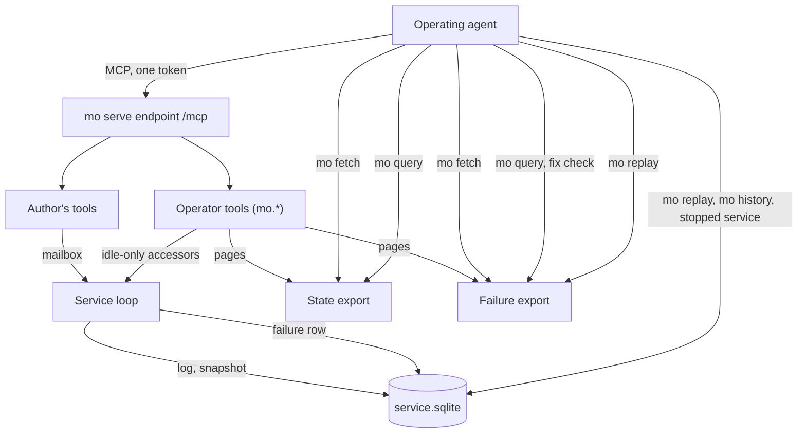
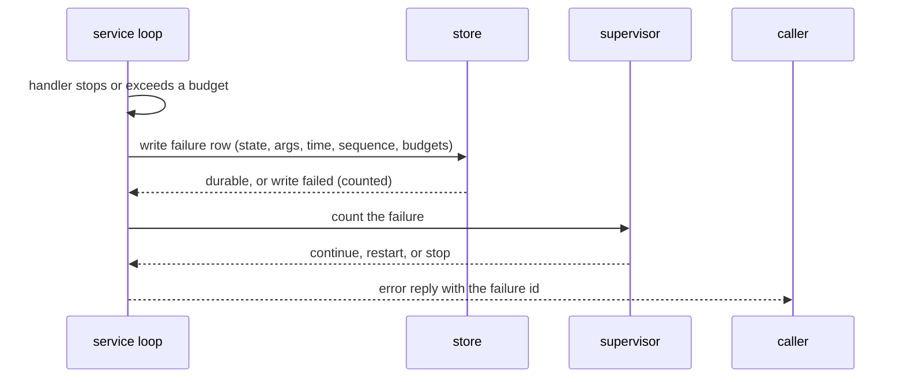

# Phase 4, Agents Can See Inside It - Plan

## Goal Capsule

- **Objective:** An agent operating a running Mo service can see what it is doing, answer questions its author wrote no tool for from an export of its state, and re-run a saved failure exactly; the repository records fresh agents having done so against seeded failures; and Mo v0.1 is released on that evidence.
- **Means:** Six milestones in a fixed order, each its own brainstorm, plan and pull requests (KTD7): built-in operator tools on the service's MCP endpoint feeding files that `mo` reads (KTD1, KTD2), a failure record in the store (KTD3), read-only access to a data folder (KTD4), replay through the service's own execution path and the fix check as the query command over a saved failure under the same budgets (KTD5), and an evaluation harness around the MCP clients agents already use (KTD6).
- **Authority:** `docs/reference/README.md`, then `docs/design/architecture.md`, `docs/design/services.md` and `AGENTS.md`, then this plan. The Product Contract fixes the phase's outcomes, boundaries and order; the Planning Contract fixes the how at milestone altitude; each milestone's own plan fixes its names, formats and limits within both. Phases 5 to 8 are not active scope.
- **Stop conditions:** Stop and report if any of these turns out true:
  - a baseline scenario still leaves less room than its predicted margin after one hardening and rerun (R21);
  - the pinned export copy for the task queue's largest state does not fit beside the service's process memory under any limit the design step is willing to name (KTD1);
  - replay through the service path fails to reproduce a seeded defect on the unmodified runtime (KTD5);
  - the work needs a new store `user_version`, a change to the shape of the three `mo serve:` stderr lines (R12), or a rule change in the language reference (R27).
- **Execution profile:** Deep. Six implementation units, one per milestone, in order; each unit ships as its own pull request or series after its own brainstorm and plan, and starts when the unit before it is done as its Definition of Done line says.
- **Finishing:** Each milestone's implementer opens pull requests from the repository template with `bash ci/check.sh gcc`'s last line, and `bash ci/check.sh drivers static` after editing the guide, the reference or the library map. Robert reviews and merges, approves the design document, runs the two evaluation rounds, and tags v0.1.
- **Open blockers:** None.

---

## Product Contract

Product Contract preservation: changed: R16 — the query command also accepts a saved failure, from a failure export or a stopped service's data folder, so a fixed handler can be checked against the failure it is meant to fix (the step F1 and F2 end in); AE9 and the last step of F1 and F2 added for it. R18 and R19 — the state-type check and the recorded budgets apply to a query over a saved failure, so a fix check cannot pass a handler the service would still stop. R11 — a write the store refuses is reported, not retried. R13 — a timer failing on every tick does not evict the first failure of another kind. All other R, A, F, AE and Key Decision meaning and IDs unchanged.

### Summary

Phase 4 gives a running Mo service a set of built-in operator tools on the MCP endpoint it already has, makes the service save every failing message, and adds `mo` commands that fetch an export to a file, replay a saved failure, run a query over an exported state or a saved failure, and read a stopped service's history from its files. An evaluation in the style of the learnability test measures fresh agents against seeded failures before any instrument exists and again when all of them do. The phase closes on that evaluation and ships v0.1.

### Problem Frame

Mo's thesis is that agents can see inside a running system, diagnose it and evolve it. Phase 3 built the service runtime, but the only instruments an agent has are three stable `mo serve:` stderr lines, a defect report, and whatever tools the service's author declared. The saved data is private to the service's owner in a private format, and while the service runs nothing else can open it.

Nothing in the repository shows an agent having diagnosed a running service, because Phase 3 closed on programs with models of their own: the recovery check in `mo test` compares saved encodings, and the kill loop reconciles jobs from replies. The need Phase 4 serves is the thesis, not yet an observation, and the first public release rests on it.

Two facts shape what is possible. Service handlers are pure: they take the state, the message's arrival time and the arguments, and return the new state and a reply, so re-running a message exactly needs the state before it, the message and its time, and nothing else. But only committed state changes reach the log today; a failed message is reported to stderr and then gone, so a failure cannot be replayed until the service keeps it.

### Key Decisions

- **All three promises ship in v0.1: live views, queries over an export of the live state, and exact replay of failures.** (session-settled: user-directed — chosen over dropping live queries, replay or live views: v0.1 without any one of them is not worth calling a release.) Governs R5, R7, R11, R14, R16.
- **Live views come from the running process through its existing MCP endpoint as built-in operator tools; replay is a `mo` command over the data folder or a failure export, with the program.** (session-settled: user-approved — chosen over everything through the endpoint and over everything as host commands: a stopped service has no endpoint to ask, and a running service's data file cannot be opened by another process.) Governs R5, R7, R14, R17.
- **The service's one token grants the operator views.** (session-settled: user-directed — chosen over a separate operator token and over loopback-only views: a service has one caller in Phase 3's model, and the `service` block stays as it is.) Governs R8.
- **The phase closes on checks, an agent evaluation against a baseline, and the release.** (session-settled: user-approved — chosen over checks only and over leaving the release as a separate decision: the claim is about agents, so it needs agent evidence.) Governs R4, R20 to R25.
- **Queries run beside the service: an operator tool exports the state, and the agent's own `mo` runs any pure Mo function over it.** (session-settled: user-approved — chosen over running caller code inside the service and over a selection notation: nothing a caller writes runs in the service, and the machinery is shared with replay.) Governs R7, R16.
- **Substrate first, measured first.** (session-settled: user-approved — chosen over one milestone per promise and over substrate first with the evaluation last: the baseline has to run anyway, and running it first turns the need into an observation before any instrument is built.) Governs R1, R21.
- **One design document for the phase, extended by each milestone.** `docs/design/services.md` grew that way through Phase 3, and the roadmap says every phase begins with a design step for anything a Mo user would notice. Governs R2.
- **Phase 4 adds no rule to the language reference.** Reference section 15 says the later phases change none; Phase 4 adds commands, tools and documents. Governs R27.
- **The failure record covers what the supervisor counts as a failure, for tools and timers alike, and not application `Error` replies.** D308 defines a failed message as a handler that crashed or went over budget; a returned `Error(...)` is a normal reply. Governs R11.
- **The evaluation's seeded failures live in deliberately broken variants of the task queue, kept apart from the served program.** The served queue stays correct, and the variants are the fixtures every round reuses. Governs R23.

### Requirements

**Phase shape**

- R1. Phase 4 runs as six milestones in this order: the design step, the baseline round, the operator door, the failure record, `mo` over the files, and the final round with the release.
- R2. The design step writes one design document for the phase, holding everything a Mo user would notice, and each later milestone extends that document rather than starting its own.
- R3. Each milestone gets its own brainstorm and plan, which decide its names, formats and limits within this overview.
- R4. Milestones 3 to 5 prove themselves with checks in `ci/check.sh` before the next milestone starts, as Phase 3's did; milestones 1 and 2 pass on Robert's approval of the design document and on the recorded baseline results.

**The operator door**

- R5. A running service answers built-in operator tools on its existing MCP endpoint, beside the tools its author declared.
- R6. The operator tools show the service's processes, its current state, its mailbox, its pending timers, memory used and peak, the supervisor's failures, restarts and stops, and the messages committed since the last snapshot.
- R7. One operator tool exports the current state in its saved encoding, and another exports one saved failure with the state it ran against, its message and its arrival time; both exports are tied to the program that wrote them.
- R8. The operator tools answer to the service's one token and to nothing else; a wrong or missing token gets the same refusal as the author's tools.
- R9. No operator tool, export, record or report ever contains the service's token, the one secret value a service holds; state and arguments are the author's data and are shown as they are.
- R10. An operator tool never changes the state, never enters the log, and never counts as a message for the supervisor.

**The failure record**

- R11. The service saves every failed message, meaning a tool call or timer firing the supervisor counts as a failure, with the state it ran against in its saved encoding, its arguments, its arrival time and its position in the log, so a saved failure stays replayable after later snapshots; a write the store refuses is reported, not retried.
- R12. The operator tools show saved failures, and the three `mo serve:` stderr lines keep their stable shape.
- R13. A named limit caps how many failures a service keeps and the bytes they hold, and the oldest go first, except that a timer failing on every tick does not evict the first failure of another kind.

**`mo` over the files**

- R14. A `mo` command replays one saved failure, taken from a data folder or from a failure export, with its program, and reports the stop in source terms: the message, the state before it, the stack with its spans, and the stopping frame's variables.
- R15. Replay is exact: it runs the handler the live run ran on the same state, message and arrival time, so it reaches the same outcome, and a different outcome is reported as such; a memory-over-budget failure may not reproduce, because the record does not keep the mailbox, and is reported as not reproduced.
- R16. A `mo` command runs a pure Mo function from a program over an exported state, or over a saved failure's state with that failure's arrival time and arguments, taken from a failure export or from a stopped service's data folder, and prints the result; a function that takes a capability is refused by the checker.
- R17. A `mo` command reads a stopped service's data folder and shows its history, the same views the operator tools draw from the log and the saved failures, without starting the service.
- R18. Replay and history refuse a data folder written by a different program, with the diagnostic recovery already uses; a query refuses an export or a saved failure only when its state type differs from the query program's state type, checked through the saved encoding's schema, so a program that only adds query functions is accepted.
- R19. History and a query over a state export run under named limits for work and memory, as `mo test` does; replay and a query over a saved failure run under the work and memory budgets the failure recorded, with the service's saved-copy size check on any new state, so a budget or size stop reproduces and a fix check passes only when the fixed handler fits the budget the live run had.

**The evaluation**

- R20. The design step writes the evaluation protocol in the manner of `learnability/protocol.md`: the scenarios, how a diagnosis is graded, the rule for comparing the final round with the baseline, and predictions written before any round runs. It sets the number of sessions per scenario and family with `learnability/wilson.py --size`, so the predicted margin is distinguishable from chance, and says whether a point-estimate pass closes the phase.
- R21. The baseline round runs after the design step and before any instrument exists: fresh agents from at least two model families diagnose the seeded failures with today's instruments only, meaning the `mo serve:` stderr lines with their defect reports, the author's tools, and the host's own tools such as systemd. A scenario the baseline solves at a rate that leaves less room than its predicted margin is hardened, with a failure today's defect report does not explain, and the baseline runs again before milestone 3.
- R22. The final round repeats the scenarios with every instrument in place, on the same frozen model versions and agent settings as the baseline, and the phase closes only when its result meets the prediction the protocol set for it; a miss is recorded as written and becomes the next work.
- R23. Seeded failures are handler bugs or work-budget failures and live in deliberately broken variants of the task queue kept apart from the served program, and every round keeps its prompts, transcripts, gradings and failures as the learnability rounds do.
- R24. The scenarios between them exercise all three promises: a live view, a query the author's tools cannot answer, and a replay of a saved failure.

**The release**

- R25. v0.1 is released when the final round passes: the README's pre-release status, the build and install instructions and what v0.1 promises are rewritten to match, and `docs/ROADMAP.md` ticks Phase 4.
- R26. The agent guide gains each milestone's commands and tools in the PR that ships them, with `guide_claims` covering each claim.
- R27. Phase 4 adds no rule to the language reference; the reference's section 15 line on Phase 4 is rewritten when the phase closes.

### Milestones

Each milestone is one brainstorm and one plan. The order is fixed; a milestone starts when the one before it is done as its line below says.

1. **The design step.** Writes the phase's design document and the evaluation protocol, and says what each later milestone will add to the agent guide. Covers R2, R20, R24. Done when Robert approves the design document and the predictions are written.
2. **The baseline round.** Fresh agents diagnose the seeded failures with today's instruments, as R21 lists them. Covers R21, R23. Done when the round's results are recorded with their intervals, failures included, and every scenario leaves the room R21 requires, after hardening and a rerun where it did not.
3. **The operator door.** Built-in operator tools on the endpoint, the state export among them. Covers R5 to R10. Done when a `drivers` check calls every operator tool against a running task queue and a wrong token is refused.
4. **The failure record.** The service saves failing messages and shows them. Covers R11 to R13. Done when a seeded failure is saved and visible and every service's recovery check still passes.
5. **`mo` over the files.** Replay, query and history as `mo` commands. Covers R14 to R19. Done when replaying each seeded failure reproduces its defect and the query and history commands have `drivers` checks.
6. **The final round and the release.** The scenarios run again with every instrument, and v0.1 ships on the result. Covers R22, R25 to R27. Done when the round meets its prediction, the README and roadmap say so, and the release is tagged.

### Actors

- A1. The operating agent: a coding agent (Claude Code or Codex, started by Robert) that has the service's program and the same `mo` build, and holds the service's token.
- A2. The service: a program with a `service` block run by `mo serve`, on the same machine as A1 or behind a proxy.
- A3. The evaluation agents: fresh sessions from at least two model families, given a scenario and the instruments the round allows.
- A4. Robert: reviews each milestone, approves the design document, runs the evaluation rounds, and decides the release.

### Key Flows

- F1. Diagnosing a live service
  - **Trigger:** A1 sees a `mo serve: failure:` line, or a saved failure in the operator views.
  - **Steps:** A1 calls the operator tools for the supervisor history, the saved failures and the state; exports the state and runs a query over it with `mo`; exports the saved failure, replays it with `mo` and reads the stop in source terms; fixes the handler; runs the fixed handler on the failure export with the query command to check the fix. A wrong reply that the supervisor did not count as a failure is diagnosed with the views, a query and the pure handler itself, with nothing to replay.
  - **Covered by:** R5 to R8, R11, R14, R16.
- F2. A stopped service
  - **Trigger:** `mo serve` exited with status 69 after three restarts.
  - **Steps:** The endpoint is gone, so A1 reads the data folder with `mo`: the history, the saved failures, then a replay of the last one; A1 fixes the handler, checks the fix on that failure with the query command, and starts the fixed program on a fresh data folder, as the agent guide says.
  - **Covered by:** R14, R16, R17, R18.
- F3. A question no tool answers
  - **Trigger:** A1 needs a fact about the state the author's tools do not expose.
  - **Steps:** A1 exports the state, writes a pure function over the state type, and runs it with `mo` against the export; the result is over the state as it was at export time.
  - **Covered by:** R7, R16, R18.
- F4. An evaluation round
  - **Trigger:** The design step is approved (baseline) or milestone 5 has passed its checks (final).
  - **Steps:** A4 starts the number of fresh sessions per scenario and family the protocol set, with the instruments the round allows; `mo` and the protocol's graders grade each diagnosis; results are recorded with intervals against the written predictions.
  - **Covered by:** R20 to R24.

### Acceptance Examples

- AE1. **Covers R8.** Given a running service, when an operator tool is called with a wrong or missing token, then the reply is the same refusal the author's tools give.
- AE2. **Covers R11.** Given a handler that stops on a message, when the message fails, then the service saves its arguments, arrival time and log position; given a handler that returns `Error(...)`, when it does, then nothing is saved.
- AE3. **Covers R10.** Given a service with an empty log since its last snapshot, when every operator tool is called, then the log is still empty and the supervisor's counts are unchanged.
- AE4. **Covers R14, R15.** Given a saved failure, when `mo` replays it from the data folder or from a failure export with the program, then the report names the same stopping span and the same variables the live defect report had.
- AE5. **Covers R16, R18.** Given an export of a service's state, when `mo` is asked to query it with the service's program plus a new query function, then the query runs; given the same export, when `mo` is asked to query it with a program whose state type differs, then it is refused with the diagnostic recovery gives for a different program.
- AE6. **Covers R17.** Given a service that exited with status 69, when `mo` reads its data folder, then it shows the history and the saved failures and starts no service.
- AE7. **Covers R16.** Given a query function whose signature takes a capability, when `mo` is asked to run it over an export, then the checker refuses it.
- AE8. **Covers R22.** Given a final round whose result falls short of its prediction, when the round ends, then the phase stays open, the result is recorded as written, and the shortfall is the next work.
- AE9. **Covers R16, R19.** Given a saved failure, from a failure export or from the data folder of a service that exited with status 69, and the service's program with the failing handler fixed, when the query command runs the fixed handler on it, then it prints the handler's reply and new state instead of the stop; given a work-budget failure and a handler that still exceeds the recorded budget, when the query command runs it, then it reports the budget stop.

### Success Criteria

- The final round beats the baseline round on the protocol's measure by the margin the design step predicted, with Wilson intervals as `learnability/wilson.py` computes them.
- Every milestone's checks run in `ci/check.sh`, and a skipped check is reported as skipped, never as a pass.
- Each milestone's brainstorm starts from this plan without re-deciding posture, trust, query placement, order, export delivery or the fix check.

### Scope Boundaries

Deferred for later:

- Running a query inside the service's process, in one round trip over the freshest state.
- Replaying a committed message by its log position, for a wrong reply the supervisor did not count as a failure; it would need a live service to export its log as well as its state.
- A separate operator credential or any notion of roles.
- Keeping history further back than the last snapshot, unless the design step decides v0.1 needs it.
- Recording capability calls at the dispatch point for replay; handlers are pure, so the hook in `docs/design/architecture.md` section 9 waits for a phase that gives handlers effects.
- Timing and profiling views (Phase 7).
- The three items Phase 3 parked, pulled in only if a milestone needs them: unattended first starts after a SIGKILL during a folder's first start, supervisor event logging for the protocol server, and the poll loop spinning when descriptors run out.

Considered and not built:

- A second MCP path on the same port and token for the operator tools, so worker agents' `tools/list` would not carry them. The one-token decision already makes every token holder an operator, and one path keeps one catalog; milestone 3 records how many bytes the operator tools add to the task queue's `tools/list` reply beside its own catalog, which is the evidence that would change this.
- Relaxing a scenario's final-round gate to "no worse than the baseline" when the baseline is at ceiling; R21 hardens the scenario instead, because a relaxed gate weakens the agent evidence the phase closes on.
- A TLS client in Mo so the fetch command could pull exports from a proxied service; a loopback-only fetch keeps the token off the wire with no new dependency, and a service operated only by agents that cannot reach its host over ssh is the evidence that would change this.

Outside this phase:

- Live upgrades and state migrations (Phase 5), approving and locking promises (Phase 6), a multi-core scheduler and messages between processes.
- A query notation of its own; queries are Mo functions.
- Any change to a rule in the language reference.
- Deployment, uptime targets, or any gate measured in elapsed time.
- Changing the task queue's served tools.
- Dashboards or any human-facing interface; the audience is agents, over MCP and the command line.
- Whether the repository accepts contributions at v0.1; Robert decides that outside this plan.

<!-- ce-section: work-relationships -->
### How This Work Fits Together

This plan covers the Phase 4 overview: its outcomes, boundaries, order, and the technical decisions every milestone shares. The breakdown below is the current understanding, not a committed roadmap; each milestone's own brainstorm may revise, split or merge it and cite this plan.

- The six milestones under Milestones above, each separately brainstormed and planned, in order.
  - The operator door — Enables the failure record's views and `mo` over the files; Shares the saved-value codec and the image key with recovery; Creates the export file shape and the fetch command (KTD1).
  - The failure record — Depends on the operator door for its views; Enables replay; Creates the failure table and its record shape (KTD3).
  - `mo` over the files — Depends on the failure record and the exports; Shares one loader, decoder and evaluator across replay, query and history; Creates the read-only store open (KTD4).
  - The baseline and final rounds — Share one protocol, one harness extension and one set of seeded variants (KTD6); Can proceed independently of the instruments' internals.
- Phase 5, typed live upgrades — Depends on the state export and views, which are what an upgrade check against real state reads; Still to decide whether Phase 4's export is the form Phase 5 migrates from.
- Phase 7, fast — Still to decide whether in-process queries and profiling views belong there.

### Dependencies / Assumptions

- No agent has yet needed to see inside a running Mo service; the baseline round tests whether the need is real and what today's instruments cost.
- The operating agent has the service's program and the same `mo` build; without them the export and the data folder are unreadable by design.
- Replay needs no recording of effects because handlers are pure; a phase that gives handlers effects revisits this.
- History bounded to the records since the last snapshot is enough for v0.1 unless the design step finds otherwise.
- The task queue, `services/task-queue/main.mo`, is the evaluation's service; its variants are new fixtures.
- A baseline that already solves a scenario means the scenario is revised, never the three promises.
- The exports, replay and history need the agent on the service's machine, fetching over loopback or reading the folder as its owner; a service reached only through a proxy offers the operator tools alone.
- Robert approves the design document, runs the evaluation rounds, and decides the release and the contributions policy.

### Outstanding Questions

Resolve Before Planning: none.

Deferred to the milestone plans:

- The names of the operator tools, the fetch, replay, query and history commands, and the export file's extension (U3, U5).
- The values of the named limits: saved failures by count and bytes, the pinned export copy, the event ring, and the page size (U3, U4).
- Whether the log keeps records past the last snapshot for history, and at what cost to the store format the three build milestones share (U1).
- The eviction rule for a timer that fails on every tick, so the first failure of a kind is not the first evicted (U4).
- How the protocol grades "found and fixed" beyond the mechanical fix check, and the predicted margin over the baseline (U1).
- Whether any of the three parked Phase 3 items is needed by a milestone.

### Sources

- `README.md`: the three promises, and the pre-release status v0.1 changes.
- `docs/ROADMAP.md`: the phase table, Phase 4 as current, and the parked items.
- `docs/design/architecture.md` section 9: the hooks left for Phase 4, including the capability dispatch point.
- `docs/design/bytecode.md` sections 3.4 and 8: debug information and the structural text form.
- `docs/design/services.md` sections 4, 6, 7, 8 and 10, and the `mo serve` event-line format: pure handlers, the log and snapshots, the token, failures and the supervisor, and Phase 3's finish line.
- `docs/agent-guide.md`, "Run a service": what an agent can do with a service today, including after status 69.
- `docs/status/phase3-run.md` and `docs/plans/2026-11-02-1853-feat-phase3-recovery-checks-plan.md`: how Phase 3 closed, and what it deferred to Phase 4.
- `src/base/limits.h`: the per-message budgets and supervisor limits a query or replay inherits.
- `learnability/README.md` and `learnability/protocol.md`: the evaluation shape the rounds follow.

---

## Planning Contract

### Key Technical Decisions

- KTD1. **An export reaches the agent as a file through a `mo` command that fetches it from the endpoint.** An MCP reply is capped at `MO_LIMIT_MCP_RESPONSE_BYTES` (32 KiB), carries each value twice, and lands in the model's context when the agent uses `claude mcp add` or `codex mcp add`, while a state can reach `MO_LIMIT_SAVED_BYTES` (16 MiB). The command reads the token from the environment variable the `service` block names and pages against a copy the service pins at one log sequence; every page comes from that copy whatever the log does afterwards, so a fetch on a service that commits every minute still finishes, and the pin is released when the fetch completes, when a newer export replaces it, or after a named idle limit, with a page request for a released pin refused rather than stitched. The copy lives outside the handlers' message memory under its own named limit, so an export can never push a handler over budget (R10), and pages use a rate bucket of their own. The command creates the file with mode 0600 under a temporary umask, as `mo serve` creates `service.sqlite`. A curl loop, a raised reply ceiling and paging through the model's context were weighed; none survives the fact that the client puts replies in context, so the choice did not need a bake-off. The command sends the token only over plain HTTP to a loopback address (127.0.0.1, ::1 or localhost) and refuses any other URL before opening a connection, since `mo` has no TLS client; a remote agent runs it on the service's machine, over ssh. Governs R7, R16, F3; U3 creates the shape, U5 consumes it.
- KTD2. **Operator tools are one view per tool plus one overview tool, dispatched before the mailbox, with names outside Mo identifier syntax.** Names take a `mo-` prefix, which no Mo identifier can carry and which the Claude and OpenAI tool-name rules (letters, digits, `_` and `-`) accept unchanged, so the reference gains no rule (R27) and no client rewrites a name into one an author could also use; they are listed after the author's tools on the same `/mcp` path, carry `readOnlyHint` and `idempotentHint` annotations, and describe their result shape and size behaviour to the task queue's `##` standard. The server answers them from `mo_service_state` and new `vm.h` accessors while the service is idle, never through `mo_service_send`, so they cannot fill the mailbox or count for the supervisor (R10). Their JSON shaping lives in embedded Mo beside `runtime/mcp.mo`, as `docs/design/implementation.md` condition 4 requires. A view that would exceed the reply ceiling truncates and names the export instead of failing. Governs R5, R6, R8, R10; U3.
- KTD3. **A saved failure is two framed records under one failure id in a new store table, written in one transaction at the failure call site before the reply and before the supervisor counts it.** One record holds the state it ran against in its saved encoding; the other holds the failure's kind, its tool or timer, the arrival time, the arguments, the log sequence and the work and memory budgets in force, so each record stays within `MO_LIMIT_SAVED_BYTES` and the store's row limit holds. The id appears in the indented report after the stable stderr line, which keeps its shape (R12). Adding a table keeps `user_version` and older binaries' refusal rules unchanged. A write the store refuses is counted, shown in the views and never retried, and never stops or fails the service; the write for the failure that stops the service is attempted before the stop, and if the store refuses it, the stop line's report says the record is missing and the stderr report stays the only record (R11). The live views read the failure records and the log, plus a bounded in-memory ring only for events that leave no record: restarts, stops and refused writes. History over a data folder reads the records and the log alone and does not promise the ring's events. Governs R6, R11 to R13; U4.
- KTD4. **History and replay open a data folder read-only, hold the lock for milliseconds, and refuse a folder a service holds with a diagnostic that points at the operator tools.** `mo_store_open` creates tables and holds an exclusive lock today, so a reader built on it could make a systemd restart fail with exit 1, which the unit never retries. The read-only open tells a hot journal a killed service left apart from a lock a running service holds: it rolls the journal back as the next start would, then reads, and never creates a table or writes a record. `mo serve` also waits a bounded time for a busy store at start instead of failing. Governs R17, R18; U5, with the bounded wait landing in U4 if its plan finds a reader can collide with a restart before U5 exists.
- KTD5. **Replay re-executes the handler through the service's execution path under the recorded budgets; the fix check is the query command over a failure export.** Replay uses the same controlled call the live loop uses, with `MO_LIMIT_SERVICE_WORK` and the recorded memory budget, not `mo run`'s 1 GiB heap, and reports one of: reproduced, different outcome, not reproduced (memory), refused. The VM gains the ability to keep the stack at a work-budget cancellation, which it drops today, so a work-budget failure can be shown in source terms; a state too large to save is a distinct kind that must reproduce. The query command accepts a saved failure, from a failure export or a stopped service's data folder, and runs any function from a program whose state type matches through the schema; over a saved failure it uses the same controlled call as replay, under the recorded budgets and the saved-copy size check, so a fix check passes only when the fixed handler fits what the live run had (R19, AE9), while a query over a state export keeps the `mo test`-style limits. Command output follows `mo test --json`: one object per line, versioned, exit status last; history JSON has the same shape as the views' results, so a check can compare the two. Governs R14 to R16, R19; U5, with the stack capture and the budget fields designed in U1 so U2 picks scenarios that can replay.
- KTD6. **The evaluation harness drives the native MCP clients agents really use, records their traffic, and freezes the same models in both rounds.** `learnability/harness/` records only `mo` invocations and gives sessions no network, so the rounds need a per-session `mo serve` on a seeded variant and a client registration step; a loopback recorder for MCP traffic is built only if U1 finds a client whose transcript does not show its MCP calls. The same client setup runs in both rounds. Both rounds grade the diagnosis and the fix by the same rule, mechanically where possible by running the fixed handler on the saved failure; instrument use is read from the transcript and counts only toward R24's coverage of the three promises, never toward the pass rate the rounds are compared on. Governs R20 to R24; U1 designs it, U2 builds it, U6 reuses it.
- KTD7. **This plan is written at milestone altitude: six units, one per milestone.** (session-settled: user-approved — chosen over file-level depth for the whole phase and over full depth for milestone 1 only: each milestone gets its own brainstorm and plan.) Governs R1, R3 and the Implementation Units' shape.

### High-Level Technical Design

Three shapes carry the phase: what talks to what, how an export leaves a running service, and the order a failure is recorded in.



```mermaid
sequenceDiagram
  participant M as mo fetch
  participant E as mo serve
  participant L as service loop
  M->>E: export request (token)
  E->>L: pin encoded copy at log sequence N
  E-->>M: page 1 of K, sequence N
  M->>E: page 2 (sequence N)
  E-->>M: page 2 of K
  Note over E,L: a commit moves the log to N+1; the pinned copy is unchanged
  M->>E: page 3 (sequence N)
  E-->>M: page 3 of K, still sequence N
  Note over E,L: the pin is released when the fetch completes, a newer export replaces it, or an idle limit passes
  M->>E: page 4 (sequence N) after the pin is gone
  E-->>M: refused: export released, start again
```



### Assumptions

- The schema the saved encoding writes names records, choices, cases and fields; whether those names are module-qualified is unverified, so U5 tests a query module that `use`s the service module before fixing the acceptance rule (R18).
- A pinned export copy of the task queue's largest state fits beside the live state within a limit the design step names; if it does not, the stop condition in the Goal Capsule applies.
- The native MCP clients' own transcripts show the MCP calls a session made; U1 confirms this before U2 freezes a round, and builds the loopback recorder of KTD6 only for a client whose transcript does not.
- The three `mo serve:` stderr lines keep their shape; the failure id travels in the indented report after a line, which the stable-shape promise does not cover.

### System-Wide Impact

- Every service's `tools/list` changes: operator tools appear for every token holder, including the task queue's worker agents, and the catalog goldens in `tests/cli/` and `ci/check_cli.py` move.
- The store format gains a table; recovery, the recovery check, the kill loop and the saved-data fuzz targets must keep passing with it present and absent.
- The token becomes an operator credential in practice; `docs/agent-guide.md` and `docs/ops/task-queue.md` say so, and the runbook says a data folder is read or copied only while the service is stopped, that failure records keep copies of past state and arguments beyond the last snapshot until evicted, and how an operator clears them.
- Replay and the views are a new path for restored bytes, so `docs/design/sandbox-properties.md` P11 gains the export reader and the failure record as covered inputs, and `fuzz/` gains targets for both.

### Risks

| Risk | Mitigation |
| --- | --- |
| The baseline already solves the replay scenario, since the defect report on stderr carries the stopping span and variables | R21's hardening rule; U1 seeds work-budget failures, which print no report today |
| A work-budget failure cannot be replayed with a stack because the VM drops it at cancellation | U1 designs the capture; U2's scenarios include one only if U1 confirms the design; otherwise the scenario is a defect |
| The failure row's write cost on a hot path, up to 16 MiB under `synchronous=EXTRA`, slows a failing service | The named byte limit (R13) and the stop condition on budgets; U4 measures the write in the kill loop |
| The image key refuses the agent's own `mo` build when it differs from the server's | Exports name the `mo` commit and the entry file (U3); the guide says to use the same build |
| The rounds' transcripts hold the token and exported state, and learnability logs ship as a public release asset | U2's freeze names a per-round token discarded after the round; the token check from `docs/status/phase3-run.md` runs before any log is published |
| Worker agents' context fills with operator tool descriptions | Short descriptions; the final round's transcripts measure the cost; the considered-not-built second path is the fallback |

### Documentation Plan

- U1: `docs/design/introspection.md` (working name, Robert names it) with the shape of `docs/design/services.md`; `docs/reference/README.md` section 15 corrected for Phase 3 and 4; `docs/design/architecture.md` section 9's "recording for replay" sentence revised; `docs/ROADMAP.md` "Now" carries the six milestones as its checklist; the evaluation protocol under `learnability/`.
- U3 to U5: `docs/agent-guide.md` gains each milestone's tools and commands in the PR that ships them, with `guide_claims` and `serve_guide` in `ci/check_cli.py` updated in the same PR (R26); the reference's section 13.4 lists each new command and its exit statuses; `tests/conformance/reference.tsv` gains rows for every new reference block.
- U4: `docs/design/saved-state.md` gains the failure row; `docs/design/sandbox-properties.md` gains the new restored-bytes inputs.
- U6: `README.md` status and install, `docs/ops/task-queue.md` (token as operator credential, stopped-folder rule), `docs/status/phase4-run.md` with both rounds' predictions and results.

---

## Implementation Units

Each unit is one milestone and ships as its own pull request or series after its own brainstorm and plan; it waits on the merge of the unit before it. Files are the areas a milestone touches; its own plan names the exact files and test paths.

### U1. The design step

- **Goal:** One design document and one evaluation protocol that fix what a Mo user will notice in milestones 3 to 6, with predictions written before any round runs.
- **Requirements:** R2, R20, R24, R27; KTD1 to KTD6 are its sections; Key Decision "One design document for the phase".
- **Dependencies:** None.
- **Files:** `docs/design/introspection.md` (new), `docs/reference/README.md` (section 15), `docs/design/architecture.md` (section 9), `docs/ROADMAP.md`, `learnability/phase4/protocol.md` (new, or a section of `learnability/protocol.md`), `tests/conformance/reference.tsv`.
- **Approach:**
  1. Write the design document with one section per shared decision: the operator tools and their names, the export file and the fetch command (KTD1), the failure row and the store table (KTD3), the read-only open (KTD4), the replay statuses, JSON shapes and the fix check (KTD5), and history depth past the last snapshot, decided here with the evidence that today's history can be seconds of traffic.
  2. Write the evaluation protocol: the scenarios, one per promise at least (R24), with work-budget failures only if the stack capture in KTD5 is designed; the grading rule, mechanical where the fix check allows; the comparison rule and session count from `learnability/wilson.py --size`; the harness extension (KTD6); and the predictions for both rounds.
  3. Fix the stale lines in the reference and the architecture document, and put the six milestones into the roadmap's "Now" section as its checklist.
- **Patterns to follow:** `docs/design/services.md`'s numbered sections, "Settled" and "Done means"; `learnability/protocol.md` sections 1, 2, 7 and 8; `docs/status/phase3-run.md`'s predictions-first record.
- **Test scenarios:** Test expectation: none — a documents-only milestone; `bash ci/check.sh drivers static` must pass after the reference edit, and `ci/check_conformance.py` must accept every new or changed reference block.
- **Verification:** Robert approves the design document; the predictions are committed before U2 starts; the reference and conformance checks pass.

### U2. The baseline round

- **Goal:** Fresh agents from two families diagnose the seeded failures with today's instruments, and the results, with intervals, say how much room each scenario leaves.
- **Requirements:** R21, R23; KTD6; Key Decision "seeded failures live in variants".
- **Dependencies:** U1 (merge, and Robert's approval of the design document).
- **Files:** `learnability/harness/` (per-session `mo serve`, client registration, loopback MCP recorder), `learnability/phase4-round-1/` (`freeze.md`, prompts, scenarios, gradings, `results.md`, `notes.md`), `learnability/phase4/variants/` (seeded task-queue variants, kept apart from `services/task-queue/`), `docs/status/phase4-run.md`.
- **Approach:**
  1. Extend the harness so a session gets a running variant, a token minted for the round, and the frozen `mo` build, and so every MCP call the session makes is recorded beside its `mo` invocations.
  2. Freeze the round as `learnability/protocol.md` section 1 requires, naming the models and settings U6 must reuse.
  3. Run the sessions, grade them, record every rate with its interval against U1's predictions, and apply R21's hardening rule before U3 starts.
- **Patterns to follow:** `learnability/harness/session.py` and its `README.md`; `learnability/bench-v0-round-1/` for the folder layout; `ci/check_task_queue.py` for starting `mo serve` on port 0 and reading its listening line.
- **Test scenarios:**
  - A session's MCP calls to the variant appear in its log in order, with the `mo` invocations the harness already records.
  - A session that ends without its files is graded as a fail and is not rerun (protocol section 2).
  - The seeded failure of each variant fires under the scenario's driver before any session starts, as a fixture check.
  - The round's token appears in no committed file and no published log (the check from `docs/status/phase3-run.md`).
- **Verification:** `results.md` holds every scenario's rate with its interval and the prediction beside it; any scenario under R21's rule is hardened and rerun, and `notes.md` says so.

### U3. The operator door

- **Goal:** A running service answers the operator tools and serves a state export that `mo fetch` (working name) writes to a file.
- **Requirements:** R5 to R10; KTD1, KTD2; AE1, AE3; F1, F3.
- **Dependencies:** U2 (merge; the baseline's hardening rule is met).
- **Files:** `src/tools/protocol-descriptor.c`, `src/tools/protocol-call.c`, `src/tools/protocol-server.c` and `.h`, `src/tools/protocol.c`, `runtime/mcp.mo`, `runtime/mcp-rpc.mo`, `runtime/mcp-transport.mo`, a new runtime module for the views, `src/vm/vm.h`, `src/vm/service.c`, `src/base/limits.h`, `src/tools/cli.c`, `src/tools/execute.c`, `src/tools/tools.h` (the fetch command), `tests/test_protocol_server.c`, `tests/test_service_runtime.c`, `tests/cli/` goldens, `ci/check_cli.py`, a new `ci/check_operator.py` in the `drivers` group, `docs/agent-guide.md`, `docs/design/introspection.md`.
- **Approach:**
  1. Add the `vm.h` accessors the views need (mailbox contents and arrival times, timers, failure and restart windows, the commit sequence, the service process) and a bounded event ring, reading them only while the loop is idle.
  2. Build the operator catalog beside the author's catalog from the descriptor, list it after the author's tools, and dispatch operator calls before `mo_service_send` (KTD2).
  3. Add the pinned export copy with its named limit, idle limit and page shape, and the fetch command that assembles a file from pages served from the pinned copy and refuses a page whose pin is gone (KTD1); the failure export reuses the same path once U4's records exist.
  4. Bound every view's reply; the state view truncates and names the export.
- **Patterns to follow:** `mo_protocol_catalog` in `src/tools/protocol-call.c` and `Mcp.prepare` in `runtime/mcp.mo` for catalog paging and the response ceiling; `services/task-queue/main.mo`'s `##` comments for descriptions; `src/tools/cli.c`'s command and flag tables; `ci/check_task_queue.py` for the loopback check; `docs/status/agent-mistakes.md` row 8 for named limits on every input.
- **Test scenarios:**
  - Covers AE1. A wrong or missing token on an operator tool gets the same 401 the author's tools give.
  - Covers AE3. Calling every operator tool on a service with an empty log since its snapshot leaves the log empty and the failure and restart counts unchanged.
  - Every operator tool answers while the mailbox is full, and immediately after a handler stops at its work budget and before the next message, since reads are idle-only (KTD2).
  - A view whose result would exceed the reply ceiling returns a truncated result naming the export, never the `response_limit` error.
  - A fetch of a state larger than one reply produces a file the saved-value decoder accepts; a commit between two pages still yields the state at the pinned sequence, and a pin replaced by a newer export makes the fetch refuse and start again.
  - A fetched state export and a fetched failure export are both created with mode 0600.
  - A fetch with the wrong token writes no file and exits with the command's refusal status.
  - A fetch to a non-loopback URL sends no bytes and exits with the command's refusal status.
  - The bytes the operator tools add to the task queue's `tools/list` reply are recorded beside its own catalog's size.
  - `tools/list` pins the operator tools' names, order, descriptions and annotations in a golden; `guide_claims` runs each new guide claim.
  - The export names the `mo` commit and the entry file, and a different build's `mo` refuses it with the diagnostic recovery uses.
- **Verification:** `ci/check_operator.py` passes in `drivers` against the task queue; the task queue registered with Claude Code and with Codex has one operator tool called through each, so the names survive both clients; `bash ci/check.sh gcc` and the `sanitize` group pass with the guide change; the unit's plan has named the limits it added in `src/base/limits.h`.

### U4. The failure record

- **Goal:** Every failure the supervisor counts is saved with the state it ran against, shown in the views, and exportable, without changing what recovery or the three stderr lines do.
- **Requirements:** R11 to R13; KTD3; AE2; the second export of R7.
- **Dependencies:** U3 (merge; the views and the export path exist).
- **Files:** `src/host/store.c`, `src/host/host.h`, `src/base/hostops.def`, `src/vm/service.c`, `src/heap/saved.c`, `src/base/limits.h`, `src/tools/serve.c`, `docs/design/saved-state.md`, `docs/design/sandbox-properties.md`, `fuzz/fuzz_service_failure.c` (new) with `fuzz/corpus/`, `tests/test_service_store.c`, `tests/test_service_runtime.c`, `tests/test_recovery.c`, `ci/check_kill_loop.py`, `docs/agent-guide.md`, `docs/design/introspection.md`.
- **Approach:**
  1. Add the failure table and a store operation that writes a failure's two records in one transaction, keeping `user_version` and the existing tables untouched, with each record's envelope following `docs/design/saved-state.md`.
  2. Write the records at the failure site in `mo_service_step`, before the reply and before `supervise()`, with the budgets in force, and attempt the stopping failure's write before the stop; count a refused write and show it in the views.
  3. Put the failure id into the indented report after the stable line, and give timer failures their own form.
  4. Serve the failure export through U3's export path, and keep the event ring and the records consistent.
- **Patterns to follow:** `persist` and `restore_record` in `src/vm/service.c`; `mo_store_record_read` and the STOREOP rows in `src/base/hostops.def`; `fuzz/fuzz_service_log.c` as the two-line fuzz wrapper shape; LEARNINGS MO-159 ("classify by origin, not status alone": a pre-enqueue memory refusal is admission, never a recorded failure).
- **Test scenarios:**
  - Covers AE2. A handler that stops saves its two records with its arguments, arrival time, sequence, budgets and state; a handler that returns `Error(...)` saves nothing.
  - A timer that fails saves its records in the timer form with no arguments.
  - The records of the failure that stops the service are on disk before `mo serve` exits 69; when the store refuses that write, the stop line's report says the record is missing.
  - A refused write is counted and visible in the views, and the service neither stops nor fails the message a second time.
  - A failure whose state is near `MO_LIMIT_SAVED_BYTES` is saved, since each record stays within the row limit.
  - The named limits evict the oldest records by count and by bytes, and a timer failing on every tick does not evict the first failure of another kind (R13).
  - Every service's recovery check in `mo test` passes with records present, and recovery ignores the table.
  - The kill loop passes with records being written, and a kill mid-write leaves the store loadable.
  - The saved-data fuzz targets accept the new record kinds and refuse a damaged one with E1409.
- **Verification:** The unit's `drivers` and unit tests pass; `make fuzz-smoke` runs the new target; `docs/design/sandbox-properties.md` names the row as a covered input.

### U5. `mo` over the files

- **Goal:** `mo` replays a saved failure exactly, runs a query over a state or failure export, and reads a stopped service's history, under the right limits and with its own refusals.
- **Requirements:** R14 to R19; KTD4, KTD5; AE4 to AE7, AE9; F2, F3.
- **Dependencies:** U4 (merge; failure rows and the failure export exist).
- **Files:** `src/tools/cli.c`, `src/tools/execute.c`, `src/tools/tools.h`, new command sources under `src/tools/` (replay, query, history), `src/host/store.c` (read-only open), `src/vm/service.c` and `src/vm/process.c` (controlled call factored for replay; stack kept at a work-budget cancellation), `src/tools/render.c`, `src/base/codes.h` and `tests/errors/`, `src/base/limits.h`, a fuzz target for the export file reader with its corpus, `tests/test_cli.c`, `tests/test_recovery.c`, `tests/cli/` goldens, `ci/check_cli.py`, a `drivers` check for the three commands, `docs/agent-guide.md`, `docs/reference/README.md` (section 13.4), `tests/conformance/reference.tsv`, `docs/design/introspection.md`.
- **Approach:**
  1. Add the read-only store open, which rolls back a hot journal a killed service left, and the "running; use the operator tools" refusal (KTD4), and the bounded wait at `mo serve` start if U4 did not land it.
  2. Build replay on the service's controlled call with the recorded budgets, reporting reproduced, different outcome, not reproduced or refused, and keep the stack at a work-budget cancellation (KTD5).
  3. Build query over a state export, a failure export or a saved failure in a data folder, accepting a program by state-type schema (R18) and refusing a function that takes a capability; over a saved failure it runs under the recorded budgets and the saved-copy size check, which makes it the fix check (R19, AE9).
  4. Build history over a data folder from the log and the failure rows, with JSON equal to the views' shape.
  5. Add the new error codes, the reference's section 13.4 entries, the guide's claims and the goldens.
- **Patterns to follow:** `mo_recovery_replay` and `recovery_failed` in `src/tools/recovery.c` and `render.c` for re-running and reporting a sequence; `invoke` and `mo_call_controlled` in `src/vm/service.c` for budgets; `mo test --json` in the reference's section 13.4 for output; `ci/deps.sh` for which module a file reader may live in (file parsing in `host` or `heap`, image-key checks in `vm` or `tools`).
- **Test scenarios:**
  - Covers AE4. Replaying a seeded defect from a data folder and from a failure export reports the same stopping span and variables the live report had.
  - A work-budget failure replays to a report with a stack at the point the budget ran out.
  - A memory-over-budget failure that depends on the mailbox is reported as not reproduced, and a state-too-large-to-save failure reproduces.
  - Covers AE5. A query program that adds a function to the service's module runs over the export; a program with a different state type is refused.
  - Covers AE7. A query function with a capability in its signature is refused by the checker.
  - Covers AE9. The fixed handler run on the saved failure, from an export or from a data folder, prints its reply and new state; the broken handler run on it reproduces the stop; a handler still over the recorded work budget reports the budget stop.
  - Covers AE6. History on a folder whose service exited 69 shows the committed messages since the snapshot and the failure records, starts nothing, and matches the records and log the views showed before the stop.
  - History on a folder a running service holds is refused with the running-service diagnostic, and the service is unaffected.
  - A folder a SIGKILLed service left with a hot journal is read after the journal is rolled back, not refused as running.
  - A data folder from a different program is refused for replay and history with E1409's diagnostic.
  - A query module that `use`s the service module is accepted, which settles whether schema names are module-qualified.
  - The export file reader refuses a truncated or edited file, and its fuzz target has seeds.
- **Verification:** The three commands have `drivers` checks and goldens; every seeded failure replays; the reference's section 13.4 and the guide name every command, flag and exit status; `bash ci/check.sh drivers static` passes.

### U6. The final round and the release

- **Goal:** The scenarios run again with every instrument on the frozen models, the result meets the prediction, and v0.1 is released.
- **Requirements:** R22, R25 to R27; KTD6; AE8; F4.
- **Dependencies:** U5 (merge; all instruments exist).
- **Files:** `learnability/phase4-round-2/`, `docs/status/phase4-run.md`, `README.md`, `docs/ROADMAP.md`, `docs/agent-guide.md`, `docs/reference/README.md` (section 15), `docs/ops/task-queue.md`, `tests/conformance/reference.tsv`.
- **Approach:**
  1. Run the final round with U2's harness and frozen models, the guide and `tools/list` as the only instructions about the instruments, and grade with the fix check where the scenario allows.
  2. Record the result against the prediction; a miss stays open as AE8 says.
  3. On a pass, rewrite the README's status and install text, tick Phase 4 in the roadmap, correct the reference's section 15 line, update the runbook's token and stopped-folder rules, and tag v0.1.
- **Patterns to follow:** `learnability/final/results.md` for reporting; `docs/status/phase3-run.md` "Predictions against results" for the table; the Phase 3 close in `docs/ROADMAP.md` for the tick.
- **Test scenarios:**
  - Covers AE8. A round below its prediction leaves the roadmap unticked and records the shortfall as the next work.
  - Each session's transcript shows which instruments it called, and a pass that never used its scenario's instrument does not count for R24.
  - `guide_claims` and `serve_guide` pass on the final guide; `ci/check_conformance.py` accepts the section 15 change.
  - The token check from `docs/status/phase3-run.md` passes over both rounds' logs before they are published.
- **Verification:** `docs/status/phase4-run.md` holds both rounds' predictions and results; the README no longer says pre-release; the v0.1 tag exists on the merge that ticked the roadmap.

---

## Verification Contract

| Check | When | Proves |
| --- | --- | --- |
| `bash ci/check.sh gcc` | Every PR of every unit | Build and unit tests, with its last line in the PR body |
| `bash ci/check.sh drivers static` | Any PR that edits `docs/agent-guide.md`, `docs/reference/README.md` or `docs/design/library.md` (U1, U3, U4, U5, U6) | Embedded docs, `guide_claims`, `serve_guide`, goldens, conformance, errors |
| `bash ci/check.sh sanitize` with `drivers` | PRs that change the guide and C code together (U3, U4, U5) | The guide is checked against a fresh sanitize build, per the mistakes ledger |
| `make deps`, `make tidy`, `make format-check` | Every C PR | Module boundaries, discarded results, style |
| `make fuzz-smoke` | U4 and U5 | The new readers' fuzz targets run with seeds |
| `ci/check_kill_loop.py` long run by hand | U4 | Failure rows survive SIGKILL mid-write |
| The evaluation protocol's grading | U2 and U6 | Rates with Wilson intervals against written predictions |
| Nightly (`gcc clang sanitize drivers static lean bench`, `CI=1`) | After each merge | Nothing skipped counts as a pass |

---

## Definition of Done

Global: every unit's checks pass in `ci/check.sh` with no skipped check standing in for a pass; `docs/ROADMAP.md` ticks Phase 4; v0.1 is tagged; abandoned attempts and experimental code from any unit are removed before its PR is marked ready.

- U1: Robert approves the design document; predictions for both rounds are committed; the reference's stale lines are fixed and conformance passes.
- U2: the round's results are recorded with intervals; every scenario meets R21's room rule after any hardening; the token check passes over the logs.
- U3: `ci/check_operator.py` passes in `drivers`; a fetch of a state larger than one reply round-trips; the guide names every operator tool and the fetch command.
- U4: a seeded failure is saved and visible; every recovery check and the kill loop pass with rows present; the fuzz target has seeds.
- U5: every seeded failure replays; the fix check passes on a fixed variant; the three commands have goldens, guide claims and reference entries.
- U6: the final round meets its prediction; the README, roadmap, reference and runbook are updated; the release is tagged.
