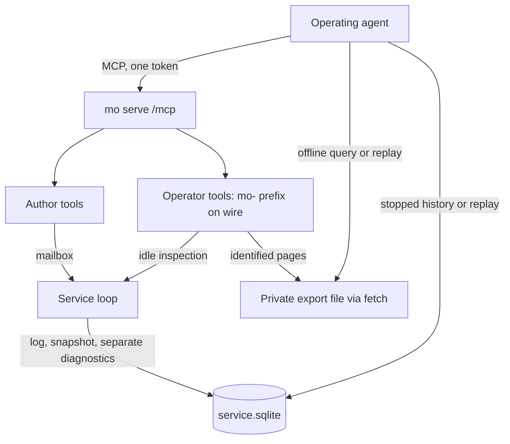

# Phase 4, Agents Can See Inside It - Plan

---

## Goal Capsule

- **Objective:** An agent operating a running Mo service can inspect it, answer questions through an offline query over exported state, reproduce a recorded handler failure, and check a proposed fix against the reconstructed case. A prospectively declared diagnostic evaluation supplies the evidence for Robert’s v0.1 release decision.
- **Execution:** Six milestones: design and feasibility, pilot findings, operator tools and export, failure recording, offline commands, final evaluation and release. The operator milestone is split into U3, U7, U8 and U9; existing unit IDs retain their meanings. This is the single implementation plan. Each unit extends the phase design document with its detailed decisions and evidence; a second brainstorm or implementation plan is not a prerequisite.
- **Authority:** The language reference, architecture, implementation rules, services design and `AGENTS.md` govern implementation. This revision incorporates the audit and subsequent user decisions. New behavior is specified below; it is not claimed to exist already.
- **Implementation entry:** U3 after the U2 pilot findings are recorded. The approved design and preflight evidence in `docs/design/introspection.md` and `learnability/phase4/preflight/README.md` govern its interfaces and budgets. Repeat measurements against the implementation; preflight results are not proof of code that does not yet exist.
- **Stop and report:** If a required export cannot fit the agreed process budget; the intended agent cannot reach the host; the revised evaluation cannot be declared before scored collection (blocks U6, not U3–U5 and U7–U9); a seeded reproducible failure cannot be replayed; or implementation requires a store-version or language-rule change beyond the clarification below. Resolve the failed gate in this plan and the design document before dependent work proceeds.
- **Finishing:** Implementers open milestone PRs using the repository template and required check results. Robert approves the phase design and evaluation contract, authorizes session execution and decides the release. Repository review and merge rules remain those in `AGENTS.md`.

---

## Revision and Evidence Status

This revision incorporates PA-1 through PA-9 from the audit (`2026-11-03-1704-feat-phase4-see-inside-plan.audit.md`, removed from the repository on 2026-11-04 and kept in git history), the user's decisions on capture, replay, compatibility and evaluation, and the request for continued Lean proofs with TLA+ where useful. Requirements and acceptance examples below are the implementation contract; implementers do not need to assemble decisions from the audit conversation.

The original plan described several decisions as previously approved without linking the originating sessions. That provenance remains unverified; those labels are removed. The current discussion explicitly authorizes this consolidation and settles the changes recorded here. It does not establish historical approvals, external prototypes, measurements or completed proofs.

The three product promises remain. Changes include best-effort diagnostic capture, narrower fix-verification claims, separate identity and schema checks, pilot/baseline separation, explicit preflight investigations, and formal-verification deliverables. Names such as `mo fetch`, `mo replay`, `mo query` and `mo history` remain working command names until U1 fixes their CLI contract.

### 2026-11-05 evaluation amendment

The completed pilot campaign informs diagnostic tooling; it does not establish that the tools lack value. `learnability/phase4/pilot/findings.md` records the outcome and limits. The old mandatory independent-baseline-before-implementation gate is superseded: U2 closes on the pilot record and findings, and U3 can proceed under the approved technical design. The original protocol, including its section 9 predictions, remains unchanged below its new historical-status notice. No baseline was collected and no pilot is relabeled as one.

The revised R20–R24 govern future evaluation. They preserve prospective criteria and honest comparison without requiring the old 36-session experiment. U6 cannot collect scored evidence or close the release gate until Robert approves the replacement diagnostic protocol. The architecture, authentication, limits, replay claims and formal-verification obligations remain in force.

### 2026-11-06 operator milestone

U3, U7, U8 and U9 landed in #294–#297: runtime identity and saved encoding, authenticated live views, immutable state export, and private `mo fetch`. U4 (failure records) is next. Failure capture, `replay` / `query` / `history` (U5) and evaluation/release (U6) remain open.

### 2026-11-07 implementation milestone

U3–U5 and U7–U9 landed in #294–#297 and #301–#302. U6 (a declared diagnostic evaluation, then v0.1 if its gate passes) is next. Evaluation is not done.

---

## Product Contract

### Summary

Phase 3 supplies a pure service runtime, stable event lines and defect reports. Phase 4 adds authenticated operator views, bounded exports, separately retained failure diagnostics, and offline commands. The revised evaluation assesses diagnostic outcomes and the limits of those instruments.

### Problem Frame

The pilots exposed manual state and history decoding, repeated author-tool paging, and source/simulation workflows. All completed pilots succeeded with existing tools; their difficulty did not support a useful solve-rate improvement experiment. That outcome leaves the utility of supported inspection in harder incidents unmeasured.

A pure handler's logical inputs are its state, arrival time and arguments. Reproducing execution also requires the original program, runtime semantics and relevant limits. Recording a heap ceiling does not reconstruct the live heap's occupants: the mailbox and other omitted allocations can make an offline execution succeed where the live execution failed. The phase reports that distinction and never turns an unreproduced original failure into a verified fix.

### Shared Decisions

- All three promises ship: live views, offline queries, and failure replay. Evaluation and the release remain part of the phase.
- Operator tools use the existing `/mcp` endpoint and the service's existing token. Any holder of that token can inspect the service; there is no additional role or operator credential.
- Caller-written queries run outside the service. The service exports bounded data; it does not execute arbitrary caller code.
- Diagnostics are separate from application state and the recovery log. A failed read-only call may create a diagnostic record, while its state and recovery position remain unchanged. U1 clarifies reference §11.5 to express this agreed interpretation.
- Capture is best effort with explicit missing-record reporting. Continuation depends on ordinary persistence remaining safe; an unusable store follows the existing store-failure stop policy.
- Fix verification means the original failure reproduced and a compatible revised handler succeeded in the reconstructed offline environment. It establishes that case, not fitness under omitted live memory pressure or all future workloads.
- **Build diagnostic instruments from the pilot findings.** (session-settled: user-directed — chosen over treating high pilot success as a reason to stop: the scenarios did not adequately exercise difficult diagnostics.) Governs R21, R24.
- **Remove the old baseline as an implementation prerequisite.** (session-settled: user-approved — chosen over spending 36 more sessions on the same limited comparison: preserve the evidence and declare a new evaluation before scored collection.) Governs R1, R4, R20–R22.
- Lean remains the primary semantic proof system. Small TLA+ models examine protocol ordering; CBMC and implementation tests examine critical C behavior. Each claim states its assumptions and implementation connection.

### Requirements

**Phase shape**

- R1. Execute the six milestones in order using the PR dependencies below; the operator milestone comprises U3, U7, U8 and U9. The superseded baseline gate does not block implementation.
- R2. Maintain one phase design document, `docs/design/introspection.md`, extended with the decisions and evidence each unit produces.
- R3. Use this document as the single implementation plan. Record detailed interfaces, formats, limits and experiments in the phase design document and link them from the relevant unit.
- R4. U1 closes on approved design and preflights; U2 on preserved pilot records, validated grading and findings; the operator, capture and offline milestones on their implementation checks; U6 on its newly declared evaluation and Robert’s release decision.

**The operator door**

- R5. A running service answers built-in operator tools beside author-declared tools on its existing MCP endpoint.
- R6. Views cover processes, current state, mailbox, pending timers, memory use and peak, supervisor failures/restarts/stops, retained failures, and committed messages since the last snapshot. Any separately retained older history is an explicit U1 decision.
- R7. Export the current state or one retained failure, including its pre-call state, message and arrival time. Artifacts carry separately defined format, runtime-build, compiled-program and schema identities.
- R8. Wrong or missing authentication gets the same refusal as author tools. Fetch sends the credential only to a validated loopback peer.
- R9. Operator tools, exports, diagnostic records and reports never include the runtime's stored bearer token. State and arguments remain author data and are shown as such. Evaluation publication separately checks artifacts for its known credentials.
- R10. Operator calls do not change application state, enter its recovery log, enqueue messages or affect supervisor counts. Pin storage and temporary inspection work have independent named budgets and do not retain live values into later handler execution.

**The failure record**

- R11. Attempt to capture every handler failure the supervisor counts, for tools (including read-only tools) and timers. Record the pre-call state, arguments, time, sequence, outcome signature and budgets. Application `Error` replies and admission refusals are not handler failures. If preparation, encoding or storage fails, report an unavailable record with a bounded reason; do not silently claim it was saved or retry indefinitely. Continue only if ordinary persistence remains safe.
- R12. Retained failures and capture refusals are visible in operator views. Preserve the three stable `mo serve:` event-line shapes; place a record id or unavailable-record reason in the following indented report.
- R13. Bound retention by both count and total bytes, with a deterministic rule that prevents one repeatedly failing timer from evicting the first failure of another kind. Atomic insertion and eviction never expose a partial failure.

**`mo` over the files**

- R14. Replay a saved failure from an export or stopped data folder using its original compiled program and runtime build. Report the original message, pre-call state, stack spans and available stopping-frame variables, with explicit unavailable/truncated diagnostic fields.
- R15. Classify reproduction using a structured signature: a handler defect matches its reason and source location in the original program; a resource failure matches the specific limit under the recorded budget. Rendered report text need not match byte-for-byte. Distinguish reproduced, different outcome, not reproduced, and refused; identify omitted live-memory conditions where applicable.
- R16. Run a pure Mo query over a state export or over a saved failure's state, time and ordered arguments. A query entry may not require capabilities, including through nested types or captures. A fix-check mode uses the same command machinery but also runs the original handler first and enforces R19.
- R17. History reads a stopped service's data folder without starting a service or running its timers. It shows persisted log/diagnostic data and explicitly identifies retention boundaries; it does not invent lost in-memory supervisor events.
- R18. Apply command-specific compatibility checks from KTD5. Exact replay requires original compiled-program and runtime-build identity. A state query permits added functions while requiring the same state schema. A failure query/fix check also requires compatible argument types, count and order, and a valid callable/result contract. Refuse schema changes with an explanation; migration is outside v0.1.
- R19. History and state queries have named work/memory limits. Replay and failure queries use recorded budgets; revised updating handlers also pass the saved-state size check. A fix is verified only after original-failure reproduction and successful compatible revision under the reconstructed conditions. A passing revision with an unreproduced original remains unverified, even if the same heap ceiling was configured.

**The evaluation**

- R20. Before U6 scored collection, Robert approves a separately named diagnostic protocol specifying questions, expected evidence, grading, session allocation, budgets, client/model configurations, missing-data rules and release thresholds. Development fixtures and native-client smoke runs are identified separately and cannot become scored evaluation observations retrospectively.
- R21. Preserve all pilot attempts, calibration classifications and original predictions. The completed campaign closes U2 with findings; it is neither a measured baseline nor evidence of an instrument effect.
- R22. U6 applies the replacement protocol without selecting or replacing inconvenient observations. A comparative improvement claim additionally requires a prospectively frozen independent baseline, equivalent grading, an appropriate comparison/sample-size calculation and a declared model-unavailability policy; without these, report demonstrated capability and limitations only.
- R23. Keep seeded defects and work-budget failures in isolated variants separate from the served program. Keep prompts, ordered transcripts, grading evidence and failures from every round. Memory-pressure cases remain implementation regressions unless the new protocol establishes a reproducible evaluation case.
- R24. The diagnostic suite must exercise live views, a question author tools cannot answer, retained failure replay and original-first fix checking. Use realistic state, call ordering and retention boundaries; do not manufacture difficulty through obfuscation or hiding source. Record instrument coverage separately from task correctness, and freeze the scoring rules before collecting the evaluation.

**Release and verification**

- R25. Release v0.1 only after the final evaluation meets its declared gate and Robert decides to release. Update status, installation instructions, promises and the roadmap to match the evidence.
- R26. Each unit updates the agent guide alongside the commands/tools it ships; guide checks exercise its claims.
- R27. Add commands, tools and documentation without new language semantics. Clarify the existing read-only rule in §11.5 as above and update §13.4/§15 as appropriate. Any further language-rule change or store `user_version` change requires revisiting scope.
- R28. Deliver the Lean properties, TLA+ models, relevant C proofs and implementation checks assigned in the Verification Design. Report their boundaries and actual results; absent tooling, waived obligations and excluded cases are not passing evidence.

### Actors and Flows

- **Operating agent:** Has the necessary source/compiled program, supported runtime build and token. Full export/offline operation requires local execution or host access such as SSH. This is a deployment prerequisite to demonstrate in U1, not an established fact about all remote agents.
- **Service:** Runs locally or behind a proxy. Proxy-only clients may use authenticated views; loopback fetch requires access to the host. No TLS client is added in this phase.
- **Evaluation agents:** Fresh sessions from at least two model families, with the frozen environment and only the round's permitted instruments.
- **Robert:** Approves the design and revised evaluation contract, authorizes execution and decides release.

- F1. **Live diagnosis:** Inspect views, export/query state, export a retained failure, replay the original, revise the handler, then request a fix check with both the original and revised program. A logical wrong reply is investigated through views/queries; it does not become a recorded runtime failure.
- F2. **Stopped service:** Read persisted history and failures, replay the original, check the revision, then follow the existing fresh-folder procedure for starting changed code. A missing diagnostic remains unavailable; the CLI does not fabricate replay inputs.
- F3. **New question:** Export state, write a pure function in the defining module or through its exposed interface, and query that snapshot. Normal source privacy remains in force.
- F4. **Evaluation:** Preserve pilot findings, implement the diagnostic milestones, declare the replacement protocol under R20–R24, collect its fresh sessions and apply its gate with all failures retained.

### Acceptance Examples

- AE1 (R8). Wrong or missing tokens receive the author-tool refusal. A non-loopback destination, redirect or proxy configuration cannot receive the fetch credential.
- AE2 (R11). A handler defect records state, arguments, time, sequence, signature and budgets when capture succeeds. An application `Error` records nothing. Preparation or write failure reports the record unavailable; only an unsafe persistence state triggers the existing store-failure policy.
- AE3 (R10). Calling every operator tool leaves application state, recovery position, mailbox and supervisor counts unchanged, including when the mailbox is full.
- AE4 (R14–R15). Original-program replay matches the structured defect reason/location or specific limit. Stack/variables are diagnostic evidence, with any capture truncation named. A different failure is not reproduction.
- AE5 (R18). Adding a state-query function preserves compatibility; changing the state schema is refused. Failure queries additionally reject incompatible arguments, reordered parameters or an invalid handler-result contract.
- AE6 (R17). History on a stopped folder shows retained persisted data without starting the service. A live owner's lock is refused; a hot journal follows the explicit recovery-permission contract.
- AE7 (R16). A query requiring a capability through its parameters or captures is refused by the query-entry checker.
- AE8 (R22). A final result below the frozen gate leaves Phase 4 open and preserves the shortfall.
- AE9 (R19). A reproduced original defect followed by a compatible successful revision verifies the reconstructed case. A revision that still exceeds the recorded work budget fails. An unchanged handler that failed with a populated live mailbox but succeeds offline never becomes a verified fix.
- AE10 (R7). Pages from two different export generations at the same log sequence cannot be assembled as one accepted export; restart, expiry and replacement invalidate stale requests.
- AE11 (R6). A service with private nominal state, only a scalar read-only tool, and a timer supports state inspection/export without depending on the author-tool MCP shape closure.
- AE12 (R11). A failed read-only call may create a diagnostic record while leaving state/recovery log unchanged. Exact-limit arguments and an exhausted live heap produce either a complete bounded record or an explicit capture refusal.
- AE13 (R20–R24). Pilots and development smoke runs never enter a later evaluation denominator. Changing a frozen scored scenario starts a new declared experiment; any baseline already collected stays recorded.

- AE14 (R6, R10, R24). An authenticated agent answers an independently specified state question in a synthetic service with private nominal state, a scalar author tool, a timer and a full mailbox. Bounded views identify truncation and do not invoke application handlers. Observations from different calls are not claimed to be one atomic snapshot.
- AE15 (R7–R10). A multi-page fetch during commits produces one complete private artifact with the expected state and identities. Replacement, expiry, interruption or corruption yields no accepted final file; retry starts a new generation.
- AE16 (R11–R13). A retained failure survives later commits and a snapshot with its original pre-call inputs intact. Timer repetition obeys first/latest retention; capture faults report unavailable context rather than a replayable-looking partial record.
- AE17 (R16–R18, R24). A pure query answers an independently specified aggregate unavailable through author tools, using exposed accessors or the defining module. Added query code is accepted under schema compatibility; a changed schema or capability capture is refused.
- AE18 (R17, R24). Stopped history supports an explanation from persisted evidence without starting timers. If the relevant successful message predates the snapshot, the output exposes the retention boundary; absence from the tail is not proof the message never ran.

### Scope Boundaries

Deferred: in-process arbitrary queries; replay of a successful committed message by log position; separate operator credentials; capability-effect recording; profiling views; live upgrades/migrations; multi-core scheduling; dashboards; contribution policy. Historical data beyond the current snapshot requires U1 evidence and a separate compatible archive if selected; never retain pre-snapshot rows in the recovery log, whose readers expect a post-snapshot tail.

The three parked Phase 3 operational items are included only if a unit demonstrably needs them. Safe-c library adoption, a runtime rewrite, TLAPS and GenMC are not prerequisites for Phase 4. Verification techniques from safe-c inform the work below; any selected library pilot must have a narrow scope and explicit acceptance evidence.

---

## Dependency and Decision Gates

The approved design and preflight README record the U1 decisions and measurements. The table retains the obligations those experiments support; implementation must still repeat code-dependent measurements and enforce the specified contracts. Evaluation-only prerequisites now block U6 under R20–R22, not the diagnostic implementation.
| Gate / audit entries | Owner and required evidence | Blocks |
| --- | --- | --- |
| Capture resources and transaction outcomes (L11, PA-2) | U1 designs byte/scratch accounting and clean-refusal vs unsafe-store classification; U4 verifies preparation, rollback, uncertain commit and write faults. | U4 implementation approval and completion |
| Reader locks/restart (L15–L16) | U1 specifies lock scope, limits, recovery permissions and retryable busy behavior; U5 measures large retained datasets and tests restart races. No millisecond guarantee. | U5 completion |
| Reproduction/compatibility (L18/L20/L38) | U1 fixes signatures, identity fields and callable contracts; U3–U5 and U7–U9 enforce the command matrix and refusal cases. | Artifact freeze and U5 completion |
| Read-only diagnostics (L21) | U1 clarifies reference §11.5; U4 proves application state/log remain unchanged through diagnostic capture. | U4 completion |
| Client modes and logs (L28/L49) | U1 records exact client versions/modes and a demonstration of discovery, invocation and complete ordered call/result capture; U2 implements a recorder where needed. | U6 protocol freeze |
| Loopback fetch and pin identity (L29/L34) | U1 specifies destination validation, no redirects/proxies, page framing and fresh export ids; U8 tests pin identity and replacement/restart behavior; U9 tests the actual connection. | U8 and U9 completion |
| Largest export and scratch (L33/L63b) | U1 measures the largest reachable task-queue state and boundary fixtures, recording encoded size, peak pin/scratch/process memory and live-heap effects; U3 accounts for cached bytes; U9 repeats full process/pin/scratch sizing against the implementation. | U1 design approval; U9 completion |
| Imported query and privacy (L45 / old plan assumption) | U1 prototypes a query module using an exposed service state type and a private-state query in its defining module. Saved nominal names are already module-qualified; acceptance across compiled programs still needs a prototype. | U5 design/implementation |
| History sufficiency (L67 / old plan assumption) | U1 runs diagnosis traces across a snapshot and decides whether the post-snapshot tail suffices. Record lost information and archive cost if needed. | Retention format freeze |
| Frozen models/settings (L50) | U1 verifies supported immutable identifiers/settings or documents limits of version guarantees, checks availability, and freezes an explicit unavailability policy. No unsupported reproducibility claim. | U6 protocol freeze and any comparison |
| Evaluation design (L51b) | U6 declares diagnostic criteria under R20; a comparative claim additionally meets R22. Preserve the original calculation as evidence for the old protocol, not authorization for a new claim. | U6 scored collection |
| Baseline oracle (L52) | U1 designs an out-of-band grader using known fixture inputs and hidden correctness checks, usable before Phase 4 instrumentation. U2 validates it; U5/U6 cross-check the new fix checker against it. | U2 grader validation and U6 grading |
| Publication scan (L55) | U2 implements and tests an exact procedure over the chosen publication artifacts, including known tokens and their transport encodings. Phase 3's recorded search is not an existing reusable scanner. | Publishing any round artifacts |
| Approval provenance (L62) | Preserve the audit's unverified historical provenance. Record U1 approval and subsequent scope decisions with actual artifact/session pointers when they occur. | Claims of approval, not starting authorized U1 work |
| Host/build access (L66) | U1 demonstrates the intended agent can obtain the correct program/build and run loopback fetch or read a stopped owner-only folder. Proxy-only limitations are explicit. | Full workflow evaluation |

---

## Planning Contract

### KTD1. Bounded, identified exports fetched to private files

Keep the explicit file-fetch command because it bounds and validates delivery independently of how a native client handles large tool replies. Current client behavior varies by version and mode; do not claim every client always places the full result in model context. The MCP reply ceiling is 32 KiB (`MO_LIMIT_MCP_RESPONSE_BYTES`), while an individual saved payload can reach 16 MiB (`MO_LIMIT_SAVED_BYTES`). Account for both text and structured result representation when sizing pages.

A pin owns immutable encoded bytes. Its export id is independent of the log sequence and unique across replacements and service incarnations; sequence is provenance, not page identity. Every response carries the id, artifact kind/version, sequence, index/offset, total length and integrity information fixed by U1. The fetcher enforces the total bound, consistent metadata and exact coverage before accepting a file. U1 selects the identifier/integrity construction and tests overflow/restart behavior; no cryptographic authenticity claim follows from a plain checksum.

Pin creation occurs at an idle safe point. Retained bytes, encoding scratch and page work have named budgets separate from handler memory; existing saved-codec scratch currently uses the live heap and cannot be reused unmodified as proof of isolation. Copy into independently owned bytes, release temporary references before the next handler and verify no retained sharing changes handler allocation/reuse. Include the sum of live memory, pin, scratch and transport overhead in the process sizing result. Resource refusal is explicit. Each pin expires after a named idle bound or is released by completion/replacement; a released pin is refused. Progress is conditional on availability and client activity, not guaranteed under repeated replacement.

Fetch accepts only plain HTTP loopback destinations. Reject userinfo, unsupported schemes and non-loopback addresses before sending a token; resolve and constrain the actual socket peer, including every retry, to loopback. Disable redirects and environment/system proxies. Define strict URL, response/header/body, page-count, aggregate-byte and work bounds. Remote operators run the command on the service host.

Create output privately with mode 0600, refuse an existing destination or symlink by default, and publish only a completely validated artifact. Remove incomplete private temporary files on failure. Do not overwrite an existing permissive file and rely on `umask` to fix its permissions. U9 introduces fuzz coverage for the HTTP/MCP/page readers; U5 adds the offline artifact-reader cases.

### KTD2. Operator dispatch, complete state coverage and client names

Use one overview and focused view tools, with wire names beginning `mo-`, listed after author tools. The prefix is outside Mo identifier syntax, but clients can normalize it: the audited Codex 0.166.0 replaces hyphens with underscores and handles collisions. Test raw names, model-visible names and correct routing in each frozen client mode, including an author `mo_state` alongside operator `mo-state`. Do not require spelling preservation or infer a routing bug from normalization alone.

Dispatch before `mo_service_send` and read only at service idle points through `vm.h` accessors. Operator tools never join the mailbox or supervisor accounting. Use `readOnlyHint`/`idempotentHint` and bounded, useful descriptions. Keep JSON shaping in embedded Mo alongside the existing MCP runtime, following implementation condition 4.

The approved design §3.3 selects a schema-driven embedded-Mo renderer over the saved encoding. Bytecode shape reachability and verifier formats remain unchanged. Existing MCP nominal shapes start from author-tool arguments/results and do not cover every legal service state. U7 must pass AE11 and keep language privacy unchanged. Oversized views return an explicitly truncated summary with an export reference.

### KTD3. Best-effort atomic failure capture

Use a separate diagnostic table, preserving existing table layouts and `user_version`. A failure has two framed records, pre-call state and message/metadata, bound to one id and atomically committed with retention updates. The message record includes tool/timer identity, ordered argument schema/data, arrival time, recovery sequence, structured failure signature, recorded budgets and program/runtime identities. Record schemas distinguish unavailable optional diagnostic details from complete replay inputs.

U1 budgets state bytes, arguments, metadata/framing, encoding scratch, retention and SQLite transaction overhead separately. Existing updating messages can already fill their encoding allowance, while read-only calls do not share that aggregate admission bound. Reserve explicit metadata space or refuse capture with a precise reason; do not silently tighten message admission. A complete record may approach two 16 MiB payloads before framing, scratch and transaction costs, not one 16 MiB write. Lower named caps are allowed only with explicit refusal behavior and evidence.

At controlled-call return, capture bounded inspection data while frames remain. Keep pre-call inputs alive until their serialization finishes, then use normal cleanup; do not retain cancelled frames across subsequent executions. Attempt persistence before supervisor handling and the reply. A successful record id is published only after commit. Preparation/allocation/size refusals and clean rolled-back diagnostic refusals leave the handler failure counted once and expose an unavailable-record reason. A failed rollback, ambiguous commit or unusable connection is not assumed safe: establish its state through the designed store contract or stop under existing persistence-failure policy. Do not retry the diagnostic blindly or count it as a second handler failure.

Attempt capture for the final stopping failure before exit. The in-memory event ring records bounded events without durable records, such as capture refusal/restart/stop; stopped history promises only persisted data. U4 defines deterministic failure-kind grouping and eviction with finite count/byte limits; floods and more distinct kinds than capacity have explicit behavior.

### KTD4. Logical read-only access and restart coordination

Implement a dedicated history/replay store reader. Do not call `mo_service_open`, which can evaluate intervals or snapshot. Distinguish a live owner's lock from a hot journal left by a killed process. Hot-journal rollback may write database pages: the command is logically read-only for application state/logs, not physically incapable of writes. Require owner permissions for recovery; otherwise report recovery required rather than silently bypassing locks or treating an immutable SQLite open as safe.

Hold the lock only while establishing a consistent bounded copy of the necessary persisted data, then close before offline evaluation. Specify maximum bytes/records/work, cleanup on cancellation and a diagnostic for exceeded limits. Measure lock duration on boundary datasets; do not promise milliseconds. A tail of 100 records at up to 16 MiB each alone makes that assumption unjustified.

`mo serve` waits a named bounded time for transient reader contention at startup. U1 defines the timeout result and service-manager retry policy together; a bounded wait alone does not prevent the current non-retried exit-1 failure. U5 tests wait success, timeout, repeated contention, cancellation and recovery. Land any required startup coordination before the reader ships.

### KTD5. Reconstruction, compatibility and fix verification

Factor the existing service controlled-call path for offline execution without starting timers, enqueueing messages or persisting state. Frames survive work cancellation today and are unwound during service cleanup; the new work is bounded inspection/report capture before that cleanup, not a new stack-retention mechanism. Preserve cleanup and subsequent-call behavior.

Store separate identities and validate them before decoding/execution:

| Operation | Required identity/compatibility |
| --- | --- |
| Fetch | Supported envelope/transport version, consistent export generation, lengths and integrity. Record producer provenance; fetching bytes does not by itself require the producer's exact runtime build. |
| Exact replay | Original compiled-program identity and original runtime-build identity, plus valid typed state/message and supported format. Source locations must correspond to that program. A source path or program checksum alone does not identify the runtime build. |
| History | Matching program/schema to interpret values and a supported store/artifact version; v0.1 uses the original runtime build for reconstruction. U1 defines metadata-only refusal output without executing mismatched data. |
| State query | Matching state schema and pure callable contract; added query functions are allowed. v0.1 uses the producer runtime build for evaluation, without requiring the original whole-program checksum. |
| Failure query / revised fix run | The query runtime uses the recorded build; state and ordered argument schemas/count match, time has its specified position/type, and the selected callable/result contract fits its mode. Handler code may differ. |
| Verified fix | Exact replay of the original first, followed by the compatible revision succeeding with recorded limits and the saved-copy check for an updating handler. Persist/report both outcomes and their identities. |

The v0.1 build restrictions are an explicit policy, not an existing loader feature; U1 specifies build provenance beyond a commit label (relevant build configuration included). Cross-build execution compatibility and schema migration are deferred. U1 fixes timer/read-only/updating callable and result shapes rather than treating every state-compatible function as a handler. Ordinary queries may return arbitrary pure results; only the designated handler mode receives a fix verdict.

U1 also specifies how the original build is retained and invoked, and the policy for legacy folders or records produced before offline replay is available. An identity field alone does not provide an executable replay path. Missing provenance or an unavailable/unsupported original runtime must produce an explicit refusal or unverified result; never silently substitute the current runtime and claim exact reproduction.

Use a versioned structured outcome signature. Match defect reason and original source location, or the specific exhausted limit with its recorded budget. Capture stack/variables as available diagnostic context, bounded independently from the complete replay inputs. Do not compare terminal formatting byte-for-byte or accept any generic memory error as a match.

Return explicit statuses for reproduction and verification, including `unverified` when the original did not reproduce. A successful revised run may still be reported as an observation in that case. Heap limits do not restore mailbox occupancy; there is no live-memory-fitness guarantee. U1 defines JSON and exit statuses using the existing line-oriented `mo test --json` conventions; history and view payloads share a schema.

### KTD6. Pilot evidence and prospective diagnostic evaluation

Use the existing `learnability/phase4/` harness, independent grader, proxy recorder and publication scanner where their contracts fit the new protocol. Preserve the original baseline binary and protocol as historical evidence. U5 cross-checks fix verdicts against an independent oracle where their contracts overlap; replay success alone does not establish a correct application fix.

R20–R24 own the replacement evaluation gate. Its definition belongs to U6 before scored sessions, while U3–U5 and U7–U9 use deterministic diagnostic fixtures and separately labeled client smoke evidence. The suite’s final scenarios, thresholds and any comparative allocation remain deferred to that protocol; they do not block U3.

Before publication, scan the actual selected artifacts and supported encodings for known evaluation credentials. Keep private originals, test the scanner with seeded leaks and fail on unreadable inputs. An expired token remains private. Pilot findings disclose evidence limits without copying private defects, fixtures, answer keys or reports into this repository.

### KTD7. One plan with milestone evidence

This document owns scope, order and acceptance. The design document holds interfaces, budgets, models and experiment results as they become concrete. Record any change to a shared contract here and in its design section before dependent code lands. Unresolved investigations are assigned by the gate table; they are not requests to repeat already settled user decisions.

### Technical Flows



```mermaid
sequenceDiagram
  participant F as fetch
  participant S as service
  F->>S: authenticated export request
  S-->>F: page 1, export id A, sequence N, total and integrity
  F->>S: next page of A
  S-->>F: page of A
  Note over F,S: service may commit; A's bytes remain unchanged
  Note over F,S: a replacement B can have the same sequence N
  F->>S: next page of released A
  S-->>F: refused; never substitute a page of B
```

```mermaid
sequenceDiagram
  participant L as service loop
  participant D as diagnostic capture
  participant S as store
  participant V as supervisor
  L->>D: handler failure; frames and pre-call inputs available
  D->>D: bounded report/encoding before cleanup
  alt preparation succeeded
    D->>S: atomic pair insertion and eviction
    S-->>D: committed, clean refusal, or unsafe/uncertain store
  end
  D-->>L: saved id or unavailable reason and store classification
  alt ordinary persistence remains safe
    L->>V: count original handler failure once
    V-->>L: continue, restart or stop
  else unsafe persistence
    L->>L: existing store-failure stop policy
  end
```

---

## Verification Design

### Proof Boundaries

Lean already proves Core type safety and determinism; it does not currently prove lowering preserves meaning or that the complete C runtime refines the model (`formal/README.md`). Core fuel is evaluation depth, not the VM instruction counter (`formal/TEXT.md`), and reached Simulation operations are outside the current evaluator. Keep these boundaries in all Phase 4 claims.

TLC explores finite instances of the specified transition system. Neither a TLC pass nor an action-to-C mapping is a proof that C implements the model. Name atomicity and fairness assumptions, model intermediate failure states, and connect counterexamples to C regressions. Do not assume atomic publication merely to prove atomic publication; represent the preparation/commit/publication boundary and identify the SQLite behavior relied on.

CBMC checks the C code reached by each harness under its stated assumptions and bounds. Keep unwinding assertions and reachability checks; a proof of safe refusal does not establish successful decoding of every valid input. Differential tests sample agreement between the Lean oracle and C; exclusions for resource cutoffs and unmodeled operations remain visible.

### Required Artifacts and Checks

| Property | Artifact and implementation connection | Owner / completion gate |
| --- | --- | --- |
| Typed reconstruction preserves the selected state and ordered arguments | Extend `formal/` with an executable reconstruction/schema model and meaningful preservation lemmas. Declare any assumed wire-decoder contract, then exercise the corresponding C decoder with typed, malformed and cross-schema cases. Do not present the conditional lemma as a proof of the C reader. | U1 defines theorem statements/assumptions; U5 implements and checks them. |
| A fix verdict requires reproduced original failure plus successful compatible revision | Model the outcome relation and decision procedure in Lean; prove soundness against an independently stated verdict contract, including the unreproduced-original case. Compare representative supported C outcomes to the model. | U1 specifies; U5 delivers proofs and differential cases. |
| Accepted exports never combine generations | Small TLA+ model of create, page, replace, expire, commit and restart; finite TLC configurations with at least same-sequence replacement and restart, plus C page-reader/state-machine regressions. | U1 defines actions/invariants; U8 delivers model/checks. |
| A published failure is complete and diagnostics preserve application recovery state | Separate TLA+ model of preparation, transaction steps, refusal, crash/recovery, publication and eviction; include supervisor counting and unsafe-store stop. Turn relevant traces into store/fault/process tests. | U1 defines assumptions; U4 delivers model/checks. |
| New C readers preserve memory/arithmetic bounds and enforce framing | Extend or add scoped CBMC harnesses for critical new parsing/length/index checks; fuzz all new outside-input paths. State bounds, modeled callees and uncovered properties. | U8 page framing; U9 fetch/pages; U4 diagnostic records; U5 offline artifacts. |
| Runtime-specific work/heap/storage behavior meets the contract | C unit tests, allocation/store fault injection, sanitizers and process crash/restart tests. Verify exact work-stop capture and cleanup; keep the live-mailbox/offline mismatch regression. | U3–U5 and U7–U9 with their implementations. |

New Lean modules must be included in the actual `lake build` targets and check entrypoints. Preserve the repository's no-`sorry` discipline and inspect theorem axioms; do not discharge a target property by adding it as an axiom or hiding it in a precondition. Pin TLC tooling/configurations and add a reproducible `models` check group to `ci/check.sh` when models land; this is a planned group, not one that already exists. Retain command/version/configuration logs, assumptions, counterexamples and relevant seeds. For progress claims, name fairness and no-expiry/no-replacement conditions.

For each important property, state the prediction first, obtain the Working Agreement's independent check and retain failures. Add negative controls that break the export-generation rule, atomic diagnostic publication and fix-verdict rule and require the intended check to reject them. Tests/proof clients should express required behavior independently of implementation branches; do not merely restate that an evaluator is a deterministic function.

### Safe-c Assessment and Optional Adoption Investigation

Safe-c is a useful source of verification practice. Inspection on 2026-11-03 used upstream commit `eebb98049e2cf0f5e9edffe892ae1f830cbaa1e5`; no safe-c proof suite was rerun for this plan. Its [contract guide](https://github.com/robertguss/safe-c/blob/eebb98049e2cf0f5e9edffe892ae1f830cbaa1e5/docs/guide/contracts.md) demonstrates explicit caller obligations, exact success/failure postconditions, mutation tests and independent property clients. Its [model documentation](https://github.com/robertguss/safe-c/blob/eebb98049e2cf0f5e9edffe892ae1f830cbaa1e5/models/README.md) maps TLA+ actions to C, describes parameterized TLAPS safety proofs, and connects bounded GenMC harnesses to the actual channel/mailbox sources under the C11 memory model. Those are complementary forms of evidence, not an end-to-end proof of arbitrary adopters.

Use the contract, independent-property, negative-control and model-to-C mapping practices in Phase 4. U1 may assess one isolated byte-framing or bounded-buffer component for library reuse or an ACSL/Frama-C proof over existing Mo code. Record the chosen property, pin, reproducible proof result, waivers, caller obligations, integration cost and Mo budget/allocator compatibility. Adopt only if it closes a concrete verification gap without weakening existing guarantees; otherwise retain the techniques and close the investigation with a documented rejection. The investigation is bounded by one component and is not a wholesale migration prerequisite.

Safe-c's [slice contract](https://github.com/robertguss/safe-c/blob/eebb98049e2cf0f5e9edffe892ae1f830cbaa1e5/include/safec/slice.h) assumes valid backing storage and a live owner; lint does not automatically discharge those obligations for all callers. Its library proof coverage and waived guards must be reported precisely. The [historical Mo lint trial](https://github.com/robertguss/safe-c/blob/eebb98049e2cf0f5e9edffe892ae1f830cbaa1e5/docs/evidence/sc18/mo-base-lint.md) documents allocator/API differences on an older revision; later safe-c changes addressed some of its findings, so its counts are not current Mo measurements. Its older plan to pilot Mo Phase 3 is not an active dependency for this Phase 4 plan.

Keep Lean as the main semantic proof environment and existing CBMC as the default C proof tool. Consider Frama-C/WP only for a selected unmet C contract. TLAPS is useful if a protocol needs a proof for arbitrary model sizes beyond TLC's finite cases. GenMC becomes relevant when actual C11 concurrent/atomic algorithms are introduced; the Phase 4 service protocol work does not itself require replacing the scheduler. Rust/Verus or another runtime language remains a separate future decision.

---

## Implementation Units

The following PR numbers are local to this phase plan, distinct from PR1–PR4 in the pilot subplan. Each PR contains a whole unit. File lists identify integration areas; U1 records exact public signatures, formats, limits and working command names in the design document. No downstream unit treats a deferred gate as already proven.

### PR1: Design and feasibility

Waits on: no earlier Phase 4 PR. The approved design and preflight artifacts already supply this milestone’s evidence.

### U1. Design, Feasibility and Verification Contracts

- **Goal:** Settle user-visible behavior and demonstrate the prerequisites for implementing it and collecting comparable evidence.
- **Covers:** R2–R4, R20, R24, R27–R28; KTD1–KTD7; every U1-owned dependency gate.
- **Files:** `docs/design/introspection.md`, `learnability/phase4/protocol.md`, evidence fixtures/scripts under `learnability/phase4/` or a documented test location, `docs/reference/README.md` (§11.5/§15), `docs/design/architecture.md` (§9), `docs/ROADMAP.md`, `tests/conformance/reference.tsv`; planned formal/model artifact map.
- **Work:**
  1. Define tool and CLI contracts, artifact framing/identity, state-view representation, outcome/callable schemas, capture/retention budgets, transaction classification, history depth and reader/startup coordination.
  2. Run and retain the maximum-state/pin/scratch sizing experiment, imported/private-query prototype, snapshot-history diagnosis traces, and host/build-access demonstration. These are investigations; U1 is not documents-only. Keep prototype tooling out of evaluation agents' environments and pin their baseline binary to a revision without Phase 4 instruments.
  3. Demonstrate supported client modes, name normalization/collision behavior and ordered MCP call/result capture. Verify model configuration availability and specify what happens if an endpoint cannot preserve a version.
  4. Preserve the original independent oracle, calculation and pre-pilot predictions. The replacement evaluation contract is U6 work under R20–R22.
  5. Specify Lean theorems, protocol actions/invariants, C proof candidates, negative controls and model-to-code test mappings. Record the bounded safe-c assessment if pursued; do not add a dependency merely because it has proofs.
  6. Clarify the read-only diagnostic rule and stale roadmap/reference/architecture descriptions, and obtain Robert's design approval with an evidence pointer.
- **Verification:** Every preflight has a command, versions, inputs and result or a recorded blocker. Imported-query work must preserve normal privacy. The sizing record includes scratch and process totals, not just encoded payload length. Embedded-doc/reference checks pass; experimental C receives the normal relevant build checks.
- **Done:** Design and evaluation protocol approved; predictions recorded; U1-owned preflights closed or explicitly scope-resolved; later unit obligations and evidence locations are concrete.

### PR2: Pilot findings

Waits on: PR1 design approval, needed before pilot execution. This group closes the historical pilot milestone; it does not authorize the old subplan’s PR4 baseline.

### U2. Pilots and Diagnostic Findings

- **Goal:** Preserve the campaign and identify diagnostic work supported by its evidence.
- **Covers:** R20–R24; KTD6.
- **Depends on:** U1 approval and validated harness, client access and grader.
- **Files:** `learnability/phase4/pilot/ledger.md`, public grade/manifest records, `learnability/phase4/pilot/findings.md`, `learnability/phase4/protocol.md`, and the pilot subplan’s supersession notice.
- **Approach:** Retain all 30 attempts, distinguish the operator interruption from graded completions, and retain uncalibrated classifications and report-revision limits. Document manual inspection patterns and the limitations of the old comparison. Preserve private originals and scanner evidence.
- **Test expectation:** No new runtime behavior in the findings closure. Review counts and claims against the retained ledger/grades; retain the existing grader, record-match and publication-scan results.
- **Verification:** The findings neither claim a measured baseline nor infer that easy scenarios invalidate diagnostic tools. Every public claim is supported without exposing private scenario contents.

### PR3: Native inspection foundation

Waits on: PR2, merge order only. Implementation can begin using the completed local pilot findings and approved U1 design.

### U3. Operator Tools and Export Foundation

- **Goal:** Make bounded native observations and immutable current-state bytes available without changing handler behavior.
- **Covers:** R5–R10, R21, R26, R28; KTD1–KTD2; AE3, AE11.
- **Depends on:** U2 findings and the approved U1 state-encoding, identity and resource design.
- **Files:** `src/vm/vm.h`, `src/vm/service.c`, `src/base/limits.h`, runtime-build identity and SHA-256 helpers, executable startup integration, `tests/test_service_runtime.c`, `tests/test_protocol_memory.c`, identity/digest unit tests, `docs/design/introspection.md`.
- **Approach:**
  1. Retain and replace the current saved encoding on initialization, recovery and accepted updates, under design §6.3 ownership. This is needed for U8 pin copies before U4 failure capture exists.
  2. Create the shared SHA-256 helper and runtime-build identity calculation required by design §4; verify digest vectors and executable identity. U7 consumes these for overview and U8 reuses them for artifacts.
  3. Add idle-only bounded accessors, snapshot sequence and event summaries through `vm.h`; tools never access private service structures directly.
  4. Expose mailbox metadata without changing read-only admission rules to obtain encoded argument sizes. Follow the design’s bounded observation contract; represent unavailable sizes explicitly rather than reporting a fabricated zero.
- **Execution note:** Add characterization coverage for successful and rejected updates before changing encoded-state ownership.
- **Test scenarios:** Recovery and accepted updates replace cached bytes; refused updates do not publish candidate bytes. A full mailbox remains inspectable. Allocation failures preserve the existing failure policy. Inspection does not change state, recovery sequence or supervisor counts, and retains no live values into later handler execution.
- **Test seam:** Service runtime tests cover ownership and scheduling; they do not establish MCP routing or socket/file safety.
- **Verification:** Independent cache/scratch accounting is bounded, state bytes match the committed state, and no operator capability is exposed before its authenticated dispatch lands in U7.

### PR4: Authenticated live views

Waits on: PR3, needed before start because the views consume its accessors and saved-byte owner.

### U7. Authenticated Live Views

- **Goal:** Let an operating agent answer live state and runtime questions through supported observations.
- **Covers:** R5–R10, R24, R26, R28; KTD2; AE1, AE3, AE11, AE14.
- **Depends on:** U3.
- **Files:** `src/tools/protocol*.c`/headers, `runtime/mcp.mo`, `runtime/mcp-rpc.mo`, `runtime/mcp-views.mo` (new), `Makefile`, embedded-runtime ABI checks, `tests/runtime/`, `tests/test_protocol_server.c`, `tests/test_protocol_memory.c`, `ci/check_operator.py` (new), guide/CLI checks.
- **Approach:** Introduce a distinct validated operator action after existing authentication and shared rate checks, before author argument conversion and `mo_service_send`. Extend existing catalog paging and annotations. Render saved schemas in embedded Mo under design §3.3; do not extend bytecode shape tables. Wire the new module into embedding and ABI checks.
- **Test scenarios:**
  - Covers AE14: private nominal state, scalar author tool, timer and full mailbox expose bounded state/path, timer and mailbox observations without invoking a handler.
  - Missing/wrong tokens and rate limits match author-tool behavior; refused calls leave application state/log/counts unchanged.
  - Oversized collections report truncation; independent observations are not advertised as an atomic snapshot.
  - Author `mo_state` and operator `mo-state` route correctly in both supported native clients, including normalized names and bounded catalog paging.
- **Test seam:** Protocol tests exercise authentication through typed view rendering; actual native-client discovery/invocation supplies access evidence beyond deterministic drivers.
- **Verification:** Guide descriptions identify host requirements and incompleteness. Failure-backed tools and state export are not advertised as working before U4 and U8 respectively; catalog exposure follows available capabilities at each merge.

### PR5: Immutable state export

Waits on: PR4, needed before start because export uses the authenticated operator route.

### U8. State Export Producer

- **Goal:** Export one identified state version while the service continues committing updates.
- **Covers:** R7–R10, R26, R28; KTD1; AE10, AE15.
- **Depends on:** U3, U7.
- **Files:** protocol/export sources, shared artifact identity/digest helpers, `src/base/limits.h`, `tests/test_protocol_server.c`, `tests/test_protocol_memory.c`, export model/runner and C trace regressions, design/guide checks.
- **Approach:** Own artifact framing and schema digests here, reusing U3’s runtime-build identity and SHA-256 helper; U9 and U5 consume these shared contracts. Copy cached bytes into independently budgeted pins. Implement design §5’s generation, page, expiry, replacement and completion rules with the model and negative controls.
- **Test scenarios:**
  - Covers AE10/AE15: all pages retain one generation and recovery sequence while later commits change current state.
  - Two exports at the same sequence remain distinct; replacement, expiry, restart and final-page release refuse stale requests.
  - Malformed offsets and page counts refuse safely; pins and temporary work respect independent limits without changing later handler heap reuse.
- **Test seam:** Producer tests and the model establish generation isolation; U9 proves transport consumption and final-file publication.
- **Verification:** Model invariants and deliberate generation-check breakage are detected. Digest/identity fixtures and pin accounting pass. Failure export remains a U4 integration obligation.

### PR6: Fetch and complete operator workflow

Waits on: PR5, needed before start because fetch consumes its exact artifact and page contract.

### U9. Private Fetch and Operator Acceptance

- **Goal:** Obtain a completely verified private artifact through a supported host-local command.
- **Covers:** R7–R10, R24, R26, R28; KTD1; AE1, AE15.
- **Depends on:** U8.
- **Files:** CLI/fetch sources, embedded-Mo response parser, embedding/ABI rules, `ci/check_operator.py`, CLI goldens/guide checks, fetch/page fuzz targets/corpora, scoped CBMC harnesses, `docs/design/sandbox-properties.md`, design budget evidence.
- **Approach:** Implement design §5.3’s bounded loopback fetch and safe publication using U8’s artifact helpers. Disable redirects/proxies and validate the actual peer before sending credentials. Introduce reader fuzzing and page-arithmetic proofs with the reader. Repeat process/pin/scratch sizing against the complete implementation.
- **Test scenarios:**
  - Covers AE15: multi-page fetch during commits yields one mode-0600 artifact with correct schema/program/build identities and the independently expected state.
  - Non-loopback resolution/peer, redirects, proxy environment, malformed/truncated/oversized responses and wrong tokens never produce an accepted artifact or leak a credential to a refused peer.
  - Existing destinations and symlinks are refused; cancellation, replacement, expiry or corrupt pages clean incomplete files. A retry starts a new export.
- **Test seam:** The operator driver covers actual sockets and filesystem publication; native-client smoke demonstrates discoverability and a complete supported workflow, not general agent effectiveness.
- **Verification:** Operator driver, goldens, guide, fuzz/CBMC scope and actual resource measurements pass. Document pin creation, page completion and file publication as different lifecycle events; idempotence annotations do not promise the same state on repeated creation.

### PR7: Retained failure diagnostics

Waits on: PR6, needed before start because capture integrates the verified export and view path.

### U4. Failure Capture and Retention

- **Goal:** Complete retained diagnostics where capture succeeds, explicit refusals where it cannot, with safe persistence and unchanged application recovery behavior.
- **Covers:** R11–R13, failure export in R7, R26, R28; KTD3; AE2, AE12, AE16.
- **Depends on:** U9 export/view milestone and U1 capture/store classification.
- **Files:** `src/host/store.c`, `src/host/host.h`, `src/base/hostops.def`, `src/vm/service.c`, relevant inspection/process code, `src/heap/saved.c`, limits and reporting, store/runtime/recovery tests, fault-injection build rules, `ci/check_kill_loop.py`, failure-record fuzz target/corpus, capture TLA+ model, relevant CBMC harnesses, saved-state/sandbox/design/guide docs.
- **Work:**
  1. Add the table and atomic record-pair/eviction operation without changing recovery tables or version. Implement and test clean refusal vs unsafe/uncertain store outcomes.
  2. Capture bounded outcome/stack context before normal cleanup, then encode state/message with explicit scratch and metadata limits. Do not change admission limits to conceal a capture failure.
  3. Report saved id or unavailable reason before supervisor/reply handling; preserve one count for the original failure and existing terminal persistence behavior.
  4. Implement deterministic retention, final-stop capture, the retained-failure view and failure export; expose their catalog entries only with their working backing store. Keep diagnostics out of application state/recovery logging, including read-only-call failures.
  5. Deliver the capture model, trace regressions, fuzzing and relevant C proofs.
- **Tests:**
  - Defects, work/memory/size limits, timer failures and read-only failures; application `Error` and admission refusal exclusions.
  - Exact-limit updating arguments plus metadata, large read-only arguments, near-limit pre-state, exhausted heap, allocation/encoding failure and transaction-write refusal.
  - Clean rollback permits later ordinary commits; rollback failure/uncertain commit does not produce a fabricated saved id or unsafe continuation. No double supervisor count.
  - Final stopping failure is attempted before exit; missing record is explicit. Atomic insertion/eviction survives crash boundaries without mixed halves.
  - Timer flood and distinct-kind overflow follow the bounded policy; snapshots leave retained failures replayable; old and new stores preserve recovery compatibility.
  - Frame capture precedes cleanup; cancellation releases resources and allows the expected subsequent service behavior.
- **Done:** Capture/refusal cases, every recovery check, retained-failure export, kill-loop/fault tests, fuzz/proof scope and capture model pass. Diagnostic capture cost is measured for both records plus overhead.

### PR8: Offline diagnosis

Waits on: PR7, needed before start because offline failure commands consume its records.

### U5. Replay, Query, Fix Check and History

- **Goal:** Offline commands implement the reconstruction and compatibility contract with explicit reproduction/verification results.
- **Covers:** R14–R19, R26, R28; KTD4–KTD5; AE4–AE7, AE9, AE17, AE18.
- **Depends on:** U4 and the U1 imported-query, history and lock/startup decisions.
- **Files:** CLI/execute/new command sources, `src/host/store.c`, controlled-call/inspection code in `src/vm/`, query-entry checking/lowering integration, `src/tools/render.c`, codes/errors, limits, artifact-reader fuzz corpus and scoped CBMC harnesses, runtime/CLI/recovery tests and drivers, `formal/` and differential fixtures/checks, guide/reference §13.4/conformance/design docs, service-manager documentation/configuration as needed.
- **Work:**
  1. Implement the dedicated logical read-only reader and hot-journal contract; coordinate reader locks with bounded startup waiting and retryable timeout behavior before shipping the reader.
  2. Enforce separate format, runtime-build, compiled-program and schema checks. Validate state and ordered arguments before executing any query/replay.
  3. Factor the service controlled call and bounded source report; implement structured reproduction matching, arbitrary pure query results and designated handler fix-check mode. Require the original program as well as the revision for a verified fix.
  4. Implement persisted history and named offline limits. Keep normal module privacy; imported queries use exported types/accessors, and private representation queries stay in the defining module.
  5. Deliver Lean reconstruction/verdict proofs, supported differential cases, independent grader cross-checks, and the C resource/crash tests outside the model's scope.
- **Tests:**
  - Every intentionally reproducible seeded defect/work/size case matches its structured signature from folder and export; different reason/location/limit is not reproduced.
  - Bounded work-stop stack/variable reporting, unavailable diagnostic fields, cleanup and later execution.
  - Live-mailbox memory failure with successful unchanged offline handler remains unverified; successful compatible revision cannot bypass original reproduction.
  - Added query function accepted; changed state/arguments/count/order rejected; wrong original program/build refused separately from malformed format; missing legacy provenance and unavailable original runtime follow the documented policy; arbitrary pure result is not misgraded as a handler fix.
  - Imported exposed-state query and defining-module private-state query succeed; capability-bearing entry/capture refused.
  - Matching persisted history without starting timers; live-owner refusal; hot-journal recovery permissions; reader cancellation; startup wait success/timeout/retry under large data.
  - Truncated/edited/oversized artifacts refuse safely; the fuzz target reaches the new path; proof and test negative controls detect relaxed compatibility/verdict checks.
- **Done:** Command drivers/goldens, reference/guide/conformance, relevant Lean and CBMC checks, differential cases, fuzzing and boundary tests pass. Reproduced originals and revision outcomes are both reported; no broader live-memory claim is made.

### PR9: Diagnostic evaluation and release evidence

Waits on: PR8, needed before scored collection because the suite must cover all three instruments. Protocol design may begin earlier.

### U6. Final Evaluation and Release

- **Goal:** Assess diagnostic outcomes under a prospectively declared protocol and support an honest release decision.
- **Covers:** R20, R22–R28; KTD6; AE8, AE13.
- **Depends on:** U5 and Robert’s approval of the replacement protocol before scored collection.
- **Files:** A separately named protocol and evidence directory under `learnability/phase4/`, `docs/status/phase4-run.md`, README, `docs/ROADMAP.md`, guide, reference §15, conformance map and task-queue runbook.
- **Approach:**
  1. Declare the new protocol under R20–R24. Identify development fixtures and smoke runs already observed; choose fresh diagnostic sessions and independent expected outcomes. Freeze release thresholds before scoring.
  2. Collect every declared session, report correctness and instrument coverage separately, and retain misses. Make a comparative claim only with the additional prospective evidence in R22.
  3. Scan the selected publication set and publish proof/model scope with actual check evidence. Do not turn missing checks or diagnostic refusals into passes.
  4. Apply R25: update release documents and tag only after a passing declared gate and Robert’s explicit release/publication decision.
- **Test scenarios:** Grading distinguishes a correct diagnosis from tool invocation alone, incomplete historical evidence from a supported causal answer, and a successful revised run from verified original-first reproduction. Missing sessions and model changes receive the declared treatment.
- **Verification:** The new protocol is approved before collection, its gate is applied without selection, publication checks pass, and release claims match the observed scope. No old solve-rate prediction is retroactively rewritten as success.

---

## Verification Contract

| Check | When | Evidence and limit |
| --- | --- | --- |
| `bash ci/check.sh gcc` | Before every PR | Build/unit result; include its final line in the PR body. |
| Clang build and relevant unit tests | C changes | Check compiler-specific diagnostics as required by `AGENTS.md`; do not infer this from GCC passing. |
| `bash ci/check.sh drivers static` | Edits to embedded guide/reference/library map | Embedded docs, goldens, guide claims, conformance and static checks. |
| `MO_ALL_DRIVERS=1 bash ci/check.sh sanitize drivers` | U3–U5 and U7–U9 C/guide changes requiring sanitizer-backed drivers | Drives the sanitizer executable as well as discovered builds. `sanitize drivers` alone can select debug first and does not establish this evidence. |
| `make deps`, `make tidy`, `make format-check` | Relevant C PRs | Dependencies, checked results and clang-format 14 style. |
| New-reader fuzz smoke, registered in `make fuzz-smoke` / `ci/check.sh fuzz` | U7–U9, U4 and U5 when each reader lands | Fetch HTTP/MCP/pages, diagnostic records and offline artifacts; seeds and bounded runs are empirical evidence. |
| Relevant CBMC harnesses plus reach checks | Critical new C readers/arithmetic and changes to existing proved components | Record input/unwinding bounds, assumptions and properties. Full boundary run follows repository policy. |
| `bash ci/check.sh lean` | PRs changing the formal model or corresponding semantics | Build the proofs and run relevant C-vs-Lean checks before merge; record exclusions. |
| Planned `bash ci/check.sh models` | Export/capture model and corresponding protocol changes | Pinned TLC configurations, invariants/progress assumptions and negative controls; group lands with models. |
| Fault injection and long kill-loop run | U4, relevant U5 reader/recovery changes | Actual allocation/transaction/process behavior; record seeds/commands and keep failures. |
| Prospective diagnostic grading | U6 | R20–R24; comparative claims additionally require the R22 baseline and comparison calculation. |
| Publication scan | Before any evaluation artifact publication | Known credential-leak checks over the actual publication set, tested with seeded failures. |
| Nightly: `gcc clang sanitize drivers static lean bench`, `CI=1`, `MO_ALL_DRIVERS=1` | Daily at 07:17 UTC and manual dispatch | Existing workflow is not triggered after every merge. Do not substitute an assumed nightly result for required pre-merge evidence. |

When a required tool is missing, report a skip locally and a failure under `CI=1`, following repository policy; neither closes a required evidence gate. Add model check documentation/CI integration when its runner lands. Follow `AGENTS.md` for detached long checks and wait for completion before ending the implementation turn.

---

## Definition of Done

- **U1:** Approved design/protocol, predictions, completed feasibility/client/access experiments, statistical calculation, identity/callable/transaction contracts and assigned verification artifacts. Remaining uncertainty is explicit and cannot silently pass a gate.
- **U2:** Pilot records and findings retained, calibration limits explicit, independent grading and record provenance validated, publication checks retained; no baseline claimed.
- **U3:** Immutable current encoding, runtime identity and bounded idle metadata preserve handler behavior and ownership.
- **U7:** Authenticated views and private-state diagnostic acceptance pass, with correct native-client routing.
- **U8:** Artifact identities, generation isolation, pin bounds and export model pass.
- **U9:** Loopback fetch, safe publication, end-to-end diagnostic acceptance, resource measurements and reader proof/fuzz checks pass.
- **U4:** Complete-or-explicitly-unavailable capture, safe transaction classification, read-only nonmutation, retention and crash recovery, failure export, fuzz/proof scope and capture model pass.
- **U5:** Command and compatibility cases pass, original-first fix verdict enforced, Lean proofs/differential cases delivered, exact VM resource and reader/startup behavior tested.
- **U6:** Frozen evaluation meets its gate, coverage/publication checks pass, claims match evidence, release docs updated and Robert's approved v0.1 tag exists.

Remove abandoned executable experiments before marking implementation PRs ready, while retaining experiment results, counterexamples and failed predictions as evidence. The audit remains a historical review of the original plan; it is not a second implementation checklist.

---

## Sources and Audit Resolution Map

Repository sources: `docs/reference/README.md`, `docs/design/architecture.md`, `docs/design/implementation.md`, `docs/design/bytecode.md`, `docs/design/services.md`, `docs/design/saved-state.md`, `docs/design/sandbox-properties.md`, `docs/status/phase3-run.md`, `docs/agent-guide.md`, `src/base/limits.h`, `formal/README.md`, `formal/TEXT.md`, `cbmc/README.md`, `learnability/protocol.md` and `AGENTS.md`. Their cited behavior is a design input; this plan does not claim their future Phase 4 extensions already exist.

| Audit finding | Integrated resolution |
| --- | --- |
| PA-1: offline memory/fix overclaim | R15/R19, AE9, KTD5 and U5 require original reproduction and narrow the verdict. |
| PA-2: capture resource/transaction gaps | R11, AE2/AE12, KTD3 and U1/U4 budget preparation and classify persistence safety. |
| PA-3: incomplete MCP state shapes | AE11, KTD2 and U1/U3/U7 require complete state encoding and a private-state fixture. |
| PA-4: client name normalization | KTD2 and U1/U7 test both normalized names and routing; no spelling guarantee. |
| PA-5: check selection/nightly timing | Verification Contract uses `MO_ALL_DRIVERS=1` and the actual daily/manual schedule. |
| PA-6: U3 reader fuzz gap | KTD1 and U9 introduce fetch/page fuzzing with the reader. |
| PA-7: selected-baseline bias | R20–R24, AE13 and KTD6 preserve pilots and prohibit retrospective selection; any future comparative claim requires its own prospective baseline. |
| PA-8: cancellation-frame premise | KTD3/KTD5 and U4/U5 capture existing frames before cleanup. |
| PA-9: missing formal work | R28, Verification Design and all implementation units assign concrete Lean, TLA+ and C obligations. |

All remaining audit dependencies are assigned in the gate table. U3 is the implementation entry after pilot closure. The remaining evaluation-contract decision blocks U6 collection, not the diagnostic milestones.
