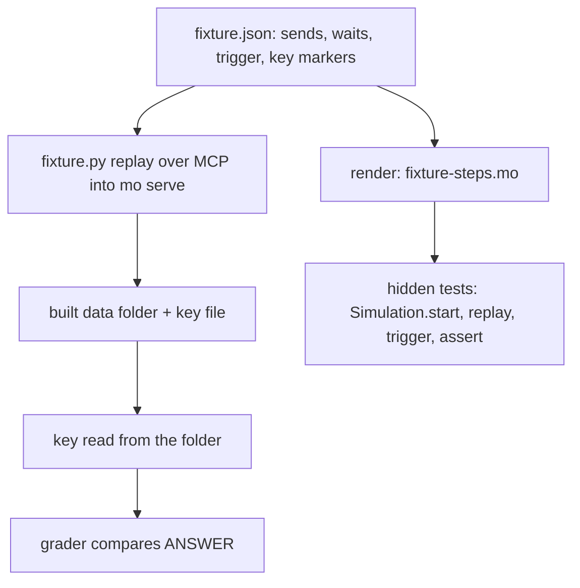

# Phase 4 Pilots and Independent Baseline - Plan

## Supersession on 2026-11-05

This document is retained as the historical implementation contract for the pilot harness and campaign. PR1–PR2 supplied the harness and grading; PR3’s records and `learnability/phase4/pilot/findings.md` close the campaign at its cap. PR4 / U8 (the freeze and 36-session baseline) is superseded and must not be launched from this plan. No measured baseline was collected.

The current execution authority is `docs/plans/2026-11-03-1704-feat-phase4-see-inside-plan.md`, R20–R24. It permits diagnostic implementation after the pilot findings and requires a new declared protocol before scored evaluation. The original predictions, calibration rules and outcome remain preserved; the historical requirements below are not current instructions to collect a baseline.

---

## Goal Capsule

- **Objective:** Before any Phase 4 instrument exists, fresh agent sessions have been measured diagnosing and fixing six seeded task-queue bugs with today's tools, on scenarios that pilots have shown to be solvable but not trivial, under a protocol frozen so that the final round can repeat it exactly.
- **Means:** Six hand-authored variants, four with a defect and two with a question, with fixtures replayed from one step list into both the live service and the hidden tests (KTD1), a harness that runs each session as a separate unix user behind a recording proxy (KTD2, KTD4), a grader built on the existing hidden-test overlay (KTD3), and a scanner that gates publication (KTD7).
- **Authority:** The approved evaluation protocol, `learnability/phase4/protocol.md`, governs rounds, grading, freezing and the comparison; the approved design, `docs/design/introspection.md`, governs what the instruments will do; the Phase 4 plan, `docs/plans/2026-11-03-1704-feat-phase4-see-inside-plan.md`, places this milestone second of six. `AGENTS.md` governs checks and merging. Within those, this document decides.
- **Execution profile:** Four PRs. PR1 (variants, fixtures, hidden tests, grader) and PR2 (harness, proxy, scanner) are code; PR3 (pilots) and PR4 (freeze and baseline round) are records of runs Robert makes with that code. Implementers open PR1 and PR2; Robert runs the sessions and merges all four.
- **Stop and report:** a variant that cannot both evade the queue's own tests and fire on its fixture data; a hidden-test replay that cannot finish within the grader's time budget; a client that cannot be run non-interactively with file edits as the session user; a pilot that shows the recording proxy losing calls. Resolve each in this plan before the dependent unit proceeds.

---

## Product Contract

### Summary

Six variants of the task queue: four with one defect each that fires only on particular data or timing, two unmodified copies that pose a question, each presented to a session as an operator's report; a fixture and trigger check for each and hidden tests for the four; a session setup that gives the agent the variant's source, the pinned `mo`, the author tools and a token, and records everything it does; pilots under a calibration rule; then the frozen 36-session baseline and the scanner that gates publication.

### Problem Frame

The Phase 4 comparison measures whether the operator views, the export and query, and the failure replay let fresh agents fix a running service's bugs more often than today's tools do. Both rounds must run the same scenarios, and the baseline must run on a `mo` with no Phase 4 instrument, so the scenarios have to exist and be frozen before the instruments are built. None exists today: `learnability/phase4/` holds the protocol, the calculator and the preflight experiments, and nothing a session could be given.

The scenarios decide what the comparison can show. A session receives the variant's full source, about 950 lines, so a plain code bug is found by reading, and both rounds would score alike. A bug only Phase 4 can find builds the result in. The scenarios must therefore be hard to localize and easy to confirm: the report says what went wrong for a user of the queue, the source holds several candidate causes, and telling them apart needs the state, the recent calls or the failure record. Pilots are how that calibration is checked before the freeze, and the freeze is what keeps a disappointing baseline from being quietly hardened away.

<!-- ce-section: work-relationships -->
### How This Work Fits Together

This plan covers the second of the Phase 4 milestones listed in `docs/ROADMAP.md`: pilots and an independent baseline. The surrounding milestones are the Phase 4 plan's current understanding, not commitments of this document.

- Depends on the design step, approved on 2026-11-04 (`docs/design/introspection.md`, `learnability/phase4/protocol.md`).
- Enables the final evaluation, which repeats the frozen scenarios with the instruments available and applies the comparison the protocol fixes.
- Can proceed independently of the operator tools, failure records and offline commands milestones, provided the baseline `mo` is pinned before any of their code reaches `main` (R27).
- Shares the task-queue service (`services/task-queue/`) with every variant; variants are copies and never change the served program.

### Key Decisions

- **Each session is told the bug as an operator's report**: the symptom a queue user saw, roughly when, and a job id or payload when they would have one; never a handler name or code location. (session-settled: user-directed — chosen over a one-line symptom and over the precise failing call: a report leaves localization, which is what the instruments help with, to the agent, while a bare symptom risks a baseline near zero and a precise call lets reading alone find the bug.) Governs R1, R7.
- **Every defect fires only on particular data or timing**, so the source yields several candidates and confirming one needs runtime evidence. (session-settled: user-directed — chosen over plain unconditional code bugs, which a careful reader finds in minutes, and over defects seeded in stored data, which a code fix cannot repair and a hidden test from clean state cannot grade.) Governs R2, R3, R4, R5, R6.
- **The question family has one state question and one recent-history question.** (session-settled: user-directed — chosen over two state questions and over two history questions: one of each exercises both the export-and-query promise and the log view.) Governs R4, R5.
- **A question session is graded on its answer plus no regression; it is asked for no fix.** (session-settled: user-directed — chosen over an added signature-preserving fix, which the history question has no natural form of, and over the answer alone, which would count a session that broke the program as a success.) Governs R7, R10, R12.
- **Sessions run as a separate unix user with files-only isolation.** (session-settled: user-directed — chosen over adding a firewall rule that forces every call through the proxy, which costs a root-installed rule and another way for a session to fail, and over the honor system, which cannot tell a session that read the answer key from one that solved the task.) Governs R13, R14.
- **Pilots run under a calibration rule with a cap of 30 sessions** rather than a fixed count. (session-settled: user-directed — chosen over a fixed 12 or 24: a fixed pass freezes a variant on one observation and has no rule for one still miscalibrated.) Governs R17, R18, R19.
- **The question family is exempt from the calibration floor**: its variants are kept even when no baseline pilot solves them, because a baseline near zero there is the predicted result, not a defect. (session-settled: user-directed — chosen over applying the floor to every family, which would push the questions toward ones `list` paging answers, and over dropping the floor everywhere, which would let a bad bug report pass as a hard bug.) Governs R18.
- **Hidden tests rebuild each pre-state by replaying the fixture's own sends and clock advances**, because the simulation API offers no way to set state directly. Governs R8, R10.
- **The token stays in the session's environment**, because the final round's `mo fetch` reads it from there and both rounds must be set up alike; the scanner, not the setup, is the control against a leaked token. Governs R15, R28.
- **Variants are hand-authored.** Mutation-generated variants were considered and set aside: mutants are mostly plain code defects, and a question cannot be a mutant.

### Actors

- A1. **Robert**: runs the pilot and baseline sessions, decides each pilot's verdict, commits the freeze, publishes the round.
- A2. **A fresh agent session**: Claude Code or Codex on the frozen settings, one scenario, no memory, no instructions beyond the prompt and `mo guide`.
- A3. **The harness**: builds the variant's data folder, starts the service and the recording proxy, launches the client with the prompt, enforces the time limit, collects the records.
- A4. **The grader**: a script that runs the hidden tests and the queue's own tests on the session's fix with the session's `mo`, and compares a question variant's answer with the key.
- A5. **The scanner**: a script that reads every file selected for publication and refuses the set when it finds a session token in any transport encoding.

### Requirements

**Scenarios**

- R1. Each scenario's prompt is an operator's bug report: what a queue user observed, roughly when, and a job id or payload when a user would have one; it names no handler, no source location and no instrument.
- R2. Each defect fires only for particular data or timing, so the symptom appears on the fixture's data and the unchanged handlers pass the queue's own tests on ordinary data.
- R3. The two wrong-state variants leave the queue in a plausible but wrong state with no failure and no error reply.
- R4. The first question variant asks for a fact about the whole current state that no single tool call reports and that paging through `list` can only rebuild slowly, such as how many jobs share a brief with another job.
- R5. The second question variant asks which call changed a named job and when, a fact no state holds; its fixture keeps that call within the log rows the last snapshot left behind.
- R6. The two failure variants fail outright on the fixture's data: one as a handler defect that only particular input reaches, one by exceeding the work budget on the seeded queue size, so that today only a `failure:` line is printed and no report.
- R7. A question variant's prompt tells the session the exact form its answer must take, so the grader reads one value by one frozen rule; the session is asked for no code change.

**Fixtures and grading**

- R8. Each variant's fixture builds the data folder and sends the triggering traffic from a replayable script of sends and clock advances that the hidden tests reuse to rebuild the same pre-state.
- R9. Before every session, the fixture checks through the author tools that the seeded condition holds; a failed check discards the session before the agent starts and is repaired before the next one.
- R10. Each defect variant's hidden tests, written from the queue's specification and not from any agent's output, start the simulation at the pre-state, send the triggering message at its arrival time, and check the correct reply and new state; for every variant the grader also runs `mo check` and the queue's own tests on the revised program.
- R11. Each variant is frozen only when its reference fix passes every hidden test, the unfixed variant fails at least one, and a deliberately wrong fix fails at least one; a question variant is frozen only when its answer key is recomputed from the built data folder and matches.
- R12. The grader runs each session's program with that session's `mo`, grades a defect variant on the hidden tests and a question variant on its answer, and needs nothing from Phase 4.

**Sessions**

- R13. A session's working folder holds the variant's source and nothing else from this repository; the fixture scripts, the hidden tests, the grader, the keys and the other variants are unreadable to the session's user.
- R14. A session can run the pinned `mo`, read the service's standard error log, read a copy of the data folder as it was when the session started, and reach the service through the proxy; a direct call to the service is possible but appears in the client's own record as a shell command.
- R15. Each session's service gets a fresh random token, delivered to the client and to the session's environment, never written to a file the session can read, and never printed by the harness.
- R16. Each session ends at the frozen time limit, 60 minutes unless the pilots change it; the harness ends the whole process tree and grades the working folder as it stands.

**Pilots and the freeze**

- R17. Pilots run with baseline instruments only, are kept apart from the measured rounds, and stop at 30 sessions or earlier when every variant is calibrated.
- R18. A wrong-state or failure variant is calibrated when a baseline pilot has solved it at least once and failed it at least once, with at least one session per client; a question variant is calibrated when at least one session per client has run and the answer key has been checked. A variant solved in all of its first three pilots is hardened and re-piloted; a wrong-state or failure variant solved in none of its first three is replaced within its family.
- R19. Pilots may change a variant's defect, data, bug report, hidden tests, answer key, the time limit and the client settings; they may not change the three families, the number of variants, the session counts, the clients or the comparison.
- R20. The freeze records what the protocol's section 7 lists, each variant and fixture by hash, and the pilot ledger: every pilot session, its verdict and what it changed.
- R21. A variant that pilots leave uncalibrated at the cap is frozen as it stands and named as such in the freeze.

**The baseline round**

- R22. 36 sessions run in the protocol's allocation, in a random order from a recorded seed, with the fixture check before each.
- R23. Each session keeps two records, the client's event stream and the proxy log; they match when every MCP tool call in one has its counterpart in the other by JSON-RPC id, with the one call in flight at the time limit excepted, and a session whose records do not match is a failure, not a rerun.
- R24. The round reports the pooled rate with its interval, each family's and each client's rate, and the room the baseline leaves the final round, using the protocol's calculator.
- R25. No baseline session is rerun, dropped or replaced for its result; the one exception is a session that failed before it saw its task, meaning before the client's first assistant event.

**Recording and publication**

- R26. The recording proxy writes every request and response between client and service in order, with status and timing, the tool called and the full bodies, and never the token.
- R27. The baseline `mo` is built from a named `main` commit that holds no Phase 4 instrument, before any Phase 4 code reaches `main`; its hash and its embedded guide's hash are in the freeze, pilots use the same binary, and the same binary grades the round.
- R28. Before anything from a round or pilot is published, the scanner reads every selected file and fails on a session token in plain text, base64, base64url, URL encoding, JSON escapes or hexadecimal, on a 16-byte or longer prefix of one, or on a file it cannot read; it is tested with seeded leaks in each encoding before its first use.
- R29. Unredacted originals stay private; published copies keep what grading and reproduction need.

### Key Flows

- F1. **A pilot session**
  - **Trigger:** Robert starts a pilot of one variant on one client.
  - **Actors:** A1, A2, A3
  - **Steps:** The harness copies the variant's built data folder, starts the service and the proxy, runs the fixture check, mints the token, launches the client with the prompt as the session user. The agent works until it stops or the limit ends it. The grader runs. Robert records the verdict and any change to the variant.
  - **Outcome:** One pilot ledger entry; a variant that is calibrated, hardened, replaced or unchanged.
  - **Covers:** R9, R15, R16, R17, R18, R19.
- F2. **The freeze**
  - **Trigger:** Every variant is calibrated or the pilot cap is reached.
  - **Actors:** A1
  - **Steps:** Build the baseline `mo` from the named commit and hash it; hash every variant, fixture, hidden test and prompt; record the client versions and settings, the time limit, the allocation and the seed; commit `freeze.md`.
  - **Outcome:** Nothing in the freeze changes until the final round; a change after the first baseline session starts a new experiment.
  - **Covers:** R20, R21, R27.
- F3. **A baseline session**
  - **Trigger:** The next session in the seeded order.
  - **Actors:** A2, A3, A4
  - **Steps:** As F1 through the launch; after the session, the grader runs and both records are checked for completeness; the result is recorded whatever it is.
  - **Outcome:** One graded session; after 36, the round report.
  - **Covers:** R22, R23, R24, R25.
- F4. **Publication**
  - **Trigger:** The round report is written.
  - **Actors:** A1, A5
  - **Steps:** Select the files to publish; run the scanner; on a hit, redact or withhold the file and run again; publish the clean set and keep the originals private.
  - **Outcome:** A published round with no session token in it.
  - **Covers:** R28, R29.

### Acceptance Examples

- AE1. **Covers R2, R3.** Given the wrong-state variant whose jobs die early, when a job on its third attempt is freshly leased and the expiry tick runs, then the queue shows it Dead although the tick that killed it came before its lease's end, while the queue's own tests, which fail a job three times, still pass.
- AE2. **Covers R5.** Given the history variant, when the session starts, then the call that changed the named job is among the log rows after the last snapshot, and the answer key names that call and its arrival time.
- AE3. **Covers R6.** Given the work-limit variant at its seeded size, when a session calls the affected tool, then the reply is the `work_limit` runtime error and the service's log holds a `failure:` line for it and no report.
- AE4. **Covers R9.** Given a fixture whose trigger did not fire, when the pre-session check runs, then no client is launched and the attempt is not counted as a session.
- AE5. **Covers R11.** Given a variant's hidden tests, when run against the unfixed variant and against a fix that changes the wrong comparison, then each run fails at least one test; when run against the reference fix, then every test passes.
- AE6. **Covers R18.** Given the history question variant unsolved in its first three pilots, when the pilots end, then it is frozen unchanged; given a wrong-state variant unsolved in its first three, then it is replaced within its family.
- AE7. **Covers R23.** Given a session whose client stream shows a tool call the proxy log lacks, when graded, then the session is a failure and is not rerun.
- AE8. **Covers R28.** Given a publication set in which one proxy log holds a session token base64-encoded, when the scanner runs, then it fails and names the file.
- AE9. **Covers R13, R14.** Given a running baseline session, when the agent tries to read the grader, a key or another variant, then the read is refused by file permissions, and when it calls the service directly, then the command is in its client record.

### Success Criteria

- The baseline leaves room: `compare.py --room K1 36 36` names a final count below 36, so the comparison can show an improvement.
- Every baseline session has a complete, matching pair of records.
- The scanner passes on the published set and has caught every seeded leak in its tests.
- The freeze is the only description of the round the final round needs.

### Scope Boundaries

- No Phase 4 instrument is built or used here; the operator tools, failure records and offline commands are later milestones.
- No scenario depends on live memory pressure, since the design does not reconstruct the mailbox.
- No scenario asks the agent to repair stored data; a fix is a code change, and migration is Phase 5.
- No remote host, proxy or SSH; sessions run on the service's own machine, as the design decided.
- Amp is not a client; the protocol chose the native CLIs.
- The final round is not part of this milestone.
- Predictions are not revisited; the protocol's stand.
- Considered and not built: a firewall rule forcing every call through the proxy (Robert chose files-only isolation; a direct call shows in the client record); the harness restarting a service its session stopped (that would make the two clients' sessions differ by their retry habits; the stop is recorded instead); per-pilot predictions beside the standing ones (the protocol's section 9 predictions stand for every pilot, and the ledger records outcomes against them).

#### Deferred to Follow-Up Work

- Mirroring `ci/check_task_queue.py`'s exact result counts into a check that runs each variant's own tests in CI; PR1 runs them through the grader's `--check` instead.
- A shared `mo serve` client module replacing the copies in `ci/check_task_queue.py`, `learnability/phase4/preflight/sizing.py` and the new fixture replayer.

### Dependencies / Assumptions

- The simulation API (`Simulation.start`, `send`, `advance`, `crash`, `restart`) rebuilds a pre-state of a few hundred sends in under a second; 2,000 sends take about 10 seconds and 5,000 about a minute, so seeds stay in the low hundreds.
- A changed program cannot be started on an existing data folder, which keeps a baseline session from adding a tool to read the state; a comment-only change may still load.
- A running service holds its database under an exclusive lock, so the data-folder copy a session reads is taken before the service starts, which is the state at session start.
- The two clients can be run non-interactively with file edits allowed as the session user: Codex with a writable sandbox whose network access is enabled, Claude Code with a permission mode that accepts edits; their own turn and time caps are set above the session limit and recorded.
- Passwordless `sudo` exists on this VM, so the harness can create the session user and run the clients as it.
- The first question's answer is derivable by paging `list`, because every job field is visible; the family's difficulty in the baseline is effort, not impossibility, and the history question carries the impossibility.
- Model names served by the providers may change; the protocol's unavailability rule covers it.

### Outstanding Questions

**Deferred to Implementation**

- The exact wording of each bug report, within R1, settled in pilots.
- The 60-minute kill's grace period between SIGTERM and SIGKILL, and the handling of a file half-written at the kill.
- Whether Codex's `--ephemeral` and Claude Code's `--no-session-persistence` leave any transcript under the session user's home that must be removed between sessions.
- The scanner's behaviour on a file larger than its memory budget: fail, never skip; the exact ceiling.

### Sources / Research

- `learnability/phase4/protocol.md` sections 2, 3, 5, 6, 7 and 10: the outline this milestone fills in.
- `docs/design/introspection.md` sections 1, 2 and 12: the promises, the host-access decision and the approved decisions.
- `docs/plans/2026-11-03-1704-feat-phase4-see-inside-plan.md`, unit U2: the milestone's place and gates.
- `services/task-queue/job-queue.mo` and `main.mo`: the handlers variants copy; `queue-tests.mo`: the tests a variant must still pass and the simulation idioms hidden tests reuse.
- `learnability/protocol.md` sections 1, 2 and 3: how earlier rounds froze, ran fresh sessions and graded; `learnability/bench-v0-round-3/` for the round layout.
- `bench/v0/grade.py`: the hidden-test overlay, `--check` with reference, broken and start controls, and `SHA256SUMS` freezing the grader reuses.
- `learnability/phase4/preflight/client_probe.py` and `results/clients/`: the recording proxy and the client settings this milestone hardens; `learnability/phase4/preflight/sizing.py` and `ci/check_task_queue.py`: the `mo serve` clients.
- `docs/ops/task-queue.md` lines 60 to 66 and 192 to 200: the token-handling rules.
- `docs/design/saved-state.md`: the snapshot, log and record format the history variant's key and the pre-start copy depend on.
- Grounding dossier for the brainstorm: `/tmp/compound-engineering-1000/ce-brainstorm/pilots-baseline/grounding.md`; planning research: `/tmp/compound-engineering-1000/ce-plan-research/phase4-pilots/{repo-research,spec-flow}.md` (machine-local, best effort).

---

## Planning Contract

**Product Contract preservation:** R13, R14 — the variants, hidden tests and keys live in a private repository until the final round, both clients run with web tools off, and a session that addresses a non-loopback host fails (Robert, 2026-11-04, at document review). Restructured, no scope change: Summary and AE1 reworded to match R4, R5 and the variants table (the two question variants carry no defect; a Dead job shows no lease end, so AE1 observes the tick's time instead). Changed: R7, R10, R12 — a question variant is graded on its answer plus `mo check` and the queue's own tests, with no fix asked for (Robert, 2026-11-04); R13, R14 — isolation is by a separate unix user and file modes, and a direct call to the service is allowed and visible in the client record (Robert, 2026-11-04); R23, R25 — the record-match rule and "saw its task" are made exact; R16, R27 — the kill covers the process tree, and pilots use the baseline binary. No R was split or renumbered.

### Key Technical Decisions

- KTD1. **One step list per variant drives both the live fixture and the hidden tests.** Each variant has a `fixture.json`: an ordered list of sends (tool, arguments), waits (live: sleep; test: `Simulation.advance`), and markers for the trigger and the key. A Python replayer plays it into `mo serve` over MCP; a generator renders the same list into a Mo module the hidden tests `use` to reach the pre-state. The rendered module is committed and a check regenerates and compares it, so the two paths cannot drift. Governs R8, R10.
- KTD2. **A data folder is built once per variant per round and copied per session.** Building replays the fixture against the pinned `mo` in real time; at launch the harness takes three copies of the built folder: the fixture check (R9) runs against a disposable one, directly with the one token the service accepts (a service declares a single `token from env`) and before the proxy starts; then, as one step, the session's service starts on the second copy and the third becomes the agent's read-only copy, so the agent reads exactly the state the service started from, which a copy made earlier could not promise once the expiry timer began ticking. A running service holds its database under an exclusive lock, so no copy is ever taken from a live service. Keys and trigger times are computed from the built folder, so the final round's rebuild recomputes them.
- KTD3. **The grader reuses `bench/v0/grade.py`'s overlay, controls and freezing.** Hidden tests live outside the variant tree under `hidden/` and are overlaid onto a copy of the session's folder at grade time, with the queue's own `queue-tests.mo` overlaid from the frozen variant so a session's edits to it count for nothing. `job-queue.mo` is never overlaid, because Mo keeps a module's tests, examples and promises in the file with its code and both expiry defects live there, so overlaying it would put the defect back; instead the grader extracts that file's `test`, `examples` and `promise` blocks from the session's copy and from the frozen variant and fails the session when they differ. `--check` requires the reference fix to pass, the unfixed variant and a `broken/` fix to fail, and a question variant's committed key rule to reproduce a built folder's key. The key itself lives in the round's built folder, never in the repository, because the history variant's key carries a wall-clock time the rebuild changes. Per-command timeouts are the grader's own, since the queue's full test run takes about a minute. A session whose program changes the `service` block, a tool's signature or a wire type fails because the overlaid tests cannot compile against it; the grader records that reason and needs no parser of its own. Governs R10, R11, R12.
- KTD4. **Sessions run as a dedicated unix user.** The harness creates `mo-session` once, keeps every harness file, key and variant under Robert's user at mode 0700, places the working folder, the stderr log and the data-folder copy under the session user, and launches the client with `sudo -u mo-session` and an environment holding only what the client needs plus the token. Both clients are logged in once under that user. (session-settled: user-directed — the product decision on isolation, instantiated here; chosen over a firewall rule and over the honor system.) Governs R13, R14, R15.
- KTD5. **The harness does not restart a service its session stopped, and the agent may serve a copied folder itself.** A service that exits 69 after the agent's retries stays down; the exit status and stderr go into the record, and the grader grades whatever the session left. An agent's own `mo serve` on its copy is ordinary use of today's tools and is visible in its record. Both are recorded as settings in the freeze. Governs R14, R16.
- KTD6. **Records match by JSON-RPC id over `tools/call` only.** The proxy records every request; the completeness check pairs each `tools/call` id in the proxy log with a tool-call event in the client stream and the reverse, ignores `initialize`, `tools/list` and notifications, which have no stream counterpart, and exempts the one call without a response at the kill. Governs R23.
- KTD7. **The scanner normalizes the file, not only the token.** It streams each file in chunks with an overlap of the longest pattern, decodes `%xx` and `\uXXXX` escapes in a parallel view, and searches for the raw token, its three base64 alignments, base64url, upper- and lower-case hex, and the 16-byte prefix of each. Tokens come from a 0600 file the harness keeps outside the repository, and a second 0600 file holds the session user's provider credentials (the clients' stored OAuth and API tokens, and any key in their environment), since an agent that prints its environment or reads its client config puts those into the published stream; the fixed canaries (`TaskQueueCanary42`, `Phase4SizingCanary`, `Phase4ClientProbeCanary`) are exempt by name. Compressed and SQLite files are refused from publication rather than scanned inside. Governs R28, R29.
- KTD8. **Every constant stays as the served queue has it, the 30-minute lease included.** The queue's own tests pin the lease length (`Leased(until: t0 + 30.minutes)`, a heartbeat at 29 minutes), so a shortened lease would fail them before any defect is involved. A fixture that needs a lease to lapse waits the 31 minutes once per round at build time (KTD2); `expire-kills-third-attempt` needs no wait, since its kill comes at the next one-minute tick. Governs R2, R3.
- KTD9. **Seeded queues stay in the low hundreds of jobs.** Hidden-test replay cost grows faster than linearly (2,000 sends take 10 seconds), the fixture build is paced by the 20-calls-a-second rate limit, and the work-limit bug fires from a few hundred jobs. Governs R6, R8.
- KTD10. **The baseline `mo` is tagged before the first pilot.** The tag `phase4-baseline` marks the `main` commit; the binary is built from it once, hashed, used by every pilot and baseline session and by the grader, and its embedded guide's hash is in the freeze. The final round's `mo` must still compile and pass every hidden test before that round starts. Governs R27.
- KTD11. **Everything that would give a bug away lives in a private repository until the final round ends.** The public repository is readable by a session with network access, so the variants' sources (whose diff against the served queue is the defect), their `fixture.json`, `hidden/`, `report.md` and the exact defect descriptions live in a private repository beside this one, `robertguss/mo-phase4-private`, checked out at mode 0700 under Robert's home; the public repository holds the tooling, the protocol, the prompt, this plan with the variants described only by family and shape, the pilot ledger's verdicts, the round results, and the freeze with every private file's hash. Both clients run with their web tools off, and a session whose stream shows a shell command addressing a host other than the loopback address fails, since a direct fetch is the one route file modes cannot close. After the final round the private repository's history is published and the hashes checked. (session-settled: user-approved — the recommendation accepted over accepting the risk with the stream check alone and over making the whole repository private.) Governs R13, R14, R20, R29.

### The six variants

Each lives in the private repository (KTD11) under `variants/<name>/` as a copy of `services/task-queue/` with the defect applied, plus `report.md` (the bug report), `fixture.json`, `fixture-steps.mo` (generated), `hidden/` (tests, reference fix, broken fix, key rule) and `SHA256SUMS`; the tooling in this repository takes the variants' root as an argument. A session sees the copy as a folder named `task-queue` and never the variant's name. The private repository's `variants/README.md` holds the exact defect, fixture and report of each variant; this plan gives only each variant's family and shape. Each defect is a candidate: the implementer confirms by R11 that it evades `queue-tests.mo` and fires on the fixture, and replaces it within its family if not.

| Family | Variant | Shape (details in the private repository) |
| --- | --- | --- |
| Wrong state | `expire-one-per-tick` | The expiry tick returns fewer jobs than it should when several leases lapse together. Fixture: about 300 jobs, a dozen leased, the lapse waited out once per round at build time. Report: a worker host rebooted and its jobs came back slowly. Hidden tests: several lapsed leases, one tick. |
| Wrong state | `expire-kills-third-attempt` | A job on its last attempt is treated as finished too early. Fixture: a few jobs failed twice, then leased, with the build asserting the timing of the wrong transition; the check asserts the resulting state and attempt count (a Dead job carries no lease end). Report: a third try was marked Dead while the worker was working. Hidden tests: third lease, one tick. |
| Question, state | `shared-briefs` | No defect. About 600 jobs with 2 KiB payloads, a few briefs submitted more than once. Report asks how many jobs share a brief with another job; answer form `ANSWER: <integer>`. Key computed by the fixture; paging `list` needs a limit of about 6 per page, so about 100 calls. |
| Question, history | `who-killed-the-job` | No defect. Filler submits, then one job leased and failed three times at known times, placed right after a snapshot so at least 60 log rows of margin remain. Report asks which tool call made the job Dead and when; answer form `ANSWER: <tool> <RFC 3339 time>`. Key decoded from the built folder's log record. |
| Failure, defect | `list-pasted-brief` | `list` fails on a payload of a particular shape. Fixture: about 350 jobs, one such payload near id 320; check: `list` over that page returns `handler_failed` and the stderr log holds a report. Report: `list` fails from a certain page on, `stats` works. Hidden tests: submit such a payload, `list` its page succeeds. The fixture calls the failing tool at most twice a minute. |
| Failure, work limit | `stats-quadratic` | `stats` does work that grows with the square of the queue's variety and exceeds the budget on the seeded data. Fixture: about 500 jobs; check: `stats` returns `work_limit` and stderr holds only the `failure:` line. Report: `stats` stopped working this morning as the queue grew. Hidden tests: the seeded queue then `stats` succeeds. |

The queue's own test "a full queue refuses submit for good and everything else keeps working" submits 5,001 jobs with an empty payload, pages past id 4,900 and calls `stats`; a defect that fires on an empty payload or on job count alone fails it, so both failure candidates key on the payload's content.

### High-Level Technical Design

A session, from the harness's point of view:

```mermaid
sequenceDiagram
  participant R as Robert
  participant H as harness (Robert's user)
  participant S as mo serve
  participant P as proxy
  participant C as client (mo-session user)
  participant G as grader
  R->>H: run variant V on client X
  H->>H: mint token and record it; copy built folder three times
  H->>H: fixture check on the disposable copy, direct, with the token
  H->>S: start on copy A, token in env (copy B is the agent's read-only copy of the same snapshot)
  H->>P: start on a fresh port, upstream S
  H->>C: sudo -u mo-session; prompt, MCP config at P, token in env, copy B read-only
  C->>P: MCP calls (recorded with bodies, no token)
  P->>S: forwarded
  C->>C: edits task-queue/, runs mo
  H-->>C: at 60 min: SIGTERM, then SIGKILL the process tree
  H->>H: collect stream, proxy log, stderr, folder; write manifest with hashes
  H->>G: grade folder with the pinned mo
  G-->>R: success or failure, with the record-match result
```

One step list, two consumers:



### Implementation constraints and sequencing

- Python scripts follow the repository's shape: shebang, docstring with a usage block, `sys.argv` by hand, `unittest` files run under `PYTHONDONTWRITEBYTECODE=1`, lines at most 100 columns, no committed caches.
- Every tracked `.mo` file is checked by the formatter driver, so variants and hidden tests are `mo format` clean and `mo check` clean; the grammar check's glob is not widened to variants.
- New checks join the `bench` group of `ci/check.sh`: unit tests through `later`, the variant soundness check beside `bench/v0/grade.py --check`, anything over a minute in the serial slot after `report`.
- Nothing here changes `services/task-queue/`, the embedded guide or the reference; the one protocol edit is a sentence in `learnability/phase4/protocol.md`.
- The private repository (KTD11) is created before PR1 lands; every public commit that depends on its contents names the private commit it was checked against.
- Sequence: PR1 then PR2 can be built together, PR2 imports PR1's replayer; pilots need both merged; the freeze and baseline need the pilots.

---

## Implementation Units

### PR1: Variants, fixtures, hidden tests and grader

Waits on: nothing.

### U1. Six variants with their bug reports

- **Goal:** The six variants exist as copies of the task queue, the four defect variants with one defect each and the two question variants unmodified, all passing the queue's own tests and carrying their reports.
- **Requirements:** R1, R2, R3, R4, R5, R6, R7; AE1, AE3; KTD8, KTD9; the Key Decisions on reports, data-dependent defects and the question family.
- **Dependencies:** none.
- **Files:** in the private repository (KTD11): `variants/<name>/{main.mo,job-queue.mo,queue-tests.mo,report.md}` for the six names in the variants table, and `variants/README.md` (the exact defect, fixture and report of each variant, what a session sees, the family rules); in this repository, `learnability/phase4/README.md` names the private repository and what it holds.
- **Approach:**
  1. Copy `services/task-queue/` into each variant folder; in the four defect variants apply the one defect and change nothing else (KTD8); the two question variants stay byte-identical to the served queue.
  2. Write each `report.md` as the operator's message: symptom, rough time, ids or payloads; for the question variants, the question and the exact `ANSWER:` form; for every variant, the instruction that tool signatures and the `service` block must not change.
  3. Run the queue's own tests on each variant; a defect caught by them is replaced within its family. Steps on defects apply to the four defect variants only.
- **Execution note:** For each defect candidate, confirm first that `mo test` on the variant passes before writing its report; the evasion is the property the family rests on.
- **Patterns to follow:** `services/task-queue/` as the base; `learnability/bench-v0-round-3/prompt.md` for the register of a prompt a session reads.
- **Test scenarios:**
  - `mo check` and `mo test` on each of the six variants: clean, every result passed, the recovery check included.
  - `mo format` on each variant: no change.
  - Each `report.md` names no handler, no file and no instrument (a grep in `test_variants.py` for the handler names and the words `handler`, `function`, `mo-`).
  - The two question reports contain exactly one `ANSWER:` form line.
- **Verification:** Six variants check, test and format clean; each report passes the leak grep; the defects fire in U2's fixture check.

### U2. Fixture step lists, the live replayer and the rendered test prelude

- **Goal:** Each variant's pre-state and trigger are one step list that both builds a live data folder and renders into a Mo module hidden tests use.
- **Requirements:** R8, R9; AE4; KTD1, KTD2, KTD9.
- **Dependencies:** U1.
- **Files:** in the private repository: `variants/<name>/fixture.json` and `variants/<name>/fixture-steps.mo` (generated); in this repository: `learnability/phase4/fixture.py` (replay, render, check, key; takes the variants' root as an argument) and `learnability/phase4/test_fixture.py`, whose tests use a tiny synthetic variant under `learnability/phase4/testdata/` with no seeded defect.
- **Approach:**
  1. Define the step list: `submit`, `lease`, `heartbeat`, `acknowledge`, `fail` with arguments by id or by step reference, `wait` with a duration, `trigger` marking the calls whose outcome the check asserts, `key` marking where the answer is read and the rule that derives it.
  2. `fixture.py build VARIANT MO DIR TOKEN_ENV`: starts `mo serve` on an empty folder (a generalized copy of `ci/check_task_queue.py`'s client), replays the steps at the rate limit, stops the service, writes `key.json` beside the folder; for `who-killed-the-job` the key is decoded from the log record as `learnability/phase4/preflight/history_trace.py` decodes it.
  3. `fixture.py render VARIANT`: writes `fixture-steps.mo`, a module whose one function replays the steps into a `Simulation`, turning each `wait` into `Simulation.advance`.
  4. `fixture.py check VARIANT URL TOKEN_ENV`: the pre-session check, through `list` and `stats` and, for the failure variants, the error code and the stderr file; calls the failing tool at most twice. It calls the service directly, never through the proxy, so the proxy log holds only the session's traffic (KTD6); for a failure variant the harness waits until 60 seconds have passed since the check's last failing call before launching the client, so the check's failures cannot count toward the supervisor's limit in the agent's first minute.
  5. A `wait` is a real sleep at build time and a `Simulation.advance` of the same duration when rendered; `expire-one-per-tick` is the one fixture with a long wait, 31 minutes, paid once per round.
- **Patterns to follow:** `ci/check_task_queue.py` (`Queue`, pacing, `every_job`); `learnability/phase4/preflight/history_trace.py` (log record decoding); `learnability/phase4/preflight/sizing.py` (`Server`, `Refused`).
- **Test scenarios:**
  - Rendering each `fixture.json` reproduces the committed `fixture-steps.mo` byte for byte.
  - A rendered prelude compiles: `mo check` on each variant with its prelude beside it.
  - Building `stats-quadratic` against the pinned `mo` yields a folder whose `stats` returns `work_limit` and a stderr file with one `failure:` line and no report (Covers AE3).
  - Building `who-killed-the-job` yields a key naming `fail` and an arrival time equal to the log record's; the kill rows are after the last snapshot with at least 60 rows of margin (Covers AE2).
  - The check refuses a folder whose trigger did not fire (a built folder with the kill steps removed) and reports which assertion failed (Covers AE4).
  - A `fixture.json` with an unknown step kind is refused before any send.
  - The failing tool is called at most twice during a build and a check (counted in the replayer's log).
- **Verification:** `python3 learnability/phase4/test_fixture.py MO` passes against the gcc debug build; every variant builds in under ten minutes of wall time.

### U3. Hidden tests, reference and broken fixes, keys, and the grader

- **Goal:** Each variant is gradable: hidden tests from the specification for the four defect variants, keys for the two question variants, a reference fix and a broken fix for each defect variant, and a grader with `--check` and `--freeze`.
- **Requirements:** R10, R11, R12, R7; AE5; KTD1, KTD3; the Key Decision on question grading.
- **Dependencies:** U1, U2.
- **Files:** in the private repository: `variants/<name>/hidden/{tests.mo,reference/,broken/}` for the defect variants, `variants/<name>/hidden/key-rule.md` for the question variants (how the key is derived from a built folder, with no time-dependent value), and `variants/<name>/SHA256SUMS`; in this repository: `learnability/phase4/grade.py` and `learnability/phase4/test_grade.py`, whose tests use the synthetic variant under `learnability/phase4/testdata/`.
- **Approach:**
  1. Hidden tests: `module HiddenTests`, `use` the rendered prelude, reach the pre-state, send the trigger at its time, assert the correct reply and state from the queue's specification; two to four tests per defect variant.
  2. Reference fix: the variant's folder with the defect corrected and nothing else; broken fix: a plausible wrong correction (the wrong comparison, the wrong branch) that still checks.
  3. `grade.py session VARIANT MO FOLDER STREAM KEY`: copy the folder, overlay the frozen `queue-tests.mo` and the hidden tests, compare `job-queue.mo`'s test, example and promise blocks with the frozen variant's and fail on any difference, run `mo check --json` then `mo test --json` with a per-command timeout of 240 seconds, parse results as `bench/v0/grade.py` does; for a question variant, extract the last `ANSWER:` line of the last assistant message from the client stream (one parser per client), normalize, and compare with the round's built-folder `key.json` (KTD2). A program whose `service` block, tool signatures or wire types changed fails when the overlaid tests do not compile against it; the grader records that compile error as the reason.
  4. `grade.py --check MO [BUILT_DIR]`: for every defect variant, reference passes, unfixed fails, broken fails; for a question variant, when a built folder is given, the key rule reproduces that folder's `key.json`; `--freeze VARIANT` writes `SHA256SUMS`.
- **Execution note:** Write each hidden test from the queue's documented behaviour before touching the variant's defect, then watch it fail on the variant and pass on the reference; the broken fix must fail for the test's stated reason, not a compile error.
- **Patterns to follow:** `bench/v0/grade.py` (`overlay`, `sums`, `--check` controls, JSON result parsing); `services/task-queue/queue-tests.mo` (simulation idioms); `learnability/phase4/preflight/client_probe.py` (`visible_names`, the stream parsers).
- **Test scenarios:**
  - Covers AE5. For each defect variant: reference passes every hidden test; the unfixed variant fails at least one; the broken fix fails at least one.
  - `expire-one-per-tick` reference: two lapsed leases, one tick, both Ready; unfixed: one Ready, one Leased.
  - `expire-kills-third-attempt` reference: third lease then one tick, still Leased (Covers AE1); unfixed: Dead.
  - `list-pasted-brief` reference: `list` over the page holding the payload that starts with a line break returns `Ok`; unfixed: `ToolFailed`.
  - `stats-quadratic` reference: 500 distinct submits then `stats` returns within the simulation's work budget; unfixed: `ToolFailed`.
  - A session folder that renamed a tool or added one fails with the overlaid tests' compile error as the recorded reason.
  - A session folder that edited `queue-tests.mo` is graded on the frozen copy; its edit is noted, not used.
  - A reference fix in `job-queue.mo` survives grading and passes; a session that removed or changed an example or test block in `job-queue.mo` fails with that reason.
  - Answer extraction: a Claude stream and a Codex stream each with one `ANSWER:` line give the value; two different values on the last message give wrong; no line gives wrong; a value wrapped in backticks gives the value.
  - `--check` on a variant whose `SHA256SUMS` is stale fails and names the file.
  - The full queue tests on a variant finish within the grader's timeout on the gcc debug build.
- **Verification:** `python3 learnability/phase4/grade.py --check MO PRIVATE_ROOT` passes for all six variants on this machine (the key rules against a built folder); `test_grade.py` passes on the synthetic variant and is wired into `ci/check.sh`'s `bench` group; the six-variant check itself cannot run in CI until the private repository is published, so its result goes in the PR body and the freeze.

### PR2: Harness, proxy and scanner

Waits on: PR1, merge order only (the harness imports `fixture.py`; it is built on PR1's branch and merges after it).

### U4. The recording proxy

- **Goal:** A proxy between client and service that records every request and response with bodies, status and timing, never the token, and forwards faithfully.
- **Requirements:** R26, R23; KTD6.
- **Dependencies:** none.
- **Files:** `learnability/phase4/proxy.py`; `learnability/phase4/test_proxy.py`.
- **Approach:**
  1. Start from `client_probe.py`'s `ThreadingHTTPServer` handler and `Recorder`; drop the operator-tool stubs and the catalog edit.
  2. Record per request: sequence, time, method, path, JSON-RPC method and id, tool, argument body, `authorized` as a boolean; per response: status, elapsed, body, `isError`, error code; one JSON line each, written under a lock in arrival order.
  3. Forward `Authorization` upstream unchanged and never write it; handle chunked request bodies and `Transfer-Encoding` on responses; keep-alive upstream per connection; a request the upstream refuses with 401 is recorded with its status.
  4. A `match` function pairs `tools/call` ids with a client stream's tool-call events for both clients and reports unmatched ids each way, exempting an id with a request and no response; a `hosts` function lists every host a stream's shell commands address, so the harness can fail a session that reached anything but the loopback address (KTD11).
- **Patterns to follow:** `learnability/phase4/preflight/client_probe.py` (`proxy_handler`, `Recorder`, `visible_names`).
- **Test scenarios:**
  - A `tools/call` through the proxy to a real `mo serve` on a tiny service records request and response bodies and a `200`, and the log contains no byte of the token.
  - A request with no `Authorization` header is forwarded, gets 401, and is recorded with `authorized: false`.
  - A chunked request body is forwarded whole.
  - Two concurrent calls are both recorded with distinct sequence numbers.
  - `match`: a stream and log that agree pass; a log with an extra `tools/call` fails naming the id; a stream with an extra tool call fails; a log entry with no response is exempt (Covers AE7).
  - `initialize` and `tools/list` in the log do not count against the match.
- **Verification:** `test_proxy.py MO` passes; the probe's recorded summary fields are a subset of the new log's.

### U5. The session harness

- **Goal:** One command runs one session end to end as the session user and leaves a complete record.
- **Requirements:** R13, R14, R15, R16, R22, R23, R25; AE9; KTD2, KTD4, KTD5, KTD6.
- **Dependencies:** U2, U4.
- **Files:** `learnability/phase4/harness.py`; `learnability/phase4/test_harness.py`; `learnability/phase4/prompt.md` (the prompt with `REPORT` and `ANSWER_FORM` placeholders); `learnability/phase4/README.md` (including where the session user's binaries live and how they are pinned).
- **Approach:**
  1. `harness.py setup`: creates the `mo-session` user if absent; installs the pinned `mo` and the frozen versions of both clients under a root-owned path outside Robert's home (which is mode 0750, so the session user can reach nothing under it, the repository and its `hidden/` folders included), with the clients' self-update turned off and the three binaries' hashes recorded for the freeze; asserts that Robert's home grants others no access; verifies both clients run as the session user; snapshots its home right after the logins, copies the clients' stored credentials and any provider key in their environment into a second 0600 secrets file the scanner reads (KTD7), builds the six data folders for a round (`fixture.py build`) under Robert's user at mode 0700, records the pinned `mo` hash.
  2. `harness.py run VARIANT CLIENT OUT`: mints a fresh `secrets.token_urlsafe(32)` token and appends it to the 0600 token file the scanner reads before anything else uses it; copies the built folder three times; runs the fixture check directly against a service started on the disposable copy with that token, then stops it; starts `mo serve` on copy A with the token in its environment and stderr to a file the session user can read, and in the same step places copy B, read-only, beside the working folder as the agent's view of the start state; starts the proxy on a free port; writes the working folder as `task-queue/` under the session user; writes the client's MCP config pointing at the proxy with the token by variable name; launches the client with `sudo -u mo-session env -i` and only the variables it needs, the prompt with the report filled in, `--output-format stream-json` or `--json`, Codex `--sandbox workspace-write` with network access on and web search off, Claude Code `--permission-mode acceptEdits` with `WebFetch` and `WebSearch` disallowed, `--no-session-persistence` and `--ephemeral`, turn caps above the limit (KTD11).
  3. At 60 minutes from launch: SIGTERM the process group, 10 seconds later SIGKILL, then kill every remaining process of the session user and confirm none is left; stop the service and proxy; move the working folder, the stderr log and the data copy into Robert's 0700 tree; restore the session user's home from the snapshot taken after the one-time client logins and delete its files under `/tmp`, `/var/tmp` and `/dev/shm`, so no session can find an earlier one's fix, memory or daemon; write `manifest.json` with each artifact's hash, the exit statuses, the service's exit status and whether the client's first assistant event arrived.
  4. Run `proxy.match` and `grade.py session`; write `grade.json`.
  5. `harness.py round PLAN`: the seeded order for 36 sessions, running them one at a time, with a slot that a discarded fixture check does not shift.
- **Patterns to follow:** `learnability/harness/session.py` (hash-gated `mo`, `collect`); `learnability/bench-v0-round-3/setup.sh` and `prompt.md`; `docs/ops/task-queue.md` for token handling.
- **Test scenarios:**
  - Covers AE9. Run as `mo-session`, reading the repository path, the private repository's checkout, the token file and another variant's folder fails with permission denied.
  - `setup` refuses to continue when Robert's home grants others read or search access.
  - A dry run with a stub client (a script that calls one tool through the proxy, edits one file and exits) produces a manifest, a matching record pair and a grade.
  - A stub client that sleeps past a 20-second test limit is killed with its child `sleep`, and the folder it half-edited is what the grader sees.
  - The stderr file holds the service's `failure:` line after the stub triggers the work-limit variant, and the service is not restarted when the stub trips the supervisor into exit 69; the manifest records 69.
  - The copy of the data folder the session reads equals the folder the service started on (same `service.sqlite` bytes) and is read-only to the session user, and the disposable copy the check used is gone before the client launches.
  - A stub session whose stream holds a shell command addressing a host other than the loopback address is marked failed in the manifest with that command quoted (KTD11).
  - The harness's own logs and the manifest contain no byte of the token.
  - A session whose fixture check fails is discarded: no client launch, no slot consumed.
  - A stub session that leaves a file in its home, a `setsid` background process and its working folder is followed by a second stub session that finds none of them.
  - A harness killed after the client ran but before grading has already written the session's token to the scanner's file.
  - The 36-session order from a fixed seed is reproducible and balanced: 3 per variant per client.
- **Verification:** `test_harness.py MO` passes with the stub client, including the kill, the manifest and the permission refusals; no model session runs in this unit, so the pinned binary and the ledger stay untouched until the first pilot.

### U6. The publication scanner

- **Goal:** A scanner that refuses a publication set containing any session token in any transport encoding.
- **Requirements:** R28, R29; AE8; KTD7.
- **Dependencies:** none.
- **Files:** `learnability/phase4/scan.py`; `learnability/phase4/test_scan.py`.
- **Approach:**
  1. `scan.py TOKENS_FILE... -- PATH...`: reads tokens (one per line, 0600 files: the session tokens and the provider credentials), walks the paths, refuses `.sqlite`, `.gz`, `.zst`, `.tar` and unreadable files, streams each other file in 1 MiB chunks with overlap, builds a decoded view (`%xx`, `\uXXXX`), and searches both views for each token's raw form, three base64 alignments, base64url, hex in both cases, and the 16-byte prefix of each; exempts the three fixed canaries.
  2. Output: each hit as `path:offset encoding token-index`; exit 1 on any hit or refusal, 0 when clean; never prints a token.
- **Patterns to follow:** `learnability/phase4/compare.py` for the script shape; `learnability/phase4/protocol.md` section 10 for the contract.
- **Test scenarios:**
  - Covers AE8. A proxy log with the token base64-encoded fails and names the file.
  - One seeded leak per encoding: raw, base64 at each of three alignments, base64url, URL-encoded, JSON `\u` escaped, hex upper, hex lower, 16-byte prefix only.
  - A token split across a chunk boundary is found.
  - A file holding only the canaries passes.
  - A stream holding a provider credential from the second file fails.
  - A `.sqlite` file in the set is refused with its name.
  - An unreadable file is refused, not skipped.
  - A clean set exits 0 and prints nothing but a count.
- **Verification:** `test_scan.py` passes and is wired into `bench`; the scanner runs on the preflight results already in the repository and passes.

### PR3: Pilots

Waits on: PR1 and PR2, needed before start (pilots run the merged tooling and the freeze later hashes the merged files).

### U7. Pilot sessions and the calibration ledger

- **Goal:** Every variant is calibrated or named uncalibrated, with every pilot kept, before anything is frozen.
- **Requirements:** R17, R18, R19, R21; AE6; the Key Decisions on the calibration rule and the question-family exemption.
- **Dependencies:** U1 to U6 merged; the `phase4-baseline` tag (KTD10) created before the first pilot.
- **Files:** `learnability/phase4/pilot/ledger.md` (verdicts, sessions, changes named without the defect's details); `learnability/phase4/pilot/<NN>-<variant>-<client>/` (grade, manifest; streams and proxy logs stay out of git); in the private repository, the notes that describe defects and the changes to variants as pilots require.
- **Approach:**
  1. Robert tags `phase4-baseline` on `main`, builds and hashes the binary, runs `harness.py setup`.
  2. Run the first two pilots on `shared-briefs`, one per client, as the end-to-end check of the harness with real clients; then continue one at a time, alternating clients, one per variant per client; after each, record the verdict, the time used, and whether the record pair matched.
  3. Apply R18 after each variant's third pilot: harden, replace or accept; a change to a variant re-runs `grade.py --check` and `--freeze` and restarts that variant's count.
  4. Stop at the cap or when every variant is calibrated; write the ledger's summary table.
- **Patterns to follow:** `learnability/bench-v0-round-3/notes.md` for the register of a run log.
- **Test scenarios:**
  - Test expectation: none for code; the ledger's checks are the rule's own: each variant's row shows its sessions, solves and fails per client, and its verdict; a changed variant shows which pilot caused the change (Covers AE6).
- **Verification:** The ledger accounts for every pilot session; `grade.py --check` passes on the final variants; the scanner passes on the pilot folders selected for publication.

### PR4: Freeze and baseline round

Waits on: PR3, needed before start.

### U8. The freeze, the 36 baseline sessions and the round report

- **Goal:** The frozen protocol applied without selection, and the baseline measured and reported.
- **Requirements:** R20, R22, R23, R24, R25, R27, R28, R29; F2, F3, F4.
- **Dependencies:** U7.
- **Files:** `learnability/phase4-round-1/{freeze.md,prompt.md,order.tsv,results.md,notes.md}`; `learnability/phase4-round-1/<client>/<NN>-<variant>/` (grade, manifest, notes); `docs/status/phase4-run.md`; one sentence in `learnability/phase4/protocol.md` section 2 correcting "the fix needs that answer" to the question family's grade.
- **Approach:**
  1. `freeze.md` from the protocol's section 7 plus this plan's additions, with every hash, the pilot ledger reference, the settings of KTD5, and the two client command lines verbatim.
  2. Rebuild the six data folders for the round with the pinned `mo` (KTD2); run `harness.py round` over the seeded order; never rerun a graded session.
  3. `results.md`: per-session table, pooled rate with Wilson interval, per-family and per-client rates, `compare.py --room K1 36 36`, the record-match tally, sessions that ended at the limit, services that stopped.
  4. Scan the publication set; publish streams and proxy logs as an evidence release asset as earlier rounds did; commit the rest.
  5. `docs/status/phase4-run.md`: the baseline beside the standing predictions.
- **Patterns to follow:** `learnability/bench-v0-round-3/freeze.md` and `results.md`; `docs/status/phase3-run.md`.
- **Test scenarios:**
  - Test expectation: none for code; the round's checks are: every one of the 36 sessions has a manifest, a grade and a record-match result; the order matches the seed; the scanner passed on the published set; `results.md`'s numbers reproduce from the grades with `wilson.py` and `compare.py`.
- **Verification:** The round folder is complete; the roadmap ticks the milestone; the room check is recorded whatever it says.

---

## Verification Contract

| Check | When | Evidence |
| --- | --- | --- |
| `bash ci/check.sh gcc` | Before every PR | Its last line in the PR body, per `AGENTS.md`. |
| `bash ci/check.sh bench` | PR1 and PR2, after wiring | `test_fixture.py`, `test_grade.py`, `test_proxy.py`, `test_harness.py` and `test_scan.py` run on the synthetic variant and pass; the PR body says so. |
| `bash ci/check.sh drivers` | PR1 | The formatter driver covers the new tracked `.mo` files (the synthetic variant); `mo format` is run by hand on the private variants and preludes, and the PR body says so. |
| `grade.py --check MO PRIVATE_ROOT` | PR1 by hand, before each pilot that follows a variant change, and at the freeze | Reference passes, unfixed and broken fail, key rules reproduce built keys, `SHA256SUMS` current; recorded in the PR body and the freeze because CI cannot reach the private repository. |
| `scan.py` | Before any pilot or round artifact is published | Exit 0 on the publication set; its own tests passed in `bench`. |
| `harness.py` stub run | PR2 | A dry run with the stub client produces a matching record pair and a grade; the kill test leaves the half-edited folder. |
| `compare.py --room K1 36 36` | After the baseline | The room the baseline leaves, recorded in `results.md`. |

Model sessions are never run by CI: pilots and the baseline are Robert's runs, recorded in PR3 and PR4.

---

## Definition of Done

- **Global:** six variants frozen with reference, broken and key controls; the harness runs both clients as the session user and leaves matching records; the scanner gates publication; the pilot ledger accounts for every pilot; `freeze.md` committed before the first baseline session; 36 sessions graded, reported with intervals and room; the publication set scanned; the roadmap's second Phase 4 milestone ticked. Abandoned experiments and stub clients used only during development are removed before each PR is marked ready; experiment results and failed candidates stay in the ledger.
- **U1:** six variants check, test and format clean; reports pass the leak grep.
- **U2:** every `fixture.json` renders to its committed prelude; every variant builds and its check fires; keys computed.
- **U3:** `grade.py --check` passes; answer extraction tested for both clients; the grader refuses signature changes.
- **U4:** bodies, status, timing recorded; no token byte in any log; the match function tested both ways.
- **U5:** a stub session end to end as `mo-session`, with the kill, the manifest and the permission refusals demonstrated.
- **U6:** every seeded encoding caught, canaries exempt, binary and unreadable files refused.
- **U7:** every variant calibrated or named uncalibrated in the ledger; `--check` passes on the final variants.
- **U8:** the freeze precedes every baseline session; no session rerun for its result; results, room and publication scan recorded.
