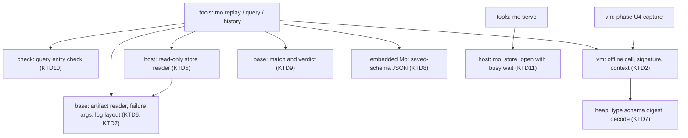
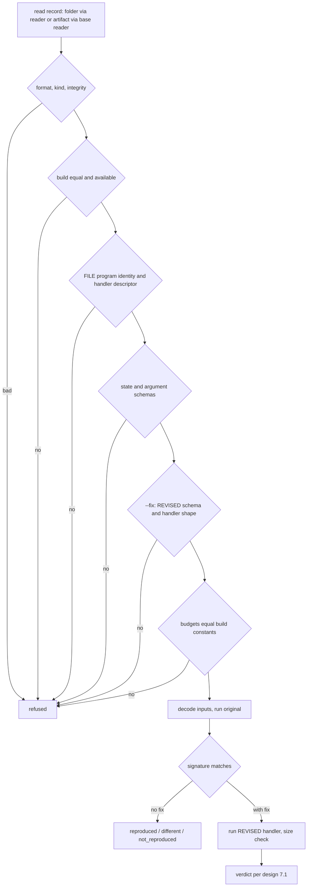
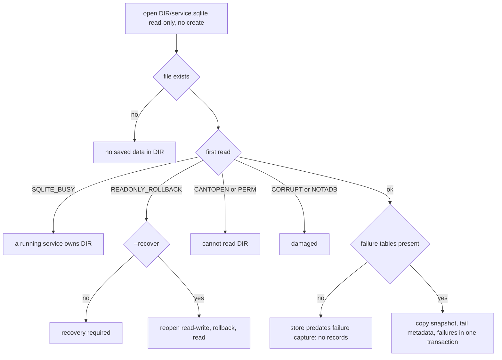

# Phase 4 Offline Diagnosis - Plan

## Goal Capsule

- **Objective:** An agent with a shell on a Mo service's host can replay a retained handler failure and learn whether it reproduced. It can check a revised handler against the same inputs and get a verdict that is never `verified` unless the original reproduced. It can run its own pure function over an exported state or a failure's inputs, and read a stopped data folder's persisted history without starting the service. Every incompatibility is refused by name before anything runs.
- **Means:** replay lifts the service's own recovery-replay call path and shares capture's signature code (KTD2); a dedicated read-only store reader classifies the folder by SQLite's result codes (KTD5); identity and schema checks run separately before any decode (KTD4).
- **Authority:** the phase plan (`docs/plans/2026-11-03-1704-feat-phase4-see-inside-plan.md`) governs scope, order and acceptance through its U5, R14–R19, R26, R28 and KTD4–KTD5. The approved design (`docs/design/introspection.md`) governs interfaces, formats and limits, except where KTD1 amends it; each amendment lands in the design document before the code that depends on it. `AGENTS.md` governs checks and merging. Within those, this document decides.
- **Execution profile:** one PR, the phase plan's PR8. It is built on phase U4's branch (PR #301, `feat/failure-capture-retention`) and merges after it. Units land in dependency order inside the PR; the serve lock wait (U2) is in place before any command can open a data folder.
- **Finishing:** the implementer opens the PR with the repository template and the checks in the Verification Contract. Robert reviews and merges, and approves the reference §13.4 and §15 changes as guarantee claims.
- **Stop and report:**
  - a seeded reproducible failure cannot be replayed to `reproduced`;
  - the work needs a store `user_version` or language-rule change;
  - PR #301 changes in review in a way that removes a replay input from the record;
  - a type's saved-schema digest cannot be computed without a value;
  - the vendored SQLite cannot tell a live owner from a hot journal on a read-only open.

  Resolve each in this plan and the design document before the dependent unit proceeds.

---

## Product Contract

### Summary

Three offline commands, `mo replay` (with `--fix`), `mo query` and `mo history`, plus the `mo serve` lock wait that must precede them. They implement the phase plan's U5: replay of a retained failure on its recording build and program, an original-first fix verdict, pure queries over an export or a failure's inputs, and persisted history from a stopped folder through a reader that never starts the service. The unit also delivers the verification the design promised and nothing yet provides: Lean models of reconstruction and the verdict, an axiom check, a fuzz target and CBMC proof for the export-file reader, the live-mailbox regression, and a cross-check against the independent grader. Two adjacent refactors are in because the commands need them: capture and replay share the signature and context code, and the CLI flag table becomes one row per flag.

### Problem Frame

Phase U4 (PR #301) leaves each counted handler failure as a retained record, or as an explicit "record unavailable", and lets an agent fetch it as a private file. Nothing can use that record yet. An agent still diagnoses by reading source and simulating by hand, which the pilots showed to be slow and error-prone (`learnability/phase4/pilot/findings.md`). A replay that reports `reproduced` without matching what capture saw, or a fix check that blesses an unreproduced failure, would be worse than none: the design's narrow promise (§1) is only worth having if it is enforced exactly.

### Key Decisions

- **The runtime build identity is the SHA-256 of the `mo` executable, and replay runs only on the recording build.** (approved 2026-11-04, design §12.1) Governs R3, R11, R12.
- **History is the log since the last snapshot; no archive.** (approved 2026-11-04, design §12.5) Governs R9.
- **`mo serve` waits up to 10 seconds for a store lock another process holds, then exits 75.** (approved 2026-11-04, design §12.3) Governs R13.
- **Schema changes are refused; migration is Phase 5.** (phase plan R18) Governs R4, R11.

### Requirements

IDs are local to this plan; the phase plan's ID follows in parentheses.

**Replay**

- R1. (phase R14) `mo replay FILE --failure ID (--data DIR | --export ARTIFACT)` runs the recorded handler on the record's pre-call state, arrival time and arguments, and reports the original message, the pre-call state, the signature, and the regenerated stack with top-frame variables, marking fields unavailable or truncated.
- R2. (phase R15) Replay classifies its outcome as `reproduced`, `different`, `not_reproduced` or `refused` by the structured signature of design §6.2, never by rendered text; a memory failure that does not recur offline says that live heap occupants are not reconstructed.
- R3. (phase R19) Replay runs only under the record's budgets, and refuses a record whose budgets differ from the recording build's own limits.

**Fix check**

- R4. (phase R16, R19) `mo replay … --fix REVISED` replays the original first, then runs the handler of the same name from REVISED on the same inputs and budgets, and reports both outcomes with the verdict of design §7.1; the verdict is never `verified` unless the original reproduced.
- R5. For an updating tool or a timer, the revised run succeeds only when its new state passes the saved-copy size check; the revised outcome reports the reply kind (`ok` or `error`) and whether the state changed.

**Query**

- R6. (phase R16) `mo query FILE FUNCTION --export ARTIFACT` runs `FUNCTION(state)`, and `mo query FILE FUNCTION (--data DIR | --export ARTIFACT) --failure ID` runs `FUNCTION(state, time, arguments…)`; the result prints in `mo`'s structural text form or, with `--json`, as JSON.
- R7. (phase R16, AE7) The entry is a non-generic top-level function of FILE's main module, or `Module.name` of a module the program uses; its parameters and result hold no capability or function; its first parameter is exactly the state type of FILE's main service; a failure query's remaining parameters are `Time` and the handler's argument types in order.
- R8. (phase R19) A query runs under named limits, `--max-work`, `--max-heap`, `--max-stack` and `--max-depth`, each defaulting to a value in `src/base/limits.h`; a query that stops on a limit names it.

**History**

- R9. (phase R17) `mo history DIR` shows the last snapshot, labelled with its sequence and the number of later messages not applied. It also shows the log tail's metadata (sequence, handler, arrival, argument sizes) and each retained failure with its build label, its digest and whether this build can replay it. It does this without starting the service or running its timers, and says that messages before the snapshot are gone, so absence from the tail is not proof a message never ran.
- R10. (phase AE6) The reader refuses a folder a running service owns, a hot journal unless given `--recover`, and a folder it cannot read, each with its own message; it never waits for a lock, and it bounds what it copies by `MO_LIMIT_HISTORY_BYTES`, reporting what it read and what it left.

**Compatibility**

- R11. (phase R18) Each check of design §7.4 runs separately, on both programs for `--fix`, before any value is decoded or any handler runs; a refusal names what differs and both values.
- R12. An artifact of the wrong kind, a record whose build cannot be identified or is not this one, and a store from before failure capture are each refused with their own reason; history lists such records without offering to replay them.

**Serve**

- R13. `mo serve` waits up to `MO_LIMIT_SERVE_STORE_WAIT_US` for a store lock another process holds; when the wait ends it exits 75 with a message naming the cause, and a store that is damaged or unreadable still fails at once as today.

**Output and documentation**

- R14. `--json` writes one object per line in the `mo test --json` shape; exit statuses follow design §7.3 as amended by KTD1.
- R15. (phase R26) The agent guide, reference §13.4 and §15, and the conformance map describe the commands as they ship, and `guide_claims` runs each claim the guide makes about them.

**Verification**

- R16. (phase R28) The Lean reconstruction and verdict properties, the axiom check, the differential cases, the fuzz targets and CBMC proofs for the new readers, the live-mailbox regression and the grader cross-check all exist and pass. Each has its prediction written before it runs, and failed runs are kept.

### Acceptance Examples

- AE1. (phase AE4) **Covers R1, R2.** Given a failure from `stop` in a tool handler, when replayed from the stopped folder and from its fetched artifact, then both report `reproduced` with the same reason, function and span; given a program whose handler stops at a different span, then the outcome is `different`.
- AE2. (phase AE9) **Covers R2, R4.** Given a handler that ran out of heap live because the mailbox held large queued arguments, when replayed, then the outcome is `not_reproduced` with the live-memory note; `--fix` with the unchanged handler is `unverified`.
- AE3. (phase AE9) **Covers R3, R4.** Given a work-limit failure, when `--fix` names a revision that still exceeds the recorded work budget, then the verdict is `not_fixed`.
- AE4. (phase AE5, AE17) **Covers R7, R11.** Given an exported state, a query program that only adds a function is accepted. A program that renames a state field is refused with both schema digests, and a failure query whose parameters reorder the handler's arguments is refused before anything runs.
- AE5. (phase AE7) **Covers R7.** Given a query entry whose parameter holds a capability inside a record, the entry check refuses it before the artifact is read.
- AE6. (phase AE6, AE18) **Covers R9, R10.** History on a stopped folder shows the snapshot as of its sequence, the tail and the failures, and runs no timer. On a folder a service is running, it refuses at once. On a folder with a hot journal it reports recovery required, and with `--recover` it rolls the journal back and then reads.
- AE7. **Covers R4.** Given the synthetic variant's retained `stats` failure, the unfixed program is `not_fixed`, the reference fix is `verified` and passes the grader, and the broken fix is `verified` but fails the grader.
- AE8. **Covers R13.** Given a reader holding the store for 3 seconds, `mo serve` starts after the reader closes; given a lock held for longer than the wait, `mo serve` exits 75 and the store is unchanged.
- AE9. **Covers R4, R11.** Given a revision that adds a field to the state type, `--fix` is refused before the original runs, and the refusal says the fix changes the state type.

### Success Criteria

- The guide's offline how-to, followed literally by the acceptance driver against a real `mo serve`, reaches every verdict and every refusal it describes.
- Every cell of the verdict table and every separate compatibility check has a test that a mutant relaxing it fails.
- The Lean theorems depend on no axiom beyond `propext`, `Classical.choice` and `Quot.sound`, and the check that says so fails on a planted `sorry`.

### Scope Boundaries

- No current state for a stopped folder and no state query over `--data`: reconstructing the current state means re-running the tail through the handlers, which is recovery. History shows the snapshot labelled as such.
- No replay on another build, no cross-build compatibility, no schema migration (design §7.4, phase plan scope).
- No archive of messages before the snapshot (design §12.5).
- No replay of a successful committed message by log position, and no in-process queries (phase plan deferred list).
- Records captured by a build without `mo replay` cannot be replayed. That includes the phase-U4-only builds between PR #301 and this PR. The guide says so, and history lists them as not replayable here.
- Considered and not built:
  - **Git commit in the build label.** The refusal names the recorded digest, and the guide gives the `sha256sum` route to find the recording `mo`. Revisit if agents in U6 fail to locate builds.
  - **Raising the task-queue unit's start limits.** Exit 75 plus `StartLimitBurst=5` in 600 seconds tolerates about 75 seconds of continuous contention, and the reader holds its lock only while copying. The runbook documents exit 75 and `start-limit-hit`. Revisit if a measured reader holds the lock for more than a few seconds.
  - **Opening the store before the listener in `mo serve`.** A waiting serve holds its port for up to 10 seconds, which is harmless, and reordering changes the announcement contract the drivers pin.
  - **Parsing the captured context text into JSON fields.** Replay regenerates the stack and variables from the live run, so the stored text stays context only (design §6.1 item 8).

### Dependencies / Assumptions

- PR #301 merges with the record layout of commit `c63a8bae`: `src/base/failure.h`, store kinds 3 and 4, and MOEX kind 2.
- The vendored SQLite (3.54.1) reports a live exclusive owner as `SQLITE_BUSY` and a hot journal on a read-only open as `SQLITE_READONLY_ROLLBACK`, as measured on the system SQLite 3.53.1. U3's tests confirm this against the vendored copy.
- Lean v4.34.0 (elan), TLC and CBMC are installed on the implementation machine; a skipped group is not a pass.

### Outstanding Questions

**Gates on merging**

- PR #301 merges first.
- Robert approves the reference §13.4 and §15 changes.

**Deferred to Implementation**

- Exact function, file and code names.
- The value of `MO_LIMIT_OFFLINE_VALUE_BYTES` (KTD8), sized from the largest task-queue state.
- Whether the history JSON reuses the embedded views' functions for log and failure objects or only their field names (KTD8 requires the field names).
- The measured lock duration of the reader on the boundary datasets (U10).

### Sources / Research

- `docs/design/introspection.md` §4, §6, §7, §8, §9, §10 and §11, and the phase U4 appendix (on PR #301's branch, from line 942).
- `src/vm/service.c`: `restore_record` (recovery replay, about lines 284–378), `call_message`, `invoke`, `replacement`, `saved_copy`, `capture_failure` (about 760–917). These are the seam KTD2 lifts.
- `src/base/failure.{h,c}` (`mo_failure_read`), `src/base/export.{h,c}` (`mo_export_verify`), `src/heap/saved.c` (`write_schema`, `mo_value_decode`), `src/host/store.c` (`mo_store_open`, `load`, `failure_read`).
- `src/check/services.c` (`handler`) and `src/check/captures.c` (`mo_check_service_purity`), the pattern for KTD10.
- `src/tools/cli.c` (flag table), `src/tools/execute.c` (pipeline), `src/tools/render.c` (`mo_write_version`, totals, `state_literal`), `src/tools/fetch.c` (named-function call into the embedded image), `runtime/mcp-views.mo` (`saved_state`).
- `learnability/phase4/testdata/variants/synthetic/` and `learnability/phase4/grade.py`: the cross-check fixture and oracle. `learnability/phase4/fixture.py` (`log_records`) is an independent folder reader.
- `learnability/phase4/failure-capture/results/verification.md` and `learnability/phase4/private-fetch/results/verification.md` show how earlier units laid out predictions and kept failures.
- `docs/status/agent-mistakes.md` classes 1, 6, 7, 8, 9 and 12 apply: stale usage strings and guide lines, tests without negative controls, overload names (`tick@Count`), unnamed limits, `make deps` drift, relayed rules contradicting the approved one.

---

## Planning Contract

**Product Contract preservation:** carried from the phase plan's U5. Its R14–R19, R26 and R28 and its AE4–AE7, AE9, AE17 and AE18 are restated as local R1–R16 and AE1–AE9, each tagged with its phase ID; there is no scope change. R5, R12 and R13 make explicit what design §7.1, §4 and §9 already imply. The design details this plan changes are listed in KTD1.

### Key Technical Decisions

- KTD1. **Amend the approved design in the places research found wrong or unprovable, in `docs/design/introspection.md` first.** (session-settled: user-approved — chosen over implementing the design as written: these points contradict existing code or prove nothing.) Each amendment gets a row in "Approval and changes":
  - §7.3: the totals record keeps `"status"`, as `mo test --json` and `ci/check_cli.py`'s `records()` do; the version record allows the new commands. A query whose function stops exits 70 with the defect report, as `mo run` does (reference §13.2).
  - §7.4, history row, and §9: `mo history` takes no FILE. Values render from the saved schema alone (KTD8). Snapshots carry no build identity, so the snapshot is shown with "producer build not recorded", and each failure record shows its own build and whether this build can replay it.
  - §9: liveness and hot journals are classified by SQLite's result code, never by whether a `-journal` file exists. A permission failure gets its own message. The reader never waits. The owned, recovery-required and unreadable refusals exit 1.
  - §4: its sentence on pre-Phase-4 state becomes "their state can be read by `mo history`; a state query needs an export from a Phase 4 build". Records from a build without `mo replay` are evidence only.
  - §7.1: timers get the saved-copy check like updating tools. An `Error` reply is a success that reports its kind. Both programs are checked before anything runs. Budgets are compared with the build's constants (KTD3).
  - §7.2: the state type is that of FILE's main service. Generic entries are refused. A function is selectable whether or not its module exposes it. The capture clause is dropped, since a named top-level function captures nothing.
  - §8: `--max-work` counts through the controlled-call hook, with default `MO_LIMIT_QUERY_WORK`.
  - §11.1: the corollary "replay twice gives the same outcome" is dropped, because the existing `eval_deterministic` (`formal/MoCore/Theorems.lean`) is `h₁ ▸ h₂` and proves nothing about replay. What it was meant to show, that replay runs on exactly the recorded inputs, is carried by KTD12's round-trip theorem over the input tuple.
- KTD2. **The offline call is the recovery-replay pipeline lifted out of the service loop, and capture and replay share one signature function and one context renderer.**
  - `restore_record` already decodes a state and arguments, calls the handler, takes the replacement state and saved-copies it. `call_message`, `invoke`, `replacement` and the store-backed half of `saved_copy` move into a vm function. It takes a process, a service descriptor, a timer flag, a handler index, the state cell, an arrival time and the argument cells, and returns status, reply, defect and saved-copy status.
  - The `MO_LIMIT_SERVICE_WORK + 1` poll formula lives inside that function, so its callers cannot drift.
  - The signature computation and the context rendering in `capture_failure` become vm functions that both capture and replay call; the signature function returns the base type of KTD9. That makes `reproduced` a comparison of the same function's output on two runs. A new vm accessor walks the frames of a work-cancelled call, which today only capture reaches through VM internals.
  - Each run gets its own process, freed with `mo_process_free`. Simulation is not reused: opening it runs the interval functions and queues every timer.
- KTD3. **Replay compares the recorded budgets with the build's constants and refuses a mismatch; it never runs with budgets read from the file.** (session-settled: user-approved — chosen over passing recorded budgets into `mo_process_new`: replay already requires the same build, so a differing budget means a damaged or crafted record, and nothing bounds a file-supplied budget.) The constants are `MO_LIMIT_SERVICE_WORK`, the service process's default limits and `MO_LIMIT_SAVED_BYTES`.
- KTD4. **Compatibility checks run in one fixed order, on both programs, before any decode or execution, and each refusal is an outcome record, not a coded diagnostic.**
  - The order:
    1. artifact format, kind and integrity;
    2. runtime build available and equal to the record's;
    3. FILE's program identity equal to the record's image key;
    4. the handler descriptor (index, name, timer and read-only flags, argument count) against FILE;
    5. the state schema digest;
    6. each argument's schema;
    7. for `--fix`, REVISED's state schema and its handler's name, kind, argument types and result shape class;
    8. the record's budgets equal to the build's constants (KTD3).
  - Which steps apply follows design §7.4's table. `mo replay` runs all of them, and under `--fix` steps 3 and 4 apply to FILE only. A state query runs steps 1, 2 and 5. A failure query runs steps 1, 2, 5 and 6, with step 6 matching the entry's trailing parameters to the record's argument schemas; its program may differ, so steps 3, 4 and 8 do not apply.
  - A refusal prints `refused` with the field and both values, and exits 1. These cannot be static `tests/errors` fixtures, because the build digest differs per binary; they follow `mo fetch`'s uncoded refusal lines.
  - Entry-rule violations (KTD10) depend only on source, so they are coded diagnostics from E1410 with `tests/errors` cases. An unknown FUNCTION or a misused flag is a command mistake, exit 2.
  - The program refusal adds that FILE must be the untouched source that recorded the failure, since any byte change in any module changes the program identity. REVISED is a main module whose sibling modules resolve from its own folder.
- KTD5. **The history and replay reader opens read-only, classifies by SQLite result code, and copies inside one read transaction.**
  - The open: a new host function with no CREATE, normal locking mode, no `journal_mode` or `locking_mode` pragmas, no busy timeout, and a check-only form of the table check.
  - The classification: `SQLITE_BUSY` means owned; `SQLITE_READONLY_ROLLBACK` means recovery required; `SQLITE_CANTOPEN` or `SQLITE_PERM` means cannot read; corrupt or not-a-database means damaged; a missing file means no saved data.
  - Missing failure tables mean a store from before failure capture, with no records; nothing is created.
  - `--recover` opens read-write without CREATE and lets SQLite roll the journal back; the output says the rollback wrote pages.
  - Log rows stream through SQLite's incremental blob reads in fixed chunks, so the FNV-1a check covers every byte while only metadata is retained. Retained bytes count against `MO_LIMIT_HISTORY_BYTES`.
  - The reader reuses `load` and `failure_read` logic through the existing `struct mo_store` paths.
- KTD6. **The log record layout moves to `base`, beside `failure.h`, shared by the writer in `vm` and the reader in `host`.** `host` may not depend on `vm`. A metadata walk over the 25-byte header and the length-prefixed arguments, reading through a bounded offset callback, lets the reader report argument sizes without holding argument bytes. The walk gets a fuzz target.
- KTD7. **One artifact reader in `base` returns the identity, the payload spans and the parsed failure record; `mo_export_verify` becomes a wrapper over it.**
  - A per-argument iterator joins `base/failure.c`.
  - A heap function writes a runtime type's expected schema bytes without a value, exposing `write_schema`. That lets the schema check run, and report both digests, before `mo_value_decode`.
  - The artifact reader and the iterator are the targets of `fuzz_artifact` and the new CBMC harnesses.
  - `fuzz/fuzz_fetch.c`'s assertion that every verified artifact is kind 1 is corrected for kind 2.
- KTD8. **Values print as structural text through `mo_value_print` when a program is in hand, and as JSON through the embedded views' saved-schema renderer.**
  - The renderer, `runtime/mcp-views.mo` `saved_state`, needs no program types, which is what lets `mo history` take no FILE.
  - A new exposed renderer entry for complete offline output is added to the embedded ABI table, with its budget named `MO_LIMIT_OFFLINE_VALUE_BYTES` and truncation marked.
  - History's and replay's JSON objects for log entries and failures use the live views' field names, checked by the acceptance driver against `mo-failures` for the same record.
  - A log row stores only the handler's index and timer flag, and history has no program, so a tail entry shows those two with the name marked "not recorded in the log": in JSON, `handler` is null and `handler_index` carries the index. This is the one field that differs from `mo-log`. Failure entries keep their recorded names.
- KTD9. **Signature matching and the verdict are pure functions in `base`, over signature and outcome types `base` also owns, tested exhaustively and mapped cell by cell to the Lean model.**
  - `base` may use no other module, so the structured signature type lives in `src/base/verdict.h`, built from the fields `mo_failure_record` already carries; vm's shared signature function (KTD2) returns it.
  - Matching follows design §6.2: class plus reason, function and span for `defect`; limit value for `work`; limit name and value for `memory`; the saved-bytes limit for `state_size`. `native allocation` matches only itself.
  - The verdict follows design §7.1 with KTD1's amendments.
  - Timers count as updating for the size check. An `Error` reply is a success whose outcome reports `reply: error` and `state_changed: false`. (session-settled: user-approved — chosen over counting an `Error` reply as a failure: live, an `Error` reply records nothing and is not a handler failure.)
- KTD10. **The query entry check is a public `check/check.h` function built from the service handler pattern.**
  - The pattern is `handler()` in `src/check/services.c`: resolve the name through checker symbols (never bytecode strings, which carry `@Receiver` suffixes on overloads), refuse generics before the purity walk asserts on them, apply `mo_check_service_purity`'s type walk to every parameter and the result with query wording, and match the first parameter to the main service's state type.
  - Lowering returns the Core function index of the checked entry, as `service_handler` does for handlers through `mo_lower_services`, and `tools` maps that index to bytecode the way the compiled service descriptors map handler indices. Matching names, as `src/tools/run.c` does for `main`'s `%entry` wrapper, would hit the `@Receiver` suffixes.
  - Lowering keeps every non-generic function, so a query function nothing calls is still in the image.
  - (session-settled: user-approved — chosen over requiring the function to be exposed: selection is an operator action like `mo test --only`, and module privacy already governs the body.)
- KTD11. **The serve wait is a busy timeout on serve's own store open only.**
  - `mo_store_open` sets `sqlite3_busy_timeout` for its first locking statements when asked, and maps a timeout to a new `MO_STORE_BUSY`. `mo serve` maps that to `MO_EXIT_STORE_BUSY` (75) with an uncoded message naming a reader or a second `mo serve`; exit 75 cannot be a `tests/errors` case, which requires exit 1.
  - `MO_LIMIT_SERVE_STORE_WAIT_US` is `#ifndef`-overridable, shortened in a test build by the renames pattern `MO_LIMIT_FETCH_US` uses.
  - The listener order is unchanged.
- KTD12. **The Lean model defines its own saved schema and abstract outcomes rather than reusing Core types.**
  - `MoCore/Saved.lean` defines a schema type from the tag table in `docs/design/saved-state.md`, with records apart from choices and type parameters, and saveable values with distinct map keys. It proves the round trip and the refusal of a differing schema. Core `Ty` and `ValTy` lack the record/choice split and allow duplicate keys.
  - `MoCore/Verdict.lean` defines outcomes and signatures with decidable equality. It proves the verdict sound and complete against an independently written specification, `verdict o r = verified ↔ reproduced o ∧ succeeded r ∧ sizeOk r`, and proves the matching relation of KTD9.
  - The negative controls: a verdict that accepts a successful revision alone, and a decoder that ignores the schema, are each refuted by a concrete counterexample.
  - Each theorem carries `#guard_msgs in #print axioms`, so `lake build MoCore` fails on axiom drift, and a script in the `lean` group confirms that a planted `sorry` is caught.
  - The differential check covers defect-class replays only, with inputs written by the fixture author in Core text, so no C value printer is involved. Work, heap and size classes are excluded by name, since Lean fuel is not VM work.
- KTD13. **The grader cross-check asserts a one-way relation, not agreement.** (session-settled: user-approved — chosen over requiring the fix checker and grader to agree: a fix that removes the failure but computes a wrong answer is `verified` by design §1 and fails the hidden tests.) Grader pass implies a verdict other than `not_fixed` on the recorded inputs. The synthetic matrix (AE7) runs in `bench`; the six private variants run by hand and their result goes in the PR body.

### High-Level Technical Design

Where the pieces live, and who calls whom. Module edges are the existing ones in `ci/deps.sh`; nothing needs a new edge.

A replay or fix check, from inputs to verdict:

How the reader classifies a data folder:

### Implementation constraints and sequencing

- C rules from `AGENTS.md` and `docs/design/implementation.md`: named limits, arenas, checked results, no silent conversions, both gcc and clang builds, a fuzz target for every outside-input reader, and fault injection by compile-time renaming. Code moved out of `src/vm/service.c` must join the Makefile's service fault rule sets, which today rename symbols only inside that file.
- Order inside the PR: U1 first; U2 before U3's reader is reachable from any command; U3, U4, U6 and U7 in parallel, then U5 on U7's signature type; U8 after them; U9's proofs in parallel with U3–U8, with its differential after U8; U10 last.
- `ci/check_cli.py`'s flag table, `mistake()` strings and `tests/test_cli.c` pin the usage strings, so all three change with the commands.

---

## Implementation Units

The U-IDs below are local to this plan, distinct from the phase plan's U1–U9.

| U-ID | Title | Key files | Depends on |
| --- | --- | --- | --- |
| U1 | Design amendments and predictions | `docs/design/introspection.md`, `learnability/phase4/offline/` | — |
| U2 | Serve lock wait and exit 75 | `src/host/store.c`, `src/tools/serve.c`, `docs/ops/task-queue.md` | U1 |
| U3 | Log layout in base and the read-only reader | `src/base/log-record.*`, `src/host/store.c`, `fuzz/fuzz_log_record.c` | U1 |
| U4 | Artifact reader, argument iterator, type schema digest | `src/base/export.*`, `src/base/failure.*`, `src/heap/saved.c`, `fuzz/fuzz_artifact.c`, `cbmc/` | U1 |
| U5 | Offline call shared with capture | `src/vm/service.c`, `src/vm/offline.c`, `src/vm/vm.h` | U1, U7 |
| U6 | Query entry check | `src/check/check.h`, `src/check/services.c`, `src/lower/lower.h`, `tests/errors/` | U1 |
| U7 | Signature matching and verdict | `src/base/verdict.*`, `tests/test_verdict.c` | U1 |
| U8 | The commands, their output and their documentation | `src/tools/`, `runtime/mcp-views.mo`, `docs/agent-guide.md`, `docs/reference/README.md` | U2–U7 |
| U9 | Lean models, axiom check and differential | `formal/MoCore/Saved.lean`, `formal/MoCore/Verdict.lean`, `ci/check_offline_core.py` | U1; differential U8 |
| U10 | Acceptance driver, grader cross-check, measurements | `ci/check_offline.py`, `learnability/phase4/test_offline.py`, `ci/check_kill_loop.py` | U8 |

### U1. Design amendments and predictions

- **Goal:** The design document states the contract this PR implements, and the predictions for every property check are committed before any of them runs.
- **Requirements:** R14, R16; KTD1.
- **Dependencies:** none.
- **Files:** `docs/design/introspection.md` (§4, §7.1–§7.4, §8, §9, §11.1, "Approval and changes"); `learnability/phase4/offline/README.md`; `learnability/phase4/offline/results/predictions.md`.
- **Approach:**
  1. Apply each KTD1 amendment in its section and add one dated row per amendment, citing this plan.
  2. Add an "Offline commands implementation evidence" section header for U10 to fill.
  3. Write `predictions.md`: for each property in R16 and each verdict cell, the expected result and the check that will show it. This follows `learnability/phase4/failure-capture/results/verification.md`.
- **Test expectation:** none. This is documentation; `bash ci/check.sh drivers static` runs in U8 after the guide and reference change.
- **Verification:** every KTD1 bullet has a matching design-document change and change-table row; the predictions file exists in the first commit that adds a check.

### U2. Serve lock wait and exit 75

- **Goal:** A reader or a second `mo serve` holding the store delays a starting service by at most 10 seconds and then lets the service manager retry, instead of stopping it for good.
- **Requirements:** R13; AE8; KTD11.
- **Dependencies:** U1.
- **Files:**
  - `src/host/store.c`, `src/host/host.h` (`MO_STORE_BUSY`, an opt-in wait on open);
  - `src/base/limits.h` (`MO_LIMIT_SERVE_STORE_WAIT_US`);
  - `src/tools/serve.c`, `src/tools/tools.h` (`MO_EXIT_STORE_BUSY`);
  - `Makefile` (a short-wait test build);
  - `tests/test_service_store.c`;
  - `ci/check_cli.py` (the case at about line 1834 that expects E1409 at once, and the guide claim near line 1704);
  - `docs/agent-guide.md` (the E1409 line near 223, exit statuses);
  - `docs/reference/README.md` §13.4;
  - `docs/ops/task-queue.md` (exit table, the start-limit note).
- **Approach:**
  1. Add the wait and the busy status in `host`; only serve's call asks for the wait.
  2. Map the busy status to exit 75 in serve, with a message naming the cause.
  3. Update the pinned driver case, the guide line and the runbook together (mistake class 1).
- **Patterns to follow:** `MO_LIMIT_FETCH_US` and `FETCH_DEADLINE_RENAMES` in the `Makefile` for the overridable limit; `MO_EXIT_SERVICE_STOPPED` for the exit constant.
- **Test scenarios:**
  - Covers AE8. A second process holds the database in exclusive mode for less than the (shortened) wait: the open succeeds and the service recovers its state.
  - The lock is held past the wait: the open returns the busy status, serve exits 75, and the store's bytes are unchanged.
  - A second `mo serve` on a live folder exits 75 after the real 10-second wait (driver, replacing the E1409 expectation).
  - A zero-length or corrupt store still fails at once with E1409 and exit 1.
  - Three successive starts against a held lock each exit 75 and change nothing; after release the next start recovers the same state.
- **Verification:** the unit and driver cases pass; the guide, reference §13.4 and runbook list 75.

### U3. Log layout in base and the read-only reader

- **Goal:** A stopped data folder can be read without starting the service, without a lock that outlives the copy, and without trusting a row it has not checked.
- **Requirements:** R9, R10, R12; AE6; KTD5, KTD6.
- **Dependencies:** U1.
- **Files:**
  - `src/base/log-record.h`, `src/base/log-record.c` (new: layout constants, encoder used by `persist`, bounded metadata walk);
  - `src/vm/service.c` (`persist` and `restore_record` use the base layout);
  - `src/host/store.c`, `src/host/host.h` (read-only open, classification, snapshot and tail-metadata copy, failure pair read, `--recover` open);
  - `src/base/limits.h` (`MO_LIMIT_HISTORY_BYTES`);
  - `Makefile` (store fault doubles reach the reader);
  - `tests/test_service_store.c`, `tests/test_log_record.c` (new);
  - `fuzz/fuzz_log_record.c` with `fuzz/corpus/fuzz_log_record/`;
  - `cbmc/log-record.c`, `cbmc/prove.sh`, `cbmc/README.md` (the walk's length and offset arithmetic, in the shape of `cbmc/failure.c`).
- **Approach:**
  1. Move the log layout to base without changing a byte; the recovery checks prove it.
  2. Build the read-only open and the classification of KTD5.
  3. Copy the snapshot frame, the tail metadata and the failure catalog inside one read transaction, streaming each log row for its checksum.
  4. Read one failure pair by id for replay. An unknown or evicted id reports the retained ids. Ids are never reused within a folder, so a gap means a replaced or evicted record.
- **Execution note:** Characterize first. Run the existing recovery and kill-loop checks against the moved layout before adding the reader.
- **Patterns to follow:** `load` and `failure_read` in `src/host/store.c`; `fuzz/store_record.h` for the fuzz wrapper; `mo_store_fault_step` doubles for injecting result codes.
- **Test scenarios:**
  - Covers AE6. A folder written by a stopped service: the reader returns the snapshot sequence, every tail entry's sequence, handler index, timer flag, arrival and argument sizes, and every failure's id and kind key, equal to what the service wrote.
  - The database held by a live owner: the read-only open is classified as owned and returns at once.
  - A hot journal (an injected `SQLITE_READONLY_ROLLBACK`, and a real process killed mid-transaction): classified as recovery required. With `--recover` it rolls back, and a later `mo serve` starts on the pre-transaction state.
  - A service killed while idle leaves a `-journal` file that is not hot: the reader reads normally.
  - A store without failure tables: zero records, no table created, file bytes unchanged.
  - A folder the user cannot read: classified as cannot read, never as missing or damaged.
  - A missing `service.sqlite`: "no saved data", and no file is created.
  - A log row whose checksum fails: refused naming the sequence.
  - Retained bytes over a shortened `MO_LIMIT_HISTORY_BYTES`: the result reports what was read and what was left.
  - The reader killed mid-copy: no lock survives, and `mo serve` starts at once.
  - Without `--recover`, the database file's bytes are unchanged after any read.
  - The log walk refuses truncated headers, a length past the end, a count that disagrees with the arguments, and trailing bytes; writer then walk round-trips.
- **Verification:** unit tests pass under gcc, clang and sanitizers; `make deps` passes; the fuzz target reaches the walk.

### U4. Artifact reader, argument iterator and type schema digest

- **Goal:** Offline commands get an export's identity, payload and parsed failure record from one bounded reader, and can compare a program's types with the artifact's schemas before decoding.
- **Requirements:** R1, R6, R11, R12; KTD7.
- **Dependencies:** U1.
- **Files:**
  - `src/base/export.h`, `src/base/export.c` (the reader; `mo_export_verify` as a wrapper);
  - `src/base/failure.h`, `src/base/failure.c` (per-argument iterator);
  - `src/heap/heap.h`, `src/heap/saved.c` (schema bytes and digest for a runtime type);
  - `tests/test_export.c`, `tests/test_saved_state.c`, `tests/test_service_store.c`;
  - `fuzz/fuzz_artifact.c` with `fuzz/corpus/fuzz_artifact/` (a kind-1 seed from `fuzz/corpus/fuzz_fetch/artifact`, a kind-2 seed);
  - `fuzz/fuzz_fetch.c` (the kind assertion);
  - `cbmc/artifact.c`, `cbmc/failure.c`, `cbmc/prove.sh`, `cbmc/README.md`.
- **Approach:**
  1. Extend the export reader to return identity, spans and the parsed record. The existing callers keep their behaviour.
  2. Add the argument iterator over `mo_failure_record.arguments`.
  3. Expose schema writing for a runtime type and hash it with `mo_sha256`.
  4. Add a bounded read of an artifact file into a confidential arena, as `src/tools/fetch.c` does.
  5. The CBMC harness covers the kind-1 header walk, with digest, UTF-8 and schema callees modelled as in `cbmc/export.c` and a least input size of at least 172 bytes; the iterator extends `harness_slice`. Each scope goes in `cbmc/README.md`.
- **Patterns to follow:** `cbmc/export.c` (nondet input, exact acceptance oracle, refusal preserves outputs, `reached_end`); `fuzz/fuzz_export.c` (independent oracle); `fuzz/fuzz_service_failure.c` (truncated-prefix refusal).
- **Test scenarios:**
  - A kind-1 and a kind-2 artifact from real captures return the same identity as `mo_export_verify` and spans that decode to the captured state, message and arguments.
  - Every strict prefix of a valid artifact is refused; a flipped byte in the body, the trailing digest or a frame checksum is refused.
  - The type schema digest of the task queue's state type equals `mo_export_schema` over an encoding of that state; a renamed field, an added field and a reordered choice each give a different digest.
  - The iterator yields each argument's encoded value in order, and refuses a count that disagrees with the bytes.
  - `fuzz_fetch` accepts a kind-2 artifact without tripping its assertion.
- **Verification:** unit tests and both fuzz targets' smoke runs pass; `bash cbmc/prove.sh` and its reach check pass for the new harnesses, with their bounds recorded.

### U5. Offline call shared with capture

- **Goal:** One function runs a handler on given inputs exactly as the service does, and capture and replay compute signatures and context with the same code.
- **Requirements:** R1, R2, R3, R5; AE1, AE2, AE3; KTD2, KTD3.
- **Dependencies:** U1; U7 for the signature type.
- **Files:**
  - `src/vm/vm.h`;
  - `src/vm/service.c`;
  - `src/vm/offline.c` (new; or kept in `service.c` if the fault rules make that simpler);
  - `Makefile` (service fault rule sets);
  - `tests/test_service_runtime.c`, `tests/test_service_store.c`, `tests/test_recovery.c`.
- **Approach:**
  1. Lift the call pipeline of KTD2 and make `restore_record` and `mo_service_step` call it.
  2. Factor the signature and context rendering out of `capture_failure`, and add the frame walk for a cancelled call.
  3. Expose the budget constants replay compares against (KTD3).
- **Execution note:** Characterize first. Every existing recovery, capture and runtime test must pass unchanged after the lift and before the new entry is used offline.
- **Patterns to follow:** `memory_boundary` and `work_boundary` in `tests/test_service_runtime.c`; `runtime_capture` in `tests/test_service_store.c`.
- **Test scenarios:**
  - Covers AE1. A captured `stop` failure: the offline call on the decoded record gives a signature equal field by field to the stored one, and context text equal to the stored text.
  - Covers AE3. A work-limit failure at exactly `MO_LIMIT_SERVICE_WORK`: the offline call stops at the same poll and its frame walk names the same frames.
  - Covers AE2. The `memory_boundary` setup fails live with a full mailbox; the offline call on its record succeeds, and its signature does not match.
  - An updating handler whose new state exceeds the saved-bytes limit gives the `state_size` class offline as live, and so does a timer.
  - A read-only tool's failure replays with the state unchanged.
  - Allocation faults injected into the moved code produce the existing failure policy (the fault doubles reach it).
  - A process used for one offline run is freed with no leak under ASan.
- **Verification:** the full unit suite, the kill-loop driver and the failure capture tests pass with no expectation changed.

### U6. Query entry check

- **Goal:** A query function is accepted only when it is pure, its inputs are exactly a state (and a failure's time and arguments), and its name is the one the author wrote.
- **Requirements:** R7; AE4, AE5; KTD10.
- **Dependencies:** U1.
- **Files:**
  - `src/check/check.h`, `src/check/services.c`, `src/check/captures.c`;
  - `src/lower/lower.h`, `src/lower/lower.c` (return the entry's Core function index, as `mo_lower_services` returns handler indices, KTD10);
  - `src/base/codes.h` (E1410 onward);
  - `tests/test_check.c`;
  - `tests/errors/e1410-*/` (one case per new code, `command` file `query`, a nonexistent artifact path);
  - `tests/conformance/rules.tsv` if a rule row is needed.
- **Approach:**
  1. Add the public check with the two modes, state and failure.
  2. Give the purity walk a wording parameter, so a query refusal does not print the service headline.
  3. Return the checked function so `tools` can map it to bytecode.
- **Patterns to follow:** `handler()` in `src/check/services.c`; the E0104 cases in `tests/errors/`.
- **Test scenarios:**
  - Covers AE5. A parameter record holding a capability, a function-typed parameter and a function inside a list result: each refused with the new code.
  - A generic entry is refused before the purity walk (no assertion).
  - Covers AE4. A failure query whose trailing parameters swap two argument types, omit `Time`, or add an argument: each refused.
  - A first parameter that is a different type with the same shape is refused.
  - Overloaded `tick` with receivers `Count` and `State` selects the `State` overload by name `tick`.
  - `Module.name` of an unexposed function in a used module is accepted; a module the program does not use is a mistake.
- **Verification:** `tests/test_check.c` and `ci/check_errors.py` pass; `make deps` passes.

### U7. Signature matching and verdict

- **Goal:** The rules deciding `reproduced` and `verified` are small pure functions whose every case is tested and mirrored in Lean.
- **Requirements:** R2, R4, R5; AE2, AE3, AE9; KTD9.
- **Dependencies:** U1. U5 builds on the signature type defined here.
- **Files:** `src/base/verdict.h`, `src/base/verdict.c` (new); `tests/test_verdict.c` (new).
- **Approach:**
  1. Define the structured signature and outcome types, then write the matching and verdict functions over them (KTD9).
  2. Write a table in the test file that names each design §7.1 cell and its Lean theorem (U9).
- **Execution note:** Test-first. Write the full cell table, then build each mutant (verdict ignores the original; matching ignores the span; matching accepts any memory limit) and confirm the table fails it before keeping the real code.
- **Test scenarios:**
  - Each §7.1 row: reproduced with a succeeded revision gives `verified`; reproduced with a failed revision gives `not_fixed`; different or not reproduced gives `unverified` whatever the revision did; refused gives `refused`.
  - A reproduced original with a revision that succeeds but fails the size check gives `not_fixed`.
  - A revision returning an `Error` reply gives `verified` with reply kind `error` reported.
  - A defect matches only with equal class, reason, function and span; a different span gives `different`.
  - A `memory` failure under `--max-heap` does not match one under `--max-stack` or `native allocation`.
  - Each mutant above fails at least one row (recorded in the evidence file).
- **Verification:** the test passes and the mutant results are in `learnability/phase4/offline/results/`.

### U8. The commands, their output and their documentation

- **Goal:** An agent can run `mo replay`, `mo replay --fix`, `mo query` and `mo history` as the guide describes, and get text or JSON results and exit statuses it can act on.
- **Requirements:** R1–R12, R14, R15; AE1–AE6, AE9; KTD4, KTD8, KTD10.
- **Dependencies:** U2, U3, U4, U5, U6, U7.
- **Files:**
  - `src/tools/cli.c`, `src/tools/tools.h` (flag rows: `--failure`, `--data`, `--export`, `--fix`, `--recover`, `--max-work`, `--json` for the new commands);
  - `src/tools/execute.c`, `src/tools/run.c`;
  - `src/tools/offline.c` (new: replay, fix, query, history);
  - `src/tools/render.c` (version record for new commands, outcome records, totals);
  - `src/tools/protocol.c` (ABI table entry);
  - `runtime/mcp-views.mo` (exposed offline renderer);
  - `src/base/limits.h` (`MO_LIMIT_QUERY_WORK`, `MO_LIMIT_OFFLINE_VALUE_BYTES`);
  - `tests/test_cli.c`, `fuzz/corpus/fuzz_cli/`;
  - `ci/check_cli.py` (flags table, `mistake()` strings, `guide_claims`);
  - `docs/agent-guide.md` (command list near line 9, the "not available yet" sentence near 27, exit statuses, an offline how-to beside the fetch how-to);
  - `docs/reference/README.md` §13.4 and §15;
  - `tests/conformance/rules.tsv`, `tests/conformance/reference.tsv`.
- **Approach:**
  1. Rebuild the flag table as one row per flag (name, takes a value, number kind, accepted commands), covered by the existing parse tests and `fuzz_cli`.
  2. `query` and `replay` run after compilation, beside `serve`. `history` dispatches before the pipeline, as `fetch` does.
  3. Run the KTD4 checks in order, then the offline call, then matching and verdict.
  4. Write outcome records (`original`, `revised`, `query`, `history`) and totals with `status`.
  5. In the guide's how-to:
     - use the deployed `/opt/mo/$SHA` tree as FILE and a copied folder as REVISED;
     - run as the service user, or copy the whole stopped folder including any `-journal` file, never `service.sqlite` alone;
     - find the recording build by `sha256sum`;
     - records from builds without `mo replay` cannot be replayed.
- **Execution note:** Characterize first. The flag-table rewrite lands with every existing parse test and `fuzz_cli` seed passing before any new flag is added.
- **Patterns to follow:** `src/tools/fetch.c` for calling a named function in the embedded image; `src/tools/promises.c` `arguments()` for owned and borrowed parameters; `state_literal` in `src/tools/render.c` for printing a decoded state.
- **Test scenarios:**
  - Parsing: each new flag on each command it belongs to, and refused elsewhere; `replay` without `--failure`; both or neither of `--data` and `--export`; `--fix` on `query`; `query` with one positional; a repeated flag. Exit 2 with pinned usage strings.
  - Covers AE1. `mo replay` from folder and from artifact on a captured `stop`: text names `reproduced`, the message, the state and the stack; `--json` gives version, `original` and totals with `status` 0.
  - Covers AE9. A revision adding a state field: `refused` naming the state type, exit 1, and no handler ran (the original's output is absent).
  - Each KTD4 check refused separately, by a fixture breaking only that check: wrong kind, other build, FILE edited by one comment, handler renamed, state field renamed, argument type changed, revised handler changed from read-only to updating. Each names the field and both values.
  - A record with budgets edited to differ from the constants is refused (KTD3).
  - Covers AE4. A state query adding a function returns its result in text and JSON; a renamed state field is refused with both digests.
  - A query over a failure gets the record's state, time and arguments in order.
  - A query exceeding `--max-work` stops naming `--max-work` and exits 70.
  - `mo history` text and JSON on a stopped folder show the snapshot "as of sequence S, K later messages not applied", tail entries and failures with build and replayable-here; on a Phase 3 store, "this store predates failure capture".
  - `mo replay --data` with an evicted id lists the retained ids; a kind-1 artifact with `--failure` and a kind-2 artifact without it are refused by kind.
- **Verification:** `tests/test_cli.c`, `ci/check_cli.py` and `guide_claims` pass; `bash ci/check.sh drivers static` passes after the guide and reference edits; the conformance inventory is refreshed.

### U9. Lean models, axiom check and differential

- **Goal:** The reconstruction and verdict rules have machine-checked statements against independent specifications, and C replays agree with the Lean evaluator where both apply.
- **Requirements:** R16; KTD12.
- **Dependencies:** U1 for the proofs; U8 for the differential.
- **Files:**
  - `formal/MoCore/Saved.lean`, `formal/MoCore/Verdict.lean` (new), `formal/MoCore.lean`;
  - `formal/README.md` (claims and their check);
  - `ci/check_lean_axioms.sh` (new: planted-`sorry` control);
  - `ci/check_offline_core.py` (new) with fixtures under `tests/offline-core/`;
  - `ci/check.sh` (`lean` group).
- **Approach:**
  1. Write the specifications first, separately from the functions they judge.
  2. Prove the round trip, the schema refusal, verdict soundness and completeness, and matching.
  3. Add a `#guard_msgs in #print axioms` per theorem, and the negative-control counterexamples.
  4. The differential builds a Run whose entry is the handler, with inputs the fixture author wrote, and compares its stop with `mo replay --json`. Work, heap and size classes are listed as excluded.
- **Patterns to follow:** `formal/MoCore/TextChecks.lean` (round trip, `#guard !…` refusals); `ci/check_core_differential.py` and `ci/check_vm.py` `canonical`.
- **Test scenarios:**
  - `decode τ (encode τ v) = some v` for every saveable value of a schema, maps with distinct keys included.
  - `decode` refuses bytes whose schema differs from the expected one.
  - The verdict equals `verified` exactly when the specification holds; `¬ reproduced o → verdict o r ≠ verified` for every `r`.
  - The revised-only verdict is refuted by a concrete pair; the schema-blind decoder is refuted by a concrete byte string.
  - A theorem file with a planted `sorry` makes the axiom check fail.
  - At least three defect fixtures (`stop`, integer overflow, division by zero) agree between `mocore` and `mo replay`.
- **Verification:** `make formal` and `bash ci/check.sh lean` pass with elan present; the axiom output is recorded.

### U10. Acceptance driver, grader cross-check and measurements

- **Goal:** The commands are shown working end to end against real services and the independent oracle, and the lock and size budgets are measured on the implementation.
- **Requirements:** R9, R10, R13, R16; AE2, AE6, AE7, AE8; KTD13.
- **Dependencies:** U8.
- **Files:**
  - `ci/check_offline.py` (new) and `ci/check.sh` (`drivers` group);
  - `ci/check_kill_loop.py`;
  - `learnability/phase4/test_offline.py` (new, `bench` group);
  - `learnability/phase4/offline/results/` (verification record, measurements, kept failures);
  - `docs/design/introspection.md` (evidence section).
- **Approach:**
  1. The driver serves a small service with a failing tool, a failing timer and a failing read-only tool. It triggers each failure, fetches one, stops the service, then runs every command and refusal the guide names. It checks history against `learnability/phase4/fixture.py`'s independent `log_records` reader, and history's failure fields against `mo-failures` from the live run.
  2. The kill loop runs `mo history` between a kill and the restart and accepts only a normal read or "recovery required".
  3. The bench test builds the synthetic variant's data with `fixture.py` and asserts the AE7 matrix against `grade.py`.
  4. Measure the reader's lock duration and peak memory on the largest task-queue folder (5,000 jobs of 2,048 bytes) and on a tail of 100 near-limit rows. Measure serve's start under a reader held across the wait.
- **Test scenarios:**
  - Covers AE7. Synthetic `stats` failure: `--fix` with the unchanged program gives `not_fixed`; with `hidden/reference/main.mo`, `verified` and the grader passes; with `hidden/broken/main.mo`, `verified` and the grader fails.
  - Covers AE6. While the service runs, `mo history DIR` refuses at once with the owned message; after SIGTERM it reads.
  - Covers AE8. A history read held across a `mo serve` start: the service starts within the wait.
  - Covers AE2. The live-mailbox case run through the real service and `mo replay` gives `not_reproduced`, and `--fix` with the unchanged program gives `unverified`.
  - Timer, read-only and updating failures each replay to `reproduced` from folder and artifact.
- **Verification:** the driver, kill loop and bench test pass; the six private variants' `--fix` matrix is run by hand and recorded; the measurements and every failed attempt are in `learnability/phase4/offline/results/` and summarized in the design document's evidence section.

---

## Verification Contract

| Check | When | Evidence |
| --- | --- | --- |
| `bash ci/check.sh gcc` | Before the PR | Its last line in the PR body (`AGENTS.md`). |
| Clang build and unit tests | C changes | Clang-specific warnings checked, not inferred from gcc. |
| `MO_ALL_DRIVERS=1 bash ci/check.sh sanitize drivers` | After U8 and U10 | Drives a freshly built sanitize `mo` with the new embedded guide. |
| `bash ci/check.sh drivers static` | After the guide, reference and conformance edits | Embedded docs, goldens, guide claims, conformance. |
| `make deps`, `make tidy`, `make format-check` | C changes | Module edges, checked results, clang-format 14. |
| `bash ci/check.sh lean` | U9 | Proofs, axiom check with its planted-`sorry` control, differential; axiom output recorded. |
| `make fuzz-smoke` / `bash ci/check.sh fuzz` | U3, U4, U8 | `fuzz_artifact`, `fuzz_log_record`, `fuzz_fetch` with a kind-2 seed, `fuzz_cli`. |
| `bash cbmc/prove.sh` and `--reach` for the new harnesses | U3, U4 | Bounds, models and reach results in `cbmc/README.md` and the results folder. |
| `ci/check_kill_loop.py` long run | U3, U10 | Seeds and outcomes recorded. |
| `bash ci/check.sh bench` | U10 | `learnability/phase4/test_offline.py` passes. |
| Private variants `--fix` matrix | U10, by hand | Results in the PR body; CI cannot reach the private repository. |

A missing tool is a skip locally and a failure under `CI=1`; neither closes a gate. Long runs follow `AGENTS.md`'s detached-run procedure.

---

## Definition of Done

- **Global:**
  - All four commands, the serve wait and the reader behave as R1–R16 state.
  - The design document records every amendment and the implementation evidence.
  - Predictions precede checks, and failed attempts stay in `learnability/phase4/offline/results/`.
  - The guide, reference and conformance map match the build.
  - Abandoned experiments and scratch tooling are removed from the diff.
- **U1:** every KTD1 amendment is in the design document with a change row, and the predictions file is committed.
- **U2:** a held lock gives a wait and then exit 75; damaged stores still fail at once; the runbook and guide list 75.
- **U3:** every folder state of KTD5 is classified as specified; the reader writes nothing without `--recover`; the log walk is fuzzed and its CBMC harness passes.
- **U4:** one reader serves export files and fetch; type schema digests exist; `fuzz_artifact` and the CBMC harnesses pass.
- **U5:** the lifted call and shared signature pass every existing test unchanged, and the replay equality cases pass.
- **U6:** each entry rule has a coded refusal and a `tests/errors` case.
- **U7:** every verdict cell is tested and every listed mutant fails.
- **U8:** commands, JSON, exits and docs pass their drivers, goldens and guide claims.
- **U9:** the Lean theorems build with only the allowed axioms, the controls are refuted, and the differential cases agree.
- **U10:** the acceptance driver, kill loop, grader matrix and measurements pass and are recorded.
