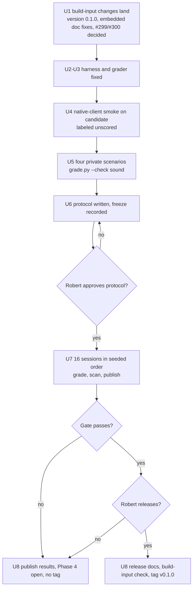

# Phase 4 Diagnostic Evaluation and v0.1 Release - Plan

## Goal Capsule

- **Objective:** Robert can decide whether to release v0.1 from a published, prospectively declared record of what fresh agent sessions could diagnose and fix with Phase 4's instruments, misses included. If he releases, users get a tagged build that is the build that was evaluated, with documentation that claims only what the record shows.
- **Means:** reuse the `learnability/phase4/` harness, grader, proxy and scanner, fixed where Phase 4 breaks them (KTD2–KTD4). Four new private scenarios, one per instrument, run as a capability-only evaluation (KD1, KD2). The build inputs are frozen before collection (KTD1).
- **Authority:** the phase plan governs scope and acceptance through U6, R20–R28, KTD6 and AE8/AE13. `docs/design/introspection.md` governs the instruments' interfaces. `AGENTS.md` governs checks and merging. The protocol U6 writes governs collection and grading once Robert approves it. Within those, this document decides.
- **Execution profile:** one PR, the phase plan's PR9. It stays open through collection. Units land in order. After the freeze (U6), no commit changes a build input (KTD1).
- **Finishing:** the implementer opens the PR with the repository template, then stops at each of Robert's gates: the open-PR decision (U1), protocol approval (U6), and the release decision (U8). Robert reviews and merges, and creates or approves the `v0.1.0` tag.
- **Stop and report:**
  - a scenario cannot be made sound under `grade.py --check`;
  - a native client cannot reach an instrument in the U4 smoke run;
  - a pinned client or model becomes unavailable after the freeze;
  - a build input must change after the freeze;
  - a session leaks a credential into the publication set.

  Each stop is resolved in this plan and the protocol before dependent work goes on. A change after the freeze starts a new declared experiment (AE13).

---

## Product Contract

### Summary

The phase plan scopes U6 as declaring a replacement diagnostic protocol, collecting fresh sessions under it, and releasing v0.1 only if its frozen gate passes and Robert decides to. This plan covers all of U6 as a capability-only evaluation of 16 scored sessions: 4 new scenarios, run on Claude Code and Codex, twice each. First the harness is fixed where Phase 4 breaks it, a native-client smoke run is labeled as development evidence, and the binary is frozen at version 0.1.0 with every embedded-document fix in place. Results and every miss are published whether or not the gate passes. A comparative study is deferred.

### Problem Frame

The phase's diagnostic milestones have merged (#295–#302), but none of the instruments has been used by a fresh agent on a scored incident. The 30 pilots used the baseline binary on six scenarios that agents solved without Phase 4 tools (`learnability/phase4/pilot/findings.md`). Those six scenarios are spent, and the harness built for them breaks in several ways under a Phase 4 `mo` (see Sources).

### Key Decisions

- KD1. **Capability only, no comparative claim.** (session-settled: user-directed — chosen over a comparative claim with a new baseline round: about twice the sessions, and a gate small samples could not pass.) Governs R5, R9.
- KD2. **4 scenarios × 2 clients × 2 runs = 16 scored sessions.** (session-settled: user-directed — chosen over 8 sessions without repeats and the old protocol's 36.) Robert approves the final numbers in the protocol. Governs R2, R5.
- KD3. **The hidden tests and answer keys are the only correctness oracle.** A fix-check `verified` verdict can accompany a wrong fix (`learnability/phase4/test_offline.py`), so verdicts and instrument use are recorded beside correctness, never in it. Governs R6, R7.

### Requirements

IDs are local to this plan; the phase plan's ID follows in parentheses.

**Protocol**

- R1. (phase R20) A separately named protocol, approved by Robert before any scored session, declares the scenarios' families, grading, allocation and order, budgets, clients and models, the missing-data and model-unavailability rules, predictions, and the release gate.
- R2. (phase R20, R21, AE13) The protocol lists every earlier observation (preflight probes, the 30 pilots, the live-views, private-fetch, failure-capture and offline evidence, and U4's smoke run) as unscored, and no scored scenario is a pilot scenario.
- R3. (phase R24) The suite has one scenario for each instrument: a live-state question, a question only a query over exported state answers, a retained failure diagnosed from a stopped folder with replay, and a fix checked original-first. Each uses realistic state and ordinary source access.
- R4. (phase R23) Scenario variants, hidden tests, answer keys and reference fixes stay in the private repository until the final round. The public repository names each scenario's family and shape only, and the freeze records every private file by hash.

**Collection and grading**

- R5. (phase R22, AE8) Every declared session is collected and graded under the frozen rules. None is selected, replaced or regraded, except under the declared missing-data rule.
- R6. (phase R24) Each session's grade reports correctness and instrument coverage separately. Coverage records which operator tools and which `mo fetch`, `mo replay`, `mo replay --fix`, `mo query` and `mo history` commands the session ran.
- R7. (phase R19, AE9) Any fix-check verdict a session obtains is recorded and cross-checked against the hidden tests. A `verified` verdict on an original that did not reproduce is an invariant violation that fails the gate.
- R8. (phase KTD6, R9) Nothing is published until `scan.py` passes over the exact publication set. Private originals stay private; transcripts and proxy logs go to an evidence release asset only after the scan.

**Release**

- R9. (phase R25, AE8) v0.1.0 is tagged only after the gate passes and Robert decides to release. Below the gate, the results are still published, Phase 4 stays open, and nothing is tagged.
- R10. (phase R25) The tagged commit's build inputs are byte-identical to the evaluated binary's, and the version it reports is `0.1.0`.
- R11. (phase R25–R27) README, roadmap, status, runbook, guide and reference claim only what the evaluation and the merged checks show. Replay is described as same-build reproduction of a reconstructed case, not exact replay, and queries are described as offline.
- R12. (phase R28) `docs/status/phase4-run.md` reports each proof, model and check's actual result and boundary. A skipped or waived check is listed as such, not as a pass.

### Acceptance Examples

- AE1. (Covers R5, R9) Given 11 of 16 sessions correct against a declared threshold of 12, the results are published, the roadmap keeps Phase 4 open, and no tag exists.
- AE2. (Covers R7) Given a session whose fix check reports `verified` while its original reported `not_reproduced`, the gate fails whatever the correctness count.
- AE3. (Covers R5) Given a session the harness discarded (exit 3) for a fixture failure before the client started, it is rerun under the declared rule. A session whose client ran and then failed is scored as a miss.
- AE4. (Covers R10) Given a commit after the freeze that changes `docs/agent-guide.md`, the build-input comparison fails and the release cannot be tagged from it.
- AE5. (Covers R6) Given a session that answers the live-state question correctly from source and author tools alone, it is scored correct, and its coverage shows no operator tool was used.

### Success Criteria

- Robert can read `docs/status/phase4-run.md` and say, for each instrument, whether a fresh agent on each client used it in a correct session, without opening a transcript.
- A reader can rebuild the tagged commit and compare its build-input tree hashes with the ones the protocol froze.

### Scope Boundaries

- No comparative or improvement claim, and no baseline round (KD1).
- No change to Mo's language, store format or instrument behavior. A defect the evaluation finds is recorded, and a fix waits for after v0.1 or a new declared experiment.
- No model graders for free-text diagnosis. Questions use structured `ANSWER:` lines graded by fixed rules.
- Considered and not built: a harness that restarts the live service mid-session so the session can read its own stopped folder. The pre-session read-only copy already holds the build's retained failure (KTD3). Evidence that a scenario needs post-session history would change this.

#### Deferred to Follow-Up Work

- A comparative study with a prospective independent baseline and power calculation (phase R22), after v0.1.
- Re-landing the cleanups in #299 and #300 after the release, if Robert closes them in U1.

### Sources / Research

- Harness gaps, each verified against code: `mo fetch` calls through the proxy have no client-stream twin, so `proxy.match` fails the session (`learnability/phase4/proxy.py` `match`, `harness.py` `graded`). `prompt.md` gives no service URL and lists only `check`, `test`, `run`, `serve` and `guide`. `fixture.py`'s `failure_only` stderr assertion fails under Phase 4 because `mo serve` prints a `record:` line after every failure (`src/tools/serve.c`). `harness.py setup` overwrites the baseline's `binaries.json`.
- Replay identity: a record's build digest is the SHA-256 of the `mo` that built the fixture, and program identity changes with any source byte (`docs/agent-guide.md`, Diagnose offline).
- Version `0.0.0` is defined in `src/tools/cli.c` and `src/base/runtime-identity.c`, and asserted as the running binary's version in `ci/check_cli.py`, `ci/check_offline.py` and `tests/cli/*/json.golden`. The other `0.0.0` hits are made-up input data: the frozen `bench/tools/tally/hidden/` logs (hashed in its `SHA256SUMS`; `bench/tools/README.md`, "Frozen means frozen") and digest-terminated fuzz seeds. Those stay unchanged.
- Embedded-document drift: reference §11.5/6 points to §15 for diagnostic records, but §15 has nothing on them. §13.4 does not mention `mo fetch` or the operator tools. The guide's `sha256sum /opt/mo/*/mo` never matches the runbook's `/opt/mo/$SHA/build/gcc/debug/mo`, and that sentence is pinned in `ci/check_offline.py`.
- `learnability/phase4/offline/results/verification.md` holds two leftover diff3 conflict markers.
- Statistics: `learnability/wilson.py` (`verdict` with point-estimate semantics, as the Phase 2 protocol used). With 16 sessions a lower-bound pass is out of reach, so the gate uses counts.
- Prior evaluation shape: `learnability/phase4/protocol.md` (historical), `learnability/protocol.md` (Phase 2), and `docs/status/phase3-run.md` as the model for the run record.

---

## Planning Contract

### Key Technical Decisions

- KTD1. **Freeze build inputs, not a commit.** The freeze records the git tree hashes of every path the binary is built from: `src/`, `lib/`, `runtime/`, `vendor/`, `Makefile`, `ci/embed_docs.py`, `ci/embed_protocol.py`, and the embedded `docs/agent-guide.md` and `docs/reference/README.md`. It also records the candidate binary's SHA-256. Because the guide and reference are frozen, their claims are settled in U1 and describe command behavior only; evaluation results are stated only in documents outside the binary (U8). U8 tags only a commit whose build-input hashes match. The binary's own digest includes its compiled-in `lib/` path, so the tree hashes are what a third party can reproduce. Everything that changes a build input (the version bump, the embedded-document fixes, #299 and #300) lands before the freeze. Main takes no build-input change between the freeze and the merge; if it has to, the run is refrozen as a new experiment.
- KTD2. **Attribute `mo fetch` traffic to the shell.** A `tools/call` that is in the proxy log but not in the client stream is accepted only when it is a `mo-export` call that falls inside a `mo fetch` command the session ran (`proxy.commands`). Any other log-only call still fails `match`. This keeps the record check's guarantee for MCP traffic without changing the binary.
- KTD3. **Sessions get two read-only inputs: the stopped data folder and the deployed source.** DATA stays the pre-session copy. The protocol states it is a stopped folder, and the build's retained failure is already in it. A new read-only DEPLOYED folder holds the untouched source the service runs, so `mo replay` and `mo replay --fix` keep program identity after the session edits WORK. The prompt names the service URL and the token's environment variable, and lists `mo`'s commands from its own help. It does not teach the instruments; `mo guide` does, as in the old protocol §3.
- KTD4. **Coverage comes from records the harness already keeps.** Operator tool calls are the proxy-log calls `proxy.match` pairs with client-stream calls; the `mo-export` calls KTD2 attributes to a `mo fetch` command count toward `mo fetch` only. Offline commands come from `proxy.commands`. Both are joined into a `coverage` object in `grade.json`, next to `correct`. Coverage is published; hidden-test details stay redacted by `publish.py` as now.
- KTD5. **New question scenarios get new answer-key rules, computed by `fixture.py`.** Each rule computes its key from the fixture's own step list, as `shared_payload_jobs` and `killing_call` do. A key never comes from running the instrument under test.
- KTD6. **Install the candidate beside the baseline.** The candidate is built from the frozen tree under `/opt/mo-phase4/candidate` (root-owned, since `lib/` is compiled in). `harness.py setup` keeps the baseline's `binaries.json` and records the candidate's under its own name. The harness refuses a run whose installed `mo` differs from the one that built the round's fixtures.
- KTD7. **The gate uses counts, with point-estimate semantics, frozen in the protocol.** The defaults U6 proposes are in Open Questions; Robert approves or changes them before collection.

### High-Level Technical Design

The freeze sits between U5 and U7. Nothing upstream of it may change once Robert approves.

### Open Questions

**Blocking, Robert's decisions at their gates**

- Q1 (U1). Land or close #299 and #300 before the freeze? Default: close both and re-land after v0.1, since each changes the binary for no user-visible gain. Close #298 as superseded either way.
- Q2 (U6). Approve the protocol's gate. Default proposal:
  - at least 12 of 16 sessions correct;
  - at least 2 of 4 correct in every scenario;
  - at least 5 of 8 correct on each client;
  - no R7 invariant violation and a passing publication scan.

  An instrument counts as demonstrated on a client when at least one correct session on that client used it. By default, demonstration is reported per instrument and client and is not part of the pass condition; Robert may make it one.
- Q3 (U6). Approve the clients and models: Claude Code and Codex at the versions installed at the freeze, with the models the pilots used (`claude-opus-5-5`; `gpt-6.1-sol` at the pilots' reasoning setting), and the time limit the pilots used.
- Q4 (U8). The release decision itself, after the gate result.

**Deferred to implementation**

- The exact form of the KTD2 time-window match: use the command's start and end if the stream carries them, otherwise its order relative to the paired calls.
- Each scenario's concrete defect or question, decided while writing it in the private repository.

---

## Implementation Units

### U1. Build-input changes before the freeze

- **Goal:** Every change to what the binary is built from lands here, so nothing later has to.
- **Requirements:** R10, R11; KTD1.
- **Dependencies:** none; Q1 answered.
- **Files:** `src/tools/cli.c`, `src/base/runtime-identity.c`, `ci/check_cli.py`, `ci/check_offline.py`, `tests/cli/*/json.golden`, `docs/reference/README.md` (§11.5/6 pointer, §13.4/1 `mo fetch` and operator tools), `tests/conformance/reference.tsv`, `tests/conformance/rules.tsv`, `docs/agent-guide.md` (the `/opt/mo` glob), `learnability/phase4/offline/results/verification.md` (conflict markers).
- **Approach:**
  1. Act on Q1: close #298, then land or close #299 and #300.
  2. Bump `MO_VERSION` to `0.1.0` in both definitions, and update the checks that assert the running binary's version. Leave the bench tasks' hidden input logs and the fuzz seeds unchanged (see Sources).
  3. Point §11.5/6 at §13.4. Add `mo fetch` and the operator tools to §13.4/1 as commands and tools, with no new semantics (phase R27). Refresh the conformance snapshot and rows.
  4. Make the guide's identity sentence match the runbook's install path, and update its pinned claim in `ci/check_offline.py`.
- **Test scenarios:**
  - `mo --version` and `--json` outputs report `0.1.0` in every CLI golden.
  - The conformance check fails on the old §11.5/6 text and passes on the new.
  - The guide claim check runs the corrected `sha256sum` sentence against a runbook-shaped `/opt/mo/$SHA/build/gcc/debug/mo` layout and finds the executable.
- **Verification:** `bash ci/check.sh gcc`, `bash ci/check.sh drivers static` and `bash ci/check.sh bench` pass; no check that asserts the binary's version still expects `0.0.0`.

### U2. Harness support for the Phase 4 instruments

- **Goal:** A session can reach every instrument and is not failed for using one.
- **Requirements:** R3, R6; KTD2, KTD3, KTD6.
- **Dependencies:** U1.
- **Files:** `learnability/phase4/harness.py`, `learnability/phase4/proxy.py`, `learnability/phase4/fixture.py`, `learnability/phase4/prompt.md`, `learnability/phase4/test_harness.py`, `learnability/phase4/test_proxy.py`, `learnability/phase4/test_fixture.py`, `learnability/phase4/README.md`.
- **Approach:**
  1. Candidate install beside the baseline, and the build-time vs run-time `mo` refusal (KTD6).
  2. The KTD2 attribution in `proxy.match`, reported as a separate `shell` count so a reader sees it.
  3. A read-only DEPLOYED copy of the variant's session source, beside DATA (KTD3).
  4. Prompt changes per KTD3. The prompt stays a template the protocol freezes.
  5. Make the `failure_only` stderr assertion accept the `record:` and `record unavailable:` lines that follow a failure.
- **Patterns to follow:** `place_read_only` for DEPLOYED; `test_harness.py` with `testdata/stub_client.py` for end-to-end checks.
- **Test scenarios:**
  - The stub client runs `mo fetch` through the proxy, and `match` is true with a `shell` count equal to the export pages fetched.
  - A log-only `mo-export` call with no `mo fetch` command, or a log-only call to any other tool, still makes `match` false.
  - The session user can read DEPLOYED and DATA and cannot write either. `mo replay --data DATA` with DEPLOYED's `main.mo` gets past the program identity check after WORK is edited.
  - `mo history DATA` succeeds as the session user on the operator-owned read-only copy.
  - A synthetic failure with its `record:` line satisfies `failure_only`, and a failure followed by an indented report does not.
  - `harness run` refuses when the installed `mo` differs from the round's recorded `mo_sha256`.
  - `setup` for the candidate leaves the baseline's `binaries.json` entry unchanged.
- **Verification:** `bash ci/check.sh bench` passes, including `test_harness.py` with passwordless sudo.

### U3. Coverage and the new answer-key rules

- **Goal:** A grade says separately whether the session was right and which instruments it used.
- **Requirements:** R6, R7; KD3; KTD4, KTD5.
- **Dependencies:** U2.
- **Files:** `learnability/phase4/grade.py`, `learnability/phase4/harness.py` (`graded`), `learnability/phase4/fixture.py` (key rules), `learnability/phase4/publish.py`, `learnability/phase4/test_grade.py`, `learnability/phase4/test_publish.py`.
- **Approach:**
  1. Build `coverage` from proxy records (KTD4).
  2. Record each `mo replay --fix` verdict the session printed, the original's outcome, and the hidden-test result side by side. Flag an R7 violation.
  3. Add the answer-key rules the U5 question scenarios need, computed from the step list (KTD5).
- **Test scenarios:**
  - A stub session that calls `mo-state` and runs `mo query` gets coverage listing exactly those two, and its correctness comes from the answer key alone.
  - A stub session that only runs `mo fetch` gets coverage listing `mo fetch` and no operator tool.
  - A stub session using no instrument and answering correctly is graded correct with empty coverage. Covers AE5.
  - A recorded `verified` verdict beside an original `not_reproduced` sets the violation flag. Covers AE2.
  - `publish.py` output keeps `coverage` and still redacts hidden-test names.
  - Each new key rule computes the expected value on the synthetic variant's fixture, and an unknown rule is refused at load.
- **Verification:** `bench` group passes; a stub session's `grade.json` carries `correct`, `coverage` and the verdict record.

### U4. Native-client smoke run on the candidate (unscored)

- **Goal:** Show that each pinned client can discover and use every instrument through the harness, before anything is frozen.
- **Requirements:** R2; phase gates L28/L49 and L66.
- **Dependencies:** U3.
- **Files:** `learnability/phase4/smoke/README.md`, `learnability/phase4/smoke/results/` (manifests and grades only, scanned).
- **Approach:** one session per client on the public synthetic variant, prompted to exercise each instrument, run as `mo-session` with the candidate. Label every record development smoke. Fix what fails in U2 or U3 and rerun, keeping every attempt.
- **Test expectation:** none -- this unit produces evidence, not code. Its pass condition is the verification below.
- **Verification:** for each client, the records show an operator tool call, `mo fetch`, `mo history`, `mo replay`, `mo replay --fix` and `mo query`, each completing, and `match` true. Any client that cannot is a stop condition. The client versions and SHA-256s the smoke used are the ones U6 freezes; if either client changes before the freeze, U4 runs again on the new one.

### U5. Four private scenarios

- **Goal:** Four sound, realistic incidents, one per instrument class (R3), unseen by any session.
- **Requirements:** R3, R4; KTD5.
- **Dependencies:** U3 (key rules), U4.
- **Files:** private `robertguss/mo-phase4-private` `variants/<name>/` for each scenario. Public: the scenario families and shapes in the protocol only.
- **Approach:** one scenario each for a live-state question, a query-only aggregate question, a stopped-folder retained failure, and a fix that must be checked original-first. Each is a task-queue incident with ordinary source access and no obfuscation (phase R24). The defect scenarios' failures are produced by the fixture's own `call` assertions, so the build leaves the retained record in DATA.
- **Test scenarios:**
  - `grade.py --check` passes for each, by kind. For the two defect scenarios: the reference fix passes, and the variant and a broken fix each fail a hidden test. For the two question scenarios: the key recomputed from the built folder matches. For all four: the report names no internals, and the hashes match.
  - For each defect scenario, `mo history` on the built DATA lists the retained failure, and `mo replay` with DEPLOYED reports `reproduced`.
  - For each question scenario, the key computed by `fixture.py` matches the answer read through the intended instrument on the built service.
- **Verification:** all four pass `--check` against the candidate. `SHA256SUMS` is committed privately.

### U6. Protocol and freeze

- **Goal:** A protocol Robert approves before any scored session, with the freeze it governs.
- **Requirements:** R1, R2, R4, R5; KTD1, KTD7; Q2, Q3.
- **Dependencies:** U1–U5.
- **Files:** `learnability/phase4/diagnostic-protocol.md`, `learnability/phase4/freeze.json`, `learnability/phase4/README.md`, `learnability/phase4/protocol.md` (a pointer in its historical notice only).
- **Approach:**
  1. Write the protocol. It covers each R1 element, the R2 list of unscored evidence, scenario families and shapes, the seeded order from `harness.py order` with two sessions per scenario on each client (16 in all, KD2), and predictions written before collection.
  2. The missing-data rule follows the old protocol §6: rerun unstarted (exit 4) and discarded (exit 3) sessions; score everything else.
  3. Model unavailability stops collection with no substitution; resuming is a new declared experiment.
  4. Record the freeze: build-input tree hashes, candidate and client SHA-256s and versions (the clients must be the ones U4 smoked), models and settings, prompt hash, the SHA-256 of each harness and grading script (`learnability/phase4/*.py`, `learnability/wilson.py`), and private file hashes.
- **Test expectation:** none -- documentation and a record. Its correctness is checked by U7's freeze comparison and Robert's approval.
- **Verification:** Robert's approval is recorded in the protocol with its date and a pointer to where he gave it. `freeze.json` matches the installed binaries and the branch's build-input hashes.

### U7. Collection, grading and publication

- **Goal:** All 16 sessions collected and graded under the frozen protocol, with the results published.
- **Requirements:** R5–R8; AE1–AE3.
- **Dependencies:** U6 approved.
- **Files:** `learnability/phase4/evaluation/<session>/` (`manifest.json`, `grade.json`), `learnability/phase4/evaluation/results.md`, `docs/status/phase4-run.md`; the evidence release asset (outside the repository).
- **Approach:**
  1. Before the first session, compare the installed binaries, build-input hashes and harness script hashes against `freeze.json`, and stop on any difference.
  2. Run the round in its seeded order.
  3. Grade, scan the publication set, and publish manifests and grades.
  4. For the evidence release (following `evidence-learnability-2026-10`), stage the transcripts and proxy logs in one folder and scan it. Build the archive from that folder only. `scan.py` refuses archives, so extract the archive into an empty folder and scan the extracted copy before uploading. Record both scan outputs.
  5. Write `phase4-run.md` on the `phase3-run.md` model: environment and pinned binaries, predictions, results per scenario and client, coverage, verdict records, misses, predictions against results, and the R12 check inventory.
- **Test expectation:** none -- this unit runs the declared experiment. Its correctness is the frozen rules applied without selection.
- **Verification:** 16 graded sessions, or a recorded stop. Every rerun is justified by the missing-data rule. The scan passes. The gate result is computed exactly as the protocol states.

### U8. Release documents and the tag

- **Goal:** The documents match the evidence, and v0.1.0 is tagged only if the gate passed and Robert released.
- **Requirements:** R9–R12; AE1, AE4.
- **Dependencies:** U7; Q4.
- **Files:** `README.md` (status, promises, a new install section), `docs/ROADMAP.md`, `docs/ops/task-queue.md` (a Phase 4 operator section: fetch on the host, stopping before history, keeping `/opt/mo/$SHA` for replay), `docs/design/introspection.md` (status banner), `docs/plans/2026-11-03-1704-feat-phase4-see-inside-plan.md` (status stamp), `learnability/phase4/README.md`.
- **Approach:** none of these files is a build input (KTD1).
  - **If the gate passed and Robert released:** state each promise at the scope the results show (R11), mark Phase 4 done, and tag `v0.1.0` on the squash-merge commit once its build-input hashes match `freeze.json`.
  - **Otherwise:** publish the same documents with Phase 4 open and the shortfall stated (AE1).
- **Test scenarios:**
  - The build-input comparison against `freeze.json` passes on the merge commit and fails on a commit that edits `docs/agent-guide.md`. Covers AE4.
  - The repository link check passes over the edited documents.
- **Verification:** `bash ci/check.sh gcc` passes on the final branch. The tag, if any, points at a commit whose `mo --version` reports `0.1.0` and whose build-input hashes match the freeze.

---

## Verification Contract

| Check | When | Evidence and limit |
| --- | --- | --- |
| `bash ci/check.sh gcc` | Before opening the PR and after U8 | Its last line goes in the PR body. |
| `bash ci/check.sh drivers static` | After U1's guide and reference edits | Embedded docs, guide claims, conformance snapshot. |
| `bash ci/check.sh bench` | After U2 and U3 | Harness, proxy, fixture, grade, publish and scan tests; `test_harness.py` needs passwordless sudo. |
| `grade.py --check MO PRIVATE_ROOT BUILT` | U5, against the candidate | Scenario soundness; private, run by hand, results recorded in the protocol. |
| Native-client smoke | U4 | Development evidence only, never scored. |
| Freeze comparison | Start of U7 and at U8's tag | Build-input tree hashes and binary SHA-256s against `freeze.json`; harness script hashes at U7's start. |
| `scan.py` over the publication set | Before every publication in U7 and U8 | Seeded-leak tests already in `test_scan.py`; an unreadable file fails. The evidence archive is scanned again after extraction. |
| Nightly | Daily on `main` | Not a substitute for the checks above. |

Long runs follow `AGENTS.md` "Waiting on checks". A skipped tool is reported as a skip, not a pass.

---

## Definition of Done

- **U1:** version reports `0.1.0`, the embedded-document fixes and conformance rows have landed, and #298–#300 are resolved per Q1.
- **U2:** a stub session using every instrument passes `match` and grading; DEPLOYED and DATA are read-only and readable by the session user.
- **U3:** grades carry `correct`, `coverage` and verdict records; R7 violations are flagged.
- **U4:** each client's smoke run reached every instrument, and every attempt is retained and labeled unscored.
- **U5:** four private scenarios pass `--check` against the candidate.
- **U6:** the protocol is approved by Robert and `freeze.json` matches the installed build.
- **U7:** all declared sessions are graded and published after a passing scan, and `phase4-run.md` reports results, misses and check boundaries.
- **U8:** documents match the evidence; either `v0.1.0` is tagged on a build-input-matching commit after Robert's decision, or Phase 4 is recorded as open with its shortfall.
- **Global:** no build input changed after the freeze; no abandoned harness code is left in the diff; no pilot or smoke observation is counted as scored.

