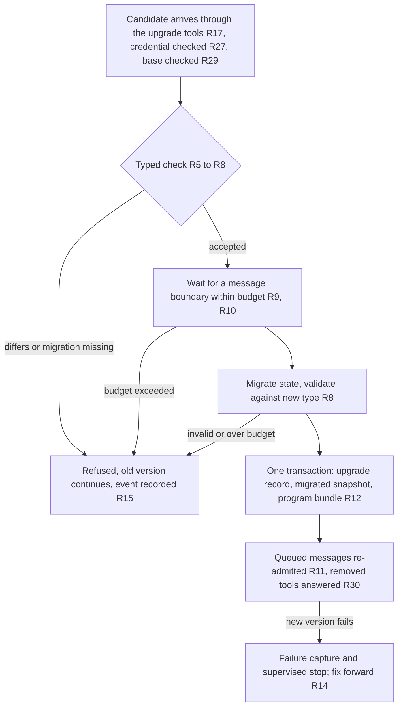
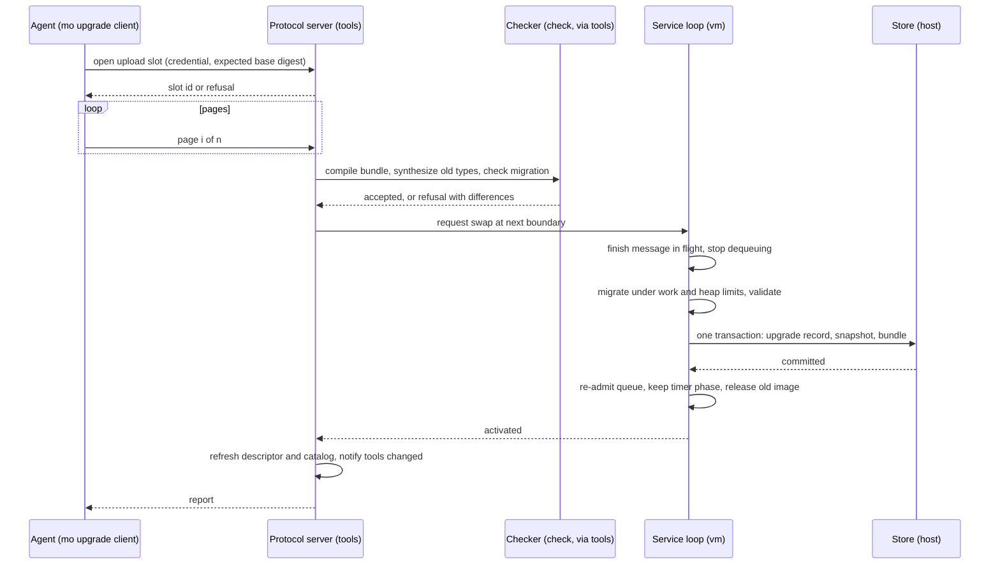
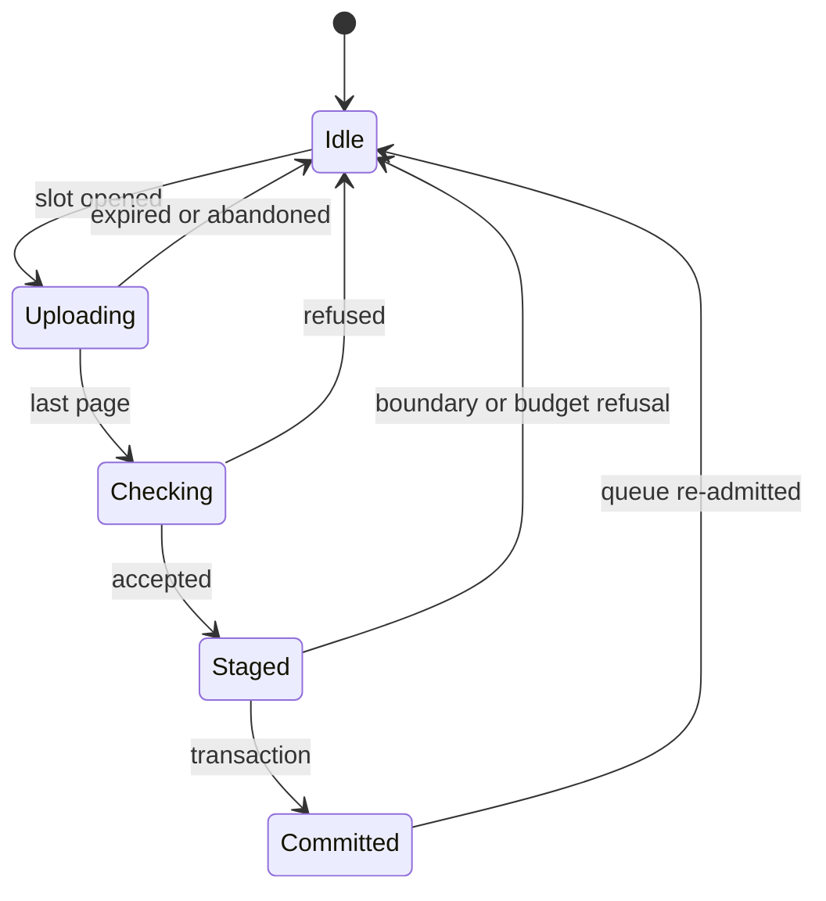

# Phase 5, It Evolves While Running - Plan

## Goal Capsule

- **Objective:** An agent operating a running Mo service can push a changed program to it, with a typed migration when the state type changed, and the service keeps its saved data, its queued messages and its connection. A refused upgrade leaves the old version running and says why. The phase releases v0.2.
- **Means:** A typed upgrade checker in the compiler (KTD5), an in-process swap at a message boundary in the runtime (KTD6), one upgrade path reached by a client command on the host or remotely (KTD1), a data folder that records its active program (KTD4, KTD8), and offline rehearsal of an upgrade against saved state.
- **Authority:** `docs/ROADMAP.md` (Phase 5 row), the language reference, `docs/design/architecture.md`, `docs/design/implementation.md`, `docs/design/services.md` section 6, `docs/design/saved-state.md`, `docs/design/introspection.md` and `AGENTS.md` govern. This plan is the single implementation plan for the phase: it fixes the promises, the milestones, their order, the technical decisions and the closing evidence. Exact names, formats, limits and budgets are decided in the design step (U1) and recorded in one phase design document that later units extend.
- **Execution profile:** Six milestones, each one PR reviewed by Robert, merged in order. Implementation starts with U1, the design step; no compiler or runtime change lands before Robert approves the phase design.
- **Stop and report:** If the old program's types cannot be supplied to the migration checker without a language rule change beyond what U1 proposes; if a complete upgrade of the task queue cannot fit the pause budget U1 declares; if recovery after a kill during an upgrade cannot be made exact; or if the evaluation harness cannot give sessions the upgrade path through the recording proxy. Resolve the failed gate in this plan and the design document before dependent work proceeds.
- **Finishing:** Implementers open one PR per unit under `AGENTS.md` with the required check results. Robert approves the phase design (U1), the evaluation contract and the v0.2 release.

---

## Product Contract

**Product Contract preservation:** changed: R12, R13, R16, R19, R22, AE7 — research showed the folder does not record its program, the folder is locked while the service runs, image keys can differ across builds, and a compiled candidate cannot be identified; added R27–R31 and AE14–AE17 for the upgrade credential, the restart rule, safe retry, queued calls to removed tools and the retained previous program, all confirmed in the planning synthesis. Changed in the confidence pass: R6 (a candidate cannot change the service's token clause), R15 (the full report goes only to the credentialed caller), R16 (the toolchain has no TLS client, so remote means a loopback tunnel), R22 (a v0.1 folder is adopted outright when the named source compiles to its key, otherwise only with an explicit flag after verified replay, and nothing is altered until verification passes), R31 (one transaction); added AE18–AE23. Other IDs keep their meaning.

### Summary

Phase 5 lets a running Mo service change its program without losing its state. The compiler compares the old and new state types and demands a pure migration function when they differ, so an upgrade that cannot work is refused before anything moves. The runtime applies an accepted upgrade between two messages with a bounded pause. An agent reaches the service through one upgrade path, from the host or remotely, and can rehearse the upgrade offline first. The phase closes on an upgrade drill of the task queue plus a small declared agent evaluation.

### Problem Frame

A Mo service is one state type plus pure handlers, saved in a recovery log that only the exact compiled program can read. Any change to the source makes `mo serve` refuse the old data folder with E1409, and the documented way forward is to start the old program, read state out through its tools, and start the new program on an empty folder. Phase 4 made a failing handler diagnosable and a fix checkable offline, but the fix cannot reach the service that failed. In the mo-v2 research Robert called hot code reloading "paramount" and said he wants the language itself to support continuous delivery; the bounded pause of one process was provisionally accepted there (decisions D109 to D111, 5 October 2026). Phase 6, "people approve intent; agents ship the rest", needs a mechanism to gate. Phase 5 is that mechanism.

### Key Decisions

- **Live means a hot swap at a message boundary.** The running service receives a new program, checks it, migrates state between two messages and continues; callers see a brief pause, not a restart. (session-settled: user-approved — chosen over a shadow run before activation and over a checked restart only: the smallest runtime change that is still live, and the shape decision D109 and the mo-v2 Rust experiments already explored.) Governs R9, R10, R11.
- **A changed state type ships an agent-written typed migration, and the checker enforces it.** An unchanged type needs nothing; a changed one needs a pure function from old state to new state, or the upgrade is refused. (session-settled: user-approved — chosen over compiler-derived migrations for compatible changes only: every change becomes upgradable, and the compiler tells the agent exactly what to write.) Governs R5, R8.
- **Abort before activation, fix forward after.** Any failure before activation refuses the upgrade and the old version keeps running; after activation there is no rollback. (session-settled: user-approved — chosen over a reverse migration and over restoring the pre-upgrade snapshot: neither undoes effects already performed, and the snapshot restore would discard accepted work.) Governs R13, R14.
- **Two doors, one path.** An upgrade is started from the host or remotely, and both ways run one implementation. (session-settled: user-directed — chosen over the operator door alone, which was recommended: it covers a remote agent and a host operator, and the host is the only way back when a new version stops the service.) Governs R16, R17, R18.
- **Upgrades need their own credential.** The service token every caller holds does not authorize an upgrade; a second secret does. (session-settled: user-approved — chosen over reusing the service token: Phase 4 promised that operator tools never change the service, and with the shared token any task-queue client could replace the program and its state.) Governs R27.
- **The data folder records its active program.** A start names the folder, not a source file, and a crash restart runs the program that was live. (session-settled: user-approved — chosen over keeping the source on the command line: after a live upgrade the deployed unit would compile the old source and either roll back silently or stay down.) Governs R28, R31.
- **A push is safe to repeat.** A push names the program it expects to replace, and pushing the program that is already active reports that. (session-settled: user-approved — chosen over a plain push: an agent that never saw its reply, or two agents racing, would otherwise get a misleading refusal.) Governs R29.
- **A queued call to a tool the upgrade removed or retyped gets an error reply.** (session-settled: user-approved — chosen over refusing the upgrade while such a call is queued and over dropping the call: the upgrade proceeds, nothing accepted is lost, and the caller learns what happened.) Governs R30.
- **The phase closes on an upgrade drill and a small declared agent evaluation.** (session-settled: user-approved — chosen over the drill alone and over a full 16-session campaign: the drill proves the mechanism, the evaluation keeps the agent track alive at a fraction of Phase 4's cost.) Governs R23, R24.
- **Checker first, swap later, with an offline rehearsal before the swap.** (session-settled: user-directed — chosen over the same sequence without the rehearsal, which was recommended, over swap-first and over rehearsal-first: a remote agent can test an upgrade without host access, and every milestone still ships value.) Governs R1.
- **Phase 5 upgrades the Mo program, not the `mo` binary.** The service compiles what arrives with its own build. Loading bytecode written by another build stays out of scope. Governs R19.
- **Signing upgrade packages is deferred.** The upgrade credential authenticates whoever pushes; the bytecode design's promise of signed packages moves to a later phase.
- **Phase 6 owns approval.** Observation windows, automatic expansion and the criteria under which an agent may deploy autonomously are not part of Phase 5; every Phase 5 upgrade is explicitly requested.

### Requirements

**Phase shape**

- R1. Execute six milestones in order: M1 design step; M2 typed checker, migration and checked restart; M3 offline rehearsal over an exported snapshot; M4 in-process swap and the client command; M5 the upgrade tools on the MCP endpoint and the remote path; M6 upgrade drill, agent evaluation and the v0.2 release.
- R2. M1 produces one phase design document that Robert approves before any compiler or runtime change; it fixes the pause budget, the bundle form, the store additions, the checker's rules, the restart rule and the verification obligations.
- R3. Each later milestone extends that design document with its decisions and evidence; no second plan is a prerequisite.
- R4. Each milestone closes on its own checks; the phase closes per R23 to R25.

**The typed check**

- R5. The checker compares the state type of the running program with the state type of the candidate and accepts the candidate only when the types are equal or the candidate supplies a migration function from the old state type to the new one that type-checks.
- R6. The checker reports every other difference between the two programs, including handlers added or removed, changed tool schemas and changed timers, without refusing the upgrade for them; a change to the service's `token from env` clause or to any other setting that decides who may reach the service is refused.
- R7. The same check runs without a running service, given the old and new programs, and is the check the service applies on arrival.
- R8. A migration is a pure Mo function with no capabilities; its output is validated against the new state type before the upgrade is accepted, per `docs/design/services.md` section 6.

**Applying an upgrade**

- R9. An accepted upgrade is applied between two messages: no handler is mid-execution when the state is migrated, and one program is authoritative at every moment.
- R10. The pause has a declared budget; an upgrade whose boundary cannot be reached or whose migration exceeds the budget is refused and the old version continues unchanged.
- R11. Messages queued before activation, the MCP connection and the timers survive the upgrade, and queued messages are handled by the new version after activation, except as R30 says.
- R12. The recovery log records each upgrade with the identity of the program that became active, and recovery after a crash never reruns a migration and never needs the previous program.
- R13. The pre-upgrade snapshot and the previous program's source are retained together for inspection with the Phase 4 offline commands; retention is bounded.
- R14. After activation there is no automatic rollback; a failing new version follows the Phase 3 and Phase 4 rules for failure capture and supervised stop, and the fix is another upgrade.
- R15. A refusal reports which check refused, what differs and both values, in the form of a diagnostic, to the credentialed caller that requested the upgrade; the service event records only the refusal class and the program digests, and no tool reachable with the service token alone returns program source or compile diagnostics.

**The doors**

- R16. A `mo` client command starts an upgrade of a running service by talking to its endpoint over plain HTTP to a loopback address, with `mo fetch`'s destination and credential rules; a remote agent runs it on the host or through a loopback tunnel to the host, since the toolchain has no TLS client.
- R17. Upgrade tools on the service's MCP endpoint accept a candidate in bounded pages and start the same upgrade; the client command drives them.
- R18. Every way in runs one upgrade path and produces identical outcomes and reports for the same candidate.
- R19. A candidate arrives as a bundle of Mo source files whose imports resolve only within the bundle and the serving build's `lib/`; the service checks and compiles it with its own build.
- R27. An upgrade is accepted only with the upgrade credential the service was given at start; without that credential at start the upgrade tools refuse every call, and the service token alone never authorizes an upgrade.
- R29. A push names the program it expects to replace and is refused when another program is active; a push of the program that is already active is reported as already active and changes nothing.

**Starting and restarting**

- R28. `mo serve` started on a data folder without a source file runs the program the folder records; started with a source file that differs from the recorded program it refuses, unless the start is explicitly an upgrade, which is the checked restart of R20.
- R20. An explicit checked restart on a stopped data folder with a changed program and its migration migrates the saved state at start instead of refusing with E1409; it has no pause budget and is the path for migrations too heavy for R10.
- R31. The first start of an empty data folder takes a source file and records it as the active program in the same transaction as the first snapshot, so a kill leaves either an empty folder or a recorded one.

**Offline**

- R21. An offline rehearsal applies a candidate and its migration to an exported snapshot and reports the result, so an agent without host access can test an upgrade before pushing it; a rehearsal verdict never stands in for the check the service performs on arrival.

**Compatibility**

- R22. A data folder that records no program, which is what v0.1 wrote, is adopted by `mo serve FILE --data DIR` when FILE compiles to the folder's image key, and otherwise only with an explicit flag after replaying its log under the new build with every record's state checksum verified, the report naming how many records were verified; a checksum mismatch refuses and names the first record, and nothing the v0.1 build wrote is altered until verification passes, after which the v0.1 snapshot is retained verbatim.
- R30. A message queued before activation whose tool the new program no longer has, or whose argument types changed, receives an error reply naming the upgrade and leaves no effect; a queued tick of a removed timer is dropped and reported as an event.

**Closing evidence**

- R23. An upgrade drill repeatedly upgrades the task queue live under load with kills injected, including at least one state-type change, and shows no accepted message lost or completed twice and every deliberately bad upgrade refused; it runs in the `drivers` group and its results are recorded in a run file under `docs/status/`.
- R24. A small agent evaluation declares its scenario, its gate and its clients before collection, runs fresh sessions from two clients that each perform an upgrade through the proxy with the client command, and publishes every miss; development runs never enter its denominator.
- R25. Robert decides the v0.2 release after R23 and R24; the roadmap, the README, the runbook and the agent guide describe the shipped behaviour in the same PR.

**Verification tracks**

- R26. Formal and robustness obligations continue: the migration validation boundary and the swap's ordering get Lean or TLA+ treatment where a claim needs it, CBMC covers the new readers, and the saved-state fuzz targets are extended to migration input and output as `docs/design/services.md` section 6 promises; each claim states its assumptions.

### Actors

- **Operating agent:** holds the upgrade credential and the service token; may be remote. Pushes candidates with the client command, rehearses offline, reads refusals and Phase 4 diagnostics.
- **Host operator:** has shell access to the machine running the service. Uses the client command over loopback, the checked restart and the Phase 4 offline commands; is the recovery path when a new version stops the service.
- **The service:** one process, one data folder, one state type, pure handlers; checks, migrates and activates candidates; refuses what it cannot apply.
- **Callers:** MCP clients of the service's tools; see a bounded pause, never a lost accepted message.
- **Evaluation agents:** fresh sessions from two clients under the declared protocol of R24.
- **Robert:** approves the design, authorizes the evaluation, decides the release.

### Key Flows

- F1. Live upgrade from a remote agent
  - **Trigger:** An agent has a fixed or extended program for a running service.
  - **Steps:** Rehearse offline (R21) if desired; run the client command against the host's loopback endpoint, through a tunnel when remote, with the credential (R16, R27); the bundle is paged to the upgrade tools (R17), checked (R5 to R8, R29), applied at a boundary (R9, R10), committed (R12); queued messages continue under the new version (R11, R30); the agent reads the report (R15).
  - **Outcome:** The service runs the new program with its migrated state; callers saw a bounded pause.
- F2. Live upgrade from the host
  - **Trigger:** A host operator has the candidate on the machine.
  - **Steps:** Run the client command against the loopback endpoint (R16); the same path as F1 follows (R18).
  - **Outcome:** As F1, with the report on the host.
- F3. Refused upgrade
  - **Trigger:** The credential or the expected base is wrong, the candidate's state type differs and no migration is supplied, the migration output is invalid, or the boundary or budget cannot be met.
  - **Steps:** The service refuses (R27, R29, R5, R8, R10) and reports what differs (R15); the old version never stopped serving.
  - **Outcome:** The agent fixes the candidate and retries.
- F4. A new version stops the service
  - **Trigger:** After activation the new version's handler fails and supervision stops the service with the existing exit status.
  - **Steps:** Phase 4 captures the failure (R14); the deployed unit restarts the recorded program (R28) or stays down per its restart policy; the host operator pushes a further fixed program over loopback, or uses the checked restart (R20).
  - **Outcome:** Fix forward; no accepted work is discarded.
- F5. Closing the phase
  - **Trigger:** M1 to M5 are merged.
  - **Steps:** Run the drill (R23); declare and run the agent evaluation (R24); Robert decides the release (R25).
  - **Outcome:** v0.2, or the phase stays open with the shortfall recorded.

### Acceptance Examples

- AE1 (R5, R15). A candidate that renames a field of the state type and ships no migration is refused, and the report names the two state types and says a migration is required.
- AE2 (R5, R8). A candidate that adds a field to the state type and ships a migration giving the field a value is accepted, and the migrated state validates against the new type before activation.
- AE3 (R8). A migration whose output fails validation against the new type refuses the upgrade; the old program and its state are untouched.
- AE4 (R6). A candidate that adds a tool and removes another, with an unchanged state type, is accepted, the report lists both tool changes, and connected clients are told the tool list changed.
- AE5 (R9, R11). Ten messages are queued when an upgrade is accepted; the migration runs after the message in flight completes, and all ten are handled by the new version in order, each saved before its reply.
- AE6 (R10, R20). A migration that cannot finish inside the declared budget is refused, the old version continues, and the same candidate succeeds through the checked restart.
- AE7 (R12). The process is killed after an upgrade and before the next snapshot; on restart, recovery starts from the snapshot written at activation, replays only post-upgrade records with the new program, and reaches the same state.
- AE8 (R18). The same candidate pushed over loopback and through the proxy produces the same acceptance or the same refusal text.
- AE9 (R17, R27). A wrong or missing service token receives the existing author-tool refusal; a correct service token without the upgrade credential receives an upgrade refusal; neither starts an upgrade.
- AE10 (R20, R22, R28). A v0.1 task-queue data folder opens under v0.2 with the same program; the same folder with a changed program and a migration migrates at an explicit checked restart; with a changed program and no explicit upgrade it is refused and the report names the recorded program.
- AE11 (R21). An agent rehearses a candidate against an exported snapshot and gets the refusal of AE1; after adding the migration the rehearsal passes, and the live push is still checked on arrival.
- AE12 (R23). In the drill, a kill during the migration leaves a folder that recovers to the pre-upgrade state with no accepted message lost, and the upgrade can be retried.
- AE13 (R24). A result below the declared gate leaves the phase open and the shortfall published.
- AE14 (R29). The process is killed after the commit and before the reply; the agent pushes the same candidate again and is told it is already active; a second agent pushing against the old base is refused with the active program named.
- AE15 (R28). After a tool-only upgrade, the deployed unit restarts the service without a source file and the new program runs; a restart that names the old source file is refused and does not roll back.
- AE16 (R30). A call to a tool the candidate removed is queued when the upgrade commits; the caller receives an error reply naming the upgrade, the service state is unchanged, and the next message is handled by the new version.
- AE17 (R13). After more upgrades than the retention count, a failure record from the first program still replays offline using the program retained in the folder for it, without the agent supplying its source.
- AE18 (R6). A candidate that changes the `token from env` clause is refused with the two clause values named; after an upgrade, a restart reads the same environment variable as before.
- AE19 (R27, R15). A wrong credential is refused when the slot opens and on every page, no byte reaches the compiler, the refusal never echoes the value presented, and the credential appears in no event, failure record, data folder row or proxy log.
- AE20 (R12). The activation transaction fails before commit from a full disk: the upgrade is refused and the old program serves on; the commit's outcome is unknown: the service stops with the store-failure status and the restart finds the folder either fully pre-upgrade or fully post-upgrade.
- AE21 (R28). The `mo` binary is replaced by a later build and the service restarts without a source file; the recorded bundle compiles to a different image key, the log is replayed and verified, and the service runs with its state intact.
- AE22 (R16). The client command refuses a non-loopback URL before reading the credential.
- AE23 (R20, R28). A second `mo serve` on a folder that a running service or an upgrade in progress holds waits for the lock and exits with the existing busy status without reading the program row.

### Scope Boundaries

Deferred: shadow execution of a candidate beside the live version; observation windows, automatic expansion and approval criteria (Phase 6); rollback after activation by reverse migration or snapshot restore; upgrading the `mo` binary or replacing the process; loading bytecode written by another build; signed upgrade packages; compiler-derived migrations; rolling upgrades across several instances or a fraction of traffic; upgrading more than one service in one operation; capability-effect compensation.

Considered and not built: a rehearsal of the queued messages against the new handlers before the commit. A new version that fails on its first message stops the service with the existing status and failure capture, which is visible at once and fixed forward through the host path; the drill (R23) is the evidence that would change this call if first-message failures turn out to be common. Also not built: a counter that coalesces credential refusals in the event ring, since the upgrade table is the durable record and a lost ring entry costs nothing an operator cannot read there; the drill would change this call if a real upgrade's record is lost to refusal noise.

Phase 4's deferred items (in-process arbitrary queries, replay by log position, separate operator credentials for views, profiling, dashboards) stay deferred. `mo replay --fix` keeps refusing a state-type change; the rehearsal (R21) is the command for a fix that needs a migration.

#### Deferred to Follow-Up Work

- A TLS client in the toolchain, so the client command can reach the public HTTPS route directly (R16), unless the Resolve Before U4 question brings it into this phase.
- Adding the `models` check group to the nightly workflow once the swap model lands (R26); today it runs by hand.
- Accepting a same-build compiled candidate, which first needs `mo emit` to accept a service-only program and a build identity in the bytecode file.

### Dependencies and Assumptions

- Phase 4's operator door, token, export, paging and offline commands exist and are the base for R17, R13 and R21.
- The Phase 3 recovery check and kill loop exist in `mo test` and the `drivers` group and are extended for R23 rather than rebuilt.
- The Phase 4 evaluation harness in `learnability/phase4/` is reused for R24; its sessions reach the service only through the recording proxy, which the client command fits.
- Assumed: the pause budget U1 declares is acceptable to callers of the task queue; the mo-v2 experiments used 200 ms for preparation, which is a data point, not a decision.
- The rehearsal of R21 reads the Phase 4 export, not a copy of a stopped folder: a folder now carries code that runs when loaded, and the export carries none.
- Assumed: `host` can run the same `mo` binary as a child process under CPU and memory limits (KTD2); U1 proves it or falls back to the in-process compile with the trusted base widened.

### Outstanding Questions

**Resolve Before U4**

- Whether v0.2 adds a TLS client so the client command can push through the public HTTPS route, or remote pushes go through a loopback tunnel to the host for this phase (R16). Default if unanswered: no TLS client in v0.2; the runbook documents the tunnel.

**Deferred to Planning**

- The reserved module name, whether the old types come from the recorded old bundle or from the old image's type table, and the index-keyed override table for migration input (KTD5, U1).
- The pause budget, the compile budget, the migration work and heap limits, the bundle size and file-count limits and the upload page size (KTD7, KTD1, U1).
- How many previous bundles and snapshots the folder retains beyond those failure records pin (R13, KTD4, U1).
- Whether `user_version` changes so a v0.1 build refuses a v0.2 folder with upgrade tables (KTD4, U1).
- The drill's load, kill schedule, concurrent callers and iteration count, and the evaluation's scenario, gate and session count (R23, R24, U6).

### How This Work Fits Together

<!-- ce-section: work-relationships -->

This plan covers Phase 5 of the roadmap. The surrounding phases are context, not scope.

- Phase 4, Agents can see inside it: complete. Phase 5 depends on its operator door, export and offline commands.
- Phase 6, Intent and autonomy: depends on Phase 5's upgrade mechanism; owns observation, expansion and the criteria for autonomous deployment, which this plan defers.
- Phase 7, Fast: can proceed independently; the swap's indirection cost should be measured so Phase 7 knows it.

---

## Planning Contract

### Key Technical Decisions

- KTD1. **One upgrade path: upgrade tools on the MCP endpoint, driven by a client command.** The store holds an exclusive SQLite lock for the life of `mo serve` (`src/host/store.c`), so nothing can reach a running service through its folder; the only existing host-side client of a running service is `mo fetch` (`src/tools/fetch.c`), which this command mirrors in the upload direction. The candidate is uploaded in pages because `MO_LIMIT_MCP_BODY_BYTES` is 16 KiB and the task queue's source is about 24 KB; the page protocol mirrors the export pages (`src/base/export.h`, `mo_export_accept`): one upload slot per service, pages carrying slot id, index, offset and total, expiry like export pins, a second concurrent upload refused as busy. The command keeps `mo fetch`'s loopback-only destination rule, since the toolchain has no TLS client; a remote agent reaches the host's loopback through a tunnel, and whether v0.2 adds TLS is the Resolve Before U4 question. (session-settled: user-approved — chosen over a host command that works through the data folder: the folder is locked, and a bare agent paging 24 KB of source by hand is not a usable door.) Governs R16, R17, R18.
- KTD2. **The candidate is a source bundle, compiled outside the service process and loaded through the verifier.** The bundle is the entry module plus every module it imports outside `lib/`, with relative paths; imports resolve only within the bundle and the serving build's `lib/`, never the host filesystem. The bundle reader refuses absolute paths, `..`, duplicate paths, a module that shadows `lib/`, a module carrying KTD5's reserved name, and more files than a small limit. The threat model in `docs/design/sandbox-properties.md` trusts the verifier, not the compiler, and the compile path in `src/tools/offline.c` (`compile_revision`) runs under command-line budgets with a 1 GiB heap, so compiling network input inside the service would widen the trusted base and stall the single-threaded poll loop. The service therefore runs the same `mo` binary as a child process under CPU and memory limits and a compile budget to compile the bundle, and loads the result through the existing loader and verifier, whose fuzz and CBMC coverage already exists. Every compile of a received or recorded bundle goes through that child: the live push, the folder-only start, the explicit upgrade start and the verified replay of KTD10. The child shares the service's user, files and secrets, since the threat model has no OS confinement, so it contains crashes and stalls but not a memory-safety exploit of the compiler; the compiler front end is therefore reachable by whoever holds the upgrade credential, which the threat model states plainly, and long compiler fuzz runs become a gate (Verification Contract). The compile happens when the bundle completes, before the boundary, and outside the pause budget. Source rather than bytecode because `mo emit` refuses a service-only program and a bytecode file carries no build identity. Governs R19.
- KTD3. **Two identities, two jobs.** The source digest of the bundle identifies a program to agents: a push carries the digest of the program it expects to replace, "already active" is a digest match, and `mo history` and the overview show digests. The program checksum (`src/bytecode/image.c`) stays the store's image key, because it covers the compiler's output and so changes with the build; it is never shown to agents as the thing to compute. Governs R29, R12.
- KTD4. **The point of no return is one new store operation in one SQLite transaction.** A typed C function in `host/host.h`, beside the Phase 4 capture operation and not a new entry in `hostops.def`, writes in one transaction: the snapshot of the migrated state at the current head under the new key, the deletion of the log tail, the program row (source digest, image key, build digest, schema digest, activation ordinal), the upgrade record (keyed by its own strictly increasing activation ordinal, carrying the head sequence, both source digests, both keys, both schema digests, the build digest, the migration name and the report, so two upgrades with no message between them get distinct records in order), the retained previous bundle and the retained pre-upgrade snapshot, keyed by that ordinal and holding the encoded state at that head under the old key, and any evictions. The ordinary snapshot write never touches the new tables; a kill before the commit leaves the folder pre-upgrade, and a kill after it leaves it post-upgrade. A failure before the commit refuses the upgrade and the old program keeps serving; an uncertain commit outcome stops the service with the store-failure status and never falls back to serving the old program, because its next log row would go in under the old key. The in-memory log count and log summaries reset at activation as a snapshot resets them; the message sequence continues from the head, never restarts. Recovery starts from the activation snapshot and never reruns a migration or needs the previous program (R12). New tables follow Phase 4's precedent: added to `tables[]` in `src/host/store.c`, created when absent, existing table SQL unchanged. Retention (R13): the last N bundles plus every bundle a retained failure record references, since a kind's first failure is kept across upgrades and the Phase 4 design caps retained failure records, so the pins are bounded by that cap; snapshots bounded by count and by bytes; `mo history` says "program not retained" rather than failing. `user_version` stays 1 unless U1 shows a v0.1 build could misread an upgraded folder. Governs R12, R13, R31.
- KTD5. **The typed check compares saved schemas and checks the migration like a query entry.** State-type equality is equality of the saved-schema digest (`mo_type_schema_digest`), which includes constructor and field names, so a rename or a swap of same-typed fields needs a migration and never passes silently. The migration function is named at the door, like `mo query --fn`, and checked by a sibling of `mo_check_query_entry` (`src/check/services.c`): non-generic, no capability or function in parameters or result, first parameter the old state type, result the new state type. The old state type is supplied to the candidate as a reserved module that `tools` hands to the checker as in-memory source, so the agent copies no old definitions. Its default source is the recorded old bundle's type declarations compiled under the reserved prefix, since the folder records the bundle (KTD4) and a type table holds only instantiations, not generic declarations; synthesizing from the snapshot's stored schema bytes, which carry every type's shape and name, is the fallback for a recorded bundle that no longer compiles (KTD8), and synthesizing only the types whose schema digest changed is the refinement to try first; U1 prototypes both sources. The schema comparison for migration input stays in `heap` and never learns about modules: `heap` exposes a decode variant that takes an override table from type-table index to expected saved name, `tools` builds that table, and everything else is compared byte for byte, so the Lean model gains one override table rather than a rename rule. The rename-per-upgrade alternative, where the agent copies the old types under new names, breaks on any nested type that changed, and a rename-aware decoder would reopen the Lean claim `decode_refuses_other_schema`. This came close to a bake-off: the surviving mechanisms are structurally distinct and language-visible, but U1 is the design step where the chosen one is prototyped and Robert approves it, so a separate bake-off would duplicate U1. The cross-program report of R6 generalizes `check_revision` in `src/tools/offline.c` over whole descriptors and lives in `tools`, since `check` cannot see the old image; the checker's interface is a third query-input kind beside `mo_check_query_entry`. The source digest and the type synthesizer live in `tools`, using `base/sha256.h`, so `host` and `vm` treat digests and bundles as opaque bytes. Governs R5, R6, R7, R8.
- KTD6. **`tools` orchestrates the swap; `vm` performs the state transfer; the protocol server owns the images.** `mo_protocol_server_poll` calls `mo_service_step` once per poll; the swap runs between that return and the next poll, when no handler is on the stack and every accepted update is on disk. The mailbox, timers, log ring and events ring are private to `src/vm/service.c`, so `vm` gains one entry that builds a new loop from the old one given the new image, the migration function and the activation payload as opaque bytes: it runs the migration under the KTD7 limits, re-admits each queued message by mapping its handler by name to the new table and moving its arguments across heaps through `heap`'s encode and decode with a target type, answering per R30 where no target exists, keeps each timer's phase by name and re-evaluates intervals in the new process, a failure being a refusal, and commits through the KTD4 operation; on refusal the old loop is untouched. No early reply: no R30 reply and no activation report leaves before the commit, and re-admitted messages are handled in mailbox order before any new arrival, each with at most one log row. `tools` decides when to swap, compiles the candidate, owns the current and previous images, and refreshes caches. Preconditions and follow-ups on the `tools` side: no connection may hold a cell in the service heap, so pending replies are encoded before the swap; every connection's borrowed descriptor and catalog are refreshed and a connection waiting on a re-admitted call has its expected handler remapped; the catalog process is recreated rather than appended to, since today's catalog is made immortal in its heap. Event and message summaries carry an epoch so the views render pre-upgrade entries with the previous image, and a new upgrade event kind marks the boundary; both event printers handle it under `-Wswitch-enum`. The server advertises `listChanged: true` and notifies after a tool-set change, so connected clients learn the new tool list (AE4). Image ownership moves into the protocol server, which keeps the current and the previous image and releases the previous one after the commit and after the last reference into it is gone. Governs R9, R11, R30.
- KTD7. **Budgets are deterministic and refusals are enumerated.** The migration runs under its own work and heap limits, new `MO_LIMIT_*` entries beside `MO_LIMIT_SERVICE_WORK`, never with the handler limits lifted, in two sets: a live set sized to the pause budget, and a larger checked-restart set bounded by the service heap, which is what makes the checked restart the path for a migration refused live (R20, AE6); the whole live pause, from the boundary to the commit, stays under the MCP deadline that governs the request. Refusal classes, each with its own code in the E14xx tools range and a line in `tests/errors/`: credential, busy, stale base, bundle too large or malformed, compile error, compile budget exceeded, state-type change without migration, migration type error, migration trap or budget, migrated value invalid, access clause changed, timer interval failure, boundary not reached. Every refusal is reported through `offline.c`'s `struct refusal` form, text and JSON, so both ways in produce the same text (AE8), and recorded as an event (R15); the durable record of an upgrade is the store's upgrade table, so a refusal evicted from the event ring by noise loses nothing an operator cannot read there. U1 measures the stall of a hostile-shaped bundle, maximum nesting and many generic instantiations, not only the task queue. When the network path is starved by other callers, the host checked restart (R20) is the recovery path. Governs R10, R15.
- KTD8. **The folder owns the active program; the command line owns the first start and explicit upgrades.** `mo serve --data DIR` compiles the recorded bundle through the KTD2 child and runs it; `mo serve FILE --data DIR` on an empty folder records FILE (R31); on a folder whose recorded digest differs from FILE's it refuses with the recorded digest named, unless `--upgrade` is given, which runs the typed check and migration at start as the checked restart (R20). A recorded bundle that no longer compiles under the serving build, which a pre-release toolchain can cause, is refused with its own code naming the recording build digest and the first diagnostic, with an exit status the deployment unit does not retry; the checked restart then builds the old state type from the snapshot's stored schema bytes (KTD5). The deployment unit's `ExecStart` drops the source path. Governs R20, R28, R31.
- KTD9. **The upgrade credential is a second bearer secret, carried in a second header.** `mo serve` reads it from an environment variable named on the command line, never from the program, and refuses a start whose two credential values are equal under the constant-time compare, whatever the variable names; the upgrade tools require it in a request header checked by the constant-time compare in `src/host/credentials.c` and wiped from the input buffer as the `Authorization` header is today, so it never enters the Mo heap, a failure record or an event; a minimum length applies and U1 rechecks `MO_LIMIT_MCP_HEADER_BYTES` for two credentials; the tools refuse every call when the service was started without the credential; the client command reads it from an environment variable the way `mo fetch` reads `--token-env`. No roles, no per-tool policy. The evaluation's recording proxy redacts both secrets and the publication scan's token list includes the upgrade credential. `docs/design/sandbox-properties.md` and the introspection design's statement that operator tools never change the service are updated to name this exception, and to state that write access to a data folder now equals the upgrade authority, since the folder records the program that runs. Governs R27.
- KTD10. **A folder with no program row, or whose recorded source compiles to a different key, opens by verified replay.** The image key covers compiler output only, so a later build may or may not change it for the same source; the trigger is never "the key differs" alone. A folder with no program row is a v0.1 folder: when the named source compiles to the folder's key it is adopted outright, and otherwise only with an explicit flag, because an empty log tail verifies nothing and a short tail verifies only the handlers it exercises, which the report says in plain words. A folder whose recorded source digest matches the bundle but whose key differs is the same path without the flag, since the source match is the stronger evidence; this is what keeps `mo serve --data DIR` working after the `mo` binary is replaced (AE21), and the program row records the build digest that produced its key. In both cases the snapshot is decoded against the unchanged schema, the tail is replayed under the new compile with every record's state checksum verified, a mismatch refuses naming the first record and handler and leaves the folder byte-identical, and a verified replay is committed through the KTD4 operation with an "adopted" upgrade record, the old snapshot retained verbatim under its old key. A handler whose semantics changed between builds, a `lib/` change, or a primitive's text output are what the checksums catch when the tail exercises them; the checksum is not adversarial protection. Governs R22, R28.
- KTD11. **Verification follows the Phase 4 shape.** Lean: the migration boundary, decode against the old schema, migrate, validate against the new schema, with a lemma that an accepted upgrade's snapshot validates and that a refused one leaves the store unchanged; the existing `decode_refuses_other_schema` is kept and the reserved-module mapping of KTD5 is modeled explicitly. TLA+: a swap model of upload, stage, boundary, commit, crash and restart with invariants "one authoritative program", "no accepted message lost or duplicated", "no record spans an upgrade", plus negative controls that break each. CBMC: the upload page reader and the bundle reader. Fuzz: upload pages, bundle framing and migration input and output, extending `fuzz/fuzz_saved_state.c`, `fuzz/fuzz_service_log.c` and `fuzz/fuzz_service_snapshot.c` as `docs/design/services.md` section 6 promises. Governs R26.
- KTD12. **The drill extends the kill loop; the evaluation extends the Phase 4 harness.** `ci/check_kill_loop.py` gains upgrade calls with a variant program set, so its reply model has two outcomes, old or migrated, and its restart rule uses `mo serve --data DIR`. The evaluation keeps the Phase 4 harness's session user and recording proxy; sessions get the `mo` client command and the upgrade credential, push through the proxy, and the proxy records the upgrade tool calls; the loopback path is proven by the drill. Governs R23, R24.

### High-Level Technical Design

### Assumptions

- The reserved-module mechanism of KTD5 can be expressed without a new language rule; U1 proves it with a prototype on the task queue's state type before Robert approves.
- The pause for the task queue's largest reachable state fits the budget U1 declares; U1 measures it with the Phase 4 sizing fixtures.
- The handler table order and the saved encoding of an unchanged program are stable across builds, which KTD10's verified replay relies on; U2's v0.1 fixture is the check.

### System-Wide Impact

- **Authority.** A new credential (KTD9) sits beside the service token; holders of the token alone can still exhaust the shared rate limit, the eight connection slots and the event ring, and the host checked restart is the recovery path when they do (KTD7). Write access to a data folder becomes upgrade authority, because the folder records the program that runs (KTD4, KTD8); the threat model gains that sentence, and the sentence that the upgrade credential's authority is bounded only by the compiler's memory safety.
- **Trusted base.** The compiler front end becomes reachable by the upgrade credential: every compile of a received or recorded bundle runs in a child process and the result enters the service through the verifier (KTD2), which contains crashes and stalls but not a compiler memory-safety bug, since nothing confines the child. Long compiler fuzz runs become a gate. The bundle reader is new untrusted-input code in `base`, so it gets CBMC and fuzz coverage like the export page reader.
- **Store.** New tables for the program, upgrades and retained rows, one new typed operation for activation, and recovery that reads the program row before compiling anything (KTD4, KTD8, KTD10). Existing table SQL is unchanged, so v0.1 folders stay readable.
- **Protocol server.** Image ownership, per-connection cache refresh, an epoch on event and message summaries, a recreated catalog process, `listChanged: true` and a notification (KTD6). Every view that resolves a function or handler name by index resolves it against the image of the entry's epoch.
- **Operator tools and clients.** The upgrade tools are the first operator tools that change the service; they are not marked read-only, which Codex's approval policy treats differently, and the agent guide's operator-tool list and tool-safety statement change.
- **Deployment.** The unit's `ExecStart` names the folder, not the source; the runbook's Upgrade section becomes one client command over loopback or a tunnel (R16, R28).
- **Offline commands.** `mo history` labels snapshot, tail and failure records with program digests through the upgrade records; `mo replay` resolves a failure's program from the folder's retained bundles when present; the rehearsal takes the export as input.
- **Contracts touched in lockstep.** `vm/vm.h` (swap entry, event kind, epoch, migration limits, replay-open mode), `heap/heap.h` (index-keyed decode override, copy with a target type), `check/check.h` (migration input kind), `host/host.h` (tables and activation), `tools/protocol.h` (image ownership), `base/codes.h`, `base/limits.h`; `docs/design/saved-state.md` (override table, new tables), `formal/MoCore/Saved.lean` (`decode_refuses_other_schema` restated with the override table), `models/Swap.tla`, CBMC harnesses for the page and bundle readers. Unchanged: `docs/design/bytecode.md`, `hostops.def`, `prims.def`, `formal/TEXT.md` and `TRANSLATION.md`, since a migration is an ordinary Core function and the bytecode format stays internal. `docs/design/architecture.md` sections 9 and 13 are rewritten to say that an upgrade replaces the whole program with no call indirection and that candidates are source, not bytecode.

### Risks and Dependencies

| Risk | Decision |
| --- | --- |
| The compiler, run on network input, has a memory bug | Every compile of a received or recorded bundle runs in a child under limits and loads through the verifier (KTD2); the child is not confined, so the compiler is inside what the credential reaches and long compiler fuzz runs gate U2 and U4. |
| A candidate changes the service's access clause and the change takes effect at the next restart | Refused difference (R6, AE18). |
| The credential leaks through a body field, a refusal, an event, a proxy log or a publication | Header, constant-time compare, wipe, no echo, proxy redaction, scan list (KTD9, AE19). |
| A kill or a failed commit tears the activation | One store operation; uncertain commit stops the service; fault injection on every statement (KTD4, AE20). |
| A v0.1 folder, or a torn first start, is adopted by a same-schema program with nothing verified | Adoption outright only on a key match; otherwise an explicit flag and verified replay; first start in one transaction (KTD10, R31, AE10). |
| A later `mo` build changes the image key and the folder-only restart refuses | Verified replay on a source-digest match (KTD10, AE21). |
| Retention evicts a program a failure record needs | Bundles pinned by failure records (KTD4, AE17). |
| A pending reply or a borrowed descriptor points into the old heap at the swap | Encode pending replies first; refresh and remap per connection (KTD6). |
| Views render old entries with the new program's names | Epoch on summaries, two images kept (KTD6). |
| Compile or migration stalls every caller | Compile outside the loop and the pause; deterministic migration budgets; compile budget class (KTD2, KTD7). |
| Service-token holders starve the upgrade path | Host checked restart as recovery; the upgrade table, not the event ring, is the durable record (KTD7). |
| The toolchain has no TLS client | Loopback-only command with a tunnel; the Resolve Before U4 question decides whether v0.2 adds TLS (R16). |
| The `models` group is not in the nightly | Run by hand before U4 merges; deferred follow-up adds it. |

### Future Considerations

- Phase 7: the pause grows with state size because the whole state is encoded and decoded at each swap; U1's measurement is the baseline. The compile budget and the pause budget are two separate limits.
- A second service per process would share the image; the plan assumes one image per service, and the protocol server's single service field is where that assumption would break first.

---

## Implementation Units

Each milestone is one PR because `AGENTS.md` requires Robert's review of each PR and a whole phase in one PR is more than one reviewer can read well. Each group waits on the previous group's merge, and units U4 to U6 also need the merged behaviour of the earlier units to build and verify. U1 records exact public signatures, formats, limits and command names in the design document; file lists identify integration areas.

### PR1: Design step

Waits on: nothing.

### U1. Design, feasibility and verification contracts

- **Goal:** Settle everything a Mo user would notice about a live upgrade, prove the two mechanisms the plan rests on, and obtain Robert's approval.
- **Requirements:** R2, R3, R19, R26; KTD1 to KTD12; A/F/AE as the design document's acceptance table.
- **Dependencies:** none.
- **Files:** `docs/design/upgrades.md` (new phase design document), `docs/design/services.md` section 6, `docs/design/saved-state.md`, `docs/design/introspection.md` (identities table, operator-tools statement), `docs/design/sandbox-properties.md` (threat model: upgrade credential and bundle input), `docs/reference/README.md` sections 11.5 and 15, `docs/design/architecture.md` Phase 5 notes, `docs/ROADMAP.md`; prototype sources and results under `learnability/phase5/preflight/`.
- **Approach:**
  1. Write the design document: bundle form and size limit, upload page protocol, source digest, upgrade credential, restart rule, store tables and retention count, the reserved-module rule for old types and the schema comparison for migration input, refusal classes and codes, budgets, event kind, `listChanged` behaviour, rehearsal input, and the Lean, TLA+, CBMC and fuzz obligations with their assumptions.
  2. Prototype the reserved-module mechanism (KTD5) on `services/task-queue/` state types: synthesize declarations from an image's type table, compile a migration against them, and compare schemas; record what works and what needs a rule change.
  3. Measure the pause for the largest reachable task-queue state: encode, migrate with an identity function, validate, commit, using the Phase 4 sizing fixtures; declare the budget from the measurement.
  4. Write the identity table (KTD4): which digest and key each row carries, how `mo history` and `mo replay` resolve a program after several upgrades, and the tie rule for failure records whose key matches two retained bundles.
  5. Prove the child-process compile (KTD2) on this host, measure the stall of a hostile-shaped bundle (KTD7), declare the live and checked-restart migration limit sets (KTD7), and decide the `user_version` question (Outstanding Questions).
  6. Update the roadmap's "Now" section, the reference's section 15, the architecture's sections 9 and 13 (whole-program swap, no call indirection, candidates are source), the threat model's trusted-base table, its folder-authority sentence and its statement that the upgrade credential's authority is bounded only by compiler memory safety (KTD2, KTD9); obtain Robert's approval with an evidence pointer, including the Resolve Before U4 answer on TLS.
- **Test scenarios:**
  - The prototype compiles a migration from the task queue's current state type to a variant with one added field and reports a schema digest match for the old side and a mismatch for the new side.
  - The prototype refuses a migration whose first parameter is not the old state type and one that takes a capability.
  - The sizing run records encoded size, migration work, heap peak and commit time for the largest fixture, and the declared budget exceeds all of them with the margin the document states.
- **Verification:** The design document is approved; every preflight has a command, inputs and a result or a recorded blocker; `bash ci/check.sh drivers static` passes after the embedded-doc edits.

### PR2: Typed checker, migration and checked restart

Waits on: PR1, merge order only.

### U2. Typed upgrade check, migration function and checked restart

- **Goal:** `mo check` compares two programs, a migration function is checked and run offline, and `mo serve` on a stopped folder records its program, refuses a differing source, and migrates at an explicit upgrade start.
- **Requirements:** R5, R6, R7, R8, R20, R22, R28, R31; KTD2, KTD3, KTD4, KTD5, KTD7, KTD8, KTD10; AE1, AE2, AE3, AE10, AE15, AE18, AE21.
- **Dependencies:** U1.
- **Files:** `src/check/services.c`, `src/check/check.h` (migration input kind beside `mo_check_query_entry`), `src/tools/upgrade.c` (new: source digest, reserved-module source from the recorded bundle, override table, cross-program report, refusal rendering shared with `offline.c`), `src/base/bundle.c` and `src/base/bundle.h` (new: bundle framing reader, untrusted input), `src/tools/offline.c`, `src/tools/execute.c`, `src/tools/cli.c`, `src/tools/serve.c`, `src/tools/run.c` (start rule), the host process file (child-process compile under limits), `src/host/store.c` and `src/host/host.h` (program, upgrade and retained tables; the activation operation), `src/heap/saved.c` and `src/heap/heap.h` (decode with an index-keyed name override), `src/base/codes.h`, `src/base/limits.h`, `tests/test_check.c`, `tests/test_store.c`, `tests/test_offline.c` or a new `tests/test_upgrade.c`, `tests/errors/e14NN*/`, `tests/cli/` goldens, `ci/check_cli.py`, `tests/lower-source/` fixtures for the migration shape, a v0.1 fixture folder under `tests/`, `formal/MoCore/Saved.lean`, `fuzz/fuzz_saved_state.c`, `fuzz/fuzz_bundle.c` (new) with corpus, `cbmc/` harness for the bundle reader, `docs/agent-guide.md`, `docs/ops/task-queue.md`.
- **Approach:**
  1. Add the migration entry check and the cross-program difference report (KTD5), with refusals in the shared form (KTD7).
  2. Add the store tables for the active program, the upgrade records and the retained previous program (KTD4), and the first-start recording (R31).
  3. Implement the child-process compile (KTD2) in `host` and use it for every compile of a recorded bundle, then the start rule (KTD8): folder-only start, differing-source refusal, the refusal of a recorded bundle that no longer compiles, and the `--upgrade` checked restart that runs the check, migrates under the checked-restart limits (KTD7), validates, and commits the activation transaction.
  4. Implement the v0.1 open path (KTD10) and pin it with a v0.1 fixture folder committed under `tests/`.
  5. Extend the Lean saved-codec module with the migration boundary lemmas and the fuzz target with migration input and output (KTD11).
  6. Update the agent guide's recovery section and the runbook's Upgrade section; the fresh-folder procedure becomes the fallback for a refused checked restart.
- **Test scenarios:**
  - Covers AE1. Two programs differing by a renamed state field, no migration: `mo check` reports the two schemas and that a migration is required, exit status as the design states.
  - Covers AE2. Added field with a migration: check passes; the checked restart on a stopped folder produces a snapshot that validates against the new type and a recorded upgrade.
  - Covers AE3. A migration that returns a value failing validation refuses; the folder's snapshot, log and recorded program are byte-identical afterwards.
  - Covers AE10. A folder written by the v0.1.0 binary with the task queue opens under the new build and `mo history` shows the recorded program; the same folder with a changed program and no `--upgrade` is refused naming the recorded digest.
  - Covers AE15. After a checked restart to a tool-only variant, `mo serve --data DIR` runs the variant and `mo serve OLD.mo --data DIR` is refused.
  - A bundle whose entry imports a module outside the bundle is refused before compilation.
  - A migration that exceeds the checked-restart work limit refuses with the budget class and leaves the folder unchanged; one that exceeds only the live limit succeeds at the checked restart.
  - A recorded bundle that fails to compile under the serving build is refused naming the recording build digest and the first diagnostic, with the non-retried exit status, and the folder is unchanged.
  - A folder-only start compiles the recorded bundle in a child process; a compile that exceeds the compile budget or crashes the child is refused and the service process is unharmed.
  - A migration that takes a capability, or is generic, or whose result is not the new state type, is refused with its own code; each code has its `tests/errors/` case.
  - The reserved-module schema comparison accepts an unchanged nested type and rejects a nested type that changed without a mapping.
  - Covers AE18. A candidate whose `token from env` clause differs is refused with both clause values named.
  - Covers AE21. A folder recorded under one build opens under a build whose compile gives a different key: the tail is replayed, every checksum verified, and the program row gains the new build digest; a fixture whose tail exercises a changed handler is refused naming the record.
  - A v0.1 fixture with an empty tail and a different same-schema program is not adopted without the flag, and with the flag the report says zero records were verified.
  - Covers R31. A kill between the first snapshot and the program row cannot be constructed, because they commit together; the test fails the transaction and finds the folder empty.
  - Bundle reader: absolute paths, `..`, duplicate paths, a `lib/` shadow, the reserved module name and too many files are each refused; fuzz and CBMC cover the reader.
  - Fuzz: malformed migration output never crashes the validator; seeds in `fuzz/corpus/`.
- **Verification:** `bash ci/check.sh gcc` passes; `bash ci/check.sh drivers static` passes for the guide and reference edits; `bash ci/check.sh lean` passes with the new lemmas and no `sorry`; a v0.1 fixture folder opens and its replay verifies every record checksum.

### PR3: Offline rehearsal

Waits on: PR2, merge order only.

### U3. Rehearsal of an upgrade over an exported snapshot

- **Goal:** An agent without host access applies a candidate and its migration to an exported state snapshot and gets the same report the service would give.
- **Requirements:** R7, R21; KTD3, KTD5, KTD7; AE11.
- **Dependencies:** U2.
- **Files:** `src/tools/offline.c` (relax `check_program` for the rehearsal while keeping `check_build`), `src/tools/upgrade.c`, `src/tools/cli.c`, `tests/test_offline.c`, `tests/cli/` goldens, `ci/check_offline.py`, `docs/agent-guide.md`, `docs/design/upgrades.md`.
- **Approach:**
  1. Add the rehearsal subcommand: inputs are a Phase 4 export artifact, the old program's bundle, the candidate bundle and the migration name; output is the R6 report plus the migrated state's validation result, in the shared refusal form. The export carries no program, so the old bundle supplies the old types (KTD5); an old bundle whose compile does not match the export's recorded program checksum is refused, as `mo query` refuses a mismatched program today.
  2. Reuse U2's check and migration runner unchanged; the new code reads the export as the old state, pairs it with the old bundle, and reports that a rehearsal is not acceptance.
- **Test scenarios:**
  - Covers AE11. Rehearsal of the AE1 candidate against an export refuses with the AE1 text; after adding the migration it reports the migrated state as valid and names the candidate digest.
  - An old bundle that does not compile to the export's recorded program checksum is refused naming both.
  - An export from another `mo` build is refused by the build check, as `mo query` does today.
  - A rehearsal never writes to any folder and its exit status distinguishes "would be accepted" from "refused".
- **Verification:** `bash ci/check.sh gcc` and `drivers static` pass; `ci/check_offline.py` covers the new command with a golden.

### PR4: In-process swap and the client command

Waits on: PR3, needed before this group can finish: the swap reuses U2's check and migration runner and U3's report form from the merged tree.

### U4. Hot swap at the boundary, upload slot and the loopback client

- **Goal:** A running service accepts a candidate from the client command over loopback, applies it at a message boundary, keeps its queue and timers, and recovers exactly after a kill at any point.
- **Requirements:** R9, R10, R11, R12, R13, R14, R15, R16, R17, R18, R27, R29, R30; KTD1, KTD2, KTD4, KTD6, KTD7, KTD9; AE5, AE6, AE7, AE12, AE14, AE16, AE17, AE19, AE20, AE22, AE23.
- **Dependencies:** U2, U3.
- **Files:** `src/vm/service.c`, `src/vm/vm.h`, `src/vm/internal.h` (swap entry building a new loop from the old, upgrade event kind, epoch on summaries, re-admission), `src/heap/saved.c` and `src/heap/heap.h` (copy with a target type), `src/tools/protocol-server.c`, `src/tools/protocol-server.h`, `src/tools/protocol.h` (image ownership), `src/tools/protocol-call.c` (per-connection refresh and remap, catalog process recreated), `src/tools/protocol-views.c` and the serve event printer (epoch-aware rendering, new event kind), `src/tools/upgrade.c` (upload slot, staging, commit), `runtime/mcp-views.mo` and `src/tools/protocol-views.c` (names, arguments and dispatch of the upload-slot, page and commit tools), `src/host/credentials.c` and `src/tools/protocol-request.c` (second header, wipe), `src/tools/serve.c`, `src/tools/cli.c`, `src/tools/fetch.c` or a new `src/tools/push.c` (the client command), `src/base/limits.h`, `src/base/codes.h`, `runtime/mcp-rpc.mo` (`listChanged`), `tests/test_service.c`, `tests/test_protocol_server.c`, `tests/test_store.c` (fault injection on the activation), `tests/runtime/*.mo` simulation checks, `models/Swap.tla` with `Bad*.cfg` controls and `ci/check_models.py`, `cbmc/` harness for the page reader, `fuzz/fuzz_upgrade_pages.c` (new) with corpus, `ci/check_kill_loop.py` (upgrade step, concurrent callers), `docs/agent-guide.md`, `docs/ops/task-queue.md`, `docs/design/sandbox-properties.md`.
- **Approach:**
  1. Register the upload-slot, page and commit tools under the `mo-` prefix after the Phase 4 views (names, arguments, dispatch); upload slot and pages (KTD1), credential header and wipe (KTD9), base check (KTD3), the U2 child-process compile on the last page (KTD2).
  2. The `vm` swap entry (KTD6) with the activation operation (KTD4) and the deterministic budgets (KTD7); pending replies encoded first.
  3. Queue re-admission with the R30 reply, timer phase by name, per-connection descriptor and catalog refresh and remap, recreated catalog process, epoch and upgrade event, `listChanged` notification, release of the previous image.
  4. The client command over loopback, with `mo fetch`'s destination and credential rules unchanged.
  5. The TLA+ swap model and controls, the CBMC harness, the fuzz target, store fault injection, and the kill-loop upgrade step with concurrent callers (KTD11, KTD12).
- **Execution note:** Write the simulation checks for the boundary and the kill cases before the swap code; the recovery outcome after a kill at each step is the contract.
- **Test scenarios:**
  - Covers AE5. Ten queued tool calls, an accepted upgrade: the in-flight message finishes, the swap runs, the ten calls are handled by the new program in order, each committed before its reply.
  - Covers AE6. A migration over the live budget is refused with the budget class; the service continues and the next message is handled by the old program; the same candidate succeeds at the checked restart under the larger limit set.
  - A service started with equal values in the two credential variables refuses to start.
  - Covers AE7. Kill after commit, before the next snapshot; restart runs the recorded program and reaches the state the reply model predicts.
  - Covers AE12. Kill between staging and commit: restart runs the old program with the old state; the upgrade record is absent; a re-push succeeds.
  - Covers AE14. Kill after commit before reply; re-push of the same bundle reports already active; a push naming the old base digest is refused naming the active digest.
  - Covers AE16. A queued call to a removed tool receives the R30 reply with no effect; a queued tick of a removed timer is dropped and an event records it.
  - Covers AE17. After two upgrades the retained previous program replays a first-program failure record offline.
  - A second upload slot while one is open is refused as busy; an abandoned slot expires and a new one opens.
  - A correct service token without the upgrade credential is refused; a service started without the credential refuses every upgrade tool call.
  - After an upgrade that adds a tool, `tools/list` on an existing connection returns the new list and a notification was sent.
  - Timer phase: a timer due in 40 seconds before the upgrade is still due in 40 seconds after it.
  - Pre-upgrade events render with the old program's handler names, and a view of a pre-upgrade entry whose function index exceeds the new image's table does not read past it.
  - Covers AE19. A wrong credential at slot open and at a page is refused before any byte reaches the compiler; the refusal text, the events, the folder rows and the proxy log contain no credential.
  - Covers AE20. Store fault injection fails each statement of the activation and the commit in turn: the reopened folder is fully pre-upgrade or fully post-upgrade, and an uncertain commit stops the service with the store-failure status.
  - Covers AE22. A non-loopback URL is refused by the client command before the credential is read.
  - Covers AE23. A second `mo serve` on the folder during an upgrade waits and exits with the busy status without reading the program row.
  - A connection waiting on a call that is re-admitted receives its reply from the new program with the right handler name, and a pending reply encoded before the swap is delivered unchanged.
  - No R30 reply and no activation report leaves before the commit; a refusal after staging leaves the queue untouched and the old program handles it.
  - Two upgrades in a row leave at most two images alive, and the previous image is released only after its last reference is gone.
  - Two upgrades of different candidates with no message between them produce two upgrade records in order with distinct ordinals and the right digests; `mo history` lists both, and each retained snapshot and bundle resolves to its own program.
  - TLC: the swap model's invariants hold on the declared finite instance; each negative control finds its counterexample.
  - Fuzz: malformed pages never crash the reader; CBMC proves the page reader's bounds.
- **Verification:** `bash ci/check.sh gcc`, `clang`, `sanitize` and `MO_ALL_DRIVERS=1 bash ci/check.sh sanitize drivers` pass; `bash ci/check.sh models` passes with the swap model; the kill loop with upgrade steps passes at the count U1 declares; fuzz smoke passes for the new target.

### PR5: Remote path

Waits on: PR4, merge order only.

### U5. The upgrade tools in the operator catalog and the remote client

- **Goal:** The upgrade tools are first-class operator tools on the MCP endpoint, documented and pinned like the Phase 4 views, and the client command works from a remote machine through a loopback tunnel to the host.
- **Requirements:** R16, R17, R18, R27; KTD1, KTD9; AE8, AE9, AE22.
- **Dependencies:** U4.
- **Files:** `runtime/mcp-views.mo` (catalog entries for the tools U4 registered), `src/tools/protocol-views.c`, `src/tools/fetch.c` or `src/tools/push.c` (loopback-only destination rule unchanged), `tests/runtime/mcp-views-check.mo`, `tests/test_protocol_server.c`, `ci/check_operator.py`, `fuzz/fuzz_mcp_views.c`, `docs/agent-guide.md` (operator tool list), `docs/design/introspection.md` section 3.1, `docs/ops/task-queue.md` (the tunnel procedure).
- **Approach:**
  1. Give the upload-slot, page and commit tools U4 registered their catalog descriptions and the credential requirement; the tools are not read-only and say so.
  2. Document the remote path: the client command over a loopback tunnel to the host. If the Resolve Before U4 question brings TLS into this phase, the plan is amended with a new unit for a TLS client with certificate verification before U4 starts; U5 never relaxes the loopback rule itself.
  3. Pin raw and normalized tool names in both frozen clients, as Phase 4 did.
- **Test scenarios:**
  - Covers AE8. The same bundle pushed over loopback directly and through a loopback recording proxy produces identical acceptance and identical refusal text.
  - Covers AE9. Wrong service token: author-tool refusal; right token, wrong credential: upgrade refusal; neither opens a slot.
  - The operator catalog lists the upgrade tools after the views with the expected names in both client name normalizations, and marks them as not read-only.
  - Covers AE22. The client command refuses a non-loopback URL before reading the credential, unchanged from U4.
- **Verification:** `bash ci/check.sh gcc` and `MO_ALL_DRIVERS=1 bash ci/check.sh sanitize drivers` pass; `ci/check_operator.py` covers the new tools; fuzz smoke for the views passes.

### PR6: Drill, evaluation and release

Waits on: PR5, needed before this group can start: the drill and the evaluation run the merged binary.

### U6. Upgrade drill, declared agent evaluation and v0.2

- **Goal:** Prove the mechanism under load and kills, measure whether agents can perform an upgrade with the tools and diagnostics shipped, and release v0.2 on Robert's decision.
- **Requirements:** R23, R24, R25; KTD12; AE12, AE13.
- **Dependencies:** U5.
- **Files:** `ci/check_kill_loop.py`, `ci/check.sh` (drill invocation in `drivers`), `services/task-queue/` variant programs under a test location, `docs/status/phase5-run.md` (new), `learnability/phase5/` (protocol, harness changes, fixtures, grading), `learnability/phase4/harness.py` reuse, `docs/ROADMAP.md`, `README.md`, `docs/agent-guide.md`, `docs/ops/task-queue.md`, release notes.
- **Approach:**
  1. The drill: the kill loop with an upgrade schedule over a variant set (tool-only, added field with migration, deliberately broken migration, oversized bundle, stale base), kills at every step class, the reply model extended with the migrated outcome, and the restart rule `mo serve --data DIR`.
  2. The evaluation: declare scenario, gate, clients and session count before collection; give sessions the client command and the credential; sessions push through the recording proxy; grade with a hidden check that the upgraded service answers the scenario's question; publish every session and every miss.
  3. Release: run record, roadmap and README updates, runbook Upgrade section rewritten to the one-command procedure, tag on Robert's approval with the build-input comparison Phase 4 used.
- **Test scenarios:**
  - Covers AE12. Across the drill's kill schedule, every restart reconciles with the reply model and no accepted message is lost or duplicated.
  - Covers AE13. The grading script leaves the phase open on a result below the gate and the run record states the shortfall.
  - Every deliberately bad variant in the drill is refused with its declared class.
  - A development run with the instruments named in the prompt is labeled development evidence and excluded from the denominator.
- **Verification:** The drill passes in `drivers` at the declared count and its results are recorded; the evaluation's gate passes or the phase stays open; `bash ci/check.sh gcc` passes on the release commit; the tag matches the frozen build inputs.

---

## Verification Contract

| Check | When | Evidence and limit |
| --- | --- | --- |
| `bash ci/check.sh gcc` | Before every PR | Build and unit result; include its final line in the PR body. |
| Clang build and unit tests | C changes | gcc and clang warn differently; do not infer one from the other. |
| `bash ci/check.sh drivers static` | Edits to the agent guide, reference or library map (U1 to U6) | Embedded docs, goldens, guide claims, conformance and static checks. |
| `MO_ALL_DRIVERS=1 bash ci/check.sh sanitize drivers` | U4, U5 | Sanitizer-backed drivers against every built executable. |
| `make deps`, `make tidy`, `make format-check` | Every C PR | Module rules, checked results, clang-format 14 style. |
| `bash ci/check.sh lean` | U2 | Migration boundary lemmas build with no `sorry`; axiom guard unchanged. |
| `bash ci/check.sh models` | U4 | Swap model invariants and every negative control; the group is not in the nightly, run it by hand before merge. |
| Fuzz smoke for new targets | U2, U4, U5 | Migration input and output, upload pages, bundles; seeds checked by `ci/check_fuzz_seeds.py`. |
| CBMC harnesses with reach checks | U2 (bundle reader), U4 (page reader) | Record bounds and assumptions. |
| Store fault injection on the activation | U4 | Compile-time renaming per translation unit, as `AGENTS.md` requires; each failed statement leaves a consistent folder. |
| Long fuzz runs of the compiler front end | U2, U4 | `fuzz_check`, `fuzz_lower`, `fuzz_codegen`, `fuzz_program` beyond the smoke duration, because the compiler is reachable by the upgrade credential (KTD2). |
| Kill loop with upgrade steps | U4, U6 | Reply model reconciles after every kill, with concurrent queued callers; count declared in U1. |
| Declared evaluation grading | U6 | Gate declared before collection; every miss published. |
| Nightly `gcc clang sanitize drivers static lean bench` | Daily | Not a substitute for pre-merge evidence. |

A missing tool reports a skip locally and fails under `CI=1`; neither closes a required gate. Start long checks detached and wait for them in the same turn, as `AGENTS.md` describes.

---

## Definition of Done

- **U1:** Design document approved by Robert; reserved-module prototype and pause measurement recorded with commands and results; budgets, limits, codes and retention count declared; roadmap, reference and architecture updated.
- **U2:** Two-program check and migration check pass their cases; checked restart, start rule, first-start recording and v0.1 open path pass; Lean lemmas and fuzz extension land; agent guide and runbook updated.
- **U3:** Rehearsal gives the service's report over an export and never writes; build check kept, program check relaxed.
- **U4:** Swap, re-admission, timers, caches, events, credential, base check, activation transaction and retention pass their cases; kill loop with upgrades passes; swap model, CBMC and fuzz land; loopback client works.
- **U5:** Upgrade tools in the operator catalog with pinned names in both clients; a push through a loopback tunnel from a remote machine gives the same report as a local one.
- **U6:** Drill recorded in the run file; evaluation declared, collected and published with every miss; release docs updated; v0.2 tagged on Robert's approval, or the phase recorded as open.

Remove abandoned prototypes and experimental code before marking a PR ready, keeping their results and failed predictions as evidence under `learnability/phase5/`.

---

## Sources

- Grounding dossier, machine-local: `/tmp/compound-engineering-1000/ce-brainstorm/phase5-1794094566/grounding.md`. Research dossiers, machine-local: `/tmp/compound-engineering-1000/ce-plan-research/63eb4c34/repo-research.md`, `best-practices.md`, `spec-flow.md`. A missing dossier is not a blocker; this plan governs.
- Repo: `src/vm/service.c` (loop, mailbox, `mo_service_step`, persist and snapshot), `src/tools/protocol-server.c` (poll loop, cached descriptor and catalog), `src/tools/offline.c` (`compile_revision`, `check_revision`, `struct refusal`), `src/check/services.c` (`mo_check_query_entry`), `src/host/store.c` (tables, exclusive lock, `user_version`), `src/heap/saved.c` (schema comparison, `mo_value_copy_saved`), `src/base/export.h` (paging), `src/tools/fetch.c`, `runtime/mcp-views.mo`, `runtime/mcp-rpc.mo`, `ci/check_kill_loop.py`, `learnability/phase4/harness.py`, `docs/design/services.md` section 6, `docs/design/saved-state.md`, `docs/design/introspection.md` sections 3 and 7.4, `docs/design/bytecode.md` section 11, `docs/agent-guide.md` "Recover from a stop", `docs/ops/task-queue.md` "Upgrade".
- mo-v2 archive, `docs/history/linear/documents/`: `2026-10-06-mo-direction-agent-first-development-and-native-continuous-delivery.md` (candidate lifecycle, recovery classes), `2026-10-02-decisions-and-approvals-live-register.md` (D109 to D112, D122, D123), `2026-10-06-testing-mo-tools-rust-implementation-and-the-first-live-update-milestone.md` (experiments 5 to 9).
- External: Hayden et al., "Evaluating Dynamic Software Update Safety Using Systematic Testing", IEEE TSE 2012 (update points at the event loop); Gupta, Jalote and Barua, IEEE TSE 1996 (validity of online change undecidable, sufficient conditions); Erlang/OTP `sys` and `appup` documentation (suspend, change_code, point of no return); Kitsune and Rubah (eager versus lazy state transformation); Avro schema resolution and Confluent compatibility modes (writer schema recorded with data); Unison unique versus structural types (names as part of identity); Greg Young, Versioning in an Event Sourced System (immutable past events).
- Phase 4 overview plan `docs/plans/2026-11-03-1704-feat-phase4-see-inside-plan.md`, for the phase-plan shape and the deferred list.

---

## Deferred / Open Questions

Entries here are review items left for the author; they do not block implementation.

### From 2026-11-08 review

- **Connected clients cannot be told the tool list changed** — AE4 (tool added and removed, clients told) and KTD6 (the swap) (P1, feasibility, confidence 100)

  A client connected during an upgrade keeps using a stale tool list, because the MCP endpoint accepts only POST requests and answers JSON, so a server-sent list-changed notification has no channel to travel on. As written AE4 cannot pass and advertising the capability would mislead clients. Decision: drop the "clients are told" clause from AE4 and the notification from KTD6, with a fresh tools list on any connection returning the new set, or add a streaming transport to the phase.

- **One PR for the typed check, the start rule and folder adoption is more than one reviewer reads well** — U2 (typed check, migration and checked restart) (P2, scope-guardian, confidence 75)

  Robert reviews every PR, and U2 lists about thirty-five files spanning the checker, the store, the start rule, a new untrusted-input reader with its own proofs and the whole adoption path. The adoption path depends only on the program row and the replay verifier, so it could land as its own PR between M2 and M4 without changing the milestone order. Decision: split it out, or let the design step decide the PR shape of M2.

- **Flag-gated adoption of a v0.1 folder verifies nothing on an empty log** — R22 (opening v0.1 folders) and KTD10 (verified replay) (P2, scope-guardian, confidence 50)

  The explicit-flag branch adopts a v0.1 folder under a different image key after a replay that, on an empty tail, checks nothing, and the report has to say so. The v0.1 population is small and the documented fresh-folder procedure still exists. Decision: cut the flag branch and refuse such a folder with the fresh-folder procedure named, keeping adoption on a key match and the verified replay on a source-digest match; this changes R22.

- **The remote milestone adds a PR cycle without a new capability** — U5 (operator catalog and remote client) (P2, scope-guardian, confidence 50)

  After the tool registration moved into U4, U5 holds catalog text, name pinning in two clients and the tunnel procedure; remote reach beyond a tunnel arrives only if a TLS client is added. Decision: fold U5 into U4 and drop the fifth PR unless the TLS question brings a TLS unit into the phase.

- **The compile child shares the service's identity and secrets** — KTD2 (compiling the candidate) (P1, security-lens cross-model review, confidence 75)

  A compiler memory bug triggered by a crafted bundle would run with the service's user, files and credentials, because the child process has no OS-enforced isolation; the plan states this and gates on compiler fuzz runs. Decision: accept that for v0.2, since the credential already grants replacement of the whole program, or require the child to run as an unprivileged identity with no network, no inherited secrets and a bounded scratch directory, which is a new subsystem.

- **A remote agent who did not write the current version cannot rehearse** — U3 (rehearsal) and U5 (operator catalog) (P2, adversarial, confidence 75)

  The rehearsal now needs the old program's bundle, and no tool reachable with any credential returns the active source, so an agent without the current source cannot rehearse an upgrade from a distance. Change: add one upgrade-credential-gated read tool that returns the active bundle and its digest, in the operator catalog unit.
