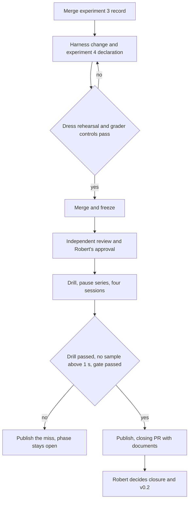

# Close Phase 5 on an Outcome-Gated Evaluation - Plan

## Goal Capsule

- **Objective:** Phase 5 closes with published evidence that agents from both clients can upgrade a running service, so that Robert can decide the v0.2 release.
- **Means:** A fourth, separately declared experiment judged on the result of the work, inside one closing sequence on a single frozen build.
- **Product authority:** This Product Contract governs the closing work. For experiment 4 it replaces the pass conditions and evidence requirements of `docs/plans/2026-11-09-0124-fix-phase5-evaluation-capture-plan.md`. The approved design in `docs/design/upgrades.md` and the original Phase 5 plan continue to govern runtime behaviour.
- **Open blockers:** None.

---

## Product Contract

### Summary

Declare experiment 4 with the same four sessions and the same 3-of-4 gate, where a session passes on the outcome of its upgrade and not on forensic proof of how the bytes travelled.
Run the kill drill, the pause series and the four sessions on one frozen build, publish everything, update the release documents, and hand Robert the release decision.

### Problem Frame

The live upgrade feature is built and merged, and the 1,000-kill drill passed.
The phase is still open because three scored experiments have produced no passing cohort.

No recorded miss says the upgrade did not work.
In all five scored sessions that ran to the end, the service state and the recorded activation were correct.
Experiment 1 stopped on a harness credential defect.
Experiment 2 scored 0/4 on a missing model name, a grader naming assumption, shell calls with no matching client event, and two answers written as sentences.
Experiment 3 stopped after one session because the capture rejected three resumed `sendfile` calls.

After experiment 2 the harness gained a syscall tracer that must recognise every action of two closed-source clients on a live kernel, and that rejects anything it does not recognise.
Each new client behaviour then needed a repair and a review: a client sandbox, `copy_file_range`, `io_uring`, mount namespaces, an unanswered request at session end.
The collection rules forbid repairs during an experiment and count harness faults as misses, so each surprise costs a whole experiment.
Nobody can say how many more surprises remain.

The debug-build pause is the second open item.
The original series missed the 0.5-second margin at 0.554 seconds; after optimisation a development series reached 0.393 seconds, with one intermediate series at 0.669 seconds.
No sample in any of these series exceeded the 1-second target.

### Key Decisions

- **Experiment 4 passes on outcome.** (session-settled: user-directed — chosen over keeping the seven-check gate, regrading sealed sessions offline after harness fixes, and closing without an agent evaluation: the forensic checks depend on a tracer with an unbounded tail of client behaviours, and the protocol calls this a capability demonstration.) Governs R2, R3, R4, R5.
- **Only the 1-second pause target blocks closing.** (session-settled: user-directed — chosen over a hard 0.5-second gate and over gating the optimised build only: the 0.5-second margin is a self-imposed cushion measured on a noisy shared host, and plain `make` produces the debug build, so it must still be measured and reported.) Governs R12, R13.
- **A client-reported substitute model does not fail a session.** (session-settled: user-approved — chosen over keeping the original rule that a substituted model is a miss: the claim is that an agent from each client can do the upgrade, and the record names the model that did.) Governs R6.
- **Codex keeps the full-access sandbox setting.** (session-settled: user-approved — chosen over returning to the `workspace-write` sandbox of experiment 2: every recent session ran this way, and reverting would introduce an untested condition.) Governs R7.
- **Any upload through the proxy counts.** The agent may reach the upgrade tools with `mo push` or with its native MCP route; the design gives every way in one upgrade path. Governs R3.
- **A dress rehearsal precedes the freeze.** No single live session has yet passed end to end without an offline repair, and an untested harness is what cost experiments 1 and 3. Governs R9.

### Actors

- A1. Robert: approves the freeze before launch and decides phase closure and the v0.2 release.
- A2. The implementing agent: changes the harness and declaration, runs the closing sequence, publishes the results.
- A3. The independent reviewer: reviews the freeze before the first scored launch.
- A4. The two evaluation clients, Codex and Claude Code: each performs the upgrade task in fresh sessions.

### Requirements

**Experiment 4 declaration**

- R1. Experiment 4 is declared as a separate experiment before any of its sessions launches, and the declaration states that the pass conditions were narrowed after experiments 1 to 3 and why.
- R2. The experiment keeps experiment 2's shape: four fresh sessions in Codex, Claude, Codex, Claude order, the same frozen client versions and requested models, the same task with the clarified final-answer instruction, a 3,600-second limit, and a gate of at least three passes with at least one per client.
- R3. A session passes when all of these hold: the hidden checks on the running service pass; exactly one durable activation with the expected identity follows the fixture's preparation; the folder-only restart check passes; the immutable source tests pass; the proxy record shows the candidate upload arriving through the proxy; and the final message, trimmed of whitespace, is exactly the revision value the grader itself reads from the live service.
- R4. Command origin by process trace, traffic completeness and model provenance are not pass conditions, and the syscall tracer does not run in scored sessions.
- R5. Each session's published record states the requested model, the model the client reported or that it reported none, whether the transcript shows `mo push`, and the number of proxy calls with no matching client event.
- R6. A session whose client reports a different model from the one requested counts when R3 holds, and is published under the reported model.
- R7. Codex runs with `--sandbox danger-full-access` under the collector's isolation, and the declaration discloses the difference from experiment 2.
- R8. Experiment 2's counting rules carry over unchanged: every launched session counts, there are no replacements, and neither harness nor grader changes after the first launch.

**Readiness before the freeze**

- R9. Before the freeze, one development session per client passes R3 live on the final harness with no offline repair, and the grader's controls accept a reference upgrade and reject each wrong outcome the protocol lists.

**Closing sequence**

- R10. All remaining code and harness changes merge to `main` before one freeze, and the drill, the pause series and the four sessions run on that frozen build; a result carries to a later freeze only when the inputs it depends on are byte-identical.
- R11. The 1,000-kill drill reruns on the frozen build under its existing declaration and must pass.
- R12. One declared pause series of five debug and five optimised repetitions on the declared workload runs on the frozen build, and every sample is published.
- R13. A slowest sample at or under 0.5 seconds is a pass; a slowest sample above 0.5 seconds and at or under 1 second is published as a margin miss and does not block closing; any sample above 1 second keeps the phase open.
- R14. An independent review of the freeze and Robert's approval both precede the first scored launch.

**Records**

- R15. Experiments 1, 2 and 3, the original pause miss and every development failure stay published unchanged; experiment 3's record merges to `main` as a stopped experiment and its session is not regraded.
- R16. All four sessions of experiment 4 and every miss are published after a clean publication scan.
- R17. If experiment 4 misses its gate, the phase stays open, the miss is published, and no further experiment runs without Robert's decision.

**Close and release**

- R18. When the drill has passed, the pause has not blocked and the gate has passed, the closing PR updates the roadmap, the run record, the README, the runbook, the agent guide and the release notes to describe the shipped behaviour and the evidence, including the narrowed gate and any pause margin miss.
- R19. Robert decides phase closure and the v0.2 release after reviewing the evidence; nothing tags, releases or deploys automatically.

### Key Flows

- F1. Closing sequence
  - **Trigger:** This plan is approved for implementation.
  - **Actors:** A1, A2, A3, A4
  - **Steps:** Merge the experiment 3 record. Change the harness and write the experiment 4 declaration. Run the dress rehearsal and grader controls. Merge and freeze. Independent review, then Robert's approval. Run the drill, the pause series and the four sessions on the frozen build. Publish. Open the closing PR with the updated documents. Robert decides.
  - **Outcome:** Phase 5 is closed with v0.2 decided, or it is open with a published miss and a decision waiting for Robert.
  - **Covered by:** R1, R9, R10, R11, R12, R13, R14, R15, R16, R17, R18, R19

### Acceptance Examples

- AE1. **Covers R3, R4.** A session ends with correct live state, one expected activation, a passing restart check, passing source tests, the upload in the proxy record and the final message `1`. The client used a kernel call the old tracer rejected. The session passes.
- AE2. **Covers R3.** The upgrade is correct in every respect and the final message is "The revision is 1." The session is a miss.
- AE3. **Covers R3.** The agent edits the source correctly and never uploads it, so the proxy record holds no candidate upload and no new activation exists. The session is a miss.
- AE4. **Covers R5, R6.** Codex reports no model and its work satisfies R3: the session passes and its record says no model was reported. Claude reports a fallback model and its work satisfies R3: the session passes and is published under the fallback model.
- AE5. **Covers R2, R17.** Both Codex sessions pass and both Claude sessions miss. The gate is missed, the phase stays open, the result is published and no fifth experiment starts until Robert decides.
- AE6. **Covers R13.** The slowest debug sample is 0.56 seconds: it is published as a margin miss and closing proceeds to Robert's decision. The slowest debug sample is 1.04 seconds: the phase stays open.
- AE7. **Covers R8.** A harness defect appears after the first session launches. The harness is not changed during the experiment and the affected session is not replaced.
- AE8. **Covers R10.** After the drill has run, a harness file that the drill does not depend on changes and a new freeze is taken. The drill result carries forward once its input hashes are shown to match.

### Scope Boundaries

- Deleting the syscall tracer, its tests and its development notes waits until after the close.
- The open cleanup PRs #312, #313, #319, #320 and #322 are not part of the closing path.
- Experiments 1 to 3 are not regraded or re-scored.
- The gate size, the session count, the clients and the task do not change.
- No further pause optimisation happens unless R13 keeps the phase open.
- No runtime upgrade behaviour changes.
- Comparative or population-rate claims about agents are outside this work.

### Dependencies and Assumptions

- The frozen client versions, Codex 0.166.0 and Claude Code 2.1.317, and their requested models are still available to run.
- The private evidence roots the run record names are intact.
- The proxy record can show a candidate upload for both `mo push` and the native MCP route. This rests on the protocol's description of the proxy and was not checked in the harness code.
- The formal and robustness artifacts the design asks for exist (`models/Swap.tla`, `cbmc/bundle.c`, `fuzz/fuzz_upgrade_pages.c`, `fuzz/fuzz_upgrade_schema.c`, `fuzz/fuzz_bundle.c`). The scheduled nightly passed on 2026-11-10 at commit `86f526cd`; `cbmc` and long fuzz runs are done by hand and were not rerun here.

### Outstanding Questions

**Deferred to Planning**

- How the grader recognises the candidate upload in the proxy record for each route.
- Whether the drill rerun uses its declared seed 20261110 or a newly declared one.
- How the session record obtains Codex's reported model without the tracer, or records that none was reported.
- Whether the scored path can skip the tracer cleanly or needs a small harness change to do so.

### Sources

- `docs/status/phase5-run.md`: the run record, including each experiment's outcome and the pause series.
- `learnability/phase5/protocol.md`: the evaluation declaration and its counting rules.
- `learnability/phase5/collection.md`: the drill and pause declarations.
- `learnability/phase5/results/experiment-3/` on branch `phase5/freeze-3`: the stopped experiment and its seven graded dimensions.
- `learnability/phase5/evaluation/integration-development.md`: every capture failure and repair.
- `docs/plans/2026-11-09-0124-fix-phase5-evaluation-capture-plan.md`: the strict-gate plan this one replaces for experiment 4.
- `docs/releases/v0.2-preparation.md`: the release preparation notes.
