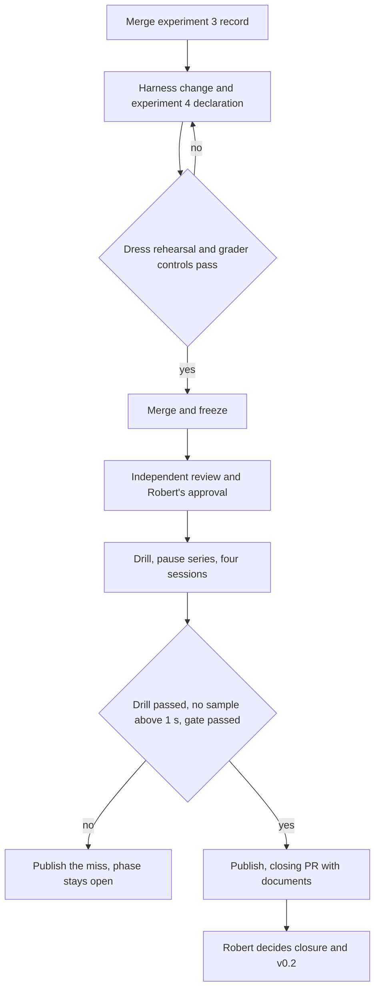

# Close Phase 5 on an Outcome-Gated Evaluation - Plan

## Goal Capsule

- **Objective:** Phase 5 closes with published evidence that agents from both clients can upgrade a running service, so that Robert can decide the v0.2 release.
- **Means:** A fourth, separately declared experiment judged on the result of the work, inside one closing sequence on a single frozen build (KTD1, KTD2, KTD8).
- **Product authority:** This Product Contract governs the closing work. For experiment 4 it replaces the pass conditions and evidence requirements of `docs/plans/2026-11-09-0124-fix-phase5-evaluation-capture-plan.md`. The approved design in `docs/design/upgrades.md` and the original Phase 5 plan continue to govern runtime behaviour.
- **Execution profile:** Two PRs. PR1 carries every code, harness, declaration and version change and merges before the freeze. PR2 carries the collected results and the closing documents.
- **Stop conditions:** No scored session launches before the independent freeze review and Robert's approval (R14). Nothing changes in the harness or grader after the first scored launch (R8). A missed gate, a failed drill or a pause sample above 1 second ends the run with the miss published and the phase open (R13, R17). Nothing tags, releases or deploys (R19).
- **Who finishes:** The implementing agent builds, runs and publishes. Robert merges PR1, approves the launch, and decides the release by deciding PR2.
- **Open blockers:** None.

---

## Product Contract

**Product Contract preservation:** Product Contract unchanged. The four questions deferred to planning are resolved in KTD1, KTD3, KTD5 and U6, and the proxy assumption is confirmed against the harness code.

### Summary

Declare experiment 4 with the same four sessions and the same 3-of-4 gate, where a session passes on the outcome of its upgrade and not on forensic proof of how the bytes travelled.
Run the kill drill, the pause series and the four sessions on one frozen build, publish everything, update the release documents, and hand Robert the release decision.

### Problem Frame

The live upgrade feature is built and merged, and the 1,000-kill drill passed.
The phase is still open because three scored experiments have produced no passing cohort.

No recorded miss says the upgrade did not work.
In all five scored sessions that ran to the end, the service state and the recorded activation were correct.
Experiment 1 stopped on a harness credential defect.
Experiment 2 scored 0/4 on a missing model name, a grader naming assumption, shell calls with no matching client event, and two answers written as sentences.
Experiment 3 stopped after one session because the capture rejected three resumed `sendfile` calls.

After experiment 2 the harness gained a syscall tracer that must recognise every action of two closed-source clients on a live kernel, and that rejects anything it does not recognise.
Each new client behaviour then needed a repair and a review: a client sandbox, `copy_file_range`, `io_uring`, mount namespaces, an unanswered request at session end.
The collection rules forbid repairs during an experiment and count harness faults as misses, so each surprise costs a whole experiment.
Nobody can say how many more surprises remain.

The debug-build pause is the second open item.
The original series missed the 0.5-second margin at 0.554 seconds; after optimisation a development series reached 0.393 seconds, with one intermediate series at 0.669 seconds.
No sample in any of these series exceeded the 1-second target.

### Key Decisions

- **Experiment 4 passes on outcome.** (session-settled: user-directed — chosen over keeping the seven-check gate, regrading sealed sessions offline after harness fixes, and closing without an agent evaluation: the forensic checks depend on a tracer with an unbounded tail of client behaviours, and the protocol calls this a capability demonstration.) Governs R2, R3, R4, R5.
- **Only the 1-second pause target blocks closing.** (session-settled: user-directed — chosen over a hard 0.5-second gate and over gating the optimised build only: the 0.5-second margin is a self-imposed cushion measured on a noisy shared host, and plain `make` produces the debug build, so it must still be measured and reported.) Governs R12, R13.
- **A client-reported substitute model does not fail a session.** (session-settled: user-approved — chosen over keeping the original rule that a substituted model is a miss: the claim is that an agent from each client can do the upgrade, and the record names the model that did.) Governs R6.
- **Codex keeps the full-access sandbox setting.** (session-settled: user-approved — chosen over returning to the `workspace-write` sandbox of experiment 2: every recent session ran this way, and reverting would introduce an untested condition.) Governs R7.
- **Any upload through the proxy counts.** The agent may reach the upgrade tools with `mo push` or with its native MCP route; the design gives every way in one upgrade path. Governs R3.
- **A dress rehearsal precedes the freeze.** No single live session has yet passed end to end without an offline repair, and an untested harness is what cost experiments 1 and 3. Governs R9.

### Actors

- A1. Robert: approves the freeze before launch and decides phase closure and the v0.2 release.
- A2. The implementing agent: changes the harness and declaration, runs the closing sequence, publishes the results.
- A3. The independent reviewer: reviews the freeze before the first scored launch.
- A4. The two evaluation clients, Codex and Claude Code: each performs the upgrade task in fresh sessions.

### Requirements

**Experiment 4 declaration**

- R1. Experiment 4 is declared as a separate experiment before any of its sessions launches, and the declaration states that the pass conditions were narrowed after experiments 1 to 3 and why.
- R2. The experiment keeps experiment 2's shape: four fresh sessions in Codex, Claude, Codex, Claude order, the same frozen client versions and requested models, the same task with the clarified final-answer instruction, a 3,600-second limit, and a gate of at least three passes with at least one per client.
- R3. A session passes when all of these hold: the hidden checks on the running service pass; exactly one durable activation with the expected identity follows the fixture's preparation; the folder-only restart check passes; the immutable source tests pass; the proxy record shows the candidate upload arriving through the proxy; and the final message, trimmed of whitespace, is exactly the revision value the grader itself reads from the live service.
- R4. Command origin by process trace, traffic completeness and model provenance are not pass conditions, and the syscall tracer does not run in scored sessions.
- R5. Each session's published record states the requested model, the model the client reported or that it reported none, whether the transcript shows `mo push`, and the number of proxy calls with no matching client event.
- R6. A session whose client reports a different model from the one requested counts when R3 holds, and is published under the reported model.
- R7. Codex runs with `--sandbox danger-full-access` under the collector's isolation, and the declaration discloses the difference from experiment 2.
- R8. Experiment 2's counting rules carry over unchanged: every launched session counts, there are no replacements, and neither harness nor grader changes after the first launch.

**Readiness before the freeze**

- R9. Before the freeze, one development session per client passes R3 live on the final harness with no offline repair, and the grader's controls accept a reference upgrade and reject each wrong outcome the protocol lists.

**Closing sequence**

- R10. All remaining code and harness changes merge to `main` before one freeze, and the drill, the pause series and the four sessions run on that frozen build; a result carries to a later freeze only when the inputs it depends on are byte-identical.
- R11. The 1,000-kill drill reruns on the frozen build under its existing declaration and must pass.
- R12. One declared pause series of five debug and five optimised repetitions on the declared workload runs on the frozen build, and every sample is published.
- R13. A slowest sample at or under 0.5 seconds is a pass; a slowest sample above 0.5 seconds and at or under 1 second is published as a margin miss and does not block closing; any sample above 1 second keeps the phase open.
- R14. An independent review of the freeze and Robert's approval both precede the first scored launch.

**Records**

- R15. Experiments 1, 2 and 3, the original pause miss and every development failure stay published unchanged; experiment 3's record merges to `main` as a stopped experiment and its session is not regraded.
- R16. All four sessions of experiment 4 and every miss are published after a clean publication scan.
- R17. If experiment 4 misses its gate, the phase stays open, the miss is published, and no further experiment runs without Robert's decision.

**Close and release**

- R18. When the drill has passed, the pause has not blocked and the gate has passed, the closing PR updates the roadmap, the run record, the README, the runbook, the agent guide and the release notes to describe the shipped behaviour and the evidence, including the narrowed gate and any pause margin miss.
- R19. Robert decides phase closure and the v0.2 release after reviewing the evidence; nothing tags, releases or deploys automatically.

### Key Flows

- F1. Closing sequence
  - **Trigger:** This plan is approved for implementation.
  - **Actors:** A1, A2, A3, A4
  - **Steps:** Merge the experiment 3 record. Change the harness and write the experiment 4 declaration. Run the dress rehearsal and grader controls. Merge and freeze. Independent review, then Robert's approval. Run the drill, the pause series and the four sessions on the frozen build. Publish. Open the closing PR with the updated documents. Robert decides.
  - **Outcome:** Phase 5 is closed with v0.2 decided, or it is open with a published miss and a decision waiting for Robert.
  - **Covered by:** R1, R9, R10, R11, R12, R13, R14, R15, R16, R17, R18, R19

### Acceptance Examples

- AE1. **Covers R3, R4.** A session ends with correct live state, one expected activation, a passing restart check, passing source tests, the upload in the proxy record and the final message `1`. The client used a kernel call the old tracer rejected. The session passes.
- AE2. **Covers R3.** The upgrade is correct in every respect and the final message is "The revision is 1." The session is a miss.
- AE3. **Covers R3.** The agent edits the source correctly and never uploads it, so the proxy record holds no candidate upload and no new activation exists. The session is a miss.
- AE4. **Covers R5, R6.** Codex reports no model and its work satisfies R3: the session passes and its record says no model was reported. Claude reports a fallback model and its work satisfies R3: the session passes and is published under the fallback model.
- AE5. **Covers R2, R17.** Both Codex sessions pass and both Claude sessions miss. The gate is missed, the phase stays open, the result is published and no fifth experiment starts until Robert decides.
- AE6. **Covers R13.** The slowest debug sample is 0.56 seconds: it is published as a margin miss and closing proceeds to Robert's decision. The slowest debug sample is 1.04 seconds: the phase stays open.
- AE7. **Covers R8.** A harness defect appears after the first session launches. The harness is not changed during the experiment and the affected session is not replaced.
- AE8. **Covers R10.** After the drill has run, a harness file that the drill does not depend on changes and a new freeze is taken. The drill result carries forward once its input hashes are shown to match.

### Scope Boundaries

- Experiments 1 to 3 are not regraded or re-scored.
- The gate size, the session count, the clients, the task and the prompt do not change.
- No further pause optimisation happens unless R13 keeps the phase open.
- No runtime upgrade behaviour changes.
- Comparative or population-rate claims about agents are outside this work.
- Considered and not built: a switch that lets the harness run with or without the tracer. One untraced path is all experiment 4 needs; a second path would need its own controls. A decision to run another traced experiment would change this.
- Considered and not built: a tool that compares two whole freeze manifests. Every measured run sits on one freeze, and `evidence.py build-inputs --compare` already covers the carry-forward case in AE8.

#### Deferred to Follow-Up Work

- Deleting the syscall tracer, its tests and its development notes, after the close.
- The open cleanup PRs #312, #313, #319, #320 and #322.

### Dependencies and Assumptions

- The frozen client versions, Codex 0.166.0 and Claude Code 2.1.317, and their requested models are still available to run.
- The private evidence roots the run record names are intact.
- The formal and robustness artifacts the design asks for exist (`models/Swap.tla`, `cbmc/bundle.c`, `fuzz/fuzz_upgrade_pages.c`, `fuzz/fuzz_upgrade_schema.c`, `fuzz/fuzz_bundle.c`). The scheduled nightly passed on 2026-11-10 at commit `86f526cd`; `cbmc` and long fuzz runs are done by hand and were not rerun here.

### Sources

- `docs/status/phase5-run.md`: the run record, including each experiment's outcome and the pause series.
- `learnability/phase5/protocol.md`: the evaluation declaration and its counting rules.
- `learnability/phase5/collection.md`: the drill and pause declarations.
- `learnability/phase5/results/experiment-3/` on branch `phase5/freeze-3`: the stopped experiment and its seven graded dimensions.
- `learnability/phase5/evaluation/integration-development.md`: every capture failure and repair.
- `docs/plans/2026-11-09-0124-fix-phase5-evaluation-capture-plan.md`: the strict-gate plan this one replaces for experiment 4.
- `docs/releases/v0.2-preparation.md`: the release preparation notes.
- `docs/solutions/best-practices/qualify-trace-instruments-against-real-clients-first.md`: the learning behind R9.

---

## Planning Contract

All file references below are to the harness as it stands on branch `phase5/freeze-3`, which is `main` plus four commits.

### Key Technical Decisions

- KTD1. **The session launch returns to Phase 4's untraced pattern.** `collect_locked` in `learnability/phase5/evaluation/harness.py` launches the client only through `origin_observer.TraceRun`, which also owns output capture, the timeout and the user switch. The untraced launch in `learnability/phase4/harness.py` already does those three jobs, and experiment 2 ran on it. Governs R4.
- KTD2. **Four graded dimensions replace seven.** `task_state`, `activation_identity`, `final_answer` and `source_tests` remain; `command_origin`, `traffic_completeness` and `model_provenance` leave the verdict. The mapping from R3 is in the design table below. Governs R3, R4.
- KTD3. **`activation_identity` already proves the upload came through the proxy.** It takes the accepted commit reply from the proxy record and compares it with `mo history` and a recompile of the candidate, and the harness firewalls the service's direct port from the session account. No new check is added. Governs R3.
- KTD4. **`final_answer` compares against the grader's own live reading.** The grader already calls the service's `revision` tool; the trace-derived `revision_observed` condition is removed. Governs R3.
- KTD5. **Model and traffic evidence become recorded fields.** The adapters in `model_adapter.py` are pure functions of the client's own output: Codex's diagnostic stderr lines and Claude's stream-json. The harness keeps a private raw copy of stderr for them. Whether an upload has a twin in the client stream tells a native MCP call from a shell call. None of these fields enters `failures` or the verdict. Governs R5, R6.
- KTD6. **The retained-bundle regrade becomes the independent regrade.** `protected_regrade.partial_regrade` already regrades state, identity and source tests from retained artifacts without a capture; it gains `final_answer` and stops hard-coding a miss. The sealed-trace `regrade` path is not used. Governs R16.
- KTD7. **The freeze and publication tools become tracked code.** Experiment 3's freeze manifest and its publication both ran from untracked scripts under a gitignored `build/` folder, and `publish.py`'s command line cannot publish a graded session on its own. A disk cleanup already deleted `build/` once. Governs R10, R16.
- KTD8. **The version becomes 0.2.0 before the freeze.** The version is a constant in two C files, so changing it after the freeze would make the released binary differ from the evaluated one. Phase 4's candidate reported `mo 0.1.0` at its freeze for the same reason. Governs R10, R19.
- KTD9. **The dress rehearsal runs on the PR1 head, and the freeze proves tree equality.** PR1 is squash-merged, so the merged tree equals the rehearsed tree when the branch is current with `main`. The freeze step checks that equality instead of repeating the sessions. Governs R9, R10.
- KTD10. **The drill and pause series run during the review wait.** R14 gates only the scored launch. Running the measured runs first also means a pause sample above 1 second is found before any scored session is spent. Governs R11, R12, R14.

### High-Level Technical Design

How each pass condition of R3 is graded, and what is recorded beside it.

| R3 condition | Dimension | Evidence it reads | Needs the tracer |
| --- | --- | --- | --- |
| Hidden checks on the running service | `task_state` | Live MCP calls by the grader | No |
| Folder-only restart check | `task_state` | Restart of the stopped data folder | No |
| One durable activation, expected identity | `activation_identity` | `mo history`, recompiled candidate digest | No |
| Candidate upload through the proxy | `activation_identity` | Accepted commit reply in the proxy record | No |
| Immutable source tests | `source_tests` | `mo test` on the restored tests | No |
| Final message equals the live revision | `final_answer` | Client stream, grader's `revision` call | No |

| Recorded, never graded (R5) | Source |
| --- | --- |
| Requested and reported model | Launch settings; Codex diagnostic stderr; Claude stream-json |
| Upload route: native or shell | Whether each upload call has a twin in the client stream |
| Transcript shows `mo push` | Shell command events in the client stream |
| Proxy calls with no client event | The proxy and stream match |

### Assumptions

These are bets made without asking; each is cheap to change before PR1 merges.

- PR1 is built on `phase5/freeze-3`, so the experiment 3 record and the harness change merge together. The branch stays on origin because experiment 3's candidate commit lives on it.
- `main` reports `mo 0.2.0` from the PR1 merge until Robert decides the release (KTD8).
- The prompt stays byte-identical. It still tells the agent to use `mo push`; the declaration states that grading credits either route.
- Codex keeps the HTTP Responses transport and diagnostic logging that the recent sessions used, since they are what let it report a model.
- The tracer modules and their tests stay in the tree untouched and unused.

### Sequencing

PR1 merges first. The freeze is then taken on merged `main`, and everything in PR2 depends on that commit. Inside PR2 the order is fixed by KTD10: freeze, measured runs, approval, scored sessions, publication, documents.

### Risks and Dependencies

| Risk | Mitigation |
| --- | --- |
| The version constant feeds the runtime identity that data folders record, and a fixture or golden pins it | U5 finds every pinned occurrence and checks that a 0.1.0 folder still opens |
| The untracked experiment 3 scripts vanish before they are tracked | U3 copies them into the repo as its first step |
| A real agent miss: a Codex design choice fails the source tests, or a client answers in prose | The 3-of-4 gate tolerates one; a missed gate follows R17 |
| The installed `mo` cannot read its library as the session account, as on 2026-11-10 | U6 rehearses with the binary installed exactly as the freeze installs it |
| A pause sample is slow on the shared host | R13 blocks only above 1 second; KTD10 finds it before the scored sessions |
| A proxy recorder step needs a capture object to run | U1 removes only what fails without one |
| PR1 drifts from `main` between rehearsal and merge | KTD9's tree-equality check fails and the rehearsal repeats |

### Open Questions

**Gates on merging and launching (Robert)**

- PR1 needs one review and Robert's word to merge, per `AGENTS.md`.
- R14's approval may be given together with the PR1 merge, conditional on a clean independent freeze review. That saves one round trip; it is Robert's choice.

**Deferred to implementation**

- Whether the Phase 5 proxy recorder runs unchanged without a capture object.
- Which tests, goldens and fixtures pin the version string or the runtime identity.
- The wall time of the pause series; no record of it was found.

---

## Implementation Units

### PR1: Outcome-gated harness, experiment 4 declaration and version

Waits on: nothing.

### U1. Untraced session launch

- **Goal:** A session runs without `strace` and still yields the client stream, a public stderr and a private raw stderr.
- **Requirements:** R4, R7; KTD1, KTD5.
- **Dependencies:** None.
- **Files:** `learnability/phase5/evaluation/harness.py`, `learnability/phase5/evaluation/proxy.py`, `learnability/phase5/evaluation/test_harness.py`.
- **Approach:**
  1. Replace the `TraceRun` launch in `collect_locked` with the launch pattern from `learnability/phase4/harness.py`: session-user switch, output to files, TERM then KILL at the limit.
  2. Write the client's stdout as the stream and keep its raw stderr in the private session folder; the public stderr stays stripped of diagnostic lines as today.
  3. Stop constructing the capture object; adjust the proxy recorder only where it fails without one.
  4. Leave the Codex and Claude command lines as they are.
- **Patterns to follow:** `learnability/phase4/harness.py` client launch; the existing `public_stderr` filter.
- **Test scenarios:**
  - Stub client, normal exit: the stream file and both stderr files exist, and no trace folder is created.
  - Stub client that exceeds the limit: the client is killed, the session records a timeout and counts as launched.
  - Codex stub with diagnostic stderr lines: the private copy keeps them and the public copy has none.
  - The built Codex command still carries `danger-full-access`, and no built command contains `strace`.
- **Verification:** A stub session completes with the tracer modules never imported by the harness.

### U2. Outcome grading and recorded evidence

- **Goal:** The live verdict is the four dimensions of KTD2, and each session manifest carries the R5 fields.
- **Requirements:** R3, R4, R5, R6; KTD2, KTD3, KTD4, KTD5.
- **Dependencies:** U1.
- **Files:** `learnability/phase5/evaluation/grade.py`, `learnability/phase5/evaluation/harness.py`, `learnability/phase5/evaluation/model_adapter.py`, `learnability/phase5/evaluation/test_grade.py`, `learnability/phase5/evaluation/test_model_adapter.py`.
- **Approach:**
  1. Reduce the dimension set assembled in the harness and compared in `grade.compare` to the four of KTD2.
  2. Grade `final_answer` against the live reading the grader already stores, and drop `revision_observed`.
  3. Keep `accepted_report` and the identity comparison; remove the trace-proven-upload requirement from `attestation`.
  4. Stop appending model, attestation and revision-observation reasons to `failures`, so that list holds execution failures only.
  5. Add the R5 fields to the manifest from the model adapters, the proxy and stream match, and the stream's shell command events.
- **Patterns to follow:** `grade.observe` for the live reading; `proxy.match` pairs and `log_only` rows.
- **Test scenarios:**
  - Covers AE1. Correct state, one expected activation, passing restart and tests, accepted commit in the proxy record, final message `1`: all four dimensions true and `correct` true.
  - Covers AE2. Same session with the final message "The revision is 1.": `final_answer` false and `correct` false.
  - Covers AE3. Correct source, no upload calls in the proxy record: `activation_identity` false and `correct` false.
  - Two accepted activations after the fixture's preparation: `activation_identity` false.
  - Final message `1` while the live revision reads `2`: `final_answer` false.
  - Covers AE4. Codex stderr with no model lines: `correct` true, reported model recorded as none, `failures` empty.
  - Covers AE4. Claude stream reporting a different model: `correct` true and the manifest names the reported model.
  - Upload calls with stream twins record the native route; upload calls without twins record the shell route and are counted as unmatched.
  - A stream containing a shell command that runs `mo push` sets the transcript field; a stream without one clears it.
- **Verification:** The grader's reference and wrong-outcome controls from `learnability/phase5/protocol.md` give the same accept and reject results as before on the outcome dimensions.

### U3. Independent regrade, publication and freeze tooling

- **Goal:** Four sessions can be regraded, published and gated, and a freeze manifest can be produced, all from tracked code.
- **Requirements:** R10, R16; KTD6, KTD7.
- **Dependencies:** U2.
- **Files:** `learnability/phase5/evaluation/protected_regrade.py`, `learnability/phase5/evaluation/replay_bundle.py`, `learnability/phase5/evaluation/publish.py`, `learnability/phase5/evidence.py`, `learnability/phase5/evaluation/test_protected_regrade.py`, `learnability/phase5/evaluation/test_partial_replay.py`, `learnability/phase5/evaluation/test_publish.py`, `learnability/phase5/evaluation/test_collector.py`, `learnability/phase5/evaluation/test_harness.py`.
- **Approach:**
  1. Copy the two untracked experiment 3 scripts out of the gitignored `build/freeze-3/` folder of the `phase5/freeze-3` checkout before any other step.
  2. Make the retained bundle the only bundle a scored session writes, and make `partial_regrade` return the four-dimension verdict with the final evidence class.
  3. Change `publish.py` to validate the four dimensions and to pass the regrade callback from its own command line, taking the experiment folder as input.
  4. Add a `freeze` subcommand to `learnability/phase5/evidence.py` that writes the manifest `harness.freeze` reads, with the same artifact groups the experiment 3 script hashed.
  5. Leave `evidence.py gate` as it is; it already reads only `correct`, slot order and the scan result.
- **Patterns to follow:** `protected_regrade.partial_regrade`; `evidence.py build-inputs`; the existing publish stage, scan, archive, extract and rescan sequence.
- **Test scenarios:**
  - Retained bundle of a passing stub session: the regrade reproduces four true dimensions and matches the live verdict.
  - Retained bundle of a session with no upgrade: the regrade returns a complete miss and publication still completes.
  - Four stub sessions through the publish command line: a receipt is written and both scans are clean.
  - Three sessions, or a duplicate slot: publication refuses.
  - A session folder containing a credential: the scan fails and nothing is published.
  - Covers AE5. Gate input with two Codex passes and two Claude misses: the gate reports a miss.
  - Gate input with three passes including one per client: the gate reports a pass.
  - `evidence.py freeze` then one changed harness file: `harness.freeze` rejects the manifest.
  - The collector suite's stub cases assert the four dimensions and no trace artifacts.
- **Verification:** The full collector suite passes on stub clients with no file outside the repository involved in freezing or publishing.

### U4. Experiment 4 declaration and the experiment 3 record

- **Goal:** The experiment is declared in the repository before any session, and experiment 3 is on `main` as a stopped experiment.
- **Requirements:** R1, R2, R6, R7, R8, R13, R15, R17.
- **Dependencies:** U2, for the dimension names the declaration cites.
- **Files:** `learnability/phase5/protocol.md`, `learnability/phase5/collection.md`, `learnability/phase5/results/experiment-4/declaration.json`, `docs/status/phase5-run.md`.
- **Approach:**
  1. Append an experiment 4 section to the protocol, as experiment 2's was appended, stating R1 to R8 and that the prompt is unchanged while either upload route is credited.
  2. State in `collection.md` that the drill reruns under its declared count and seed, and record R13 as the rule for the new pause series.
  3. Write `declaration.json` in the shape of `learnability/phase5/results/experiment-3/declaration.json`, with the recording line describing proxy and client-output recording only.
  4. Keep the experiment 3 files from the branch byte-identical.
- **Patterns to follow:** The "Credential correction and separately declared experiment" section of `learnability/phase5/protocol.md`.
- **Test scenarios:** Test expectation: none -- declarations and records only; the freeze hashes them in U7.
- **Verification:** A reader of the protocol alone can state the pass conditions, what changed from experiment 2 and why.

### U5. Version 0.2.0

- **Goal:** The build that is frozen reports the version that would be released.
- **Requirements:** R10, R19; KTD8.
- **Dependencies:** None.
- **Files:** `src/tools/cli.c`, `src/base/runtime-identity.c`, `ci/check_cli.py`, `tests/cli/`.
- **Approach:** Change the constant in both files, then update each pinned occurrence the checks report. Confirm what the runtime identity feeds before trusting existing fixtures. Confirm that `docs/agent-guide.md` already describes the v0.2 behaviour; the guide is embedded in the binary, so any edit to it lands here and not in PR2.
- **Execution note:** Read `docs/status/agent-mistakes.md` first; this is the only C change in the plan.
- **Test scenarios:**
  - `mo --version` prints `mo 0.2.0`.
  - A data folder written by the 0.1.0 build opens under the new build with its state intact.
- **Verification:** `bash ci/check.sh gcc` and the `drivers` group pass with no missing-tool skips.

### U6. Grader controls and dress rehearsal

- **Goal:** The final harness is shown to work live with both real clients before anything is frozen.
- **Requirements:** R9; KTD9.
- **Dependencies:** U1, U2, U3, U4, U5.
- **Files:** `learnability/phase5/evaluation/integration-development.md`.
- **Approach:**
  1. Install `mo` from the PR1 head exactly as the freeze will, and confirm the session account can compile the fixture.
  2. Run the grader's reference and wrong-outcome controls.
  3. Run one development session per client, outside any denominator, and regrade each with the U3 path.
  4. Record every run in the development record, including failures. A failure sends the work back to the unit that owns the defect, and the pair runs again.
- **Test scenarios:** Test expectation: none -- this unit is the live proof for U1 to U3.
- **Verification:** Both development sessions pass all four dimensions live and on regrade, with no change made between the launch and the regrade.

### PR2: Experiment 4 results and closing documents

Waits on: PR1, needed before this group can start because the freeze is taken on merged `main`. The project rule that a collection candidate must be a merged commit keeps this a separate PR.

### U7. Freeze, measured runs and launch approval

- **Goal:** One frozen build has a passed drill, a published pause series, a clean independent review and Robert's approval.
- **Requirements:** R10, R11, R12, R13, R14; KTD9, KTD10.
- **Dependencies:** U6, and PR1 merged.
- **Files:** `learnability/phase5/results/experiment-4/`, `docs/status/phase5-run.md`.
- **Approach:**
  1. Confirm the merged tree equals the rehearsed PR1 head, then write the freeze manifest with `evidence.py freeze`.
  2. Start the independent freeze review.
  3. Run the drill as `learnability/phase5/collection.md` declares it, then the pause series with `measure_pause.py --freeze`.
  4. Apply R13 to the pause samples and stop here if the drill fails or any sample exceeds 1 second.
  5. Ask Robert for the launch approval with the review result and both measured results in hand.
- **Execution note:** The drill takes about 48 minutes; start it detached and wait as `AGENTS.md` describes.
- **Test scenarios:** Test expectation: none -- measured runs on frozen inputs.
- **Verification:** The drill reports no accepted message lost or duplicated, every pause sample is recorded with the freeze digest, and the approval is recorded with its date.

### U8. Scored sessions and publication

- **Goal:** The four sessions of experiment 4 are collected, regraded, published and gated.
- **Requirements:** R2, R8, R16, R17.
- **Dependencies:** U7.
- **Files:** `learnability/phase5/results/experiment-4/`.
- **Approach:** Run slots 1 to 4 in order with no change between them. Regrade and publish with the U3 command line, then run `evidence.py gate` on the published record.
- **Test scenarios:**
  - Covers AE7. A harness defect seen after slot 1 launches: no file changes, no slot is replaced, and the record names the defect.
- **Verification:** The published record holds four slots, both scans are clean, and the gate result is stated with each client's subtotal.

### U9. Closing documents and release decision

- **Goal:** The repository describes what shipped and what the evidence shows, and Robert has one PR to decide.
- **Requirements:** R15, R18, R19.
- **Dependencies:** U8.
- **Files:** `docs/ROADMAP.md`, `docs/status/phase5-run.md`, `README.md`, `docs/ops/task-queue.md`, `docs/releases/v0.2-preparation.md`.
- **Approach:**
  1. Write the experiment 4 result, the rerun drill and the pause series into the run record, beside the unchanged earlier records.
  2. If the gate passed, update the roadmap, README, runbook and release notes for v0.2, naming the narrowed gate and any pause margin miss. If it missed, update only the roadmap and run record, and stop per R17.
  3. Compare the build inputs at the PR2 head with the freeze using `evidence.py build-inputs --compare`.
  4. Leave `docs/agent-guide.md` unchanged: it is embedded in the frozen binary, and U5 settled its content for R18.
- **Test scenarios:** Test expectation: none -- documents only.
- **Verification:** The build-input comparison reports a match, and no document claims a release, tag or closure that Robert has not decided.

---

## Verification Contract

| Check | Command or evidence | Applies to |
| --- | --- | --- |
| Harness unit tests | `PYTHONDONTWRITEBYTECODE=1 python3 -m unittest discover -s learnability/phase5/evaluation -p 'test_*.py'`, with the evaluation binary variables set | U1, U2, U3 |
| Collector suite on stub clients | The slow cases in `learnability/phase5/evaluation/test_collector.py`, about ten minutes | U3 |
| Build and unit tests | `bash ci/check.sh gcc`, last line quoted in the PR body | U5, PR1 |
| CLI goldens | `bash ci/check.sh drivers` | U5 |
| Live readiness | Two development sessions passing live and on regrade | U6 |
| Kill drill | `MO_KILL_COUNT=1000 MO_KILL_SEED=20261110 bash ci/check.sh drivers` on the frozen build | U7 |
| Pause series | `learnability/phase5/measure_pause.py --freeze` on the frozen debug and optimised binaries | U7 |
| Gate | `learnability/phase5/evidence.py gate` on the published record | U8 |
| Release inputs | `learnability/phase5/evidence.py build-inputs --compare` against the freeze | U9 |

A skipped check for a missing tool is not a pass.

## Definition of Done

- PR1 is merged with one review, and its body quotes the `gcc` check result.
- The experiment 4 declaration predates every scored session.
- The drill, the pause series and all launched sessions ran on one freeze, or carried forward under R10.
- All four sessions and every miss are published after clean scans, and the gate result is recorded.
- Experiments 1 to 3 and every earlier failure are unchanged in the repository.
- PR2 is open with the run record and, on a pass, the closing documents; Robert has what he needs to decide.
- No abandoned harness experiment, switch or dead code path from this work remains in the diff.
- No tag, release or deployment was made.
