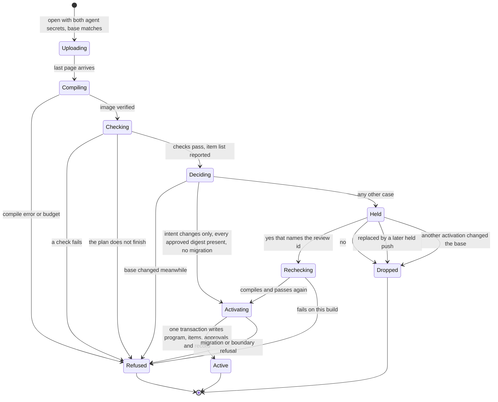

# Phase 6, Intent and Autonomy - Plan

## Goal Capsule

- **Objective:** A running Mo service accepts a change without a person only when everything Robert approved is still present and still holds, and every change that touches approved intent waits for him. Robert reaches a verdict, from simulation evidence and from real use of a service he relies on, on whether to let agents ship that way. The phase releases v0.3.
- **Means:** Promises that can describe a whole service and are checked in simulation, a strength measure for promises, approval records tied to exact content, and a review setting on the Phase 5 upgrade path (KTD1, KTD5, KTD6, KTD10).
- **Authority:** `docs/ROADMAP.md` (Phase 6 row), the language reference, `docs/design/services.md`, `docs/design/upgrades.md`, `docs/design/promise-strength.md` and `AGENTS.md` govern. Robert approves every change to Mo's language and toolchain surface: reference text, commands and error codes. The behaviour specified below is new; none of it exists yet.
- **Execution profile:** Seven pull requests, one per unit, each reviewed and merged by Robert as `AGENTS.md` requires. U1 is a design step he approves before any code.
- **Stop conditions:** Stop and ask Robert when a unit needs a change to the Product Contract, when a U1 prototype shows KTD1 or KTD9 cannot work, when the M4 proof records a planted intent change that activated without his yes, or when the nightly is red.
- **Who finishes:** Agents build each unit and open its pull request. Robert approves the design, merges each pull request, chooses the live service, answers reviews and gives the verdict.
- **Open blockers:** None. U1 puts the open design questions to Robert before any code (Outstanding Questions).
- **Product Contract preservation:** Requirements, key decisions, flows and acceptance examples are unchanged. Planning rewrote Outstanding Questions to list only what is still open, and added to Scope Boundaries the mechanisms it considered and did not build.

---

## Product Contract

### Summary

Phase 6 makes the upgrade door check each incoming program against what Robert approved. Each service gets a review setting: every change waits for Robert, or only changes to approved intent and migrations of stored state do. Before the door relies on intent, a promise can be written about a whole service and is checked in simulation, a strength measure shows whether promises reject wrong programs, and approved intent becomes readable in plain language and locked. The door is proven on the task queue sample, then runs on a service Robert uses, and the phase closes on his verdict.

### Problem Frame

Phase 5 gave an agent a way to change a running service. That path checks a second credential, compiles the incoming program, compares it with the running one and runs a migration when the state type changed. It does not consult the incoming program's promises, examples or tests. Whoever holds the credential can activate any program that compiles, including one whose promises were loosened until they passed.

Mo's intent forms stop at functions. A promise whose inputs include a `Simulation` is rejected with E1400, and the reference defers promises over a service's sequences. The task queue shows the result. Its 8 promises sit on functions in `services/task-queue/job-queue.mo`. Its behaviour as a service is covered by the 23 hand-written tests in `services/task-queue/queue-tests.mo`, which the agent changing the program can also change. `mo test` generates message sequences against a service only in its recovery check, and that check asks one question: does the state after a restart equal the state before the crash.

Nothing yet shows that a promise rejects a wrong program. `mo test --strength` is a design in `docs/design/promise-strength.md` and is not implemented. The first Mo toolchain (`robertguss/mo-lang`) ran ten control rounds in which no approved constraint tripped on a wrong edit. The agent that wrote its code also wrote the tests that judged the code, and re-pinned their expectations.

Robert therefore has two choices today: read every change in full, or trust a change on evidence that does not exist. `README.md`, the reference and the Phase 5 plan all assign approval of intent and the criteria for autonomous deployment to this phase.

### Key Decisions

- **The door has two review settings, and review everything comes first.** (session-settled: user-approved — chosen over leaving the review-everything stage to a later phase: without it the phase either grants autonomy Robert does not yet trust or changes nothing for him.) Governs R17, R18, R19.
- **People still read code.** The intent change is shown first and the code change stays available. (session-settled: user-directed — chosen over a flow in which Robert never sees code: Robert corrected that reading of the premise.) Governs R13, R21.
- **Simulation first, then a service Robert uses.** (session-settled: user-directed — chosen over proving the phase on the sample alone and over going live at once: reviews of real changes can earn trust that planted faults cannot, and simulation is the cheap place to find the door's defects.) Governs R1, R2, R23, R24.
- **Promises can be about a service.** (session-settled: user-directed — chosen over exercising the door in simulation with no new language feature: approved intent could otherwise state only function-level behaviour.) Governs R4, R5, R6, R7.
- **The phase closes on Robert's verdict, and either answer closes it.** (session-settled: user-directed — chosen over closing once the mechanism has run live, which leaves the phase's question unanswered, and over staying open until autonomy is achieved, which presses Robert to trust the system so the phase can end.) Governs R28.
- **Shadow runs, observation windows and automatic expansion are out.** (session-settled: user-approved — chosen over taking them up from Phase 5's deferral list: they were proposed in the `robertguss/mo-v2` archive and never approved by Robert, and the two review settings answer the trust question without them.)
- **Any edit or removal of approved intent goes to Robert.** An edit includes a change to anything the approved item reads. The door does not judge whether an edit weakens intent, because a wrong judgment would let a loosened promise through. Governs R14, R19.
- **Approved intent is promises and example tables.** Tests stay the agent's to change. Governs R11.
- **Evidence comes before reliance.** Intent that the strength measure shows to be weak is strengthened before the door relies on it, and the wrong versions that measure it come from a session that does not write the intent. Governs R9, R10, R31.
- **The lock's limit is documented and left open.** An agent with a shell on the service's own machine can go around the door, because Mo has no operating-system confinement, and this phase does not add it. Governs R15, R30.
- **In the live stage, agents get no shell on the service's host.** They reach the service only through its endpoint. (session-settled: user-approved — chosen over giving agents the host and saying in the verdict that the door could be bypassed: the planted change of R27 and the verdict would otherwise come from a door the agent could go around.) Governs R25, R27, R30.
- **An upgrade that migrates stored state waits for Robert in this phase.** (session-settled: user-approved — chosen over letting it activate alone when no approved item changed: simulation never runs on the live service's stored data, and there is no rollback.) Governs R19, R32.
- **Limits are fixed only when the live service hits them.** Everything else waits for Phase 7. Governs R29.

### Requirements

**Phase shape**

- R1. The phase runs five milestones in order: M1 promises about a service; M2 promise strength; M3 readable intent and the lock; M4 the review door, proven on the task queue; M5 the live stage and the close.
- R2. No service Robert uses runs behind the door before the M4 proof (R23) exists.
- R3. The phase releases v0.3 when it closes per R28.

**Promises about a service (M1)**

- R4. An author can write a promise about a service's behaviour across a sequence of messages, with a sentence, as function promises have.
- R5. `mo test` checks such a promise against generated sequences of tool calls, clock advances, crashes and restarts, and reports a failure as a short sequence that still fails.
- R6. The same program and promise give the same result on every run.
- R7. The task queue states its service guarantees as promises, and they pass.

**Promise strength (M2)**

- R8. `mo test --strength` implements the parts of `docs/design/promise-strength.md` that R9 and R10 need, and covers the service-level promises of R4. Planning names those parts. The rest of that design is deferred.
- R9. The strength of the task queue's intent is measured and recorded before M4 begins.
- R10. Before M4 begins, the task queue's intent is strengthened until Robert accepts its strength result.
- R31. The wrong versions and planted changes used for R9, R10 and R23 are written by an agent session that does not write the task queue's intent, and each record names the session that wrote it. The wrong versions are frozen before that intent is strengthened. Planted changes that edit approved intent are frozen before the M4 proof runs.

**Approved intent and the lock (M3)**

- R11. Approved intent is the promises and example tables Robert has approved, service-level promises included. Tests are not approved intent.
- R12. Robert can read a program's promises and example tables, each marked approved or not, without reading handler code.
- R13. For a proposed change, Robert sees each approved promise and example table that changed, before and after, ahead of the code change. A change to a declaration an approved item reads (R14) is shown with that item.
- R14. An approval covers exact content: editing or removing an approved item leaves it unapproved until Robert approves the new content. An item's content includes every declaration its conditions, anchors and example rows read, directly or through one another: constants, helper functions and types. The function or service the item is about is not part of it.
- R15. Only Robert can create or change an approval, and he does so somewhere an agent working on the program cannot act as him.
- R16. An agent can add promises and examples without approval, and they stay unapproved until Robert approves them.

**The review door (M4)**

- R17. Each service has a review setting with two values, review everything and review intent changes only. A service starts on review everything, and only Robert changes the setting.
- R18. Under review everything, every upgrade waits for Robert's yes. Each upgrade's record says whether review intent changes only would have activated it without him, and what he answered.
- R19. Under review intent changes only, an upgrade that leaves every approved item unchanged and carries no migration (R32) activates without a person, and an upgrade that edits or removes an approved item (R14) waits for Robert's yes.
- R20. Under either setting, an upgrade activates only when the incoming program passes its own promises, examples and tests. One that fails is refused and the running program continues.
- R21. A waiting upgrade shows Robert the intent change (R13) first and the code change after, and the running program keeps serving while it waits.
- R22. Robert's yes applies only to the incoming program he was shown, on the running program it was compared with. It approves that program's changed intent and activates it. When either program has changed since he was shown, nothing activates and he is asked again. His no discards the upgrade and changes nothing.
- R23. Before any live use, the door is exercised many times on the task queue with planted changes of three kinds: fixes that leave approved intent unchanged, changes that edit or remove it, and wrong versions from the M2 measurement (R9) that leave it unchanged. Every change of the second kind waits, and under review intent changes only no change of the first kind does. The door refuses every wrong version that the strength measure counts as rejected.
- R32. In this phase, an upgrade that carries a migration of stored state waits for Robert's yes under both settings.

**Live stage and close (M5)**

- R24. A Mo service Robert uses runs behind the door on its own host, starting on review everything.
- R25. Agents make the changes to that service, and every change goes through the door. Agents reach the service only through its endpoint, over a tunnel limited to that port, with no shell on its host and no access to its data folder. Restarting the service on a new program, and starting it in a fresh data folder, are Robert's alone.
- R26. When Robert rejects a change that passed every check, a promise or example that would have caught it is added before the next change is proposed.
- R27. At least one planted change to approved intent is pushed at the live service, under the access R25 allows, and the door holds it.
- R28. After a minimum of real use, Robert gives a verdict on moving the service to review intent changes only, and either answer closes the phase. The record of R18 is part of the evidence he weighs. After a yes, one real change activates without a person. After a no, what is missing is recorded as the next work.
- R29. A speed or size limit is fixed in this phase only when the live service hits it.

**Stated limits**

- R30. The agent guide and the design documents say what the lock does not protect against, including an agent with a shell on the service's own machine. The agent guide states the access rule of R25 for a service behind the door.

### Actors

- A1. Robert: approves intent, answers waiting upgrades, sets each service's review setting and gives the verdict.
- A2. Agent: writes and changes Mo programs, adds intent, pushes upgrades and fixes failures in the live service.
- A3. Upgrade door: the service's upgrade path. It compares an incoming program with the approvals, then refuses, holds or activates.
- A4. `mo test`: checks promises, including service-level ones in simulation, and measures strength.

### Key Flows

- F1. A fix that leaves approved intent alone
  - **Trigger:** A2 pushes an upgrade to a service on review intent changes only.
  - **Actors:** A2, A3
  - **Steps:** A3 finds every approved item unchanged and no migration. The incoming program passes its checks. A3 activates it.
  - **Outcome:** The fix is live and no person was involved.
  - **Covered by:** R19, R20, R32
- F2. A change that touches approved intent
  - **Trigger:** A2 pushes an upgrade that edits or removes an approved item.
  - **Actors:** A1, A2, A3
  - **Steps:** A3 holds the upgrade. A1 reads the intent change, then the code change if he wants it. A1 answers.
  - **Outcome:** A yes activates the upgrade and approves the new content. A no discards it. The running program serves throughout.
  - **Covered by:** R14, R19, R21, R22
- F3. Review everything
  - **Trigger:** A2 pushes any upgrade to a service on review everything.
  - **Actors:** A1, A2, A3
  - **Steps:** A3 holds the upgrade. A1 reviews it. When A1 rejects a change that passed every check, A2 adds intent that would have caught it.
  - **Outcome:** Nothing activates without A1, and each such rejection leaves the service with more intent than before.
  - **Covered by:** R18, R21, R22, R26
- F4. First approval
  - **Trigger:** A program carries promises or example tables Robert has not approved.
  - **Actors:** A1
  - **Steps:** A1 reads them. A1 approves the ones he accepts.
  - **Outcome:** Those items are approved intent and the door protects them.
  - **Covered by:** R12, R14, R15, R16
- F5. The verdict
  - **Trigger:** The live service has had its minimum of real use.
  - **Actors:** A1
  - **Steps:** A1 weighs the strength results, the M4 proof and the record of his reviews (R18). A1 answers.
  - **Outcome:** The phase closes on either answer.
  - **Covered by:** R28

### Acceptance Examples

- AE1. **Covers R19, R20.** Given the task queue on review intent changes only with approved promises, when an agent pushes a handler fix that changes no approved item, carries no migration and passes its checks, then the fix activates and Robert is not asked.
- AE2. **Covers R14, R19, R21.** Given the same service, when a push rewrites an approved promise's sentence, changes its body or deletes a row of an approved example table, then the upgrade waits, Robert sees that item before and after, and the old program keeps serving.
- AE3. **Covers R20.** Given approved promises that a push leaves unchanged, when the incoming program fails one of them, then the upgrade is refused under either setting and Robert is not asked.
- AE4. **Covers R18.** Given a service on review everything, when a push changes no approved item and passes its checks, then it still waits for Robert, and its record says the other setting would have activated it.
- AE5. **Covers R16, R19.** Given a service on review intent changes only, when a push only adds a new promise, then it activates without Robert and the new promise shows as unapproved.
- AE6. **Covers R15.** Given an agent that holds the service token and the upgrade credential, when it tries to mark a changed promise approved, then the attempt fails and the item stays unapproved.
- AE7. **Covers R4, R5.** Given a service-level promise on the task queue and a planted fault that breaks it only after a crash and restart, when `mo test` runs, then it fails and reports a short sequence that contains the restart.
- AE8. **Covers R26.** Given a service on review everything, when Robert rejects a change that passed every check, then the next proposed change carries a promise or example that the rejected change fails.
- AE9. **Covers R28.** Given the minimum of real use is met, when Robert's verdict is no, then the gaps he names are recorded as the next work and the phase closes with the service still on review everything.
- AE10. **Covers R14, R19.** Given the task queue on review intent changes only with the promise "a job is attempted at most three times" approved, when a push changes only the constant that promise reads, then the upgrade waits and Robert sees the constant before and after.
- AE11. **Covers R32.** Given a service on review intent changes only, when a push carries a migration of stored state and changes no approved item, then it waits for Robert.

### Scope Boundaries

- Shadow runs, observation windows and automatic expansion.
- Operating-system confinement of agents on a service's host.
- Judging automatically whether an edit weakens intent.
- More than one approver, roles, or delegated approval.
- Checking promises against a live service's recorded messages.
- A declared agent evaluation campaign, of the kind that closed Phases 4 and 5, as a condition of closing.
- Rollback after activation. Phase 5's rule stands: fix forward.
- Speed and size work that the live service does not need (R29).
- The parts of the promise-strength design that the task queue's measurement does not need (R8).
- The choice of the live service. It is chosen when M5 starts.

#### Considered in planning and not built

- A withdraw command for agents. A corrected push replaces the pending upgrade (KTD11). An agent that needs to cancel with nothing to put in its place would change this.
- Answering a pending upgrade while the service is stopped. Robert restarts the service and answers, or uses the checked restart (KTD12). A pending fix that is the only way to get the service to start would change this.
- Keeping rejected programs in the store. The review client saves both source trees when Robert reviews, and R26 is checked against that copy. A rejected program lost before the next proposal would change this.
- Refusing review intent changes only on a service with nothing approved. Robert sets it himself, the listing shows what is approved, and the upgrade drivers rely on that combination (KTD8).
- A notification to Robert when an upgrade is held. The agent that pushed reports the review id in its session. Held upgrades sitting unseen in the live stage would change this.
- A browser approval page and signed approval records (KTD7).

### Dependencies and Assumptions

- The door extends Phase 5's upgrade path: `mo push` on the host, the `mo-upgrade-open`, `mo-upgrade-page` and `mo-upgrade-commit` tools remotely, a second credential, and a swap between two messages.
- That path has no abort command. A refused upgrade leaves the old program running, and an open upgrade expires after 60 seconds idle (`docs/design/upgrades.md`). A wait for a person lasts longer than that.
- `Simulation` already runs a service on an in-memory store with a fake clock, crashes and restarts. Generated sequences exist only inside the recovery check.
- `docs/design/promise-strength.md` does not mention services.
- The task queue's earlier deployment is gone, so the live stage needs a new host.
- `docs/design/sandbox-properties.md` records that write access to a service's data folder equals upgrade authority. That bounds what R15 can promise.
- Assumed, not verified: the upgrade path can run the incoming program's checks within a pause or wait that callers tolerate.
- Assumed, not verified: an agent can diagnose and fix the live service through its endpoint alone (R25). The agent guide today has agents push, restart, fetch, replay and query on the service's host.

### Outstanding Questions

**Resolve in U1, with Robert's approval**

- What does a service-level promise look like in source, and which reference rules change (R4)? KTD2 gives the default form.
- Does the door run tests from modules the served program does not import (R20)? A pushed program carries only the modules its entry imports, so the task queue's 23 tests in `queue-tests.mo` do not reach the door today. The default is under Assumptions.
- Does Robert's yes also approve the items an upgrade adds (R16, R22)? The default is under Assumptions.
- Do comments and layout count as content (R14)? KTD4 gives the default.
- How many planted runs make the M4 proof (R23), and what limits bound the door's checks (R20)? Both follow from the check time U1 measures.

**Resolve when the milestone starts**

- What strength result does Robert accept (R10)? He decides when the first measurement exists.
- Which service runs live, and what is the minimum of real use (R24, R28)? Both are set when U6 starts.

<!-- ce-section: work-relationships -->
### How This Work Fits Together

This plan covers Phase 6 of `docs/ROADMAP.md`. The breakdown below is the current understanding, not a committed roadmap.

- Phase 5, finished: Enables this phase by supplying the upgrade path the door extends.
- Phase 7, Fast: Can proceed independently of M1 to M4, and may start alongside M5, which is mostly waiting. Shares the limits the live service hits (R29).
- Phase 8, Ecosystem: Still to decide whether packages share approved intent in place of source, as direction `d34` in `robertguss/mo-lang` proposed. If they do, that work Depends on R11 to R16.

### Sources

- `docs/reference/README.md`, lines 1267 to 1351: `Simulation`, E1400 and the recovery check.
- `docs/design/upgrades.md`, `docs/design/services.md`, `docs/design/promise-strength.md`, and the Gaps section of `docs/design/sandbox-properties.md`.
- `docs/plans/2026-11-08-0011-feat-phase5-evolves-while-running-plan.md`: Phase 6 owns approval, and the list of what Phase 5 deferred.
- `services/task-queue/`: the sample service, with 8 promises and 27 tests.
- `robertguss/mo-lang`, `mo-wiki/directions/d19` to `d21`: people state constraints, agents write them down, and a person sees a change only when it removes or weakens one. `mo-wiki/state-of-the-project.md`: the ten control rounds.
- `robertguss/mo-v2`, `docs/DECISION-MAP.md`: what Robert trusts must be readable by him and checked by something the code-writing agent cannot quietly change. `docs/research/documents/glossary/rules-waivers-and-approval.md`: pinned approval and approval fatigue.

---

## Planning Contract

### Key Technical Decisions

- KTD1. **A service promise is a predicate that the tools check against generated sequences. It never becomes code that drives a `Simulation`.** The recovery check already generates sequences of calls, clock advances, crashes and restarts, reuses values from earlier replies, replays a sequence, and shrinks it by deleting steps (`src/tools/recovery.c`). Its verdict is fixed to "the state after a restart equals the state before the crash", and its per-step hook in `src/tools/recovery.h` cannot fail a sequence. The hook gains a result, a failed promise gets its own outcome, and the shrinker keeps a shorter sequence when the same promise fails on the same line. Lean evaluates no `Simulation` operation (`formal/MoCore/Builtins.lean`), so a predicate over plain values keeps the comparison between the VM and Lean whole. A promise on a function that takes a `Simulation` stays E1400, because a code never changes meaning. New diagnostics take the next free codes: E0107, E1109 and E1432. Governs R4, R5.
- KTD2. **By default a service promise is checked at every step, over the state before it, the step with its reply, and the state after it.** A step is a tool call, a clock advance, or a crash with its restart. The simulation exposes state only as its saved encoding (`src/vm/vm.h`), so state reaches the check through the saved codec, as replies already do. U1 prototypes this form against the task queue's guarantees and weighs one alternative, a promise over the whole history of steps. The two forms differ in structure and are visible in the language, which is the case for a bake-off. U1 already prototypes the chosen form and Robert approves its reference text there, so a separate bake-off would repeat that work. Governs R4, R7.
- KTD3. **A verdict comes from a fixed plan and never from how far a clock let the search get.** Every search today stops at `--seconds`, 2 by default, as well as at `--calls`, 200 by default (`src/tools/cli.c`), so a slow machine checks less and still reports a pass. Service promises, strength runs and the door's checks run a plan fixed by counts and by seeds derived from names. A run that stops before its plan finishes is reported as incomplete, with its own code, and is never a pass. `mo test --strength` and the door's check child run one plan, with the same counts and seeds for each item, so a wrong version the strength record counts as killed is one the door refuses (R23). Function promises and examples keep today's behaviour under plain `mo test`. Governs R6, R9, R20, R23.
- KTD4. **One identity for an intent item serves the strength measure, the lock and the door.** Each promise and each example row has a content digest: SHA-256 over its owner, its kind, its own text, and the sorted set of name and text of every declaration its checked body reads. The walk follows every function, constant, constructor and user type a checked row refers to, then what those declarations read. It leaves out the body of the item's subject at every depth and stops at library modules. `src/check/recursion.c` already walks bodies this way. The digest does cover the subject's signature: its parameter names, order and types and its result type, and for a service promise the signatures of the tools its steps range over. A promise names its subject's parameters, so swapping two parameters of one type, or narrowing a parameter's type, changes what the promise guarantees and would otherwise leave the digest unchanged (Assumptions). A digest nests no other digest, so helpers that call each other are harmless. Each digest carries an algorithm version. The unit for examples is the row, because the checker has no table (`src/check/program.c`); a table is one function's rows shown together. Full names such as `JobQueue.fail.promise.2` renumber when an item is inserted above them, so they are for display only. Comments and layout do not count as content if U1 confirms the formatter can print a single declaration; otherwise exact bytes count. Governs R11, R13, R14.
- KTD5. **A wrong version is a set of replacement implementations for named declarations, applied to the program being measured.** The promises and example rows at the top of a replaced function stay those of the measured program. A wrong version therefore cannot edit what judges it, and a set frozen before the intent is strengthened still applies afterwards. A wrong version counts only when every intent item's digest is unchanged (KTD4). One that changes a declaration an item reads is reported as changing intent and stays out of the kill rate. The set that counts is fixed at the first measurement. A wrong version that changes intent only after the intent is strengthened stays in the denominator as its own class and is no kill, so widening what items read cannot raise the rate. The measured unit is the whole program, which goes beyond the function-scoped `docs/design/promise-strength.md`, and U1 amends that document. From that design this phase builds the frozen and versioned set, the run of the original first, the outcome classes, the kill rate with every count and a partial label, the fixed input plan (KTD3), the `--strength` entry and one JSON record kind. Its paired promise-only and example-only views, the always-true baseline, per-line attribution and the anchor view are deferred. Governs R8, R9, R23, R31.
- KTD6. **The store holds approvals, the review setting, one pending upgrade and the review record, in a version-3 data folder.** Each active program's item list (KTD4) is stored with its program row. `src/host/store.c` matches tables by exact SQL text and v0.2 refuses a newer `user_version`, so the change is one-way. Without the version change a v0.2 build would open the folder and ignore the door. U4 creates all of it, and U5 begins writing pending upgrades and decisions. The approval set carries a version number that every write increases. An activation retires approvals whose digest the new program lacks. The review record has a named limit. U1 sizes it to hold the whole live stage and decides what a full record does, since dropping old decisions would lose evidence for Robert's verdict (R28). Governs R14, R15, R17, R18.
- KTD7. **Approval authority is a third bearer secret.** `mo serve` reads the approval credential from an environment variable named on its command line, as it reads the upgrade credential (`src/tools/serve.c`), and refuses to start when any two of the three secrets are equal. A tool that approves items, changes the setting, answers a pending upgrade or reads stored source needs the service token and the approval credential, and never the upgrade credential. A request therefore carries at most two secrets, and the 1 KiB header limit in `src/base/limits.h` stands. Robert uses a client command on a machine no agent runs on. On the service's host the approval credential sits in a file of its own that only the service's account and Robert can read. It never goes in the environment file that clients copy, because `docs/ops/task-queue.md` has every client load that file into each shell. A browser page is out because the HTTP policy refuses any request with an `Origin` header and any path other than `/mcp` (`runtime/http-policy.mo`). Signed approvals are out because the C code has SHA-256 and a constant-time compare and no signature scheme, and adding one would add trusted code. Governs R15, R17.
- KTD8. **A service that accepts live upgrades always has the door.** `mo serve` refuses to start with the upgrade credential and without the approval credential. No start option accepts unreviewed live upgrades. The existing upgrade drivers start the service with both secrets and set review intent changes only, under which a program with nothing approved and no migration activates as it does today. R32 holds every migration, so a driver whose push names one answers the hold with a yes through the review client, and a driver whose checked restart names one passes the review id (KTD12). Governs R17, R32.
- KTD9. **A second child process runs the candidate's checks and reports its intent items.** The compile child in `src/host/compile.c` runs under 1 GiB, 10 CPU seconds and 15 seconds of wall time, and it lowers no promises or tests. `mo test` gains a bundle input, as `emit` has, and runs as a second child after the compile, under its own named limits and the fixed plan of KTD3, with no descriptor on the store and with the service's secrets removed from its environment. The server polls it where it polls the compile child, in `mo_protocol_upgrade_poll`, and the upload slot is busy while it runs. A failed check and an unfinished plan are separate refusals with new codes. The same child, in a mode that lists and runs nothing, computes the item list. The door decides from that list for every program, so its input never comes from a process that has run candidate code, and the run that executes checks reports only pass, fail or incomplete. A first start runs the listing mode alone. A checked restart runs both (KTD12). U1 measures the task queue's check time and sets the limits below the 600 seconds after which `mo push` gives up. Governs R12, R20.
- KTD10. **The door decides on the event loop after the checks return, from values read at that moment.** It reads the active program's digest, the review setting and the approval-set version then. A base that changed meanwhile is the existing stale-base refusal. The upgrade activates when the setting is review intent changes only, every approved digest of the active program is among the candidate's items, and the push names no migration. Otherwise it is held. A later change to the setting never decides an upgrade that is already held. Governs R17, R18, R19, R32.
- KTD11. **A held upgrade is stored under a review id, and the push returns "held".** The review id is SHA-256 over the base digest, the candidate digest, the migration name, the approval-set version and the intent difference shown. The bundle and that binding go to the store, the upload slot is released, and `mo push` exits with a status of its own and prints the review id. A service holds one pending upgrade: a later held push replaces it, any activation makes it stale, and both are recorded. Robert's answer names the review id. The service recomputes it and acts only on an exact match; otherwise it replies with the current review id and changes nothing. A yes compiles and checks the stored bundle again, then activates it at the next boundary through the existing activation transaction, which also writes the approvals of the edited items. A no drops the pending upgrade and records the answer. A restart keeps the pending upgrade. Governs R21, R22.
- KTD12. **The checked restart on the host goes through the same decision.** `mo serve FILE --data DIR --upgrade` activates through the same transaction and consults nothing today. An approved item it edited would then carry a digest nobody approved, its protection would lapse without notice, and the review record would miss the upgrade. The checked restart runs the candidate's checks under the same plan and refuses a failed or unfinished run with the same codes (R20). It then computes the same intent difference. When an approved item changed or a migration is named, it refuses and prints the review id, and it proceeds when given that id. It always writes a decision record and drops a pending upgrade as stale. The source on the host usually comes from the repository agents write to, and a service manager may run the restart, so a restart that only printed the difference would activate an intent change nobody read. The review id on this path shows that the operator saw the change. It is no authority check, since a shell on the host is the stated limit (R30). Governs R14, R18, R20, R22, R32.
- KTD13. **Agents read the door's state through one read-only view under the upgrade credential, and Robert reads source under the approval credential.** The view returns the pending review id, its state and the latest decision records, without source. An agent with no host access (R25) would otherwise learn a held push's fate only by pushing again, which replaces the pending upgrade. A paged tool under the approval credential returns the pending and the active source. It takes the review id and serves a page only while that id is pending. The client recomputes the review id from what it was shown, and checks that each source tree it received hashes to the digest that id binds, before it offers a yes. Without this an agent that alternates two candidates could have Robert read one and approve the other (R22). Robert's client prints the intent difference first and writes both source trees for the code difference. Governs R13, R21, R22, R25, R26.
- KTD14. **The proof extends the kill drill's variant table, and the swap model gains the hold.** `ci/check_kill_loop.py` builds variants by editing copies of `services/task-queue` and declares each one's expected refusal. The door's driver declares each planted change's expected outcome, records the classification KTD4 computes for it, runs it under both settings through real `mo serve`, `mo push` and the review client, and reconciles the two. `Simulation` has no upgrade operation, so the door is tested through real processes. A build with the decision bypassed must fail the run. `models/Swap.tla` gains hold, replace, yes, no and stale, with two invariants: no candidate that changes approved intent activates without a yes that names it, and a yes activates only the candidate it names. The nightly does not run the `models` group, so it runs by hand in U5 and at the close. Governs R23, R27.
- KTD15. **In the live stage the agent's side is a forward-only tunnel, and every stop of the service is Robert's.** (session-settled: user-approved — chosen over giving agents the host and saying in the verdict that the door could be bypassed: the planted change of R27 and the verdict would otherwise come from a door the agent could go around.) The tunnel is an SSH account that may forward the service port and do nothing else, which no document in the repository describes yet. Through the endpoint an agent can read the live views, push, fetch, and replay or query a fetched export with the same `mo` build and the exact deployed source. `mo history`, replay and query on the data folder, failure reports in the journal, and everything after a supervisor stop need the host. `mo fetch` through a relay has no test today. Robert reviews from his own login on the service host. Governs R24, R25, R27.

### High-Level Technical Design

A push moves through these states. Every arrow into Refused leaves the old program serving. A push refused before the decision is reported as refusals are today and stores nothing. From the decision on, every outcome is in the review record.

Who can do what, by the secrets they hold:

- **Service token:** call the service's tools and read the live views.
- **Service token and upgrade credential (the agent):** push an upgrade and read the door's state without source (KTD13).
- **Service token and approval credential (Robert):** list items with their approval marks, approve items, change the review setting, answer a pending upgrade, and read the pending and active source (KTD7).
- **A shell on the host, or write access to the data folder:** everything, which is the stated limit (R30).

### Assumptions

Planning made these calls without Robert's confirmation. U1 puts each to him.

- The door runs the checks that travel with the pushed program (R20). Tests in a module the served program does not import, such as the task queue's `QueueTests`, are not pushed and do not run there. Under R7 the task queue's service guarantees become service promises in `main.mo`, which the door does run. The alternative is a push that also carries test modules, which changes the bundle format and what the source digest covers.
- Robert's yes approves the new content of the items the review shows as edited, and leaves added items unapproved until he approves them (R16, R22).
- Robert approves from his own login on the service host, or from the client on a machine no agent runs on (R15). His development machine, where agents work under his identity, never holds the approval credential.
- Half of the frozen wrong versions are held back from the session that strengthens the intent, and the result Robert accepts is measured on that half (R10, R31). The held-back half sits outside the repository until then, its SHA-256 manifest is committed at the freeze, and the strengthening session's transcript shows it was not read. A held-back set is spent once its result is shown. If Robert declines that result, the session that wrote the wrong versions writes and freezes a new held-back set, and the next result he is asked to accept is measured on it.
- v0.3 converts a version-2 data folder when it first serves it, starting on review everything with nothing approved. v0.2 then refuses the folder.
- The task queue's approved items are reshaped to read less (R10). The third `jobs` example row calls `fail`, so every fix to `fail` would wait for Robert until that row builds its input another way.
- An item's digest covers its subject's signature and leaves out its body (KTD4). R14 leaves the function an item is about out of its content, and planning reads that as the function's body. The alternative, leaving the signature out as well, lets a change to parameter order or types alter what an approved promise guarantees with no review.

### System-Wide Impact

- **Data folder:** version 3 is one-way. The fixture folders under `tests/` and the store tests gain a version-2 case.
- **Secrets:** a third one. Anything that redacts or scans for the two existing secrets, such as the evaluation's recording proxy, gains the third.
- **`mo test`:** a bundle input, an incomplete outcome, `--strength`, and digests in `--list --json`.
- **Upgrade drivers:** `ci/check_upgrades.py`, `ci/check_upgrade_live.py`, `ci/check_upgrade_remote.py`, `ci/check_upgrade_context.py` and `ci/check_kill_loop.py` start the service under KTD8. From U5 on, every driver that pushes or restarts with a migration answers the hold (R32, KTD12): those of the five that migrate, and `ci/check_upgrade_fallback.py` and `ci/check_offline.py`, which migrate through the checked restart. The kill drill's kills during a migration then run on the activation that follows a yes.
- **Pinned counts and sentences:** `ci/check_task_queue.py` pins the result count of each task queue module, and `ci/check_cli.py` pins the recovery check as the only item in `Main` and the guide's sentences about E1400 and deferred service promises. Each changes in the unit that changes the behaviour.
- **Shared contracts:** the grammar and the hand-written parser change together in U2. Mo Core and the bytecode change only if U1 finds the validator's subject rule cannot admit a service promise. No primitive or capability operation is added.
- **Threat model:** the check child runs candidate code on the service's host under limits and without confinement by the operating system. Write access to a data folder now equals approval authority as well as upgrade authority. A memory-safety defect in the compiler or the VM that pushed source can reach is therefore a way around the door without a shell, and R30's documents list it.

### Risks and Dependencies

| Risk | What the plan does about it |
| --- | --- |
| The door's checks take longer than `mo push` waits, or finish on one host and not on another. | U1 measures before limits are set. The plan is fixed by counts (KTD3), and an unfinished plan is a refusal with its own code. |
| What approved items read is wide enough that most fixes wait, so an unattended activation is rare. | The listing shows each item's reach. U3 reshapes the task queue's items. The review record shows how often it happens in the live stage. |
| A generated sequence has at most 64 steps and 8 restarts (`src/base/limits.h`), and the queue holds 5,000 jobs, so "a full queue refuses submit" is out of reach. | That guarantee stays a test. U2 records which guarantees became promises and which could not. |
| A service promise needs a new Mo Core kind, which touches Lean, the bytecode, the verifier and the CBMC harnesses. | U1's prototype settles it before U2 starts. KTD1 keeps the predicate over plain values to avoid it. |
| The intent is fitted to the wrong versions it was measured on. | Another session writes them (R31), and half are held back (Assumptions). |
| A harness passes without testing anything. | U3 and U5 each carry a control that must fail (class 6 in `docs/status/agent-mistakes.md`). |
| The live service rarely changes, or has to be built first, and the live stage stalls. | Robert chooses it when U6 starts, with the minimum of real use, from services that have changes waiting. |
| The live service stops and agents have no endpoint to push a fix through. | Robert restarts it. The runbook and the agent guide say so (KTD15). |
| A library or toolchain change alters what an approved item means while its digest stays the same. | Nothing in this phase detects it. R30's documents list this limit. |
| The door checks the same generated sequences on every push (KTD3), so a defect outside them passes every time. | U1 sets the plan's counts with this in mind, and R30's documents list this limit. |

---

## Implementation Units

Each unit is its own pull request. `AGENTS.md` requires Robert's review of every pull request, and the phase in one pull request is more than one reviewer can read well. U1 records exact names, formats, limits and codes in the design document, so file lists below name integration areas.

### PR1: Design step

Waits on: nothing.

### U1. Design, prototypes and Robert's approval

- **Goal:** Settle everything a Mo user or operator would notice about service promises, approvals and the door, prove the mechanisms the plan rests on, and obtain Robert's approval.
- **Requirements:** R1, R2, R4, R8, R30; KTD1 to KTD15; every item under Assumptions and under Outstanding Questions "Resolve in U1".
- **Dependencies:** none.
- **Files:** `docs/design/intent.md` (new), `docs/design/promise-strength.md`, `docs/design/upgrades.md`, `docs/design/services.md`, `docs/design/sandbox-properties.md`, `docs/design/introspection.md`, `docs/design/architecture.md`, `docs/reference/README.md` (section 15), `docs/ROADMAP.md` ("Now"), `tests/conformance/reference.tsv`; prototype sources and results under `learnability/phase6/preflight/`.
- **Approach:**
  1. Write `docs/design/intent.md`: the source form and reference text of a service promise, the identity rules of KTD4 with their edge cases, the store additions, the approval credential and its tools, the check child and its limits, the decision, the review id, the checked restart, the new codes, the access rule of R25, and the model and proof obligations.
  2. Prototype service promise checking on the recovery generator: make the hook able to fail, state three task queue guarantees in the default form of KTD2, and plant a fault that shows only after a restart. Record whether Mo Core and the bytecode validator admit a promise with no linked function.
  3. Measure `mo test` on the task queue under a fixed plan, on a host like the live one. Declare the check child's limits and the plan's counts from the measurement.
  4. Prototype the identity walk on `services/task-queue`. Record each item's reach, and decide whether comments and layout count.
  5. Amend `docs/design/promise-strength.md` for a program-level subject, the wrong-version form of KTD5 and the held-back half.
  6. Correct the two paragraphs in `docs/design/services.md` and `docs/design/sandbox-properties.md` that still call whole-program upgrades unimplemented, add the approval credential and the check child to the threat model, and bring the roadmap's "Now" section to Phase 6.
  7. Obtain Robert's approval of the design and of each Assumption, with a pointer to the evidence for each.
- **Patterns to follow:** Phase 5's design step, PR #310: `docs/design/upgrades.md` and the prototypes under `learnability/phase5/preflight/`.
- **Test scenarios:**
  - The prototype fails a service promise that a planted fault breaks only after a crash and restart, and reports a sequence that contains the restart.
  - The identity prototype lists the third `jobs` example row as reading `fail`, and the `fail` promise "a job is attempted at most three times" as reading `max_attempts`.
  - A comment added inside a helper changes or keeps a digest exactly as the design document states.
  - The timing run records wall time, work and heap peak for the task queue's checks, and the declared limits exceed them by the margin the document states.
- **Verification:** Robert has approved the design document. Every prototype has a command, inputs and a result, or a recorded blocker. `bash ci/check.sh drivers static` passes after the embedded-document edits.

### PR2: Promises about a service

Waits on: PR1, needed before this group can start, because the source form is Robert's to approve.

### U2. Service promises checked against generated sequences

- **Goal:** An author writes a promise about a service, `mo test` checks it against generated sequences and reports a short failing one, and the task queue states its service guarantees this way.
- **Requirements:** R4, R5, R6, R7; KTD1, KTD2, KTD3; AE7.
- **Dependencies:** U1.
- **Files:** `grammar/mo.y`, `grammar/lexer.c`, `grammar/tests/`, `src/syntax/parser.c`, `src/syntax/lexer.c`, `src/syntax/syntax.h`, `src/syntax/format.c`, `src/check/program.c`, `src/check/bodies.c`, `src/check/check.h`, `src/check/services.c`, `src/check/recursion.c`, `src/lower/specs.c`, `src/tools/recovery.c`, `src/tools/recovery.h`, `src/tools/tests.c`, `src/tools/render.c`, `src/tools/execute.c`, `src/tools/cli.c`, `src/vm/simulation.c`, `src/vm/vm.h`, `src/base/codes.h`, `src/base/limits.h`, `tests/test_recovery.c`, `tests/test_recovery_faults.c`, `tests/errors/`, `tests/golden/`, `tests/lower-source/`, `tests/cli/test/`, `fuzz/corpus/fuzz_syntax/`, `fuzz/corpus/fuzz_grammar/`, `docs/reference/README.md` (sections 12.2, 12.4, 12.5, 13.4 and 15, appendices A and B), `tests/conformance/reference.tsv`, `docs/agent-guide.md`, `ci/check_cli.py`, `services/task-queue/main.mo`, `ci/check_task_queue.py`. Only if U1 found a new kind is needed: `src/core/core.h`, `formal/`, `src/bytecode/validate.c`, `src/bytecode/verify.c`, `docs/design/bytecode.md`.
- **Approach:**
  1. Add the source form to the grammar and the parser together, with the formatter and the fuzz seeds.
  2. Check and lower the promise as a predicate over plain values (KTD1), and copy state out through the saved codec (KTD2).
  3. Give the recovery generator a verdict that can fail, a promise outcome, and shrinking on the same promise and line.
  4. Run the fixed plan to its end, with no time cut; each service promise body runs under `MO_LIMIT_SERVICE_WORK`, and one that runs past it stops with its sequence (KTD3, as Robert settled it on 2026-11-13).
  5. State the task queue's service guarantees as promises in `main.mo`, and update the pinned counts.
  6. Update the reference, the agent guide and the claims `ci/check_cli.py` checks.
- **Patterns to follow:** `test_recovery` in `src/tools/tests.c` for the search, shrink and replay sequence; `tests/errors/e1400-simulation/` for a tools code case.
- **Test scenarios:**
  - Covers AE7. A task queue variant loses a leased job only after a crash and restart: `mo test` fails the service promise and reports a short sequence that contains the restart.
  - A service promise that holds passes and reports the full count of sequences in its plan.
  - Two runs of the same program give byte-identical JSON results.
  - `--seconds 1` leaves a service's results unchanged: its plan runs to its end whatever the clock says.
  - A service promise body that runs past `MO_LIMIT_SERVICE_WORK` stops and is reported with its sequence.
  - A failing sequence shrinks to fewer steps and still fails the same promise on the same line.
  - A promise that turns false only when a timer fires reports the clock advance in its sequence.
  - A deliberately false service promise fails. This is the control that the checker can fail at all.
  - A promise on a function that takes a `Simulation` is still E1400, with the existing case unchanged.
  - Each new code has its case under `tests/errors/`.
  - The parser and the executable grammar accept and reject the same inputs for the new form, and the formatter prints it to a fixed point.
  - The task queue's service promises pass, and `ci/check_task_queue.py` passes with its new counts.
- **Verification:** `bash ci/check.sh gcc` passes. `bash ci/check.sh drivers static` passes for the guide and reference edits. `bash ci/check.sh lean` passes, with no formal change unless U1 required one. The reference no longer says promises over a service's sequences are deferred.

### PR3: Promise strength

Waits on: PR2, needed before this group can start, because the measurement covers service promises.

### U3. Intent identity, `mo test --strength` and the task queue's measured intent

- **Goal:** The strength of the task queue's intent is measured against frozen wrong versions, the intent is strengthened, and Robert accepts the result.
- **Requirements:** R8, R9, R10, R31; KTD3, KTD4, KTD5; the held-back assumption.
- **Dependencies:** U2.
- **Files:** `src/check/intent.c` (new), `src/check/check.h`, `src/tools/strength.c` (new), `src/tools/cli.c`, `src/tools/execute.c`, `src/tools/tests.c`, `src/tools/render.c`, `src/base/codes.h`, `src/base/limits.h`, `tests/test_intent.c` (new), `tests/cli/test/`, `tests/errors/`, `ci/check_cli.py`, `learnability/phase6/strength/` (the working half of the wrong versions, the manifest of both halves, the freeze record and the results), `services/task-queue/job-queue.mo`, `services/task-queue/main.mo`, `ci/check_task_queue.py`, `docs/design/promise-strength.md`, `docs/agent-guide.md`, `docs/status/phase6-run.md` (new).
- **Approach:**
  1. Compute each item's reach in `check` and its digest in `tools` (KTD4), and print the digest in `mo test --list --json`.
  2. Add `--strength`: run the original first, apply each wrong version, confirm every digest is unchanged, run the fixed plan, classify the outcome, and write one record (KTD5).
  3. A session that does not write the task queue's intent writes the wrong versions. Split them in two, commit the manifest, and keep the held-back half outside the repository (R31). The planted changes for the door's proof are written in U5, against the strengthened intent.
  4. Measure and record the result (R9).
  5. Strengthen the intent and narrow what its items read, measure the working half again, then measure the held-back half and show Robert the result. If he declines it, repeat this step against a new held-back set (Assumptions). The unit ends when he accepts a result (R10).
- **Execution note:** Write the measurement's expected shape before the first run and keep every result, including the weak first one, as the Working Agreement asks for claims about what Mo guarantees.
- **Patterns to follow:** `docs/solutions/workflow-issues/keep-freeze-hashed-files-unchanged-after-a-rehearsal.md` for the freeze; `src/check/recursion.c` for the walk.
- **Test scenarios:**
  - The original program fails one of its own checks: the run publishes no kill rate.
  - A wrong version that does not parse or check is reported as invalid and is not a kill.
  - A wrong version that changes a constant a promise reads is reported as changing intent and stays out of the kill rate.
  - On a small fixture program with known wrong versions, each is classified as killed by a promise, killed by an example, or survived, as the golden states.
  - A run whose plan does not finish is labelled partial, and the unfinished wrong version is not a kill.
  - Two runs over the same set give identical records.
  - A fixture whose only promise is always true has a kill rate of zero. This is the control that the measure can report weak intent.
  - An item's digest is unchanged when promises are reordered, and changes when a constant it reads changes.
  - A change to a function's own body leaves that function's items' digests unchanged.
  - Two helpers that call each other give a digest and the walk ends.
  - Swapping two parameters of the same type on a function with a promise changes that promise's digest, and so does narrowing a parameter's type.
  - A promise added to read the helper that a surviving wrong version replaces does not raise the kill rate: that version is reported as changing intent and still counts in the denominator.
  - The committed manifest matches the SHA-256 of every file in both halves.
- **Verification:** `bash ci/check.sh gcc` passes, and the C changes build with clang and pass under the sanitizers. `bash ci/check.sh drivers static` passes for the guide edit. `docs/status/phase6-run.md` holds the first measurement, the measurement after strengthening and every held-back measurement, with Robert's answer to each.

### PR4: Readable intent and the lock

Waits on: PR3, merge order only.

### U4. Intent listing, the version-3 store and approvals

- **Goal:** Robert reads a program's intent with each item marked approved or not, sees the intent difference between two programs, and approves items with a secret no agent holds.
- **Requirements:** R11, R12, R13, R14, R15, R16; KTD4, KTD6, KTD7, KTD8, KTD9; AE6.
- **Dependencies:** U3.
- **Files:** `src/tools/intent.c` (new), `src/tools/cli.c`, `src/tools/execute.c`, `src/tools/render.c`, `src/tools/fetch.c`, `src/tools/serve.c`, `src/tools/upgrade.c`, `src/tools/history.c`, `src/tools/protocol-request.c`, `src/tools/protocol-server.h`, `src/tools/protocol-upgrade.c`, `runtime/http-policy.mo`, `runtime/mcp-views.mo`, `tests/runtime/mcp-views-check.mo`, `tests/runtime/mcp-upgrade-routing-check.mo`, `src/host/store.c`, `src/host/host.h`, `src/host/compile.c`, `src/base/codes.h`, `src/base/limits.h`, `tests/test_service_store.c`, `tests/test_protocol_server.c`, `tests/errors/`, `tests/cli/`, a version-2 fixture folder under `tests/`, `ci/check_cli.py`, `ci/check_review.py` (new; runs this unit's scenarios through real `mo serve` and the client), the upgrade drivers named under System-Wide Impact, `docs/agent-guide.md`, `docs/ops/task-queue.md`, `docs/design/intent.md`.
- **Approach:**
  1. Add the listing: each promise with its sentence, conditions and anchors, each function's example rows as a table, each item's digest and reach, in text and JSON. Add the difference between two programs: edited items before and after, removed, added and moved, with the declarations an edited item reads.
  2. Create the version-3 store (KTD6) and the conversion of a version-2 folder. Print approvals and decisions for a stopped folder in `mo history`.
  3. Compute and store the item list for every program that becomes active, through the check child in its listing mode (KTD9).
  4. Add the approval credential and the start rule of KTD8, then the tools that list items with their marks, approve items and change the setting. An approval names the active program's digest and only digests that program has.
  5. Add the client command Robert uses, and update the upgrade drivers to start the service with both secrets.
  6. Say in the agent guide that approvals and the setting do not yet gate an upgrade.
- **Patterns to follow:** the upgrade credential from `--upgrade-token-env` to `Mo-Upgrade-Authorization` across `src/tools/serve.c`, `runtime/http-policy.mo` and `src/tools/protocol-request.c`; the catalog entries in `runtime/mcp-views.mo`.
- **Test scenarios:**
  - Covers AE6. A caller with the service token and the upgrade credential tries to approve an item: the call is refused with the credential code and the item stays unapproved.
  - An approval of a digest the active program has, naming that program, shows the item as approved in the listing.
  - An approval that names a program digest no longer active is refused.
  - An approval of a digest the active program lacks is refused.
  - The difference shows a rewritten sentence as edited with both texts, a deleted example row as removed, a new promise as added and unapproved, and an item moved to another function as moved.
  - A change to a constant an approved promise reads shows that promise as edited, with the constant before and after.
  - `mo serve` with the upgrade credential and no approval credential refuses to start, and so does a start where two secrets are equal.
  - A request with the service token and the approval credential at their maximum lengths fits the header limit.
  - A version-2 folder with upgrade history opens, keeps its `upgrades` rows and starts on review everything with nothing approved; the v0.2 binary then refuses it.
  - Approvals survive a restart, and an activation retires the approval of an item the new program lacks.
  - A kill during an approval leaves the approval either fully stored or absent.
  - The check child in its listing mode holds no descriptor on the data folder.
  - The service token alone reads no approval, setting or source.
- **Verification:** `bash ci/check.sh gcc` passes, and the C changes build with clang. `bash ci/check.sh drivers static` passes for the guide edits. Every reader of a new stored record has a named limit in `src/base/limits.h`.

### PR5: The review door

Waits on: PR4, needed before this group can start, because the door reads the store and the approvals PR4 creates.

### U5. The decision, held upgrades, Robert's answer and the proof on the task queue

- **Goal:** Every push is checked and then activated, held or refused according to the service's review setting, Robert answers held upgrades, and the task queue proof shows the door holds planted intent changes.
- **Requirements:** R17, R18, R19, R20, R21, R22, R23, R31, R32; KTD3, KTD8, KTD9, KTD10, KTD11, KTD12, KTD13, KTD14; F1, F2, F3; AE1, AE2, AE3, AE4, AE5, AE10, AE11.
- **Dependencies:** U4.
- **Files:** `src/tools/protocol-upgrade.c`, `src/tools/upgrade.c`, `src/tools/upgrade.h`, `src/tools/fetch.c`, `src/tools/serve.c`, `src/tools/cli.c`, `src/tools/execute.c`, `src/tools/history.c`, `src/tools/protocol-views.c`, `src/host/compile.c`, `src/host/store.c`, `src/host/host.h`, `runtime/mcp-views.mo` and its checks under `tests/runtime/`, `src/base/codes.h`, `src/base/limits.h`, `tests/test_protocol_server.c`, `tests/test_upgrade_store.c`, `tests/test_compile_child.c`, `tests/errors/`, `ci/check_door.py` (new), `ci/check_upgrades.py`, `ci/check_upgrade_live.py`, `ci/check_upgrade_context.py`, `ci/check_upgrade_fallback.py`, `ci/check_kill_loop.py`, `ci/check_offline.py`, `ci/check.sh`, `models/Swap.tla` and its configurations, `learnability/phase6/door/` (the frozen planted changes, their manifest and the run record), `docs/agent-guide.md`, `docs/design/upgrades.md`, `docs/design/intent.md`, `docs/design/introspection.md`, `docs/ops/task-queue.md`, `docs/status/phase6-run.md`.
- **Approach:**
  1. Run the candidate's checks in the check child under the fixed plan, with the refusals for a failed check and an unfinished plan. Take the item list from the listing run, which executes no candidate code (KTD9).
  2. Make the decision on the event loop (KTD10). The path for an upgrade that activates stays the Phase 5 path.
  3. Store a held upgrade under its review id, return "held" from the push, and record replacement and staleness (KTD11).
  4. Add the tools and client commands for Robert's yes and no and for reading source bound to the review id, and the agent's read-only view (KTD13).
  5. Write a decision record for every push that passes its checks, including whether the other setting would have activated it (R18).
  6. Put the checked restart through the same checks and the same decision (KTD12), and have the drivers that migrate answer the hold (KTD8).
  7. Extend `models/Swap.tla` before writing the hold, and run it by hand.
  8. A session that does not write the task queue's intent writes the planted fixes and the planted intent changes for R23, against the strengthened intent and the approvals the proof runs with, and declares each one's kind. The set includes changes that reach an approved item only through a constant, a helper or its subject's signature. Freeze the set with a manifest that names the session (R31), build the proof driver, and run the proof under both settings with its controls (KTD14). The drivers group runs a short version, and the long run is recorded.
- **Execution note:** Extend the model first. The races among a yes, a second push and an unattended activation are cheaper to find there than in the driver.
- **Patterns to follow:** `variants()` and its expected refusals in `ci/check_kill_loop.py`; `mo_compile_start` and its polling for the check child; `mo_store_activate` for writing approvals and the record in the activation transaction.
- **Test scenarios:**
  - Covers AE1. Under review intent changes only, a handler fix that changes no approved item and carries no migration activates, and the record shows no person answered.
  - Covers AE2. A push that rewrites an approved promise's sentence is held, and so is one that changes its body and one that deletes an approved example row. The old program answers calls while each waits.
  - Covers AE3. A candidate that fails an approved promise it left unchanged is refused under either setting and is not held.
  - Covers AE4. Under review everything, a push that changes no approved item is held, and its record says the other setting would have activated it.
  - Covers AE5. Under review intent changes only, a push that only adds a promise activates, and the listing shows the new promise as unapproved.
  - Covers AE10. A push that changes only `max_attempts` is held, and the review shows the constant before and after.
  - Covers AE11. A push that carries a migration and changes no approved item is held under review intent changes only.
  - A yes that names the review id activates the held candidate and stores the approvals of its edited items; a kill between leaves both done or neither.
  - A yes that names an earlier review id, after a later held push replaced the pending upgrade, activates nothing and the reply names the current review id.
  - A pending upgrade goes stale after an unattended activation, and the same candidate is held again on the new base: a yes with the first review id activates nothing.
  - The same candidate pushed with a different `--migrate` name has a different review id.
  - An approval made while an upgrade is pending changes the review id, and a yes with the old one activates nothing.
  - A no drops the pending upgrade, the record keeps the answer, and the old program is unchanged.
  - A restart keeps the pending upgrade, and a yes after it compiles, checks and activates the stored bundle.
  - A yes on a build under which the stored candidate's checks now fail is refused and recorded.
  - A push that arrives while another candidate's checks run is refused as busy.
  - A candidate whose checks do not finish within the limits is refused as incomplete; it is neither held nor activated, and the service keeps serving.
  - A change of setting while an upgrade is pending leaves it held.
  - A checked restart that edits an approved item refuses and prints the review id. With the id it activates, stores the approvals, writes a record and drops the pending upgrade as stale.
  - A checked restart whose candidate fails one of its own promises is refused, and the old program stays active.
  - A candidate is replaced and then pushed again while Robert's client reads its source: the client offers no yes.
  - The agent's view shows a held upgrade's state and Robert's answer without source, and the service token alone shows none of it.
  - The proof run: every planted change's computed classification equals its declared kind. Every change that edits or removes approved intent waits under both settings. No fix that leaves it unchanged waits under review intent changes only. Every wrong version the strength run counted as killed is refused.
  - A build with the decision bypassed fails the proof run. This is the control that the proof can fail.
  - The extended swap model passes, and each negative configuration fails as declared.
- **Verification:** `bash ci/check.sh gcc` passes, and the C changes build with clang and pass under the sanitizers. `bash ci/check.sh drivers static` passes. The `models` group passes by hand. `docs/status/phase6-run.md` holds the long proof run's seed, counts and controls. No service Robert uses runs behind the door before that record exists (R2).

### PR6: Live stage preparation

Waits on: PR5, needed before this group can start, because the live service runs the door PR5 builds.

### U6. The access rule, the runbook and the live service behind the door

- **Goal:** A service Robert uses runs behind the door on its own host, on review everything, and agents reach it only through its endpoint.
- **Requirements:** R24, R25, R30; KTD15; F4.
- **Dependencies:** U5.
- **Files:** `docs/ops/live-service.md` (new), `docs/ops/task-queue.md`, `docs/agent-guide.md`, `docs/design/sandbox-properties.md`, `docs/design/intent.md`, `ci/check_upgrade_remote.py`, `ci/check_cli.py`; the live service's program, in the place Robert chooses when this unit starts.
- **Approach:**
  1. Record Robert's choice of service and the minimum of real use.
  2. Write the runbook: the forward-only account, where each secret lives, the start command, how Robert reviews from the host, and what he does after a stop. The approval credential gets a file of its own on the host, and the client recipe copies only the service token and the upgrade credential (KTD7).
  3. State the access rule in the agent guide, with which operations work through the endpoint and which need Robert (KTD15), and list in the design documents what the lock does not protect against (R30).
  4. Add the relay check for `mo fetch` and for the review client.
  5. Deploy the service on a new host, on review everything, and have Robert approve its first items (F4).
- **Execution note:** This is mostly documents and deployment. Prove it by running the whole loop on the host, with one push held and answered, before any real change goes through.
- **Patterns to follow:** the SSH forward in `docs/ops/task-queue.md`; the relay in `ci/check_upgrade_remote.py`.
- **Test scenarios:**
  - `mo fetch` through the relay returns the same export as a direct fetch.
  - The review client through the relay lists the same pending upgrade as on the host.
  - The forward-only account opens no shell and forwards no other port; the runbook records the attempt and its refusal.
  - The agent's shell environment and client configuration hold no approval credential; the runbook records the check.
  - A failure fetched through the tunnel replays off the host with the same `mo` build and the deployed source.
  - A push from the agent's side is held on the live host, and the agent's view shows it as pending.
  - The agent guide's claims about access pass `guide_claims`.
- **Verification:** `bash ci/check.sh gcc` and `bash ci/check.sh drivers static` pass. The service runs behind the door on review everything with Robert's first approvals stored. The runbook holds the evidence for each access check.

### PR7: Live use, the verdict and v0.3

Waits on: PR6, and on the live service having run for the minimum of real use Robert set.

### U7. Changes through the door, the planted change, Robert's verdict and the release

- **Goal:** Agents change the live service through the door, Robert gives his verdict from the record, and v0.3 is released.
- **Requirements:** R3, R26, R27, R28, R29; F5; AE8, AE9.
- **Dependencies:** U6.
- **Files:** `docs/status/phase6-run.md`, `src/tools/cli.c` and `src/base/runtime-identity.c` (`MO_VERSION`), `README.md`, `CONTRIBUTING.md`, `docs/ROADMAP.md`, `docs/ops/live-service.md`, `docs/releases/v0.3-preparation.md` (new), `docs/agent-guide.md`, `tests/cli/` goldens that print the version; files a limit fix touches, if the live service hits a limit.
- **Approach:**
  1. Agents make each change to the live service through the door. When Robert rejects a change that passed every check, the next proposal carries a promise or example that the saved rejected program fails (R26).
  2. Push one planted change to approved intent from the frozen set at the live service, under the access R25 allows, and record that the door held it (R27).
  3. Fix a speed or size limit only when the live service hits it (R29).
  4. When the minimum of real use is met, copy the review record into the run record and ask Robert for his verdict (R28). After a yes, change the setting and record one real change that activates without a person. After a no, record what is missing as the next work.
  5. Run `cbmc`, the `models` group and the long fuzz runs by hand, set the version, stamp the documents and tag v0.3 after Robert approves (R3).
- **Patterns to follow:** the v0.2.0 stamp, PR #328, and the earlier version change in PR #325; the structure of `docs/status/phase5-run.md`.
- **Test scenarios:**
  - Covers AE8. After a rejection of a change that passed every check, the next proposal's new promise or example fails on the saved rejected program; the run record names both.
  - Covers AE9. On a no, the run record lists the gaps Robert named and the service is still on review everything at the close.
  - The planted intent change pushed at the live service is held, and the record shows its review id and Robert's answer.
  - After a yes, the record shows one real change that activated with no answer from Robert.
  - `mo --version` and the runtime identity print 0.3.0, and the goldens that print the version pass.
- **Verification:** `bash ci/check.sh gcc` and `bash ci/check.sh drivers static` pass. `cbmc`, the `models` group and the long fuzz runs pass by hand, or their failures are fixed first. `docs/status/phase6-run.md` holds the strength results, the proof run, the review record and the verdict. Robert has approved the release.

---

## Verification Contract

| Command | When | What it shows |
| --- | --- | --- |
| `bash ci/check.sh gcc` | Before every pull request; its last line goes in the pull request body. | The build and every unit test. |
| `bash ci/check.sh drivers static` | Once in each pull request that edits `docs/agent-guide.md`, `docs/reference/README.md` or `docs/design/library.md`. | Goldens, guide claims, the executable grammar, module rules and format. |
| `make CC=clang` and `make sanitize CC=clang` | U2, U3, U4 and U5, which change C code. | The change builds under both compilers and runs clean under ASan and UBSan. |
| `bash ci/check.sh lean` | U2, and any unit that touches Mo Core. | Mo Core in Lean still matches the executables. |
| `make fuzz-smoke` | U2 for the syntax targets; U4 and U5 for any new reader of outside input. | Each fuzz target runs briefly on its seeds. |
| `bash ci/check.sh models` | U5 and U7, by hand, with the pinned `tla2tools.jar` in `build/models/`. | The swap model with the hold, and its negative configurations. |
| `bash ci/check.sh cbmc` and the long fuzz runs | U7, by hand, as `AGENTS.md` sets for a phase boundary. | The proofs and fuzz targets over the phase's changes. |
| The strength run and the door's long proof run | U3 and U5. | Recorded with seed, counts and controls in `docs/status/phase6-run.md`. |

A skipped check is not a pass. The nightly runs the wider groups on `main`, and a red nightly is fixed before the next unit starts.

---

## Definition of Done

**For the phase**

- Robert has merged every pull request and approved the release, and v0.3 is tagged.
- `docs/status/phase6-run.md` holds the strength results, the M4 proof, the live stage's review record and Robert's verdict.
- The agent guide and the reference describe what the build does, and `guide_claims` passes.
- No prototype or abandoned attempt remains outside `learnability/phase6/preflight/`.
- The nightly is green on the release commit.

**For each unit**

| Unit | Done when |
| --- | --- |
| U1 | Robert has approved `docs/design/intent.md` and each Assumption, and every prototype has a recorded result. |
| U2 | A service promise fails on a planted fault with a short sequence, the task queue's service promises pass, and the reference describes the form. |
| U3 | The task queue's strength is measured before and after strengthening, and Robert has accepted a result measured on an unspent held-back set. |
| U4 | Robert can list intent with approval marks and approve items, an agent's two secrets cannot, and a version-2 folder converts. |
| U5 | Every acceptance example for the door passes, the proof run and its controls are recorded, and the swap model passes with the hold. |
| U6 | The live service runs behind the door on review everything, and each access check has recorded evidence. |
| U7 | Robert's verdict is recorded with its evidence and v0.3 is released. |
