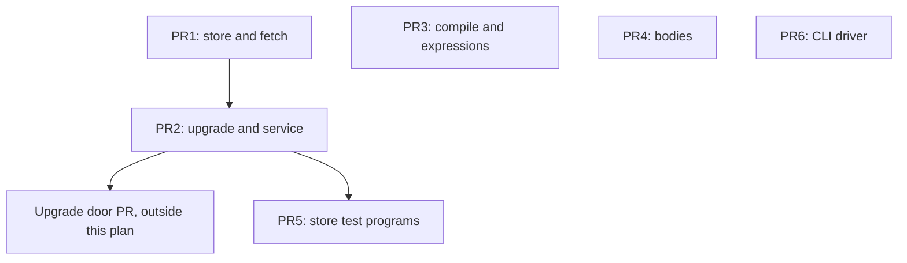

# Split the Large Source Files - Plan

## Goal Capsule

- **Objective:** An agent changing Mo's store, upgrade client, upgrade path, service loop, checker, code generator, lowering or CLI driver opens a file that holds one concern and fits in one read. Robert reviews the upgrade door's diff with no moved code mixed into it.
- **Means:** Rename shared helpers in place, then move code verbatim into sibling files behind one internal header per split, with fault-injection object sets built from file-pattern lists (KTD1, KTD2, KTD3).
- **Authority:** `AGENTS.md` governs module boundaries, C rules, checks and merging. `docs/design/architecture.md` sections 2 and 11 and `docs/status/agent-mistakes.md` apply to every unit. The code is the source of truth where a document disagrees.
- **Execution profile:** Six pull requests, each reviewed and merged by Robert as `AGENTS.md` requires. PR1 and PR2 merge before the upgrade door's PR starts.
- **Stop conditions:** Stop and ask Robert if any of these happens:
  - a move needs an edit beyond those KTD1 allows;
  - a fault-coverage proof in KTD2 differs before and after;
  - a module's public symbol set changes;
  - an open PR or worktree edits a file about to be split;
  - a learnability freeze or rehearsal that hashes `src/` is scheduled.
- **Who finishes:** Agents build each PR group and open its pull request. Robert reviews and merges each one.
- **Open blockers:** None.

---

## Product Contract

### Summary

Nine files have grown past the point where an agent can hold one in a single read. This plan splits them into cohesive pieces without changing what Mo does. The store and the fetch client go first, then the upgrade path and service loop, because the upgrade door adds code to all four. The code generator, lowering, the body checker, the store test and the CLI driver follow in four more pull requests.

### Problem Frame

Agents write all of the code in this repository, and Robert's standing rule is that files stay tight and are broken up when they get too large or do too much. PR #341 left `src/host/store.c` at 2,498 lines and `src/tools/fetch.c` at 1,038. The next feature PR is the Phase 6 upgrade door, U5 of `docs/plans/2026-11-12-1604-feat-phase6-intent-autonomy-plan.md`. It changes four files:

- the store, which gains the `pending` table and enforcement in `activate`;
- the fetch file, which gains a review client;
- `src/tools/upgrade.c`;
- `src/vm/service.c`.

The same pressure exists elsewhere. `src/check/bodies.c` is 6,105 lines with 81 commits since 2026-10-01, `src/codegen/compile.c` is 3,852 lines, and `ci/check_cli.py` is 4,875 lines with 123 commits. Every edit to one of these costs a multi-part read, and every review of one carries unrelated context.

Several of these files are compiled a second time with `-D` renames for fault-injection tests. A piece that leaves such a file without joining the renamed set links without complaint, and the test keeps passing with less coverage. That is mistake class 6 in `docs/status/agent-mistakes.md`.

### Requirements

**Behaviour preservation**

- R1. Mo's observable behaviour is unchanged: command output, diagnostics, bytecode, stored data and exit statuses.
- R2. No public header changes, and each module's set of public global symbols is the same before and after.
- R3. Moved code is textually the code that was there, apart from the differences KTD1 names.

**Fault-injection coverage**

- R4. Every fault-injection test injects at every call site it reached before the split, and each countdown test counts the same calls.
- R5. A file added later to a split family joins that family's fault builds without a Makefile edit.
- R6. Every compile-time limit override reaches every piece of the file it was applied to.

**Build and symbol hygiene**

- R7. Every commit builds and passes unit tests with gcc and clang under the repository's warning set, and passes the format and module-dependency checks.
- R8. No helper that becomes global can collide at link time, and each keeps `MO_MUST_USE` where its static form had it.
- R9. Hand-run tooling and documents that name moved code name its new location in the same PR.

**Tests and drivers**

- R10. The split store test runs the same `CHECK` lines as before, and every resulting program links the full fault object set.
- R11. The split CLI driver runs the same checks in the same order, and every script that imports from it still works.

**Delivery**

- R12. The store, fetch, upgrade and service splits are merged before the upgrade door's PR starts.
- R13. Each PR's body quotes the proof that its moved lines are moves, so Robert reviews structure rather than re-reading code.
- R14. Plan identifiers never appear in code, commits, PR titles, PR bodies or any document other than this plan.

### Success Criteria

- Each of the door's planned edits lands in a file of about 710 lines or fewer: `src/host/store-review.c`, `src/host/store-programs.c`, `src/tools/push.c`, `src/tools/upgrade-live.c`, `src/tools/upgrade.c` and `src/vm/service-swap.c`.
- No split C source file exceeds about 1,100 lines, except `src/lower/expressions.c` at about 1,600 after its single cut and the `tests/test_service_store.c` program at about 1,400.

### Scope Boundaries

- No behaviour change, cleanup or deduplication, even where a move exposes one.
- No renaming of public API in `host/host.h`, `tools/tools.h`, `vm/vm.h` or any other public header.
- No new tests. Each unit is proven by the checks in the Verification Contract.
- No other test file is split.
- Considered and not built: fragment files included into one translation unit. Fragments escape `ci/deps.sh` and clang-format, and do not compile alone. Reconsider only if the rename diff for the `bodies.c` recursive core proves unreviewable.
- Considered and not built: a committed line-conservation script. A throwaway script outside the repository gives the same proof.
- Considered and not built: fault tests for `mo push` and `mo review`. They had none before the split, and the door PR decides whether it wants them.

#### Deferred to Follow-Up Work

- Split `src/tools/render.c` into `render.c` and `render-results.c` the next time it grows.
- Move the primitive signature table out of `src/core/check.c` the next time a primitive is added.
- Cut `src/lower/expressions.c` again at its pattern cluster if it grows.
- Merge the repeated rate-pause block in `request_page` and `push_call_once`, and the repeated credential read in `fetch_attempt`.
- Replace the `strcmp` chain in `application` with a table from native name to handler.
- Cut the inline body of `check()` in `ci/check_cli.py` into named functions.

---

## Planning Contract

### Key Technical Decisions

- KTD1. **Rename in place, then move verbatim.**
  - Each split starts with a commit that gives every helper that will be shared its final prefixed name while it is still `static` in the original file. That commit only renames, and the build proves it.
  - Proof for a rename commit: `git diff --word-diff` shows only the renamed identifiers changing, and no string literal, SQL text or message changes. In `store.c`, 13 string literals contain `failure` as the SQL table name and must stay as they are.
  - Each later commit is a pure move. The only permitted differences are:
    - header prototypes;
    - include lines;
    - removal of `static` on now-shared helpers;
    - `inline` added to a KTD9 helper that moves into a header;
    - deletion of a forward declaration that a header prototype replaces;
    - clang-format reflow of a signature that lost `static`;
    - build and driver wiring the units name: Makefile rules, Python import lines, the rewritten runners in U15, and the conformance entries in U15 and U17.
  - Proof is line conservation: the multiset of lines removed from the old file equals the multiset added to the new files, apart from those differences. A throwaway script or `git diff --color-moved` shows it, and the PR body quotes the result.
- KTD2. **Fault object sets come from file-pattern lists.**
  - Each family that is compiled with `-D` renames gets one Makefile variable filtered from `LIB_SOURCES` by name pattern. Pattern rules build its fault objects, following `SERVICE_FAULT_SOURCES` at `Makefile:544-559`.
  - Every piece is compiled with exactly the flags the original file had, including limit overrides, in every build that renamed it.
  - Proof one: `nm -u` over each family's fault objects shows no undefined reference to a raw renamed symbol.
  - Proof two: the count of faulted statements in `activation_faults` is the same before and after, read from a temporary print that is not committed.
- KTD3. **One internal header per split, in the module, included only by that family.**
  - The headers are `src/host/store-internal.h`, `src/tools/fetch.h`, `src/tools/upgrade-internal.h`, `src/vm/service-internal.h`, `src/codegen/internal.h`, `src/check/infer.h` and `src/lower/cps.h`.
  - `src/host/internal.h` is not used for the store, because console.c and random.c include it and must not see SQLite.
  - `ci/deps.sh` already lets a module include its own files.
  - New files carry no header comment, matching the existing `.c` files, and no new comments.
- KTD4. **Prefixes that cannot collide.**
  - Store helpers take `store_`, because `mo_store_` is the public API of 27 functions plus `base/store-memory.h`.
  - Code generator helpers take `codegen_`, and checker helpers take `infer_`.
  - Lowering helpers take `lower_cps_`, because `lower/internal.h` already holds names such as `lower_type`.
  - Tools and VM helpers follow the existing `mo_<area>_` precedent in `src/tools/inputs-internal.h`: `mo_fetch_`, `mo_upgrade_` and `mo_service_`.
  - Before each rename commit, confirm that no chosen name is already defined in `src/` or `tests/`, and that none equals a token a `-D` rule rewrites.
  - Struct tags and enum names keep their current spelling, because they are not link symbols.
- KTD5. **Single-definition state stays where it is.**
  - `once`, `initialized`, `stores_mutex` and `stores` stay static in `store.c`, with the folder-reader open beside them.
  - `allocate` and `output` stay in `compile.c`, so `COMPILER_FAULT_SOURCES` needs no change. No new codegen file may call `mo_arena_allocate_array` or `mo_bytecode_write` directly.
  - `unknown_member` becomes one extern object, `infer_unknown_member`, because `problem` compares it by pointer.
  - `mo_pause_attempt` stays defined once, in `upgrade.c`.
  - `HISTORY_ARENA_BYTES` stays in the history file, and no header macro encodes a limit value.
  - Any new file that needs `_POSIX_C_SOURCE` repeats the define as its first line.
- KTD6. **`fetch.c` keeps the transport, the export path and the client runner.**
  - The upgrade and review clients move to `src/tools/push.c`, named after the code's own vocabulary: `push_reply`, `push_call` and `push_report`.
  - The moved code calls no renamed POSIX symbol and reads no overridden limit, so the fetch-peer and fetch-deadline rules stay as they are.
  - `cancelled` becomes the extern object `mo_fetch_cancelled`, declared in `fetch.h`.
  - No name or parameter in `fetch.h` may be `send`, `connect`, `open`, `socket`, `lstat`, `getpeername`, `fsync`, `getaddrinfo` or `freeaddrinfo`.
- KTD7. **Kill-stage anchors change with the code they anchor.**
  - `ci/check_kill_stages.py` matches exact source text in a named file, and no check group runs it.
  - An anchor's text changes in the rename commit when it contains a renamed helper. Its path changes in the commit that moves the function.
  - After each such commit, confirm the anchor text matches exactly one line of the named file.
  - The local `u` and the field `staged` in `mo_live_poll` keep their names.
- KTD8. **Documents naming moved code change in the same PR.**
  - Each unit lists the lines that change.
  - `docs/design/library.md`, historical ledgers and learnability manifests are left alone.
- KTD9. **Tiny hot helpers stay inlinable.**
  - A helper of a few lines that is called across files in the compiler moves into the internal header as `static inline`.
  - The candidates are `reference`, `flow_id`, `live_has` and the `live_position` it calls in `compile.c`, and `push`, `row` and `type` in `expressions.c`.
  - `bench/performance/measure.py` runs before and after PR3 and PR4. A delta within noise is accepted.
- KTD10. **The store test becomes several programs sharing one header.**
  - The Makefile builds every `tests/test_*.c` as its own program, so the split is into programs, following `tests/program_allocation.h`.
  - A wildcard list of the programs drives the limit and fault-link rules, so a new program cannot link unfaulted objects.
- KTD11. **The CLI driver becomes sibling modules with no re-exports.**
  - Shared helpers and the locale setup move to `ci/cli_common.py`. Topic checks move to `ci/cli_<topic>.py`.
  - `ci/check_cli.py` keeps `check()` and `main`, with the call order unchanged.
  - Scripts that imported the shared helpers from `check_cli` import them from `cli_common` instead.
  - The modules are not named `check_*.py`, because they are not standalone checks.
- KTD12. **Six pull requests, grouped by file family.** `AGENTS.md` says a PR gets one review from Robert. One diff holding all the moves would be tens of thousands of lines, too much to review in one sitting.

### High-Level Technical Design

Where each `store.c` cluster lands, with line ranges from commit 51121de6:

| Cluster | Lines | Content | Lands in |
| --- | --- | --- | --- |
| A | 1-260 | Lifecycle, SQLite init, handle count, base schema | `store.c` |
| B | 262-509 | Frames, head, snapshot and log protocol, `mo_store_call` | `store.c` |
| D | 965-1079 | Read-only folder open, `read_folder` | `store.c` |
| C | 511-963 | Failure capture, list, catalog, export, stats | `store-failures.c` |
| E | 1081-1459 | History and pair readers | `store-history.c` |
| E2 | 1703-1795 | `copy_program_history` | `store-history.c` |
| E3 | 2006-2121 | `text_valid` through `copy_review_history` | `store-history.c` |
| G | 1835-2005, 2122-2272 | Review tables, items, approvals, setting, decisions | `store-review.c` |
| F | 1461-1702, 1796-1834 | Program rows, read, write, retained programs | `store-programs.c` |
| H | 2273-2498 | First-program record, `activate`, adopt | `store-programs.c` |

Expected sizes after the split:

| File | Approx. lines |
| --- | --- |
| `store.c` | 625 |
| `store-failures.c` | 455 |
| `store-history.c` | 590 |
| `store-review.c` | 320 |
| `store-programs.c` | 505 |

### Assumptions

- Scope was inferred, because scoping confirmation is off for this repository.
  - Split now: `src/host/store.c`, `src/tools/fetch.c`, `src/tools/upgrade.c`, `src/vm/service.c`, `src/codegen/compile.c`, `src/lower/expressions.c`, `src/check/bodies.c`, `tests/test_service_store.c` and `ci/check_cli.py`.
  - Later: `src/tools/render.c` and `src/core/check.c`.
  - Left alone: `src/check/signatures.c`, `src/syntax/parser.c`, `src/tools/builders.c`, `src/tools/offline.c`, `src/tools/recovery.c` and `src/prim/unicode16-data.h`. Each is cohesive, near its size band, mutually recursive, generated or rarely changed.
- Work starts from `main` with PR #341 merged.
- Line ranges in this plan come from commit 51121de6 and are approximate. Locate code by function name.
- No learnability freeze currently hashes `src/`. Re-check before PR3 and PR4.
- PR #342 touches `src/check/captures.c`, `src/check/service-promises.c` and `src/tools/tests.c`, none of which this plan splits. Re-check open PRs and `git worktree list` before each PR.
- The door PR will edit `ci/check_cli.py`, so PR6 lands before the door PR opens or after it merges.

### Risks

| Risk | Mitigation |
| --- | --- |
| A piece escapes a fault build and the test passes with less coverage | KTD2 lists and both proofs, checked in U1, U3-U6, U8 and U9 |
| A limit override stops reaching the history code | The same flags go to every store source, and `HISTORY_ARENA_BYTES` stays in `store-history.c` |
| A mechanical rename hits a member access or struct tag such as `n->type` or `struct pattern_defaults` | Build with gcc and clang after the rename commit, before any move |
| `unknown_member` is duplicated per file and the unknown-member message changes | KTD5, plus the drivers group on PR4 |
| A kill-stage anchor goes stale silently | KTD7 uniqueness check after each affected commit |
| A split lands while another branch edits the file | Stop condition, checked before each PR |

---

## Implementation Units

| Unit | Title | Primary files | Depends on |
| --- | --- | --- | --- |
| U1 | Store fault and fuzz objects from a list | `Makefile` | none |
| U2 | Name the shared store helpers | `src/host/store.c` | U1 |
| U3 | Extract the failure records | `src/host/store-failures.c`, `store-internal.h` | U2 |
| U4 | Extract the history readers | `src/host/store-history.c` | U3 |
| U5 | Extract the review records | `src/host/store-review.c` | U4 |
| U6 | Extract programs and activation | `src/host/store-programs.c` | U5 |
| U7 | Move the push and review clients out of fetch | `src/tools/push.c`, `fetch.h` | none |
| U8 | Service fault objects from a list | `Makefile` | U1 |
| U9 | Split the service loop | `src/vm/service-swap.c`, `service-failure.c` | U8 |
| U10 | Split the upgrade path | `src/tools/upgrade-*.c` | none |
| U11 | Split the code generator | `src/codegen/*.c` | none |
| U12 | Move application lowering out | `src/lower/applications.c`, `cps.h` | none |
| U13 | Split inference leaves and finish passes | `src/check/infer-*.c`, `infer.h` | none |
| U14 | Split the recursive inference core | `src/check/infer-*.c`, `infer.c` | U13 |
| U15 | Split the store test into programs | `tests/test_service_store*.c` | U6, U9 |
| U16 | Move shared CLI driver helpers | `ci/cli_common.py` | none |
| U17 | Move CLI driver topics into modules | `ci/cli_*.py` | U16 |

Every unit below carries `Test expectation: none -- behaviour-preserving move`. Its proof is in its Verification line and the Verification Contract.

### PR1: Split the store and the fetch client

Waits on: nothing.

### U1. Store fault and fuzz objects from a list

- **Goal:** The store's test-fault and fuzz objects are built from a pattern list before any file is split.
- **Requirements:** R4, R5, R6.
- **Dependencies:** none.
- **Files:** `Makefile`.
- **Approach:** Apply KTD2.
  1. Define `STORE_SOURCES` beside `LIB_SOURCES` as the `LIB_SOURCES` entries matching `src/host/store.c` or `src/host/store-%.c`.
  2. Replace the explicit `store-faults/store.o` rules at `Makefile:573-575` and `579-581` with debug and sanitize pattern rules for `store-faults/host/%.o`. They carry `STORE_TEST_LIMITS` and the three renames.
  3. Change the `test_service_store` link rules at `Makefile:588-591` to filter out `STORE_SOURCES` and link its fault objects.
  4. Replace the `history/store.o` rule at `Makefile:655-657` with a pattern rule carrying `HISTORY_FUZZ_LIMITS`, and change the `fuzz_history` link at `Makefile:661` the same way.
- **Patterns to follow:** `SERVICE_FAULT_SOURCES`, `Makefile:544-559`.
- **Verification:**
  - `test_service_store` passes in debug and sanitize.
  - `fuzz_history` builds.
  - The KTD2 `nm -u` check is empty.
  - Record two baselines for later units: the `activation_faults` statement count, and the `nm -g --defined-only` output of `store.o`.

### U2. Name the shared store helpers

- **Goal:** Every store helper that will cross a file boundary has its final name while `store.c` is still one file.
- **Requirements:** R3, R8, R9.
- **Dependencies:** U1.
- **Files:** `src/host/store.c`, `ci/check_kill_stages.py`.
- **Approach:** Apply KTD1 and KTD4 with these names. `store_version` already fits and keeps its name.

| Current | New | Current | New |
| --- | --- | --- | --- |
| `exec` | `store_exec` | `table_state` | `store_table_state` |
| `failure` | `store_sqlite_status` | `table` | `store_table_ready` |
| `finish` | `store_finish` | `folder_status` | `store_folder_status` |
| `row` | `store_row` | `read_folder` | `store_read_folder` |
| `frame` | `store_frame` | `failure_read` | `store_failure_read` |
| `current_head` | `store_current_head` | `read_program` | `store_read_program` |
| `load_snapshot` | `store_load_snapshot` | `program_row` | `store_program_row` |
| `next_log_row` | `store_next_log_row` | `blob_size` | `store_blob_size` |
| `write_blob` | `store_write_blob` | `read_setting` | `store_read_setting` |
| `write_blob_code` | `store_write_blob_code` | `review_write` | `store_review_write` |
| `decide` | `store_decide` | `items_valid` | `store_items_valid` |
| `not_version_two` | `store_not_version_two` | | |

  The `transaction_interior` anchor at `ci/check_kill_stages.py:30-31` contains `current_head(`, so its text changes here (KTD7).
- **Verification:**
  - gcc and clang build and pass unit tests.
  - The KTD1 word-diff shows no string literal changed.
  - The anchor text matches one line of `src/host/store.c`.

### U3. Extract the failure records

- **Goal:** Cluster C lives in `src/host/store-failures.c`, and the internal header exists.
- **Requirements:** R2, R3, R4, R6, R8.
- **Dependencies:** U2.
- **Files:** `src/host/store-internal.h`, `src/host/store-failures.c`, `src/host/store.c`.
- **Approach:**
  1. Create the header. It holds `struct mo_store`, `TEXT_OF` and `DIGITS_OF`, the frame-size enum, and prototypes for the helpers C calls.
  2. Move `struct failure_row` through `mo_store_failure_stats`.
  3. Export `store_failure_read`, which the history code still calls.

  The two `_Static_assert` lines stay in `store.c`. Prototypes carry `MO_MUST_USE` only where the static had it.
- **Verification:**
  - KTD1 line conservation.
  - The KTD2 `nm -u` check over `store-faults/host/*.o`.
  - `test_service_store` in debug and sanitize.

### U4. Extract the history readers

- **Goal:** Clusters E, E2 and E3 live in `src/host/store-history.c`.
- **Requirements:** R2, R3, R4, R6.
- **Dependencies:** U3.
- **Files:** `src/host/store-history.c`, `src/host/store-internal.h`, `src/host/store.c`.
- **Approach:**
  - Move everything that uses `history_copy` or `retain`, including `HISTORY_CHUNK_BYTES` and `HISTORY_ARENA_BYTES` (KTD5).
  - The header gains `struct saved_head`, the `folder_body` typedef, and prototypes for `store_read_folder`, `store_folder_status`, `store_load_snapshot`, `store_next_log_row`, `store_version`, `store_read_program`, `store_program_row`, `store_blob_size` and `store_read_setting`.
  - `copy_bytes`, `retain` and `struct history_copy` stay static in the new file.
- **Verification:** As U3, plus `fuzz_history` builds with its object for `store-history.c` under `HISTORY_FUZZ_LIMITS`.

### U5. Extract the review records

- **Goal:** Cluster G lives in `src/host/store-review.c`, where the door's `pending` reads and writes will go.
- **Requirements:** R2, R3, R4.
- **Dependencies:** U4.
- **Files:** `src/host/store-review.c`, `src/host/store-internal.h`, `src/host/store.c`.
- **Approach:**
  - Move `review_tables` through `mo_store_set_review`, skipping the E3 block already moved.
  - The header gains `struct store_table`, `enum table_state`, and prototypes for `store_table_state`, `store_table_ready`, `store_review_write`, `store_decide`, `store_items_valid` and `store_not_version_two`. The last is called by `mo_store_program_record`, which moves in U6.
  - `hex`, `sorted_digests`, `listed`, `bind_blobs` and `step_done` stay static.
- **Verification:** As U3.

### U6. Extract programs and activation

- **Goal:** Clusters F and H live in `src/host/store-programs.c`, where the door's enforcement in `activate` will go.
- **Requirements:** R2, R3, R4, R9.
- **Dependencies:** U5.
- **Files:** `src/host/store-programs.c`, `src/host/store-internal.h`, `src/host/store.c`, `ci/check_kill_stages.py`, `docs/design/architecture.md`, `docs/design/introspection.md`.
- **Approach:**
  1. Move `upgrade_tables` through `replace_snapshot`, then `mo_store_program_record` through `mo_store_adopt`. `store_load_snapshot` in `store.c` now calls `store_read_program` across files. That is the base file's one dependency on this one.
  2. Change the `transaction_interior` path to `src/host/store-programs.c` (KTD7).
  3. Update `docs/design/architecture.md:81` to say the `src/host/store*.c` files include SQLite.
  4. Update `docs/design/introspection.md:606` to name `host/store-history.c`.
- **Verification:**
  - As U3.
  - The `activation_faults` statement count equals the U1 baseline.
  - The public `mo_store_*` symbols across the five objects equal the U1 baseline, and every other new global starts with `store_`.

### U7. Move the push and review clients out of fetch

- **Goal:** `src/tools/push.c` holds `mo push` and `mo review`, and `fetch.c` holds the transport, the export download and the runner.
- **Requirements:** R2, R3, R4, R8.
- **Dependencies:** none.
- **Files:** `src/tools/push.c`, `src/tools/fetch.h`, `src/tools/fetch.c`.
- **Approach:** Apply KTD6 in two commits.
  1. Rename these in `fetch.c`:

| Current | New |
| --- | --- |
| `cancelled` | `mo_fetch_cancelled` |
| `now` | `mo_fetch_now` |
| `connect_local` | `mo_fetch_connect_local` |
| `send_request` | `mo_fetch_send_request` |
| `receive_response` | `mo_fetch_receive_response` |
| `unhex` | `mo_fetch_unhex` |
| `client` | `mo_fetch_client` |

  2. Move `struct push_reply` through `review_attempt` at lines 583-990, plus `mo_push` and `mo_review`, into `push.c`.
     - `fetch.h` holds `struct fetch_endpoint` and the seven declarations.
     - `struct fetch_timer`, `timer_start`, `timer_stop`, `url`, `cancel` and `struct client_work` stay private to `fetch.c`.

  `push.c` starts with the `_POSIX_C_SOURCE` define, because it calls `nanosleep`. Export any further decoder only if the build shows the moved code calls it.
- **Verification:**
  - KTD1 line conservation.
  - `nm -u` on the `push.c` object shows none of the nine names in KTD6, and `push.c` does not mention `MO_LIMIT_FETCH_US`.
  - `test_fetch_peer` and `test_fetch_deadline` pass in debug and sanitize.

### PR2: Split the upgrade path and the service loop

Waits on: PR1, merge order only, because both edit the `test_service_store` link rules.

This is a separate PR because Robert reviews each PR, and one PR holding PR1 and PR2 would be too large to review in one sitting.

### U8. Service fault objects from a list

- **Goal:** All four fault builds of the service loop take their sources from one pattern list.
- **Requirements:** R4, R5.
- **Dependencies:** U1.
- **Files:** `Makefile`.
- **Approach:** Apply KTD2.
  1. Define `SERVICE_LOOP_SOURCES` beside `LIB_SOURCES` as the entries matching `src/vm/service.c` or `src/vm/service-%.c`.
  2. Build `SERVICE_FAULT_SOURCES` from it plus `src/vm/process.c` and `src/heap/heap.c`.
  3. Use it in `PROTOCOL_SERVER_FAULT_SOURCES` at `Makefile:469`, and replace the explicit `vm/service.o` rules at `498-504` with a pattern rule for `protocol-server-faults/vm/%.o`.
  4. Replace the explicit `store-faults/service.o` rules at `570-572` and `576-578` with a pattern rule for `store-faults/vm/%.o`, and update the link rules. `store-faults/simulation.o` keeps its explicit rule.
  5. Do the same for `recovery-faults` at `595-604`.
- **Verification:**
  - `test_service_runtime`, `test_protocol_server_faults`, `test_service_store` and `test_recovery_faults` pass in debug and sanitize.
  - Record `nm -u` of the service object in each of the four builds as the baseline.

### U9. Split the service loop

- **Goal:** Live swap and failure capture each have their own file.
- **Requirements:** R2, R3, R4, R8.
- **Dependencies:** U8.
- **Files:** `src/vm/service-internal.h`, `src/vm/service-swap.c`, `src/vm/service-failure.c`, `src/vm/service.c`.
- **Approach:**
  1. Check each new name against `vm/vm.h` (KTD4), then rename:

| Current | New |
| --- | --- |
| `finish_call` | `mo_service_finish_call` |
| `invoke` | `mo_service_invoke` |
| `append` | `mo_service_append` |
| `record_event` | `mo_service_record_event` |
| `sample_clock` | `mo_service_clock` |
| `without_module_or_overload` | `mo_service_short_name` |
| `handler_name` | `mo_service_handler_name` |
| `capture_failure` | `mo_service_capture_failure` |

  2. Move the code as the table below shows. The header holds `struct service_message`, `struct service_timer`, `struct mo_service_loop` and the eight prototypes.

| File | Content | Approx. lines |
| --- | --- | --- |
| `service-swap.c` | `function_name` through `mo_service_note_upgrade`, lines 1302-1492 | 200 |
| `service-failure.c` | `capture_string` through `capture_failure` at 804-1063, and `mo_service_failures` through `mo_service_pin_failure` at 1245-1300 | 325 |
| `service.c` | Everything else | 945 |

- **Verification:**
  - KTD1 line conservation.
  - In each of the four fault builds, the union of `nm -u` over the three service objects, minus the symbols those three objects define, equals the U8 baseline.
  - The four tests pass in debug and sanitize.

### U10. Split the upgrade path

- **Goal:** Bundles, the engine, the commands and the live upgrade object each have their own file.
- **Requirements:** R2, R3, R8, R9.
- **Dependencies:** none.
- **Files:** `src/tools/upgrade-internal.h`, `src/tools/upgrade-bundle.c`, `src/tools/upgrade-commands.c`, `src/tools/upgrade-live.c`, `src/tools/upgrade.c`, `ci/check_kill_stages.py`.
- **Approach:**
  1. Rename the shared helpers with `mo_upgrade_`, avoiding names already in `tools/upgrade.h` such as `mo_upgrade_metadata` and `mo_upgrade_check`. `program_metadata` becomes `mo_upgrade_program_metadata`. The shared helpers are `refuse_upgrade`, `report_json`, `report_text`, `show_report`, `compile_begin`, `compile_poll`, `compile_end`, `compile_cleanup`, `compile_image`, `image_buffers_init`, `image_buffers_free`, `compare_programs`, `program_metadata`, `migration_state`, `upgrade_error`, `file_bytes` and `write_file_bytes`.
  2. Move the code as the table below shows. The header holds `struct upgrade_image`, `struct upgrade_report`, `struct compile_job` and the prototypes. `struct mo_live_upgrade` stays private to `upgrade-live.c`.

| File | Content | Approx. lines |
| --- | --- | --- |
| `upgrade-bundle.c` | `upgrade_error` through `mo_upgrade_emit` at 33-423, `write_file_bytes`, and `mo_upgrade_replay_set` at 1978-2040 | 490 |
| `upgrade.c` | Report, clocks, compile job, comparison, `hex_digit`, `migration_state`, `mo_pause_attempt` | 710 |
| `upgrade-commands.c` | `recorded_check_input` through `schema_only_metadata` at 896-1073 minus migration, `serve_upgrade`, `mo_upgrade_serve`, rehearse at 1471-1974, and `wall_us` | 700 |
| `upgrade-live.c` | `struct mo_live_upgrade` through `mo_live_refusal` at 1285-1469 | 200 |

  The `compiled_staged` anchor at `ci/check_kill_stages.py:26` changes its text in the rename commit, and its path to `src/tools/upgrade-live.c` in the move commit. The `migration` anchor keeps `src/tools/upgrade.c` (KTD7).
- **Verification:**
  - KTD1 line conservation.
  - Both anchors match one line each.
  - A build with `-DMO_UPGRADE_PAUSE_TIMING` added to `INCLUDES` links with one definition of `mo_pause_attempt`.

### PR3: Split the code generator and application lowering

Waits on: nothing.

This is a separate PR because Robert reviews each PR, and the compiler moves would make any other group too large to review in one sitting.

### U11. Split the code generator

- **Goal:** `compile.c` keeps infrastructure and output, and each compiler stage has its own file.
- **Requirements:** R2, R3, R4, R8.
- **Dependencies:** none.
- **Files:** `src/codegen/internal.h`, `src/codegen/types.c`, `src/codegen/prepare.c`, `src/codegen/ownership.c`, `src/codegen/generate.c`, `src/codegen/program.c`, `src/codegen/compile.c`.
- **Approach:** One commit per step, each building alone.
  1. Move the file-scope types at lines 17-113 into `internal.h`.
  2. Move `suffixed_name` up beside `name`, which removes the one back edge.
  3. Rename every function that will be called across files with `codegen_`, about 47 in all. A function is shared when a caller sits in a different file in the table below. Apply KTD9 to the three named helpers.
  4. Move the clusters in this order: `program.c`, `generate.c`, `ownership.c`, `prepare.c`, `types.c`.

| File | Content | Approx. lines |
| --- | --- | --- |
| `compile.c` | `problem` through `name` at 115-239, `suffixed_name`, and `output` through `mo_compile` at 3629-3852 | 380 |
| `types.c` | `type_result` through `function_init`, 240-1028 | 810 |
| `prepare.c` | `variable` through `prepare`, 1031-1641 | 630 |
| `ownership.c` | `reference` through `live_infer`, 1643-2086 | 460 |
| `generate.c` | `span` through `generate` at 2088-2999, with `host_params` | 930 |
| `program.c` | `entry_valid` through `service_descriptors`, 3002-3627 | 640 |

  KTD5 governs `allocate` and `output`.
- **Verification:**
  - KTD1 line conservation.
  - `test_compiler_faults` passes.
  - No new codegen object has an undefined reference to `mo_arena_allocate_array` or `mo_bytecode_write`.
  - The `measure.py` delta is within noise.

### U12. Move application lowering out

- **Goal:** `application` and native dispatch, where most library-function edits land, live in `src/lower/applications.c`.
- **Requirements:** R2, R3, R8, R9.
- **Dependencies:** none.
- **Files:** `src/lower/cps.h`, `src/lower/applications.c`, `src/lower/expressions.c`, `AGENTS.md`, `docs/design/architecture.md`.
- **Approach:**
  1. Move the types at lines 8-75 into `cps.h`.
  2. Rename the 15 shared functions with `lower_cps_`: `arguments`, `continuation`, `field_read`, `join`, `jump`, `projection`, `push`, `row`, `type`, `unary`, `ability`, `ability_native`, `application`, `direct_function` and `kind`. Apply KTD9. String literals such as `"List.join"` and `"Entry.kind"` keep their text.
  3. Move `kind` through `application` at lines 837-1495.
  4. Update the "Adding a library function" sentence in `AGENTS.md`, and `docs/design/architecture.md:1035`, to name `src/lower/applications.c`.
- **Verification:**
  - KTD1 line conservation.
  - The `measure.py` delta is within noise.

### PR4: Split body inference

Waits on: nothing.

This is a separate PR because Robert reviews each PR, and 6,105 moved lines fill a review sitting on their own.

### U13. Split inference leaves and finish passes

- **Goal:** The code outside the recursive core leaves `bodies.c`.
- **Requirements:** R1, R2, R3, R8.
- **Dependencies:** none.
- **Files:** `src/check/infer.h`, `src/check/infer-terms.c`, `src/check/infer-finish.c`, `src/check/infer-dispatch.c`, `src/check/bodies.c`.
- **Approach:**
  1. Move the file-scope types at lines 20-257 into `infer.h`. Only inference files include it, which keeps enumerators such as `INT` and `FLOAT` out of the rest of the module.
  2. Rename with `infer_` every function these three files and the remaining core share. Functions already named `infer_*` keep their names, and `infer` becomes `infer_expression`.
  3. Move the code as the table below shows.
     - `unknown_member` moves to `infer-terms.c` as `infer_unknown_member` (KTD5).
     - `parameter_type` moves there too, because `qualified_ability` calls it from the core.

| File | Content | Approx. lines |
| --- | --- | --- |
| `infer-terms.c` | `problem` through `compare_text`, 260-922 | 640 |
| `infer-finish.c` | `finish_type` through `checked_pattern`, 4153-5201 | 1070 |
| `infer-dispatch.c` | `dispatch_callee` through `anchor_inputs`, 5205-5615 | 430 |

- **Verification:**
  - KTD1 line conservation.
  - gcc and clang build and pass unit tests after each commit.

### U14. Split the recursive inference core

- **Goal:** `bodies.c` keeps the entry points, and the 17-function recursive core is spread over four files by topic.
- **Requirements:** R1, R2, R3, R8, R9.
- **Dependencies:** U13.
- **Files:** `src/check/infer-names.c`, `src/check/infer-calls.c`, `src/check/infer-patterns.c`, `src/check/infer.c`, `src/check/bodies.c`, `src/check/infer.h`, `tests/errors/README.md`.
- **Approach:**
  1. Rename the remaining shared functions with `infer_`.
  2. Move the code as the table below shows. Delete each of the ten forward declarations when a header prototype replaces it.
  3. Update `tests/errors/README.md:23` to name `infer_expression` in `src/check/infer.c`.

| File | Content | Approx. lines |
| --- | --- | --- |
| `infer-names.c` | `length_habit` through `order_notes`, 926-1794 | 830 |
| `infer-calls.c` | `builtin_type` through `propagate`, 1797-2738 | 960 |
| `infer-patterns.c` | `match_pattern` through `position`, 2741-3299 | 580 |
| `infer.c` | `infer_node` and `infer_expression`, 3301-4151 | 870 |
| `bodies.c` | `infer_function` through `mo_check_service_value`, 5618-6105 | 510 |

- **Verification:**
  - KTD1 line conservation.
  - Every global the check module's objects define is `mo_*` or `infer_*`.
  - The drivers group passes, which covers the unknown-member message.
  - The `measure.py` delta is within noise.

### PR5: Split the store test into programs

Waits on: PR2, needed before this group can start, because its Makefile rules use the lists U1 and U8 create.

This is a separate PR because Robert reviews each PR, and 4,106 moved test lines on top of PR2 would be too large to review in one sitting.

### U15. Split the store test into programs

- **Goal:** `tests/test_service_store.c` becomes five programs that run in parallel under `make -j`.
- **Requirements:** R4, R6, R10.
- **Dependencies:** U6, U9.
- **Files:** `tests/store_faults.h`, `tests/test_service_store.c`, `tests/test_service_store_history.c`, `tests/test_service_store_simulation.c`, `tests/test_service_store_failures.c`, `tests/test_service_store_programs.c`, `Makefile`, `tests/conformance/rules.tsv`, `tests/errors/unit.tsv`, `docs/design/introspection.md`, `docs/design/sandbox-properties.md`, `docs/design/saved-state.md`, `docs/design/services.md`.
- **Approach:** Apply KTD10.
  1. Move the fault doubles and their state at lines 25-250 into `tests/store_faults.h`. Helpers used by more than one program go there as `static inline`.
  2. Move the sections as the table below shows.
  3. Rewrite the runner in each program. Today `main` calls the seven `diagnostic_*` sections and then runs `run` under `mo_with_stack`, and `run` calls `mo_runtime_identity_init`, makes the temporary folder with `mkdtemp` and calls the other sections. Each program gets its own `run` and `main` holding only its own sections, with the same setup lines. These runners are the one new text in the split and are excluded from line conservation (KTD1).
  4. Define `STORE_TESTS` as the wildcard of `tests/test_service_store*.c`. Replace the rules at `Makefile:564-569` and `588-591` with static-pattern rules over it.
  5. Update the `tests/test_service_store.c` entries in `tests/conformance/rules.tsv` at lines 153, 172, 173 and 175 to name the program that now defines each function, and the E1431 line in `tests/errors/unit.tsv` likewise.
  6. Update the design documents that name `tests/test_service_store.c` for a section that moved: `introspection.md:1143`, `sandbox-properties.md:269`, `saved-state.md:236` and `services.md:482` and `:540`. Leave `docs/status/agent-mistakes.md`, `models/README.md` and the learnability records alone, because they cite the test by its history or by its family name.

| Program | Sections (current lines) | Approx. lines |
| --- | --- | --- |
| `test_service_store.c` | Basics, crashes, store wait at 251-1103, and hostile, invalid, recovery at 1673-2171 | 1400 |
| `test_service_store_history.c` | History reader, 1104-1672 | 600 |
| `test_service_store_simulation.c` | Simulation, 2172-2815 | 650 |
| `test_service_store_failures.c` | Capture and offline at 2816-3500, and diagnostics at 3819-4095 | 970 |
| `test_service_store_programs.c` | First program and activation, 3501-3757 | 260 |

- **Verification:**
  - Line conservation outside the runners.
  - The count of `CHECK(` lines across the five programs and the header equals the count in the original file, plus one `mo_with_stack` check for each of the four new runners.
  - All five pass in debug and sanitize, with gcc and clang.
  - Each program's link line contains the store-fault objects and no ordinary store or service object.
  - `python3 ci/check_conformance.py` and `python3 ci/check_errors.py` pass.

### PR6: Split the CLI driver

Waits on: nothing. It lands before the door PR opens or after it merges, as Assumptions says.

This is a separate PR because Robert reviews each PR, and 4,875 moved Python lines fill a review sitting on their own.

### U16. Move shared CLI driver helpers

- **Goal:** Helpers that other scripts import live in `ci/cli_common.py`.
- **Requirements:** R11.
- **Dependencies:** none.
- **Files:** `ci/cli_common.py`, `ci/check_cli.py`, `ci/check_fetch.py`, `ci/check_offline.py`, `ci/check_operator.py`, `ci/check_offline_core.py`, `ci/check_upgrade_adoption.py`, `ci/check_upgrade_context.py`, `learnability/phase4/private-fetch/sizing.py`.
- **Approach:**
  1. Move the locale setup at lines 22-51, with `run` and `records`.
  2. Move the `SERVE_*` constants, `Served`, `serve_events`, `serve_supervised`, `serve_structured` and `serve_spellings` at lines 1704-1895.
  3. Search the whole repository, not only `ci/`, for every import of `check_cli`, and point each at `cli_common` (KTD11). `learnability/phase4/private-fetch/sizing.py:18` is one.
- **Verification:** The drivers group passes.

### U17. Move CLI driver topics into modules

- **Goal:** `ci/check_cli.py` holds `check()` and `main`, and each topic has its own module.
- **Requirements:** R9, R11.
- **Dependencies:** U16.
- **Files:** `ci/cli_promises.py`, `ci/cli_intent.py`, `ci/cli_serve.py`, `ci/cli_programs.py`, `ci/cli_runner.py`, `ci/cli_fixtures.py`, `ci/cli_guide.py`, `ci/check_cli.py`, `AGENTS.md`, `tests/conformance/rules.tsv`, `ci/check_conformance.py`, `tests/conformance/README.md`.
- **Approach:**
  1. Move the code as the table below shows. `check()` keeps its body and its call order.
  2. Update the `AGENTS.md` sentence that places `guide_claims` in `ci/check_cli.py`, and the two that send CLI changes to that file.
  3. Keep the conformance check working. `tests/conformance/rules.tsv` names 27 `ci/check_cli.py:<function>` entries, and `has_test` in `ci/check_conformance.py` requires the definition and a call in the same file. After the move the definition sits in a `cli_*.py` module and the call stays in `check()`.
     - Point each entry at the module that now defines the function.
     - Let `has_test` accept a Python function defined in a `ci/cli_*.py` module when `ci/check_cli.py` calls it.
     - Update the examples at `tests/conformance/README.md:47` and `:159`.

| Module | Content (current lines) | Approx. lines |
| --- | --- | --- |
| `cli_promises.py` | `scalar_promises` through `collection_promises`, 54-1057 | 1000 |
| `cli_intent.py` | `promise_selection` through `fix_command`, 1060-1526 | 470 |
| `cli_serve.py` | `service_commands`, `service_refusals`, `serve_guide`, `serve_command`, 1529-1701 and 1898-2319 | 600 |
| `cli_programs.py` | `imported_constants` through `generic_imports`, 2322-2963 | 640 |
| `cli_runner.py` | `small_stack`, `runner`, 2966-3545 | 580 |
| `cli_fixtures.py` | `lower_source_fixtures` through `source_stack`, 3548-4046 | 500 |
| `cli_guide.py` | `flags`, `guide_claims`, `emit_command`, 4049-4496 | 450 |
| `check_cli.py` | `check()` and `main` | 420 |

- **Verification:**
  - KTD1 line conservation across the modules.
  - The drivers group passes, with the same check names in the same order, and `python3 ci/test_conformance.py` passes.

---

## Verification Contract

| Check | Applies to | What it proves |
| --- | --- | --- |
| `bash ci/check.sh gcc`, run detached and awaited with `ci/wait-for-results` as `AGENTS.md` describes | Every PR | Build and unit tests. Its last line goes in the PR body. |
| `make test CC=clang` | PR1-PR5 | The clang warning set, including `-Wmissing-prototypes` |
| `make format-check` and `make deps` | PR1-PR5 | Format and module include rules for the new files |
| `make sanitize CC=clang` | PR1, PR2, PR5 | Fault tests whose rules changed |
| Build `fuzz_history` | PR1 | The history limit reaches the fuzz object |
| `nm -u` over each family's fault objects | PR1, PR2, PR3 | KTD2: no raw renamed symbol |
| `activation_faults` statement count, before and after | PR1 | KTD2: no statement left the count |
| `nm -g --defined-only` over each split module's objects | PR1-PR4 | R2 and R8 |
| Line conservation per extraction commit | Every PR | R3. The result is quoted in the PR body. |
| Each kill-stage anchor matches exactly one line of its named file | PR1, PR2 | KTD7 |
| A build with `-DMO_UPGRADE_PAUSE_TIMING` | PR2 | One definition of `mo_pause_attempt` |
| `bench/performance/measure.py` before and after | PR3, PR4 | KTD9 |
| `bash ci/check.sh drivers` | PR1, PR2, PR3, PR4, PR6 | CLI output and diagnostics are unchanged, including `mo push` and `mo review`, which only the Python drivers cover, and the driver split works |
| `python3 ci/check_conformance.py` and `python3 ci/check_errors.py` | PR5 | The conformance and error-code tables name the split test programs |

A skip for a missing tool is not a pass. The PR body names every group that ran.

---

## Definition of Done

**Every PR**

- The checks in the Verification Contract that apply to it pass.
- The PR body quotes the last line of `bash ci/check.sh gcc`, the line-conservation result and the symbol checks.
- No public header changed.
- No temporary print, throwaway script or abandoned attempt is in the diff.
- No plan identifier appears in code, commits, the PR title or the PR body.
- Every document line named in the PR's units is updated.

**Whole plan**

- PR1 and PR2 are merged before the upgrade door's PR starts.
- The nine files in Assumptions are split as the unit tables describe, and the Success Criteria hold.
- The deferred items remain listed in this plan and are not partly done.

---

## Deferred / Open Questions

These are review items left for the author. They do not block implementation.

### From 2026-11-14 review

- **Commit to the store, fetch, upgrade and service splits now, and keep the other four PRs as candidates** — Planning Contract, Key Technical Decisions (P2, scope-guardian-reviewer, confidence 75)

  If all six pull requests are committed now, roughly half the work is in files the upgrade door does not touch. That work is justified only by size and churn, so it competes with Phase 6 features for Robert's review time without unblocking anything. The scope reviewer also questioned whether the store test split is worth doing at all. Robert decides whether the code generator, lowering, body checker, store test and CLI driver splits are committed now or reconsidered after the door merges.

- **Check that each fault build links every fault object and no ordinary one** — Implementation Units, store and service fault lists (P1, adversarial-document-reviewer via cross-model peer, confidence 75)

  The undefined-symbol proof shows that the fault objects reference no raw renamed symbol. It does not show that the test's link line actually uses them. If a link rule still names an ordinary store or service object, the test links that object and loses its fault coverage without any check noticing.
  Change: add a check to the store and service fault-list units that every fault build's link inputs contain each object built from the family's list and none of the family's ordinary objects.

- **Show that the split store test runs its checks, not just that it contains them** — Implementation Units, store test split (P2, whole-document cross-model peer, confidence 75)

  Counting `CHECK(` lines proves the lines moved but not that each one runs. A section left out of a program's runner keeps its lines, passes the count, and silently stops running.
  Change: add a check that every section function in each split program is called from that program's runner, for example by listing the section names called in each runner and comparing their union with the original runner's list.
