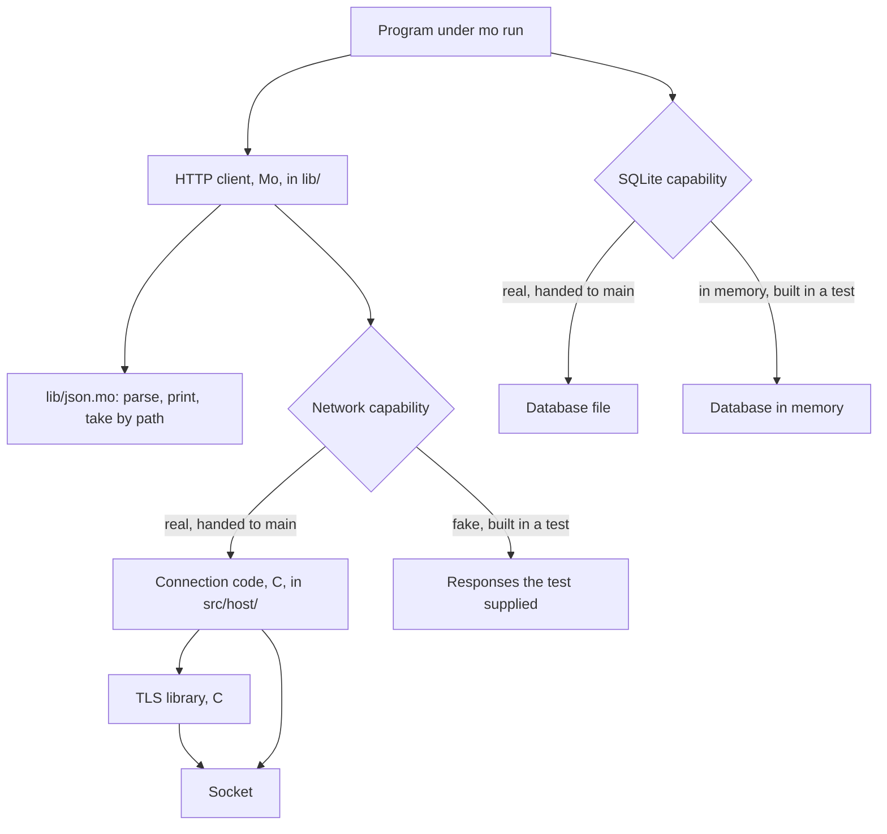
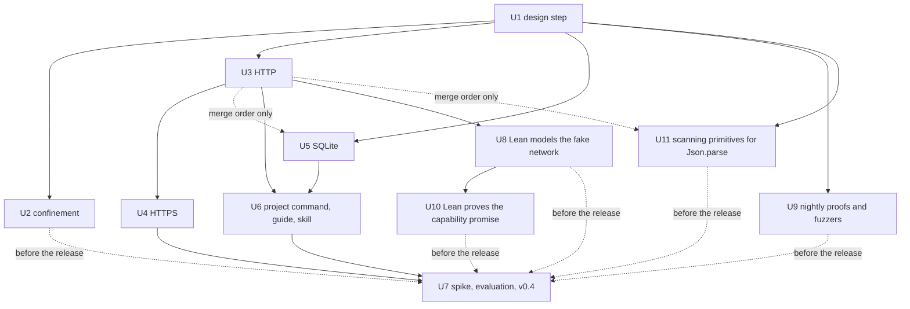

# Phase 7, Mo Talks to the Outside World - Plan

## Goal Capsule

- **Objective:** Robert can use Mo for his everyday API work. He starts a small Mo project, calls a real API over HTTPS, looks through what comes back, keeps it in SQLite and runs the program as a command-line tool. An agent can do the same from Mo's own guidance.
- **Means:** A network capability with a fake, an HTTP client library that ships with `mo`, a SQLite capability, a command that starts a project, a mo-lang skill, and operating-system confinement of the compile and check children (KTD1, KTD3, KTD5, KTD6).
- **Authority:** `docs/ROADMAP.md`, the language reference and `AGENTS.md` govern. Robert approves every change to Mo's language and toolchain surface: reference text, commands and error codes. This plan is the phase overview. Each milestone gets its own brainstorm and plan, which start from the requirements here and do not reopen the decisions below. The framework, MoDB and performance are context, not active scope.
- **Execution profile:** Seven groups of pull requests, one for each milestone, each reviewed and merged by Robert as `AGENTS.md` requires. A milestone's own plan decides whether its group is one pull request or more. U1 is a design step he approves before any code other than U1's own throwaway prototypes.
- **Stop conditions:** Stop and ask Robert when a unit needs a change to the Product Contract, when U1's measurement of HTTP written in Mo misses the bar written down before it ran, when no confinement mechanism works on both the development host and the nightly's host, or when the nightly is red.
- **Who finishes:** Agents build each unit and open its pull requests. Robert approves the design, merges each pull request, does the spike and gives the answer that closes the phase.
- **Open blockers:** None. U1 puts the open design questions and every item under Assumptions to Robert before any code.
- **Product Contract preservation:** Requirements, key decisions, flows and acceptance examples are unchanged. Planning changed three things: M5 now merges after M3 in the milestone table, Dependencies and Assumptions says what planning read about the hosts, and Outstanding Questions gained one question each for M1 and M2. Planning also added to Scope Boundaries the mechanisms it considered and did not build.

---

## Product Contract

### Summary

Phase 7 changes from "Fast" to "Mo talks to the outside world". A Mo program gains two capabilities, the network and SQLite, each with a fake so tests run with no network. An HTTP client library ships with `mo`, and one command starts a new project. The compile and check children of `mo serve` are confined by the operating system. The phase closes when Robert has done one real API spike in Mo, the automated checks pass, and an agent evaluation has scored agents writing API clients in Mo with a new mo-lang skill.

### Problem Frame

Six phases built a language, a toolchain, services, introspection, live upgrades and a review door. All of it was proved on one service of 1,214 lines, `services/task-queue/`, and nobody uses Mo for daily work, Robert included. The roadmap's next phase was speed, but nothing has met a speed limit in use. The only load measurements of a Mo service were taken for the MoDB design, outside this repository.

Robert's daily work is calling APIs. He starts a small Python project with `uv init`, installs httpx and explores an API he is learning. He cannot do that in Mo. A Mo program's capabilities are arguments, environment, console, files, clock and random (`src/base/hostops.def`). It has no network access. The toolchain has no TLS client, which is why `mo push` goes through a loopback tunnel. SQLite is built into `mo` for the service store (`vendor/sqlite`), and Mo programs cannot reach it. `docs/design/services.md` moved "an HTTP client, TLS, and database access for Mo programs" to "a later phase", and no phase claimed them.

Robert also wants Mo to be safe without Rust's compile times. Mo programs are memory-safe already: every value is immutable, nothing is passed by reference, and memory is reference-counted (reference sections 3 and 6.2). The C underneath has no such guarantee. `docs/design/intent.md` records that the check child runs pushed code on the host without a sandbox, so a memory-safety defect in the compiler or the VM is a way around the review door. Reading bytes from the internet adds to that exposure.

### Key Decisions

- **Performance is not the next phase.** (session-settled: user-directed — chosen over "Fast" as the roadmap had it: nothing has met a speed limit in use, and speed work would tune a design that real programs will change.) Governs R19.
- **The phase is built around Robert's API work.** (session-settled: user-directed — chosen over MoDB's data store as the first program: he explores APIs every week, and it is the smaller program.) Governs R1, R2, R3, R17.
- **The phase stops at scripts and command-line tools.** Running services stay as they are. (session-settled: user-directed — chosen over letting services call out and over a first framework: everything else builds on this piece, and real use will show what the framework needs before it is designed.) Governs R10.
- **Safety is one rule and one milestone.** (session-settled: user-approved — chosen over hardening the C core before any network work, over designing in-place demands now, and over a phase about safety alone: Mo programs are already memory-safe, and confinement needs no rewrite.) Governs R11, R12, R13.
- **Mo gets no borrow checker.** Value semantics already give what a borrow checker gives for safety. (session-settled: user-approved — chosen over an ownership checker: it would add no safety, and the speed guarantee it could give is the parked in-place demand.)
- **SQLite now, Postgres later.** (session-settled: user-approved — chosen over both adapters in this phase: SQLite is already built into `mo`, and Postgres needs connections, TLS and its login handshake first.) Governs R7, R8.
- **Exploring a response is part of the phase.** (session-settled: user-approved — chosen over leaving JSON handling as it is: looking through an unknown response is easy in Python and awkward in a strictly typed language, and it decides whether Robert does a second spike.) Governs R6.
- **One command starts a project, and there is no interactive prompt.** (session-settled: user-approved — chosen over a REPL: a spike in Mo is a file run with `mo run`.) Governs R9.
- **The library for HTTPS encryption is chosen in the HTTPS milestone's own brainstorm.** It is the one place R11's rule cannot hold and the riskiest choice in the phase. (session-settled: user-approved — chosen over fixing it in this overview.) Governs R4, R11.
- **The mo-lang skill points at `mo guide` and carries no copy of it.** (session-settled: user-approved — chosen over a skill with its own language guide: two copies would drift, and `mo guide` is checked on every build.) Governs R14.
- **Phase 6's open work stays out.** (session-settled: user-directed — chosen over folding real use through the review door into this phase: command-line programs never go through the door.)
- **The phase closes on Robert's spike, the automated checks and an agent evaluation.** (session-settled: user-directed — chosen over automated checks alone and over the spike without an agent evaluation.) Governs R16, R17, R18.
- **Either answer from Robert closes the phase.** A "no" to R17's question is recorded with what got in the way and becomes input to the next phase. Governs R18.

### Requirements

**Calling an API**

- R1. A Mo program makes HTTP and HTTPS requests through a network capability it lists on `main`, and a program that does not list it cannot reach the network.
- R2. The HTTP client is a library that ships with `mo`, so a new project uses it with nothing to install.
- R3. The client covers a request-and-response API call: method, headers, query, a body in and out, the status and a timeout, with failures returned as values.
- R4. HTTPS verifies the server's certificate by default, and a failed verification is an error the program receives.
- R5. The network capability has a fake that answers from responses a test supplies, so examples, promises and tests of a program that calls an API run with no network.
- R6. A program can explore a JSON response whose shape it does not know: print it readably and take values out by path, without declaring types first.

**Keeping what comes back**

- R7. A Mo program opens a SQLite database through a capability it lists on `main`, runs statements with parameters and reads rows back as Mo values.
- R8. The SQLite capability has an in-memory form for tests.

**Starting and running**

- R9. One `mo` command starts a small project that checks, tests and runs as created.
- R10. A program that uses the network and SQLite runs as a command-line tool through `mo run`, with arguments and an exit status as programs have today.

**Safety**

- R11. New code that reads bytes from the network is written in Mo wherever Mo can do the job, and every piece of new C that reads them has a fuzz target with seeds.
- R12. The compile child and the check child of `mo serve` run under operating-system confinement, so a memory-safety defect that pushed source reaches cannot read or write outside what the child needs.
- R13. A check shows the confinement works by failing when the confinement is removed.

**Agents**

- R14. A mo-lang skill helps an agent write Mo by pointing it at `mo guide` and `mo guide --reference`.
- R15. `docs/agent-guide.md` covers the two capabilities, the client and the project command, so `mo guide` teaches them.
- R16. An agent evaluation scores agents writing API clients in Mo with the skill, with its gate declared before it runs and every session published, as in Phases 4 and 5.

**Closing**

- R17. Robert does one real API spike in Mo against an API he is learning, from start to finish, and records whether he would reach for Mo again and what got in the way.
- R18. The phase closes on R17's answer, the automated checks and R16's result, and no waiting period gates it.
- R19. `docs/ROADMAP.md` names this phase as Phase 7 with release v0.4, and moves "Fast" to Phase 8 and "Ecosystem" to Phase 9.

### Milestones

Each milestone gets its own brainstorm and plan.

| Milestone | Covers | Comes after |
| --- | --- | --- |
| M1. Design step: what a spike looks like in Mo, the two capabilities and their fakes, the shape of the confinement, and the roadmap change. Robert approves it before any code. | R19, and the design of R1 to R13 | Nothing |
| M2. Confinement of the compile and check children | R12, R13 | M1 |
| M3. HTTP without encryption: the capability, its fake, the client library and exploring a response | R1, R2, R3, R5, R6, R11 | M1 |
| M4. HTTPS | R4, R11 | M3 |
| M5. SQLite | R7, R8 | M1, and it merges after M3 (KTD1) |
| M6. The project command, the guide and the mo-lang skill | R9, R10, R14, R15 | M3, M5 |
| M7. Robert's spike, the agent evaluation and v0.4 | R16, R17, R18 | M4, M6 |

M3 ends with a second pull request, in which Lean models the fake network (U8). Two more units came from Robert's request for rigor on 18 November 2026: the nightly runs the proofs and the fuzzers (U9), and Lean proves the capability promise (U10). His answer on the slow JSON documents adds scanning primitives for `Json.parse` (U11).

M2 touches the service side and nothing else in the phase does. It can run alongside M3 to M6.

### Actors

- A1. Robert: approves the design and each change to Mo's surface, does the spike and gives the answer that closes the phase.
- A2. An agent writing Mo: builds each milestone, and in the evaluation writes API clients from the skill and the guide.

### Key Flows

- F1. An API spike
  - **Trigger:** Robert wants to learn an API.
  - **Actors:** A1
  - **Steps:** He starts a project with one command. He writes a program whose `main` lists the console, the environment and the network. The program calls the API with a token read from the environment and prints the response readably. He takes the fields he wants out by path, saves rows to SQLite, and runs the program again with arguments as a command-line tool.
  - **Covered by:** R1, R2, R3, R4, R6, R7, R9, R10
- F2. A test with no network
  - **Trigger:** `mo test` runs on a program that calls an API.
  - **Actors:** A1, A2
  - **Steps:** The test builds a fake network with the responses it expects and an in-memory database, passes both to the function under test, and checks the result.
  - **Covered by:** R5, R8
- F3. The agent evaluation
  - **Trigger:** M7 starts.
  - **Actors:** A2
  - **Steps:** The gate and the tasks are declared. Each agent session gets the mo-lang skill and a task to write an API client in Mo. Sessions are scored and published.
  - **Covered by:** R14, R15, R16

### Acceptance Examples

- AE1. **Covers R1.** Given a program whose `main` lists only the console, when its code tries to make a request, then `mo check` rejects the program, because it holds no network capability to call.
- AE2. **Covers R4.** Given a server whose certificate is expired or names another host, when a program requests it, then the program receives an error and no part of the response.
- AE3. **Covers R5.** Given a test with a fake that holds one response, when the program makes a second, different request, then the test sees an error and no real connection is made.
- AE4. **Covers R12, R13.** Given a build with the confinement removed, when the confinement check runs, then it fails. Given the normal build, when the check child tries to open a file outside what it needs or to connect to the network, then the operating system refuses.
- AE5. **Covers R17, R18.** Given Robert finishes the spike and says he would not reach for Mo again, when the checks and the evaluation are done, then the phase closes and what got in the way is recorded.

### Scope Boundaries

Deferred for later:

- A running service that calls an API or a database while handling a message.
- HTTP routes that are not MCP, and the framework like FastAPI that is the north star.
- Postgres.
- More than one request at a time, streaming bodies, HTTP/2 and WebSockets.
- A standalone executable for a Mo program, and an interactive prompt.
- Packages, which stay with "Ecosystem".
- Performance: a release build target, interpreter speed, machine code and in-place demands. The one exception is U11.
- Fil-C compatibility and the question of rewriting the C core.
- Confinement of `mo serve` itself. R12 covers its two children.
- MoDB and the abilities its design asks for, such as reading and writing bytes at a position in a file, and hashing.
- Data a service keeps outside its one saved state, and the task queue's limit of 5,000 jobs.
- Real use through the review door, which is Phase 6's open work.
- A rigor track of its own, which Robert asked for on 18 November 2026. It gets a brainstorm after this design is approved. Its first items: planted bugs for the test suite as well as for the proofs, a proof in Lean that the step from Mo Core to bytecode keeps a program's meaning, and proofs of the VM loop and the heap for every input.

Considered and not built:

- Putting `lib/` inside the `mo` executable (KTD3). Nothing in this phase needs it. A standalone executable would.
- Confinement of a program under `mo run`. It runs as its user, as any script does, and R11 limits the C that touches network bytes. A defect that the new fuzz targets find in that C would change this.
- Redirects followed for the caller, retries, cookies, proxies and connection reuse in the client. R3 lists what a call covers, and Robert's spike (R17) shows which of these he misses.
- U1 handing each unit its diagnostic codes and named limits ahead of time. Each milestone's plan takes the next free ones, and a clash between two units is fixed when the second one rebases.

### Dependencies and Assumptions

- Phase 6 closes as `docs/ops/live-service.md` records, and v0.3 is tagged before this phase's first code merges.
- The hosts Mo is built and checked on allow the confinement mechanism that M2 picks. Planning read both hosts' kernel settings and tried no mechanism (Risks and Dependencies). `docs/design/architecture.md` notes a feature probe that treats seccomp's `EPERM` as unavailable, so some hosts restrict such calls.
- The load measurements behind the decision on performance are from v0.2.0 at `ef37424` and were not repeated on v0.3.
- The agent evaluation runs detached from the agent session that starts it, as `docs/solutions/workflow-issues/launch-scored-runs-detached-from-the-agent-session.md` describes.

### Outstanding Questions

Resolve Before Planning: none.

Deferred to the milestone brainstorms:

- M1: whether the network capability works at the level of an HTTP request or of a connection, with HTTP written in Mo. R11 favours the second, and its cost is interpreter time.
- M1: what authority the SQLite capability carries: which files it may open, and how that relates to `Files`.
- M1: what the client's module is called. `runtime/http.mo` already declares `module Http`, and library module names are reserved.
- M2: which confinement mechanism, and whether the development and CI hosts allow it.
- M2: what `mo serve` does on a host that cannot provide the confinement: refuse to accept upgrades, or run the children unconfined and say so.
- M4: which library provides TLS, how it is built with `mo`, and how it is kept current.
- M6: what the project command is called and what it creates.
- M7: the evaluation's tasks, clients and gate, and how its sessions call an API without the live internet.
- After the phase: where the framework and MoDB sit on the roadmap. Robert decides.

<!-- ce-section: work-relationships -->
### How This Work Fits Together

This plan covers Phase 7 only. The list below is the current understanding of the work around it, not a committed roadmap.

- The framework like FastAPI. Depends on this phase for the client and SQLite. It also needs services that call out and HTTP routes, which this phase defers.
  - Phase 6's open work, real use through the review door, returns with it, because the framework is where services matter again.
- "Fast", now Phase 8. Depends on the programs this phase produces for a workload and numbers. The parked items go with it: in-place demands, a release build and interpreter speed.
- MoDB. Can proceed independently of this phase. Still to decide: its place in the order, which is Robert's.
- "Ecosystem", now Phase 9. Enables others to share libraries like this phase's client. Until then the client ships with `mo`.
- The future of the C core, Fil-C and a rewrite. Still to decide. This phase shares its safety rule (R11) and adds confinement (R12) without settling it.

### Sources

- `docs/ROADMAP.md`: the phase table, and "Fil-C compatibility (Phase 7)" under Later.
- `docs/design/services.md`: the capabilities moved to "a later phase", and the rule that a service's state, handler inputs and results hold no capability.
- `src/base/hostops.def`: every capability operation a Mo program has today.
- `docs/reference/README.md` sections 3, 6.2, 11.2, 13.3 and 13.4: immutable values, how `main` receives capabilities, what operations cost, and the `mo` commands.
- `docs/design/intent.md`, "What the lock does not protect against", and `docs/design/sandbox-properties.md`: the trusted C and the missing confinement.
- `docs/status/mo167-filc-trial.md`: the Fil-C trial that failed.
- `bench/performance/README.md`: the only speed baseline in this repository, and how an optimized `mo` is built.
- `robertguss/modb`, `issues/11-how-fast-and-large-is-a-mo-service.md` and `design.md` section 8: the load measurements and what MoDB's design asks Mo to gain.
- Three outside reviews on 2026-11-17, from Claude Opus 5.5, GPT-6.1 Sol and Gemini 4 Carbon. Each was asked whether performance is the right next phase, without Robert's lean or the author's. All three said no and said to build real programs first.
- `docs/plans/2026-11-12-1604-feat-phase6-intent-autonomy-plan.md`: the previous phase's overview, for the form of a phase plan.
- `docs/solutions/best-practices/qualify-trace-instruments-against-real-clients-first.md`: for the evaluation in M7.

---

## Planning Contract

### Key Technical Decisions

- KTD1. **A new capability is built the way `Files` is, and it takes a new number.** `src/base/hostops.def` gives each operation one row, which the checker, the code generator, the verifier, the VM and the host all read. About ten lists outside that table are kept by hand: the `mo_capability` enum in `src/heap/types.h`, `MO_CAPABILITY_COUNT` in `src/base/capabilities.h`, arrays sized `MO_CAP_RANDOM + 1` in five files, the type names in `src/check/signatures.c`, the name lists in `src/lower/types.c` and `src/codegen/types.c`, the dispatch in `src/host/host.c`, the fake factories in `src/tools/fakes.h` that promise generation uses, and the capability lists in `docs/design/bytecode.md`. Bytecode encodes the enum's numbers, so no existing number changes. U3 and U5 edit the same lists, so U5 merges after U3. U1 writes the full list of places. Governs R1, R5, R7, R8.
- KTD2. **The real side of each capability is new C in `src/host/`.** `make deps` lets `vm` use `bytecode`, `heap`, `prim` and `host` only, so nothing in `src/tools/` can serve a capability. `src/tools/fetch.c` also accepts loopback addresses only and looks up no names. Sockets, name lookup and the calls into the TLS library therefore go in `src/host/`, and each piece that reads bytes from outside gets a fuzz target (R11). Governs R1, R4, R11.
- KTD3. **The client ships the way `lib/` ships today.** The build records the path of the checkout's `lib/` folder in the executable (`ci/embed_docs.py`), every `mo` command loads every file in that folder, and each library module's name is reserved. A module added to `lib/` therefore needs nothing installed, for a `mo` that stays in the tree it was built in. A user program cannot `use` a module in `runtime/`, so any HTTP parsing the client shares with `mo serve` moves into `lib/` or is written again there. U1 decides which. Governs R2.
- KTD4. **Each new capability operation is also a Mo Core operation, so Lean's side changes with it.** Capability operations lower to Mo Core IO operations (`src/lower/applications.c`), and `ci/check_host.py` fails when a `HOSTOP` row has no modelled Mo Core counterpart. The repository holds two precedents. `Files` is modelled in Lean in full. `Simulation` stops Lean with "not modeled by mocore", and the comparison between the VM and Lean leaves out only the runs that reach it. `Simulation` is not cheap to copy. Its operations are `SIMOP` rows with a lowering of their own, and they still needed Core types, a Core operation form, Lean syntax and a new Core text version. A `HOSTOP` row left unmodelled also needs `ci/check_host.py` to list it as an operation that stops outside the model. U1 chooses between the two for each capability (Assumptions). Robert chose on 18 November 2026: Lean models the fake network (U8), and SQLite stops outside the model. Governs R1, R7.
- KTD5. **Confinement goes in at the one place the children are started, and its control is a build without it.** `spawn()` in `src/host/compile.c` starts all three child runs: the compile, the listing of intent items and the checks. Confining there covers R12's two children and the listing run. What a child uses today sets what it may reach. It executes `/proc/self/exe` and also reads it, because every command except `check` hashes its own executable (`src/base/runtime-identity.c`). It loads the dynamic loader, libc and libm, because `mo` is linked dynamically. It reads the `lib/` folder, reads and writes its own folder under `/tmp/mo-upgrade-XXXXXX`, opens `/dev/null`, and uses no network. A sanitizer build also reads files under `/proc/self`. Inside the scratch folder one more rule holds: no child can change what an earlier child wrote. The parent reads `image.bc` and `items.moil` only after the check child has exited (`src/tools/upgrade.c`), so today a check child taken over through a VM defect could replace both and pass the door. Confinement cannot stop a child from forging its own output, so a check child taken over that way can still report a pass, and the threat model keeps saying so. R13's control is a second build of that file with the confinement call renamed away at compile time, which is how the Makefile builds its fault tests. The check runs a probe program as the child through the same `spawn()`. It must pass on the normal build and fail on the control build. Governs R12, R13.
- KTD6. **The SQLite capability uses the SQLite already built into `mo`, beside the service store and apart from it.** `vendor/sqlite` is linked into every build with extension loading compiled out, and `src/host/store.c` sets up its allocator once for the whole process under one memory budget. The capability's code sits beside the store in `src/host/`, shares that setup and takes named limits of its own. The store's own rules stay the store's: it refuses `:memory:`, turns triggers and views off and limits a statement to 4,096 bytes, and none of these applies to a program's database unless U1 says so. Governs R7, R8.
- KTD7. **Exploring a response is Mo code in `lib/json.mo`.** The module parses and pretty-prints, and it has no way to take a value out by key, index or path. `examples/json-query.mo` has that function, `at_path`, beside its own copy of the `Json` type and parser from before the library existed. U3 adds lookup to the library and reduces the example to a program that uses it. Governs R6.

### High-Level Technical Design

The path of a request, under the first Assumption below. Bytes from the network are parsed in Mo: the status line, the headers, a chunked body and the JSON. C moves those bytes and does not parse them, except inside the TLS library, which is the exception the Key Decisions name.

The order of the units. A solid arrow means the later unit cannot start before the earlier one merges.

### Assumptions

Planning made these calls without Robert's confirmation. U1 puts each to him.

- The network capability works at the level of a connection, and HTTP is written in Mo. R11 points this way, and TLS then sits under the connection, so one Mo client serves HTTP and HTTPS. The cost is interpreter time. `Bytes` has `size`, `get` and `decode_utf8` and nothing that builds or slices, and the HTTP code in `runtime/` holds a body as a list with one cell for each byte. A body must also become `Text` before `Json.parse` can read it, and no operation today slices or joins `Bytes` or turns a list of bytes into text. U1's prototype therefore settles which `Bytes` operations the client needs, and it measures a response of realistic size before Robert approves the level.
- The fake stands at the same level as the capability, and the client library gives a test a way to build it from requests and their responses. F2 then reads as request and response and never as raw bytes. Fake state may hold only texts, bytes, and lists, sets and maps of them (`docs/design/bytecode.md`).
- Lean models the fake network, in a pull request of its own after the capability lands (U8, KTD4). It models neither the real network nor SQLite, and treats both as it treats `Simulation`: a run that reaches one drops out of the comparison between the VM and Lean. The client's parsing functions take plain values and stay in it.
- A program's SQLite database allows what SQLite allows by default, with two exceptions. Extension loading is left out of the build (KTD6). No statement opens a file other than the one the capability opened, so `ATTACH` and `VACUUM INTO` are refused, and a database in memory keeps its temporary storage in memory. Without the second exception a test in pushed code could build a database in memory and read or write the host's files from the check child.
- The mo-lang skill lives in this repository, so a change to the guide and the matching change to the skill go in one pull request (R14).
- Each capability's pull request updates `docs/agent-guide.md` for what it adds, as `AGENTS.md` requires. U6 adds the worked spike and the project command (R15).
- The evaluation takes the form of the Phase 1 and 2 rounds, in which agents write programs that hidden tests grade, under Phase 5's rules for the gate, the freeze and publication (R16).

### System-Wide Impact

- **Shared contracts:** capability operations, the bytecode document's capability list, and Mo Core with its Lean side (KTD1, KTD4). Primitives probably change too, because the client needs `Bytes` operations that do not exist (Assumptions), and each new primitive needs a row in `docs/design/library.md` and a Lean counterpart.
- **The `mo` surface:** one new command, two capability types, their fakes and new library modules. The reference changes in sections 10.3, 11, 12.4, 13.4, 14 and 15, and Robert approves that text.
- **Pinned text:** `ci/check_cli.py` pins the message that lists every command, and `ci/cli_guide.py` checks the guide's command list and library module list.
- **Limits:** every HTTP limit in `src/base/limits.h` is sized for MCP, at 1 KiB of headers and 32 KiB of response. The client needs named limits of its own.
- **The build:** `mo` links `libm` and pthreads and nothing else from the system today, and SQLite is vendored. The TLS library is the first outside code in the build that reads network bytes. macOS is a supported build host.
- **Threat model:** `docs/design/sandbox-properties.md` and `docs/design/intent.md` change twice, when U2 confines the children and when U3 lets a program reach the network. A service still holds no capability (`docs/design/services.md`).
- **Phase numbers in other documents:** "Phase 7" means speed or in-place demands in `docs/ROADMAP.md`, in section 15 of the reference, in section 9 of `docs/design/architecture.md` and in `docs/design/implementation.md`. U1 changes them together (R19).

### Risks and Dependencies

| Risk | What the plan does about it |
| --- | --- |
| HTTP written in Mo is too slow for a real response, at one list cell for each byte. | U1 writes down the bar and then measures, before the level is fixed. If the measurement misses the bar, U1 proposes which `Bytes` operations to add or which part moves to C with a fuzz target, as R11 allows. |
| The confinement mechanism is not allowed on a host that must run the check. | Read on 2026-11-17, with no mechanism tried: the development host runs Ubuntu 24.04 on kernel 6.12, lists Landlock among its security modules, offers seccomp filters and loads no AppArmor. The nightly's image, `ubuntu-24.04`, ships AppArmor's restriction on unprivileged user namespaces switched on. U1 tries each candidate on both hosts. |
| TLS is outside C that R11 cannot cover, and it must be kept current. R17's spike needs HTTPS, so M4 is on the path to the close. | M4 has its own brainstorm, which starts from the line in `docs/design/implementation.md` that names "OpenSSL or BoringSSL, through the small trusted core". U3 ships HTTP first, so only the TLS work waits on that choice. |
| A check passes without testing anything (class 6 in `docs/status/agent-mistakes.md`). | U2 and U7 each carry a control that must fail. In U3, U4 and U5 each refusal is paired with the same request succeeding, and the test checks which error came back. |
| A check that needs Lean is skipped on the development host and read as a pass (class 3). | U3 and U5 run `bash ci/check.sh lean`, and a skip is not a pass. |
| A library function is built in C where Mo would do (class 2). | KTD7 and the first Assumption put parsing in Mo. U1's list says which operations are host operations and why. |
| SQLite opens its own files by path, outside the containment that `Files` gets from `src/host/path.c`. | This is M1's question about the capability's authority (Outstanding Questions). U5 builds what U1 decides. |
| The evaluation's instruments fail on the first real client, or the session that started a scored run cuts it off. | U7 follows the three learnings on evaluations in `docs/solutions/`. |
| The v0.3 release edits `docs/ROADMAP.md` and `README.md` while U1 edits them. | U1 starts after v0.3 is tagged (Dependencies and Assumptions). |

---

## Implementation Units

Each unit is a milestone. It gets its own brainstorm and plan, which settle exact names, files and tests and decide whether the unit ships as one pull request or more. `AGENTS.md` requires Robert's review of every pull request, and the phase in one pull request is more than one reviewer can read well, which is the reason each group below is separate. The file lists name the areas a unit touches.

### PR1: Design step

Waits on: nothing in this plan. v0.3 is tagged first (Dependencies and Assumptions).

### U1. Design, measurements and Robert's approval

- **Goal:** Settle what Robert and an agent will see of the two capabilities, their fakes, the client and the confinement, measure what the plan bets on, change the roadmap, and obtain Robert's approval.
- **Requirements:** R19, and the design of R1 to R13; KTD1 to KTD7; every item under Assumptions and every M1 item under Outstanding Questions.
- **Dependencies:** none.
- **Files:** a new design document under `docs/design/`, `docs/ROADMAP.md`, `docs/reference/README.md` (section 15), `docs/design/architecture.md` (section 9), `docs/design/implementation.md`, `docs/design/services.md`, `docs/design/sandbox-properties.md`; prototype sources and results under `learnability/phase7/preflight/`.
- **Approach:**
  1. Write F1 as a Mo program and F2 as a Mo test, in the forms the design proposes. Robert reads these first.
  2. Write the design document: the two capability types with their operations and fakes, the client's functions and its module name, lookup in `Json`, the authority of the SQLite capability, what a confined child may reach and what `mo serve` does where confinement is unavailable, and the list of places KTD1 names.
  3. Write down the wall time and heap peak that a JSON response of about 1 MiB must stay under, from the request to a parsed `Json`. Then prototype that request over a plain connection with HTTP parsed in Mo, and record both figures.
  4. Try each candidate confinement mechanism on the development host and on an `ubuntu-24.04` GitHub runner, with a probe that makes every attempt U2's first test scenario lists.
  5. Change the roadmap (R19) and the documents that still give "Phase 7" its old meaning, and bring the roadmap's "Now" section up to date.
  6. Obtain Robert's approval of the design, of each Assumption and of the new text for section 15 of the reference.
- **Patterns to follow:** Phase 6's design step, `docs/design/intent.md` with its prototypes under `learnability/phase6/preflight/`.
- **Test scenarios:**
  - The F1 program and the F2 test in the design document are complete Mo source in the proposed forms, and each names the requirement it shows.
  - The bar for the 1 MiB response is committed before the commit that holds its measurement.
  - The prototype fetches a response of about 1 MiB from a local server, and the record gives wall time, work and heap peak beside the bar.
  - On each host, each candidate mechanism has a recorded result for the probe: refused, allowed, or unavailable with the error.
  - Outside `docs/plans/` and the records of earlier phases, no document still calls speed or in-place demands "Phase 7".
- **Verification:** Robert has approved the design document. Each measurement has a command, inputs and a result, or a recorded blocker. `bash ci/check.sh drivers static` passes after the edit to the reference.

### PR2: Confinement

Waits on: PR1, needed before this group can start, because Robert approves there what a confined child may reach.

### U2. The children of `mo serve` run confined

- **Goal:** A compile, listing or check child reaches only what it needs, and a check shows it.
- **Requirements:** R12, R13; KTD5; AE4.
- **Dependencies:** U1.
- **Files:** `src/host/compile.c`, `src/host/host.h`, `src/tools/upgrade.c`, `src/tools/serve.c`, `src/base/codes.h`, `Makefile`, `tests/test_compile_child.c`, a new driver under `ci/`, `tests/errors/`, `cbmc/prove.sh`, `cbmc/README.md`, `.github/workflows/nightly.yml`, `docs/design/sandbox-properties.md`, `docs/design/intent.md`, `docs/design/upgrades.md`, `docs/design/architecture.md`, and `docs/agent-guide.md` if `mo serve` behaves differently.
- **Approach:**
  1. Apply the mechanism M2's brainstorm picks inside `spawn()`, after the limits and before `execve` (KTD5).
  2. Make each child's output safe from the children that run after it (KTD5).
  3. Add the probe child and the control build.
  4. Build the answer to M2's second question under Outstanding Questions, with its diagnostic.
  5. Rewrite the paragraphs that say the children run without confinement. Keep, in amended form, the entry in `docs/design/intent.md` under "What the lock does not protect against": a memory-safety defect can still make a child forge its own output.
  6. Give the CBMC proofs a planted-bug control. `cbmc/prove.sh` plants one named defect in a proved function and fails when the proof still passes. The reach check shows that a proof runs the code. It does not show that the proof would catch a defect. Start with the proofs of path containment and resolution, which keep a program inside its folder. A planted defect that changes no behaviour is listed with its reason. Robert asked for this on 18 November 2026, after `make mutate` in his `safe-c` repository.
- **Patterns to follow:** `STORE_FAULT_RENAMES` in the Makefile, for a second build made by renaming at compile time; the `openat2` probe in `src/host/path.c`, for finding out whether a host supports a feature; the child modes in `tests/test_compile_child.c`.
- **Test scenarios:**
  - Covers AE4. On the normal build the probe child fails at each of these: opening a file outside its scratch folder, creating one there, reading the service's data folder, connecting over TCP to a listener on loopback, sending a UDP datagram, connecting to a Unix socket the check set up, and signalling its parent.
  - Covers AE4. On the control build the same probe succeeds at each, and the check reports a failure.
  - A probe run as the check child cannot change `image.bc` or `items.moil`.
  - A real upgrade compiles, lists and checks under confinement: the existing upgrade drivers pass unchanged.
  - A candidate that uses a library module compiles, which shows the child still reads `lib/`.
  - On a host without the mechanism, `mo serve` does what U1's design says and prints the diagnostic.
  - Each planted defect makes its proof fail, and the same proof passes with the defect taken out.
- **Verification:** `bash ci/check.sh gcc` and `bash ci/check.sh drivers` pass. `bash ci/check.sh cbmc`, run by hand, passes with the planted-bug control in it. `make CC=clang` and `make sanitize CC=clang` pass. The confinement check runs in the nightly on `ubuntu-24.04` and is not skipped there. No design document still says the children run unconfined, and `docs/design/intent.md` still lists a child's forged output as something the lock does not protect against.

### PR3: HTTP

Waits on: PR1, needed before this group can start, because the capability's operations and the client's functions are Robert's to approve.

### U3. HTTP: the capability, its fake, the client and exploring a response

- **Goal:** A Mo program under `mo run` calls an API over plain HTTP and reads the answer, and its tests run with no network.
- **Requirements:** R1, R2, R3, R5, R6, R11; KTD1, KTD2, KTD3, KTD4, KTD7; F2; AE1, AE3.
- **Dependencies:** U1.
- **Files:** `src/base/hostops.def`, `src/heap/types.h`, `src/base/capabilities.h`, `src/base/capabilities.c`, `src/base/limits.h`, `src/base/codes.h`, `src/check/signatures.c`, `src/check/modules.c`, `src/check/program.c`, `src/lower/types.c`, `src/lower/applications.c`, `src/core/core.h`, `src/codegen/types.c`, `src/host/host.c`, new files in `src/host/`, `src/vm/process.c`, `src/tools/fakes.h`, `formal/`, the client module in `lib/`, `lib/json.mo`, `examples/json-query.mo`, `fuzz/` with `fuzz/corpus/`, `tests/test_host.c`, `tests/test_fakes.c`, `tests/test_tables.c`, `tests/lower-source/`, `tests/golden/`, `tests/errors/`, `ci/check_host.py`, `docs/design/library.md`, `docs/design/bytecode.md`, `docs/reference/README.md`, `docs/agent-guide.md`, `docs/design/services.md`, `docs/design/sandbox-properties.md`. Only if U1 adds `Bytes` operations: `src/base/prims.def` and `src/prim/`.
- **Approach:**
  1. Add the capability type and its operations in every place U1 listed (KTD1), with the real side in `src/host/` (KTD2) and Lean's side as U1 chose (KTD4).
  2. Add the fake and its factory for promise generation.
  3. Write the client in `lib/` (KTD3). Give its Mo parsing a fuzz target, and give one to each new piece of C that reads from a socket.
  4. Add lookup by key, index and path to `lib/json.mo`, and reduce `examples/json-query.mo` to a program that uses it (KTD7).
  5. Update the reference, the library map, the bytecode document, the guide and the sentence in `docs/design/services.md` that moves an HTTP client to a later phase.
- **Execution note:** Start from F2 as a failing `mo test` program, taken from U1's design document.
- **Patterns to follow:** `Files` and `ReadFiles`, for a capability with a fake from the table to the tests; `fuzz/fuzz_http.c`, for fuzzing Mo code that reads network bytes; `tests/golden/cap-files-fake/`, for a golden of a faked capability; `ci/check_host.py`, for the comparison with Lean.
- **Test scenarios:**
  - Covers AE1. `mo check` rejects a program whose `main` lists only `Console` and whose code calls the client.
  - Covers AE3. A test whose fake holds one response gets that response for the first request and an error for a second, different request, and no socket is opened.
  - Covers F2. A function that calls an API passes its test with a fake network.
  - Two programs that add the same headers in a different order send the same bytes, and one fake answers both.
  - A request that differs from the fake's by one header gets an error whose reason names that header.
  - A request to a local server with a method, headers, a query and a body arrives as sent, and the status, headers and body of the answer come back as values.
  - A server that never answers gives a timeout error after the time the program set.
  - A refused connection, an unknown host and a response cut off part way each return their own error value, and none stops the program.
  - A response larger than the named limit is an error that names the limit.
  - A response with a chunked body is read whole.
  - A JSON response prints readably, a value is taken by path, and an absent path gives no value.
  - A seed with a malformed status line is refused with no crash, and every fuzz target runs on its seeds.
  - Each new code has its case under `tests/errors/`.
- **Verification:** `bash ci/check.sh gcc`, `bash ci/check.sh drivers static` and `bash ci/check.sh lean` pass. `make CC=clang`, `make sanitize CC=clang` and `make fuzz-smoke` pass. `mo guide` describes the capability and the client.

### PR8: Lean models the fake network

Waits on: PR3, needed before this group can start, because the model follows the fake that PR3 builds.

### U8. Lean models the fake network

- **Goal:** A program that calls an API through a fake network is compared between the VM and Lean for its whole run.
- **Requirements:** KTD4; F2.
- **Dependencies:** U3.
- **Files:** `formal/MoCore/Value.lean`, `formal/MoCore/Prim.lean`, `formal/MoCore/PrimSafety.lean`, `formal/MoCore/Syntax.lean`, `formal/MoCore/Text/`, `formal/TEXT.md`, `formal/TRANSLATION.md`, `src/core/text_schema.def`, `ci/check_host.py`, `tests/core/`, `docs/design/bytecode.md`.
- **Approach:**
  1. Add the fake network's state to Lean's capability state: the map of replies, and for each connection the bytes sent and a position.
  2. Give `connect`, `send` and `receive` on a fake their evaluation in Lean, and prove that each keeps values well-typed, as the other operations are proved.
  3. Take the fake network's rows out of the set in `ci/check_host.py` that stops outside the model. The real network's rows stay in it.
  4. Write down each odd case the model had to decide, in the design document's section on the fake, and make the C fake agree.
- **Patterns to follow:** the fake for `Files` in `formal/MoCore/Prim.lean` and `Value.lean`, for a fake with state that handles share; `ci/check_host.py`, for random sequences of operations on a fake and on the model.
- **Test scenarios:**
  - Random sequences of `connect`, `send` and `receive` give the same results and the same state on the C fake and on the model.
  - A program that sends a request through the client and reads a JSON reply gives the same output on the VM and in Lean.
  - A `receive` before any `send`, a `send` after the reply has started, and a `connect` to a peer the fake lacks each give the same result on both.
  - A run that reaches the real network still stops Lean with "not modeled by mocore".
- **Verification:** `bash ci/check.sh gcc` and `bash ci/check.sh lean` pass, and the `lean` group is not skipped. `make formal` checks every proof.

### PR9: The nightly runs the proofs and the fuzzers

Waits on: PR1, needed before this group can start. It can run alongside every other group.

### U9. The nightly runs the proofs and the fuzzers

- **Goal:** A proof or a fuzz target that breaks is found the next morning, and not at the next phase boundary.
- **Requirements:** gap 3 of `docs/design/sandbox-properties.md` ("Fuzzing and CBMC do not run on their own").
- **Dependencies:** U1.
- **Files:** `.github/workflows/nightly.yml`, `ci/check.sh`, `AGENTS.md`, `docs/design/sandbox-properties.md`, `docs/design/implementation.md`, `cbmc/README.md`.
- **Approach:**
  1. Measure how long the `cbmc` group and the `fuzz` group take on the runner.
  2. Add both to the nightly with `CI=1`, so a missing tool fails. Give them a job of their own if the nightly's job would pass its 120 minutes.
  3. Run the long fuzz, five minutes for each target, as often as the measurement allows, and keep its corpus between runs.
  4. Rewrite the lines that say these run by hand: `AGENTS.md` "Checks and merging", gap 3 of `docs/design/sandbox-properties.md`, and condition 2 of `docs/design/implementation.md`.
- **Test scenarios:**
  - A dispatch of the nightly on a branch with one proof broken on purpose is red, and its log names the proof.
  - A nightly on a runner without CBMC fails. It does not skip.
- **Verification:** One dispatch of the nightly is green, and its log shows that the `cbmc` and `fuzz` groups ran with no skip.

### PR10: Lean proves the capability promise

Waits on: PR8, needed before this group can start, because the theorems must cover the fake network.

### U10. Lean proves the capability promise

- **Goal:** "A program touches only what `main` lists" is a theorem about Mo Core, and not only a tested property.
- **Requirements:** property P7 of `docs/design/sandbox-properties.md`; KTD4.
- **Dependencies:** U8.
- **Files:** a new file in `formal/MoCore/`, `formal/MoCore/Theorems.lean`, `formal/MoCore.lean`, `docs/design/sandbox-properties.md`, `docs/design/outside-world.md`.
- **Approach:**
  1. Write each statement in plain words and in Lean, with no proof, and stop for Robert's approval. A proof of the wrong statement is worth nothing, so the statements are his to approve.
  2. The statements to propose: an evaluation changes the world only through an operation on a capability value it holds. Code that holds no capability leaves the world as it was, and its result does not depend on the world. `main` is handed only the capabilities it lists. `within` and `read_only` give a capability that reaches no more than the one they came from. Only spec code makes a fake.
  3. Prove each, with no `sorry` and no new axiom.
  4. Plant a hole in the model, an operation that touches the world with no capability, and show that the proof then fails.
  5. Say in P7 what the theorems cover and what they do not. They are about Mo Core in Lean. The C VM is compared with Lean by test. SQLite and the real network stop outside the model.
- **Patterns to follow:** `formal/MoCore/Theorems.lean` and `Safety.lean`, for a theorem about every evaluation; `formal/MoCore/Verdict.lean`, which proves that a weaker rule is unsound (`verdictRevisedOnly_unsound`), for a planted hole.
- **Test scenarios:**
  - `make formal` checks every proof, and `formal/` holds no `sorry` and no `axiom`.
  - With the planted hole in the model, `make formal` fails at the capability theorem.
- **Verification:** `bash ci/check.sh lean` passes, and the group is not skipped. Robert's approval of the statements is recorded in the pull request.

### PR11: Scanning primitives for `Json.parse`

Waits on: PR1, needed before this group can start. PR3, merge order only, because both add primitives at the end of `src/base/prims.def` and both change `lib/json.mo`.

### U11. Scanning primitives make `Json.parse` faster on numbers and escapes

- **Goal:** A document made mostly of numbers, or of strings with escapes, parses faster, and the new C is small, pure and proved.
- **Requirements:** R11; Robert's answer of 18 November 2026 on the first decision of the design document.
- **Dependencies:** U1. Merges after U3.
- **Files:** `src/base/prims.def`, `src/prim/`, `src/check/signatures.c`, `src/lower/applications.c`, `lib/json.mo`, `formal/MoCore/`, `cbmc/`, `fuzz/` with `fuzz/corpus/`, `tests/test_prim.c`, `tests/lower-source/`, `docs/design/library.md`, `docs/reference/README.md`, `docs/design/outside-world.md`, `learnability/phase7/preflight/json-parse/`.
- **Approach:**
  1. Count the instructions of each function on the numbers and the escapes documents, as the first parser work did for the plain document. Name the smallest primitives that remove the cost. No one has made this count, so the primitives are not chosen yet.
  2. Write down the instruction count expected for each shape before building. A miss is recorded, and Robert decides.
  3. Add each primitive at the end of `src/base/prims.def`. It is a pure function of its arguments: it reads no file and no socket, and it keeps no state. Give it a counterpart in Lean with its safety proof, a CBMC proof, a fuzz target with seeds and an oracle in `tests/test_prim.c`.
  4. Change `lib/json.mo` to use them. The parser stays in Mo, and every result and every error stays the same.
  5. Measure each shape, and an input on each side of every new guard, and the smallest documents. Record what got slower.
- **Patterns to follow:** `text.split` and `text.contains?`, for a text primitive from the table to its Lean counterpart; `learnability/phase7/preflight/json-parse/run.sh`, for the comparison of two parsers on the corpus and the count for each shape; `docs/solutions/best-practices/measure-a-fast-path-on-both-sides-of-its-guard.md`.
- **Test scenarios:**
  - The old and the new parser print the same line for each of the 425,758 documents of the corpus.
  - Each primitive agrees with its oracle on empty text, on text of one character, on a position at the end and past the end, and on characters outside ASCII.
  - Each primitive's CBMC proof passes for every input up to its bound, and a planted defect makes it fail.
  - The numbers and the escapes documents take fewer instructions than before, and no shape in `run.sh` takes more.
- **Verification:** `bash ci/check.sh gcc`, `bash ci/check.sh drivers static` and `bash ci/check.sh lean` pass. `make CC=clang`, `make sanitize CC=clang`, `make fuzz-smoke` and `make cbmc` pass. The record in `learnability/phase7/preflight/json-parse/` holds the expected and the measured count for each shape.

### PR4: HTTPS

Waits on: PR3, needed before this group can start, because TLS goes under the connection PR3 adds.

### U4. HTTPS with certificate verification

- **Goal:** The same client calls an `https` address, and a certificate that fails verification is an error the program receives.
- **Requirements:** R4, R11; KTD2; AE2.
- **Dependencies:** U3.
- **Files:** new files in `src/host/`, `Makefile`, `vendor/` or the link line as M4's brainstorm decides, `src/base/hostops.def` if the capability gains an operation, `src/base/codes.h`, `src/base/limits.h`, `fuzz/`, `tests/`, a driver under `ci/` with its test certificates, `.github/workflows/nightly.yml`, `README.md` and `AGENTS.md` (what a build requires), `docs/design/implementation.md`, `docs/design/architecture.md`, `docs/reference/README.md`, `docs/agent-guide.md`.
- **Approach:**
  1. Add the library M4's brainstorm chose, and record how it is built with `mo` and how it is kept current.
  2. Put TLS under the connection, so the Mo client does not change (Assumptions).
  3. Verify the certificate chain and the host name by default, against the trust store M4's brainstorm names.
  4. Fuzz the C that passes bytes between the socket and the library.
- **Test scenarios:**
  - Covers AE2. A local server presents an expired certificate: the program receives an error that names the certificate and no part of the response.
  - Covers AE2. A local server presents a certificate for another host name: the program receives an error and no part of the response.
  - A certificate signed by an unknown issuer gives an error.
  - A local server whose certificate chains to a root the check supplies answers, and the response equals the one the same server gives over plain HTTP.
  - A server that closes the connection during the handshake gives an error value.
  - A test with a fake network and an `https` address passes and reaches no TLS code.
  - The build passes with gcc and with clang, warnings as errors, with the library present.
- **Verification:** `bash ci/check.sh gcc` and `bash ci/check.sh drivers static` pass. `make CC=clang`, `make sanitize CC=clang` and `make fuzz-smoke` pass. The nightly builds with the library. `README.md` and `AGENTS.md` name what a build now requires.

### PR5: SQLite

Waits on: PR1, needed before this group can start. PR3, merge order only, because both add a capability to the same hand-kept lists (KTD1).

### U5. SQLite as a capability

- **Goal:** A Mo program opens a SQLite database, runs statements with parameters and reads rows back as Mo values, and its tests use a database in memory.
- **Requirements:** R7, R8; KTD1, KTD4, KTD6; F2.
- **Dependencies:** U1. Merges after U3.
- **Files:** the capability lists U3 names, new files in `src/host/` beside `store.c`, `src/base/limits.h`, `src/base/codes.h`, `Makefile`, `formal/`, `fuzz/` with `fuzz/corpus/`, `tests/test_host.c`, `tests/test_fakes.c`, `tests/lower-source/`, `tests/golden/`, `tests/errors/`, `ci/check_host.py`, `docs/design/library.md`, `docs/design/bytecode.md`, `docs/reference/README.md`, `docs/agent-guide.md`, `docs/design/services.md`.
- **Approach:**
  1. Add the capability type and its operations as U1 designed them (KTD1, KTD4): open with the authority U1 decided, run a statement with parameters, read rows.
  2. Turn SQLite's integer, real, text, blob and null into Mo values as the design states.
  3. Add the in-memory form as a constructor that only tests, examples and promises may call (R8), and refuse every statement that would open another file (Assumptions).
  4. Give the capability named limits of its own (KTD6).
  5. Update the reference, the library map, the bytecode document and the guide.
- **Patterns to follow:** `src/host/store.c`, for opening a database, setting limits and sharing the allocator; `STORE_FAULT_RENAMES`, for tests in which `sqlite3_step` fails; `Files.in_memory`, for a constructor only tests may call.
- **Test scenarios:**
  - A program creates a table, inserts rows through parameters and reads back the values it wrote: an integer, a real, a text, bytes and a null.
  - A parameter that holds SQL text is stored as text, and the table it names is still there.
  - A statement with a syntax error returns an error value with SQLite's message, and the program continues.
  - Covers F2. A test with a database in memory passes and leaves no file.
  - Two fakes in one test share no rows, and two opens of one path on one fake reach the same rows.
  - `ATTACH` and `VACUUM INTO` with a path each return an error value, on a database in memory and on a database file, and no file is created.
  - `mo check` rejects a program whose `main` does not list the capability and whose code opens a database.
  - A path outside the capability's authority is refused as U1's design says.
  - A corrupt database file gives an error value, and the fuzz corpus holds one.
  - In the fault build a failing `sqlite3_step` gives an error value and leaks nothing.
  - A result past the row limit is an error that names the limit.
  - Rows written by one `mo run` are read by the next.
- **Verification:** `bash ci/check.sh gcc`, `bash ci/check.sh drivers static` and `bash ci/check.sh lean` pass. `make CC=clang`, `make sanitize CC=clang` and `make fuzz-smoke` pass. `mo guide` describes the capability.

### PR6: The project command, the guide and the mo-lang skill

Waits on: PR3 and PR5, needed before this group can start, because the guide's worked spike uses both capabilities.

### U6. The project command, the guide and the mo-lang skill

- **Goal:** One command gives Robert or an agent a project that checks, tests and runs, and the guide and the skill teach the spike.
- **Requirements:** R9, R10, R14, R15; F1.
- **Dependencies:** U3, U5.
- **Files:** `src/tools/tools.h`, `src/tools/cli.c`, `src/tools/execute.c`, `src/tools/render.c`, a new file in `src/tools/`, `src/base/codes.h`, `tests/errors/`, `tests/cli/`, `ci/check_cli.py`, a `ci/cli_*.py` module, `ci/cli_guide.py`, `docs/reference/README.md` (section 13.4), `docs/agent-guide.md`, `README.md`, and the skill's folder, in the place M6's brainstorm chooses.
- **Approach:**
  1. Add the command under the name M6's brainstorm chose. It writes a project whose files follow the module path rule of section 2.1 of the reference.
  2. Refuse to write over a file that is already there, with a diagnostic.
  3. Add the worked spike to the guide, with its claims in `guide_claims`.
  4. Write the skill: when to use it, and the two `mo guide` commands to run (R14).
  5. Check R10 with a program that uses both capabilities. `mo run` passes arguments and an exit status today, so this step expects to build nothing.
- **Patterns to follow:** the command table and flag table in `src/tools/cli.c`; `guide_claims` in `ci/cli_guide.py`, where a failed claim means the guide changes first and the test second.
- **Test scenarios:**
  - Covers F1. In an empty folder the command creates a project, and `mo check`, `mo test` and `mo run` each succeed on it unchanged.
  - In a folder that already holds a file the command would write, it refuses and changes nothing.
  - The message for an unknown command lists the new command.
  - The guide's spike program runs under `guide_claims` with a fake network and a database in memory.
  - A program that lists the arguments, the console, the network and SQLite, run through `mo run` with two arguments, receives both, and the shell sees the exit status the program returned.
- **Verification:** `bash ci/check.sh gcc` and `bash ci/check.sh drivers static` pass. `make CC=clang` and `make sanitize CC=clang` pass. The skill names `mo guide` and `mo guide --reference` and states no language rule of its own. One fresh agent session, given only the skill, writes a program that passes `mo check`.

### PR7: The spike, the evaluation and v0.4

Waits on: PR4 and PR6, needed before this group can start. PR2, PR8, PR9, PR10 and PR11 merge before the release.

### U7. Robert's spike, the agent evaluation and the release

- **Goal:** Robert has done one real spike and given his answer, the evaluation is published, and v0.4 is released.
- **Requirements:** R16, R17, R18; F1, F3; AE5.
- **Dependencies:** U4, U6, and U2, U8, U9, U10 and U11 before the release.
- **Files:** `learnability/phase7/` (protocol, tasks, freeze and results), `docs/status/phase7-run.md` (new), `src/tools/cli.c` and `src/base/runtime-identity.c` (`MO_VERSION`), `README.md`, `docs/ROADMAP.md`, `docs/agent-guide.md`, and the goldens under `tests/cli/` that print the version.
- **Approach:**
  1. Write the protocol: the tasks, the clients, the gate, and how a session reaches an API without the live internet. Robert approves it before any scored session.
  2. Run one real client session through the whole pipeline as development. Then simplify and review, rehearse, and freeze, in that order.
  3. Run the scored sessions detached from the agent session that starts them, and publish every session and every miss.
  4. Robert does his spike against an API he is learning. Record his answer and what got in the way in the run record.
  5. Run `cbmc` and the long fuzz runs by hand, set the version, and tag v0.4 after Robert approves.
- **Patterns to follow:** `learnability/phase5/protocol.md`, for the gate, the freeze and publication; `learnability/harness/session.py` and the Phase 1 and 2 rounds, for sessions that write programs; the three learnings on evaluations in `docs/solutions/`; the v0.3 version change, PR #358.
- **Test scenarios:**
  - Covers AE5. With Robert's answer "no", the run record lists what got in the way and the phase closes.
  - The gate and the freeze are committed before the first scored session, and the freeze's hashes match the files each session used.
  - A session that stalls or times out is published as a miss.
  - A hidden test fails on a planted wrong client, which shows the grader can fail.
  - `mo --version` prints 0.4.0, and the goldens that print the version pass.
- **Verification:** `bash ci/check.sh gcc` and `bash ci/check.sh drivers static` pass. `cbmc` and the long fuzz runs pass by hand, or their failures are fixed first. `docs/status/phase7-run.md` holds Robert's answer and the evaluation's result with every session. Robert has approved the release.

---

## Verification Contract

| Command | When | What it shows |
| --- | --- | --- |
| `bash ci/check.sh gcc` | Before every pull request. Its last line goes in the pull request body. | The build and every unit test. |
| `bash ci/check.sh drivers static` | Once in each pull request that edits `docs/agent-guide.md`, `docs/reference/README.md` or `docs/design/library.md`. | Goldens, guide claims, the executable grammar, module rules, the library map, format and fuzz seeds. |
| `make CC=clang` and `make sanitize CC=clang` | U2 to U6, which change C code. | The change builds under both compilers and runs clean under ASan and UBSan. |
| `bash ci/check.sh lean` | U3, U5, U8, U10 and U11. | Mo Core in Lean still matches the executables, and every `HOSTOP` row is either modelled or listed as stopping outside the model (KTD4). |
| `make fuzz-smoke` | U3, U4, U5 and U11. | Each fuzz target runs briefly on its seeds. |
| The confinement check, on the normal build and on the control build | U2, and then the nightly. | AE4. |
| `bash ci/check.sh cbmc` and the long fuzz runs | U7, by hand, as `AGENTS.md` sets for a phase boundary. | The proofs and fuzz targets over the phase's changes. |
| The agent evaluation | U7. | Recorded with its gate, freeze and every session in `docs/status/phase7-run.md`. |

A skipped check is not a pass. The nightly runs the wider groups on `main`, and a red nightly is fixed before the next unit starts.

---

## Definition of Done

**For the phase**

- Robert has merged every pull request and approved the release, and v0.4 is tagged.
- `docs/status/phase7-run.md` holds Robert's answer about his spike, what got in the way, and the evaluation's result with every session.
- The agent guide and the reference describe what the build does, and `guide_claims` passes.
- No prototype or abandoned attempt remains outside `learnability/phase7/preflight/`.
- The nightly is green on the release commit, and it ran the confinement check.

**For each unit**

| Unit | Done when |
| --- | --- |
| U1 | Robert has approved the design document and each Assumption, the roadmap names this phase as Phase 7, and every measurement has a recorded result. |
| U2 | The probe child is refused on the normal build and succeeds on the control build, and the upgrade drivers pass under confinement. |
| U3 | A program calls a local HTTP server and reads the answer, its test passes with a fake network, and a value comes out of a JSON response by path. |
| U4 | A request over HTTPS succeeds against a trusted certificate, and each bad certificate is an error with no response. |
| U5 | A program writes rows to a database file and reads them back as Mo values, and its test passes with a database in memory. |
| U6 | A project made by the one command checks, tests and runs unchanged, and `mo guide` teaches the spike. |
| U7 | Robert's answer and the evaluation's result are recorded, and v0.4 is released. |
| U8 | A program that calls an API through a fake network gives the same output on the VM and in Lean, and random sequences of operations on the fake agree with the model. |
| U9 | A dispatch of the nightly is green with the `cbmc` and `fuzz` groups in it and no skip, and no document still says they run only by hand. |
| U10 | Robert has approved the statements, every proof checks with no `sorry` and no axiom, and the planted hole breaks the proof. |
| U11 | Both parsers agree on the whole corpus, each primitive has its Lean counterpart, CBMC proof and fuzz target, and the record holds the expected and the measured count for each shape. |
