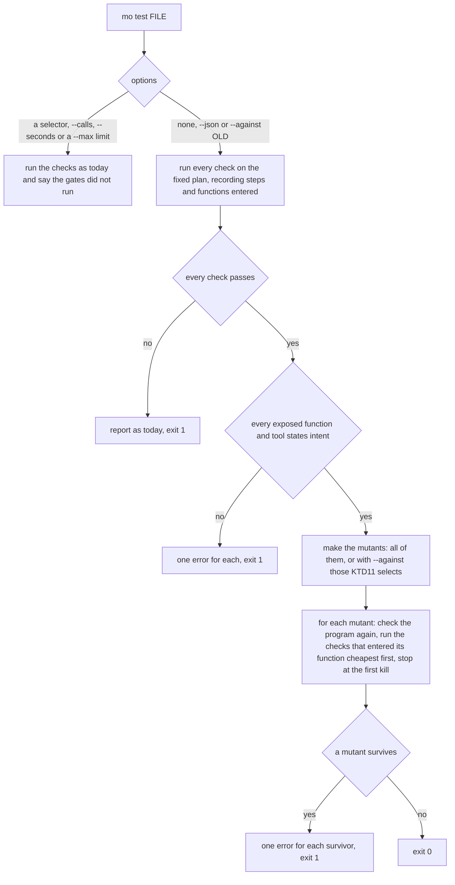

# Trust Gates in mo test - Plan

## Goal Capsule

- **Objective:** Robert can rely on a Mo program that an agent wrote without reading its code. A passing `mo test` means the program's checks notice a change to its code and its public surface states what it is for. Each change comes with an account of what it altered, in terms of checks.
- **Means:** Three additions to `mo test`: the mutation gate, a rule that every exposed function and service tool has a promise or an example, and the change summary. A measurement on the task queue shows how far to trust the gate.
- **Authority:** `docs/reference/README.md` and `AGENTS.md` govern. Robert approves every change to Mo's language and toolchain surface: reference text, commands and error codes. `GLOSSARY.md` holds the vocabulary this plan uses: check, mutant, wrong version, survivor, mutation gate, behaviour change and change summary.
- **Execution profile:** Five pull requests, PR1 to PR5, in the order given under Implementation Units. An agent builds each one. Robert reviews and merges each, and approves the reference text, option names and error codes it carries.
- **Stop and ask Robert when:** a mutant survives that neither a new check, simpler code nor dropping its kind resolves (R7); the measured full run misses R30; a file that a freeze hashes would have to change; or the reference and this plan disagree.
- **Open blockers:** None.

---

## Product Contract

### Summary

`mo test` gains three things that work as one. It fails while any mutant of the program survives. It fails when an exposed function or a service tool has no promise and no example. Given a previous version of the program, it prints a change summary.

The work includes fitting the repository's own Mo programs to the gates, and a measurement that compares the mutation gate against the agent-written wrong versions of the task queue.

### Problem Frame

Robert writes none of the Mo code and reviews little of it. His trust in a program rests on its checks, and by default nothing measures whether those checks would notice a bug. A program can pass `mo test` with checks that pin almost nothing.

Phase 6 measured this once. The task queue's intent killed 3 of the 12 agent-written wrong versions in the working half, and six of the nine survivors changed only handlers that no service promise judged (`docs/status/phase6-run.md`). Strengthening the intent by hand raised that to 11 of 12, and the held-back half of 12 then scored 11 as well. The measure that found the weakness is a report an agent runs on request, against wrong versions someone must write first. It does not stop weak checks from passing.

Trust also builds over time, change by change. Today a change arrives as a diff of code. Nothing describes it in terms Robert can judge without reading that code.

### Key Decisions

- **A surviving mutant fails `mo test`.** A report can be ignored and a gate cannot. (session-settled: user-approved — chosen over a kill-rate report as `docs/design/promise-strength.md` gives for wrong versions: a report leaves weak checks able to pass) Governs R1, R2.
- **Tests count as kills.** Effects such as what `main` prints are checked only in tests today, so a gate limited to promises and examples could not pass for programs that mostly act. (session-settled: user-approved — chosen over counting only promises and examples: that would need a new form for stating effects first) Governs R3.
- **Tests stay the agent's to change.** The mutation gate already fails when a test is loosened far enough to let a mutant through. (session-settled: user-approved — chosen over locking tests the way promises are locked: every refactor would wait for Robert, and outside a running service there is nowhere to hold an approval)
- **Outside a running service Mo stores nothing that a later run relies on.** Anything Mo writes on a machine where agents run, an agent can rewrite, so a stored result would be a claim and not evidence. (session-settled: user-approved — chosen over a store for each program that only a credential held elsewhere can change: the review door that would be its model has not yet been used for a real approval) Governs R11, R12.
- **Plain `mo test` tries every mutant, and naming a previous version shortens the run.** The rigorous run needs nothing but the program. (session-settled: user-directed — chosen over a full run every time: a gate that takes hours is too slow to use while writing code) Governs R8, R9, R10, R28, R29, R30.
- **The first version has no exceptions.** An exception is where an agent that wants a pass would go first. (session-settled: user-approved — chosen over exceptions written in the source with a reason: nobody has yet seen which mutants of a Mo program cannot be killed) Governs R7.
- **An exposed function or service tool with no promise and no example fails `mo test`.** Promises and examples are what Robert can read and approve, and the task queue's survivors sat where there were none. (session-settled: user-approved — chosen over leaving it to the mutation gate: tests alone can kill every mutant and leave nothing readable) Governs R13, R14.
- **The change summary is what Robert reads for a change.** It describes a change without showing code. (session-settled: user-approved — chosen over reading the diff or having no fixed review surface) Governs R15, R16, R17.
- **A rename that hides a behaviour change is a stated limit of the change summary.** Robert reads the checks that could not be compared as well as the ones no longer true. (session-settled: user-approved — chosen over holding such a change until the agent restates the old checks: the smaller fix keeps the summary a report) Governs R15.
- **A run of selected checks is never a pass of the gates.** It tries no mutants and says so. (session-settled: user-approved — chosen over trying every mutant on a selected run: a quick run of one check would cost a full mutation run) Governs R7, R27.
- **The repository's own programs are fitted as part of this work.** A gate that is on by default fails every program that has not met it. (session-settled: user-approved — chosen over turning the gates on for new programs only) Governs R18, R19.
- **The proof is a measurement against wrong versions, with no pass mark.** Mutants are small mechanical changes and wrong versions are mistakes an agent thought plausible, so one can check the other. (session-settled: user-approved — chosen over relying on the gate unmeasured) Governs R21 to R25.
- **Complexity and duplication gates wait for evidence.** A crude count found 207 functions with a median of 7 lines of code and one function over 30 lines. (session-settled: user-approved — chosen over adding a complexity limit and a duplication check now: a limit needs a number and the problem is not showing up)

<!-- ce-section: work-relationships -->
### How This Work Fits Together

This plan covers the gates in `mo test` and their proof. The rest of this list is the current understanding of the surrounding work, not a committed roadmap.

- **Phase 7's M3, the HTTP client.** Depends on this plan: the client is written under the gates from its first line and is their second trial. M1 has merged (#360) and M2 has merged (#366); neither depends on this plan. Phase 7 is planned in `docs/plans/2026-11-17-1900-feat-phase7-outside-world-plan.md`.
- **The gate at the review door.** Depends on this plan and gets its own. The door would refuse a push when a changed function has a surviving mutant, comparing against the running program. Its time limit is set from this plan's measurements.
- **Trying every call sequence for a service.** Still to decide. This plan's proof counts the survivors that only a rare sequence could kill, and that count is the case for or against it.
- **Exceptions for mutants that cannot be killed.** Still to decide. This plan's proof counts them.

### Actors

- A1. Robert. He reads the change summary, approves reference text and merges pull requests.
- A2. An agent writing or changing a Mo program. It runs `mo test` and acts on what it reports.
- A3. The `mo` toolchain. It makes the mutants, runs the checks and reports.

### Requirements

**The mutation gate**

- R1. `mo test` makes the mutants of a program itself. Each mutant is a copy of the program with one small change to the code of one function in the program's own modules. A library module has its mutants made when `mo test` runs on that module.
- R2. `mo test` fails while any mutant survives.
- R3. A promise, an example or a test can each kill a mutant, and the result says which kind of check killed it.
- R4. The toolchain never changes a promise, an example or a test to make a mutant.
- R5. A mutant on code that no check runs survives.
- R6. For each survivor the result names the function, the line and the change that no check noticed.
- R7. Neither the program's source nor an option of `mo test` can excuse a single mutant.
- R8. `mo test` with no previous version named tries every mutant of the program.

**The shorter run**

- R9. When the caller names a previous version of the program as a folder, `mo test` tries only the mutants of functions that changed, or whose checks changed, since that version.
- R10. The result of a shorter run says how many functions it carried over untried and gives the digest of the previous version.
- R11. Outside a running service's data folder, Mo stores nothing that a later run relies on. A cache may make a run faster, and a run without it gives the same result.
- R12. The toolchain does not read git.

**Stated intent**

- R13. `mo test` fails when an exposed function or a service tool has no promise and no example, and the error names it.
- R14. R13 does not apply to private functions or to a program's `main`, and it does not change `mo check` or `mo run`.

**The change summary**

- R15. Given a previous version, `mo test` prints a change summary: the checks no longer true, the checks newly true, the checks about something new, the checks that could not be compared with the reason for each, and a count of the checks that pass on both versions.
- R16. Nothing in the change summary fails the run.
- R17. The change summary gives the digest of the previous version it compared against.

**The repository's own programs**

- R18. The library modules in `lib/`, the programs in `examples/` and the task queue pass both gates before the gates are on by default.
- R19. A fixture or golden case that exists to show something else keeps its program, and its recorded result is rewritten by hand to what the reference now requires.

**Documents**

- R20. Sections 12 and 13.4 of the reference describe the gates and the change summary, `docs/agent-guide.md` teaches them, and `docs/design/promise-strength.md` says that mutants are gated while wrong versions stay a measurement.

**The proof**

- R21. The predictions are written before the first run, and every result is kept, including a weak one.
- R22. The measured program is the task queue as frozen before its intent was strengthened. An agent that has seen neither the wrong versions nor anything written from them makes it pass the mutation gate, using only what the gate reports.
- R23. The measurement counts how many of the 24 wrong versions the fitted program kills, with any check able to kill, by kind of check and for each half of the set. A wrong version that the fitted program's own intent or code makes uncountable is reported separately and by name, and not as a survivor.
- R24. The proof also records the time of a full run for the task queue, the library and the examples, the time of a shorter run, the number of mutants nothing could kill, and the number of survivors that only a rare call sequence could kill.
- R25. No number decides whether the gate is kept.

**The review door**

- R26. The review door's check of a pushed program runs the checks it runs today under today's limits. It tries no mutants and does not apply R13 until the door has its own plan, so R7 and R8 do not reach it.

**Runs that are not the full run**

- R27. A run that selects some of a program's checks or modules tries no mutants and does not apply R13, and its result says the gates did not run.
- R28. The result of a shorter run says it is not the full run. The digest of R10 and R17 depends only on the previous version's source, so anyone can reproduce it from a checkout.

**The full run on the repository**

- R29. The nightly runs the full run on `lib/`, `examples/` and the task queue, and fails on a survivor.
- R30. The gates go on by default only after the measured full run of those programs fits the time the nightly and the local `drivers` group allow.

### Key Flows

- F1. An agent changes a program
  - **Trigger:** A2 has edited a Mo program and wants to know whether it is done.
  - **Actors:** A2, A3
  - **Steps:** A2 runs `mo test` and names the previous version. A3 tries the mutants of what changed and reports each survivor. A2 adds a check or simplifies the code, then runs again until nothing survives.
  - **Covered by:** R2, R3, R6, R9, R10, R13, R28

- F2. Robert reads a change
  - **Trigger:** A change is ready for A1.
  - **Actors:** A1, A3
  - **Steps:** The change handed to A1 names the commit its previous version came from, and A1 reads its change summary. Anything under "no longer true" or "could not be compared" gets his attention. A fix shows one or more checks under "newly true". A change with nothing in those three lists altered no checked behaviour.
  - **Covered by:** R15, R16, R17

- F3. The full run
  - **Trigger:** The nightly runs.
  - **Actors:** A3
  - **Steps:** `mo test` runs on each of the repository's programs with no previous version named and tries every mutant. This is the run every shorter run relies on.
  - **Covered by:** R8, R11, R29

- F4. The proof
  - **Trigger:** The mutation gate works on the task queue.
  - **Actors:** A1, A2, A3
  - **Steps:** The predictions are written. A2, kept from the wrong versions, fits the frozen task queue to the gate. A3 measures the 24 wrong versions against the result. The numbers of R24 are recorded and shown to A1.
  - **Covered by:** R21, R22, R23, R24, R25

### Acceptance Examples

- AE1. **Covers R2, R6.** Given a function that compares with `<`, and no check that tells `<` from `<=`, when `mo test` runs, then it fails and names the function, the line and that change.
- AE2. **Covers R3.** Given a mutant that only a test kills, when `mo test` runs, then the mutant counts as killed and the result says a test killed it.
- AE3. **Covers R5.** Given a function that no check runs, when `mo test` runs, then every mutant of that function survives and the run fails.
- AE4. **Covers R9, R10, R28.** Given a previous version in which one function differs from the new one, when `mo test` names that version, then only that function's mutants are tried, and the result gives the number of functions carried over and the previous version's digest and says it is not the full run.
- AE5. **Covers R9.** Given a function that did not change and a test of it that was removed, when `mo test` names the previous version, then that function's mutants are tried again.
- AE6. **Covers R13, R14.** Given an exposed function with a test and no promise or example, when `mo test` runs, then it fails and names the function. Given a private function with neither, then R13 reports nothing for it.
- AE7. **Covers R15.** Given a fix whose new check fails on the previous version and passes on the new one, when `mo test` names the previous version, then that check is listed as newly true.
- AE8. **Covers R15, R16.** Given a check of the previous version that the new version fails, when `mo test` names the previous version, then that check is listed as no longer true, and the run does not fail on that account.
- AE9. **Covers R15, R16.** Given a refactor that renames a private function, and a test of the previous version that names it, when `mo test` names the previous version, then that test is listed as could not be compared, and the run does not fail on that account.
- AE10. **Covers R11.** Given the same program and the same previous version, when `mo test` runs once with a cache and once without, then both runs give the same result.
- AE11. **Covers R27.** Given a program with a surviving mutant, when `mo test` runs with one check selected, then no mutant is tried and the result says the gates did not run.

### Success Criteria

- The proof's record states its predictions, the count of wrong versions killed and the numbers of R24, and Robert has seen it.
- Phase 7's M3 starts with the gates on, and its client library never has a version that did not meet them.

### Scope Boundaries

Deferred for later:

- The gate at the review door, which gets its own plan.
- Exceptions for mutants that cannot be killed.
- A complexity limit and a duplication check.
- Trying every call sequence for a service.
- A review door for programs that are not services.
- A form for stating effects as intent.

Outside this work:

- Locking tests so that a change to one waits for Robert.
- Changes to how wrong versions and `mo test --strength` work, beyond what R23 needs.
- Process ideas that sit outside the language, such as a second agent judging the first one's work.

#### Deferred to Follow-Up Work

- Fitting `tools/*.mo` to the gates. They hold 812 lines of function code and no promise, which is more than `lib/` and the task queue together.
- A kind of change that replaces a whole function body with a plain value of its type. U8 counts the functions that have no mutant, and that count is the case for or against it.
- An optimised build of `mo` for the repository's full run. The Makefile has no release target today.

#### Considered and not built

- Making all mutants in one compiled program and switching one on at run time. It is measured elsewhere at four to five times faster than checking the program again for each mutant, but it changes lowering, codegen, the VM and the contract with the Lean evaluator. The numbers of U12 would reopen it.
- Dropping a mutant whose bytecode equals the program's. It would remove some mutants that nothing can kill. U8 shows whether such mutants appear.
- Failing a run for a function that no check runs and that has no mutant. R5 speaks only of mutants.
- Requiring a function's own promise or example to kill one of its mutants, so that an example that says nothing would not satisfy R13.
- Refusing `--against` when the previous version equals the new one. A one-line change gets round it, so it closes nothing.
- Putting a previous check's helpers into the new program beside it, so that a check whose helper changed gets a real answer in the change summary. KTD13 lists such a check as could not be compared. The extra machinery waits until that list proves too noisy.
- A cache between runs. R11 allows one and nothing needs it yet, so AE10 holds because two runs do the same work.
- Running mutants on several cores.

### Dependencies / Assumptions

- A passing gate shows that a program's code is pinned by its checks. It does not show that the checks say what Robert wants. R13 and the change summary narrow that gap and do not close it.
- Phase 7's plan does not yet say that M3 waits for this work. That plan is on `main` and another session is working from it.
- The repository holds what was written from the wrong versions: the working half and its mistakes in `learnability/phase6/strength/`, each survivor in `docs/status/phase6-run.md`, and the intent strengthened against them in `services/task-queue/`. R22 therefore needs the fitting agent to work in a folder that holds only the frozen task queue, a built `mo` and Mo's own guidance, and its transcript is kept. The held-back half is kept outside the repository, as `learnability/phase6/strength/README.md` records.
- Checked on 2026-11-18: the frozen task queue is commit `1389bdfb`. Its `main.mo` and `job-queue.mo` hash to the values in the manifest, and a `mo` built from `main` passes its 28 checks. `queue-tests.mo` has not changed since that commit.
- Unverified: what the gate costs. One pass of the task queue's checks takes about 68 seconds on a debug build, and a crude count gives about 650 places to change, so a run with no savings is on the order of ten hours. Stopping at the first kill and running only the checks that reach a change should cut that by a large factor that nobody has measured. The nightly has 120 minutes for all its groups. If the measured full run of R24 does not meet R30, the work stops and Robert decides.
- Unverified: mutants that nothing can kill are rare enough for R7 to hold. If the repository's programs meet one that neither a new check, simpler code nor dropping that kind of change resolves, the work stops and Robert decides.

- A limit of the change summary: a change that renames what a previous test names and also changes behaviour shows that test as could not be compared and shows nothing as no longer true. The summary cannot tell this from a rename alone.
- A limit of the proof: the wrong versions replace nothing that an intent item of the frozen task queue reads, so none touches `submit`, `lease`, `acknowledge` or `fail`. R23 says nothing about how the gate covers those operations, and the proof's record says so.

### Outstanding Questions

Resolve Before Planning: none.

Deferred to Planning, each now answered in the Planning Contract:

- Which kinds of change the toolchain makes to produce a mutant: KTD5.
- How a mutant that makes a check run without finishing is counted: KTD6.
- How a shorter run decides that a function or its checks changed: KTD11.
- How a previous check that no longer compiles is reported one check at a time: KTD13.
- The error codes and the wording of each report: KTD14. Robert approves both when PR1 and PR2 are reviewed.
- How `mo test --strength` counts a kill by a test for R23: KTD17.
- In what order the gates are built, the repository's programs fitted and the gates turned on by default: the order of PR1 to PR5, and KTD15.
- How the 51 golden cases that run `mo test` change: U14.
- Which file the task queue is gated and measured through: KTD16.

### Sources / Research

- `GLOSSARY.md`: the vocabulary.
- `docs/design/promise-strength.md`: the wrong-version measure and its "no arbitrary pass threshold" rule. `src/tools/strength.c` replaces declarations, classifies outcomes and leaves tests out of a kill.
- `docs/design/intent.md`: intent items and their digests, the review door, what the door runs, its limits and the task queue's timings.
- `docs/status/phase6-run.md`: the 3 of 12 and 11 of 12 results and what the survivors were.
- `learnability/phase6/strength/`: the wrong versions, the manifest that hashes the frozen task queue, and the results.
- `docs/reference/README.md` sections 12 and 13.4: examples, promises, tests, fakes, recovery checks and the `mo` command.
- `ci/check_cli.py`, `ci/check_golden.py` and `ci/check_lib.py`: where the repository's checks run `mo test`.
- `AGENTS.md`, "Checks and merging": the treatment a claim about what Mo guarantees gets.
- Two outside projects were read for this work: Robert Martin's `ub-mode`, whose mutation, coverage and duplication tools fail a build, and Cursor's `pstack`, for the rules that a check which has never failed proves nothing and that the author of a change does not loosen its gate.

---

## Planning Contract

Product Contract preservation: requirements, key decisions, flows and acceptance examples are unchanged. Planning answered the questions under Deferred to Planning, replaced one unverified assumption with what was checked, and added to Scope Boundaries the follow-up work and the mechanisms it considered and did not build.

### Key Technical Decisions

**Where the gates run and what a full run is**

- KTD1. **The gates live in the test branch of `execute_pipeline` in `src/tools/execute.c`, above `mo_run_tests`.** The review door's check child and `--strength` call `mo_run_tests` directly, so both stay as they are and R26 needs no special case.
- KTD2. **A full run is `mo test FILE` with no option except `--json`.** `--against OLD` makes it the shorter run. Any other option makes it a run on which the gates do not run, and the result says so. That covers the selectors of R27 and also `--calls`, `--seconds`, `--max-stack`, `--max-depth` and `--max-heap`: each changes what a check does, and a tightened limit could turn a borderline mutant into a kill. `--against` with any of them is a mistake in the command. (R7, R27)
- KTD3. **A full run has no clock.** Every promise runs its 200 inputs and every service its 200 sequences to the end, the counts plain `mo test` uses today. Today a promise stops after 2 seconds and passes on the inputs it reached, so one mutant could die on a fast machine and survive on a slow one. Input seeds already come from each check's name. (R2, AE10)
**Mutants and kills**

- KTD4. **A mutant is one text change in one module's source, and the whole program is checked again.** `--strength` already works this way: `apply` and `measure_one` in `src/tools/strength.c` splice a replacement into a module, then load, check and run the program. The change is found in the syntax tree and stays inside a function's code, which is child 5 of an `fn` node. It never touches the spec block, a `test` block or a service's promises (R1, R4). A changed program that the checker rejects is not a mutant, and the totals say how many were dropped that way. A changed program that fails to load for any other reason is a defect in the toolchain and fails the run, so a loading fault can never empty the gate. `--strength` leaves library modules out of the sources it rebuilds, and a library module's copy held in memory clashes with the library's own (E0037). So when the file under test is a library module, the gate loads each changed program through `mo_load_program_sources`, which takes a library flag for each source.
- KTD5. **The first table of kinds is small, and it is frozen before the proof.** The rows are: a comparison moved to its boundary (`<` to `<=`), a comparison negated (`==` to `!=`, `<` to `>=`), `and` swapped with `or`, a `not` removed, an arithmetic operator swapped (`+` with `-`, `*` with `/`), a Bool literal flipped, and an Int literal raised by one. With no exceptions (R7), dropping a row is the only way to be rid of a kind of mutant nothing can kill, and such mutants were measured at 2% to 47% of all mutants by kind in C programs. U8 counts survivors by row on the repository's programs, and Robert approves the table as reference text.
- KTD6. **A mutant is killed when a check that passed on the program does not pass on the mutant.** That means the check fails, stops on a runtime fault, has an anchor fail or runs out of steps, or the program no longer starts, which the report counts under its own heading, start. The step limit is a multiple of the steps the same check used on the program, so the result does not depend on the machine. A recovery check counts as a check here, and the report gives its kind beside promise, example and test. A mutant run stops at the first failing input and does not shrink it. (R2, R3)
- KTD7. **Each mutant runs only against the checks that ran its function.** While the checks run on the unchanged program, the VM records which functions each check entered. A check that never entered a function cannot notice a change to it. Those checks run cheapest first by the steps they used, with ties broken by name, and the run stops at the first kill. A function entered while the program starts, or while a promise's anchors are checked, counts as run by every check. A function no check entered has every mutant reported as a survivor with nothing run (R5). Checks reach the outside world only through fakes (reference 12.4), so the record is the same on every run.

**The stages and stated intent**

- KTD8. **A full run goes in three stages and stops at the first that fails:** the checks, then stated intent, then the mutants. Cheap failures come first, and a long mutant run never sits behind a failure already known.
- KTD9. **What "has a promise or an example" means in R13.** An exposed function needs a promise or an example in its own spec block, one overload at a time. A service tool needs a service promise written `on` that tool, or a promise or example on its handler. A step promise does not count for a tool, because one sentence about every step would then satisfy every tool. A function that is both exposed and a tool must meet both rules.

**The previous version**

- KTD10. **`--against OLD` takes the previous version's copy of FILE.** R9's folder is the one OLD sits in. `mo intent FILE --against OLD` already has this shape and already loads a second program (`src/tools/intent-view.c`). When FILE is a library module, OLD's folder is also the library the previous version loads from, because a library module outside its library does not load (E0037).
- KTD11. **The shorter run tries a function when its code changed or a check that ran it changed.** Its code changed when its canonical text differs or the function is new. A check that ran it changed when that check is gone, has a different full name or canonical text, reads a helper that changed, or no longer runs the function. A helper is a function or constant that only checks use: no tool, timer, start value, exposed function or `main` reaches it. `src/tools/intent.c` already walks what a declaration reads and what a service reaches. Without the helper rule an agent could weaken `acknowledged?` in `queue-tests.mo`, leave every test's text alone, and have every function of the service carried over. Canonical text is the formatted, comment-free text the intent digest already uses (`src/tools/intent.c`). The full name is compared because input seeds come from it. A function is not retried because something it calls changed, which is R9 as written. A function no check runs is reported on every run, shorter or full, because R5 says its mutants survive. It is not counted among the functions carried over. (R5, R9, AE4, AE5)
- KTD12. **The previous version's digest is the source digest `mo push` already computes** over a program's source bundle (`src/tools/push.c`). One version of a program then has one digest everywhere in `mo`. `mo push` cannot build a bundle whose entry is a library module: the bundle leaves library modules out and then finds no entry. For a library module the digest is therefore SHA-256 over the same bundle format, holding every module file of the previous library with OLD as the entry. (R10, R17, R28)
- KTD13. **The change summary sorts each check by its result on the previous code and on the new code.** The table under High-Level Technical Design gives every case. A check found in only one version is put into the other program on its own: a `test` block into its module, an example row or a promise into the spec block of the same function, a service promise into the service block. When that program does not check, its first diagnostic is the reason given. One check that no longer compiles then never hides another. A check with the same name and text in both versions that reads a helper which changed (KTD11) is listed as could not be compared, and the reason names the helper. Its text is the same and what it tests may not be. (R15, R16, AE9)

**Reports, the interim option and the repository**

- KTD14. **The output keeps its shape.** The totals line and the `totals` record stay last. In text, the gate's lines come before the totals line. In JSON, each survivor and each change-summary entry is a new kind of record, and the `totals` record gains the mutant counts by kind of check and a field saying whether the gates ran, ran shorter or did not run. A survivor and a missing intent each raise a new error code, which is what makes the run exit 1. Code numbers are taken when the code is written, because Phase 7 is adding codes at the same time. (R3, R6, R10, R27, R28)
- KTD15. **Until R30 is met, the gates run only with `--gates`.** The guide documents the option, as AGENTS.md requires for anything a `mo` command does. PR5 makes the gates the default and deletes it. `--against` is new, so it needs no interim form. (R30)
- KTD16. **The task queue is gated and measured through `services/task-queue/queue-tests.mo`.** It imports `Main` and `JobQueue`, so one run covers all three modules and all 69 checks. A run on `main.mo` would not see the tests. (R18, R22, R29)
- KTD17. **`--strength` gains one outcome: killed by a test only.** Its existing rate keeps counting kills by promises and examples, and a second total counts kills by any check. The record's version goes up by one. (R23)
- KTD18. **The repository's full run is one check, `ci/check_gates.py`, on the first driver.** It runs each program of R29 once and prints each one's time. Other checks that run the same programs for another claim may select with `--in` when the measured time requires it. (R29, R30)

### High-Level Technical Design

One run of `mo test`:

With `--against`, the change summary is printed once the checks have run on both versions, whatever the later stages find.

What each kind of run does:

| Run | Options | Checks | Stated intent | Mutants | What the result adds |
| --- | --- | --- | --- | --- | --- |
| Full | none, or `--json` | all, on the fixed plan | applied | all | mutant counts by kind of check, each survivor |
| Shorter | `--against OLD`, with or without `--json` | all, on the fixed plan, on both versions | applied | of the functions KTD11 selects | the same, plus the functions carried over, the digest, "not the full run" and the change summary |
| Not gated | `--only`, `--in`, `--calls`, `--seconds` or a `--max` limit | as today | not applied | none | "the gates did not run" |
| Unchanged | `--list`, `--bundle`, `--strength` | as today | not applied | none | nothing |

How the change summary sorts a check:

| The check is in | On the previous code | On the new code | Listed as |
| --- | --- | --- | --- |
| both versions, same name and text | passes | passes | counted as passing on both |
| both versions, same name and text | fails | passes | newly true |
| both versions, same name and text | passes | fails | no longer true, and the run fails on the check itself |
| both versions, same name and text | fails | fails | not listed, and the run fails on the check itself |
| both versions, same name and text, and a helper it reads changed | any | any | could not be compared: the helper is named. This row comes before the four above |
| the previous version only | passes | passes | counted as passing on both |
| the previous version only | passes | fails | no longer true |
| the previous version only | passes | does not check | could not be compared, with the first diagnostic |
| the previous version only | fails | any | could not be compared: the previous version did not pass it |
| the new version only | fails | passes | newly true |
| the new version only | passes | passes | counted as passing on both |
| the new version only | does not check | passes | about something new |
| the new version only | any | fails | not listed, and the run fails on the check itself |

### Assumptions

Scoping confirmation was off for this plan, so these choices were made without asking. Each is Robert's to overturn.

- `tools/*.mo` and the Phase 4 grader's frozen programs are not fitted here. R18 lists `lib/`, `examples/` and the task queue. From PR5 the checks that run them select with `--in`, so the gates do not run on them and their output says so.
- The fitting agent of R22 makes the frozen task queue pass both gates, because stated intent comes before the mutants (KTD8). Six of its seven tools have no intent today. The record says the count measures both gates together.
- A recovery check can kill a mutant (KTD6). `GLOSSARY.md` gains that sentence under Check.
- A check removed from the new version that the new code still passes is counted as passing on both and is not listed. R15 has no list for it.
- `--against` names the previous version by its copy of FILE (KTD10), where R9 says a folder.
- A step promise does not satisfy R13 for a tool (KTD9).
- The gates sit behind `--gates` until PR5 (KTD15).
- An example that says nothing satisfies R13. The first bullet of Dependencies / Assumptions already covers checks that do not say what Robert wants.
- A run with `--calls`, `--seconds` or a `--max` limit is not gated, and it exits 0 when its checks pass (KTD2). R27 names only runs that select checks or modules. A script that reads only the exit status sees a pass, and the printed line is what says the gates did not run.
- A check that reads a changed helper counts as changed, and the change summary lists it as could not be compared (KTD11, KTD13). The document review of 2026-11-18 added this. Editing a helper that many tests share lists every one of them.
- A function that no check runs fails a shorter run as well as a full one (KTD11).

### Risks

| Risk | What limits it |
| --- | --- |
| Mutants nothing can kill, with no exceptions allowed. Every tool surveyed that supports a zero-survivor rule also has a way to skip one mutant. | The small table (KTD5), the count by row in U8, and the stop rule in the Goal Capsule. |
| Cost. Nothing is measured yet. The nightly has about 40 of its 120 minutes free, and today it runs plain `mo test` on the same programs from several checks and three builds, one of them about five times slower. | KTD7 keeps each mutant to the checks that can notice it. U12 measures before PR5. KTD18 keeps the full run to one check on one build. Measured on 2026-11-18: one test, the full-queue test, takes 66 of the task queue's 73 seconds and runs nearly every handler. It is the last check tried for those functions, so each of their survivors costs about a minute. A cheaper test of the full queue is the first lever if the cost hurts. |
| A shorter run passes where a full run would not: something a function calls changed, the previous version never passed a full run, or the table changed since it did. | The result says it is not the full run (R28), and the nightly runs the full one (R29). For a program outside the repository, only a plain `mo test` is a pass. |
| The table's blind spots. Code outside function bodies, `case` patterns and Text literals are never changed, and a function with nothing the table changes has no mutant. An agent can rewrite code into those forms. | U8 counts the functions with no mutant before anything is fitted. U10 and U11 count them again after fitting and name each function that lost all its mutants, which is where an agent working under the gate would show this. R23 measures the table against mistakes an agent made. New rows follow that evidence. |
| The table was chosen by someone who had read what the wrong versions changed. | The table is frozen and its commit recorded before the proof's first run. A row added afterwards is recorded beside the result it affects. |
| A hook in the VM's call path. | It is off unless a harness turns it on, as `mo_process_instruction_limit` is. `tests/test_vm.c` and `fuzz/fuzz_vm.c` run with it off and on. |
| Merge conflicts with Phase 7 in `src/base/codes.h`, `tests/errors/` and `ci/check_cli.py`. | Each PR is rebased on `main` and re-run before it merges. Code numbers are taken late (KTD14). |
| PR5 touches 51 golden cases and about 70 plain `mo test` calls in the drivers. | U14 states one rule for all of them, and the hand-written golden results double as an independent check of U2. |

### Alternatives Considered

- **Working out from the source which checks reach a function,** by extending the walker in `src/tools/intent.c`. It would need no VM change. It misses what a check runs without naming: a `Simulation` test runs timers and the start value, and a promise over a hidden type calls its module's exposed functions to build inputs. Each miss would be a survivor no check can fix. KTD7 records what ran.
- **Changing Mo Core or the checked program in place of the source.** Lowering turns one source operator into different shapes by type and copies a generic function once for each type, and it accepts only a program `mo_check` passed. A source change goes through the whole pipeline the way a real edit would.
- **Retrying every function that a changed function or check could affect.** It is the sound rule. In a service, one service promise runs every handler, so a one-line change would retry nearly everything and AE4 could not hold. KTD11 follows R9 as written and leaves the rest to the full run.
- **Turning the gates on in the first PR.** R30 forbids it before the cost is measured, and it would put the C code, about thirty fitted programs and every fixture in one review.

### Open Questions

None of these blocks PR1. Each is a default Robert can change at the review named.

- Should `tools/*.mo` be fitted in this work? Default: no, as a follow-up. Decided at PR4.
- Does `--against` take the previous copy of FILE, or its folder? Default: the file, to match `mo intent`. Decided at PR2.
- May Phase 7's M3 start once PR4 has merged? The nightly holds `lib/` to the gates from then on, though an agent still has to pass `--gates` itself. Default: M3 waits for PR5. Decided at PR4.
- Should a check that was removed and still passes be listed in the change summary? Default: no. Decided at PR2.

### Deferred to Implementation

- The multiple and the floor of the step limit in KTD6, as named limits in `src/base/limits.h`.
- Whether the VM records entered functions for a process or for an image, and how anchor evaluation and start-up code are attributed to checks.
- Whether a check's step count includes the steps its service's handlers and timers run. A service runs them in its own process, which the caller's step limit does not reach. The service's own work limit already ends a handler that loops.
- How the position of a plain binary operator is found. The public syntax node holds the operator's kind and its two operands, not its span.
- The wording of every report and the code numbers.
- Whether checks found in only one version are put into the other program one at a time from the start, or in a batch that falls back to one at a time.
- How the fitting session of U10 is kept from the repository: the learnability harness's work-folder isolation if it hides the checkout, a fresh machine if not.
- Whether any check compares `learnability/phase4/grade.py` with `learnability/phase4/freeze.json`. If one does, stop and ask Robert before editing it.

---

## Implementation Units

| Unit | Title | Main files | Depends on |
| --- | --- | --- | --- |
| U1 | Run the checks on a fixed plan and record what each one ran | `src/vm/`, `src/tools/tests.c` | none |
| U2 | Make mutants from a module's source | `src/tools/mutants.c` | none |
| U3 | The mutation gate under `--gates` | `src/tools/gates.c`, `src/tools/execute.c` | U1, U2 |
| U4 | The stated-intent rule | `src/tools/gates.c` | U3 |
| U5 | Record that Phase 7's M3 waits | the Phase 7 plan | none |
| U6 | The shorter run | `src/tools/previous.c`, `src/tools/cli.c` | U3 |
| U7 | The change summary | `src/tools/changes.c` | U6 |
| U8 | The dry run and the frozen table | `docs/status/trust-gates-run.md` | U3, U4 |
| U9 | `--strength` counts a kill by a test | `src/tools/strength.c` | none |
| U10 | The measurement | `learnability/trust-gates/` | U6, U8, U9 |
| U11 | Fit the repository's programs | `lib/`, `examples/`, `services/task-queue/` | U8 |
| U12 | The repository's full run and its cost | `ci/check_gates.py` | U11 |
| U13 | The gates on by default, and the documents | `src/tools/cli.c`, `docs/reference/README.md` | U12 |
| U14 | Golden cases and drivers | `tests/golden/`, `ci/` | U13 |

### PR1: The gates, run with `--gates`

Waits on: nothing.

### U1. Run the checks on a fixed plan and record what each one ran

- **Goal:** The test runner can do what the gates need: run with no clock, hand back each check's result and the steps it used, record the functions it entered, run a named set of checks, and stop at the first check that does not pass.
- **Requirements:** R2, R3, R5. KTD3, KTD6, KTD7.
- **Dependencies:** none.
- **Files:** `src/vm/vm.h`, `src/vm/execute.c`, `src/vm/process.c`, `src/tools/tests.c`, `src/tools/tests.h`, `src/tools/promises.c`, `src/tools/service-tests.c`, `src/tools/tools.h`, `tests/test_vm.c`, `tests/test_gates.c` (new), `fuzz/fuzz_vm.c`.
- **Approach:**
  1. Add a harness hook to the VM beside `mo_process_instruction_limit` that records each function entered. It is off by default.
  2. Give the runner a gated mode: the fixed plan with no deadline, one result for each observation handed to the caller, the steps each used, a step limit for each, and a stop at the first one that does not pass. With the mode off, plain `mo test` behaves as today.
  3. Map each bytecode function to the source function whose span holds it, so the copies of a generic function and the closures inside a function count as that function.
- **Patterns to follow:** `mo_process_instruction_limit` and `mo_call_controlled` in `src/vm/vm.h`; `door_plan` in `src/tools/cli.c` and `src/tools/promises.c`.
- **Test scenarios:**
  - Two functions with one example each: the record for the first example names only the function it calls.
  - A generic function used at two types: both copies are recorded as the one source function.
  - A test that starts a service with `Simulation.start` and advances the clock: the record holds the timer function and the tool handler the test never names.
  - A promise over a type exposed without its insides: the record holds the exposed functions that built its inputs.
  - The same program run twice: the same step counts and the same records.
  - A check given a step limit below the steps it used: the outcome is "ran out of steps", and a function that loops forever ends the same way.
  - Three checks of which the second fails, with the stop on: the third does not run.
  - The mode off: the output for `tests/cli/test/main.mo` matches its golden files byte for byte.
  - `fuzz/fuzz_vm.c` runs each input with the record off and with it on, and the call gives the same result both times.
- **Verification:** The new tests pass with gcc, with clang and under the sanitizers, `make fuzz-smoke` passes, and no existing golden file changes.

### U2. Make mutants from a module's source

- **Goal:** Given a checked program, list every mutant with its module, function, position, kind, original text and replacement, and give the changed source for each.
- **Requirements:** R1, R4. KTD4, KTD5.
- **Dependencies:** none.
- **Files:** `src/tools/mutants.c` (new), `src/tools/mutants.h` (new), `tests/test_mutants.c` (new), `fuzz/fuzz_mutants.c` (new), `fuzz/corpus/fuzz_mutants/` (new).
- **Approach:** Hold the table of kinds as data, one row for each kind, so that dropping a kind removes one row. Walk the code of each `fn` in the modules `mo test` runs checks for, which includes a library module when it is the file under test. List mutants in source order.
- **Patterns to follow:** `apply` and `body_start` in `src/tools/strength.c`; the text edits of `mo fix` in `src/tools/fix.c`; the copy of a declaration's syntax in `src/tools/intent.c`.
- **Test scenarios:**
  - A function whose code is `a < b`: exactly two mutants, `a <= b` and `a >= b`, each at the operator's line and column.
  - A function with `==` in its example rows and `<` in its promise: no mutant inside the spec block.
  - A `test` block holding `1 + 1 == 2`, and a service block with promises: no mutant in either.
  - A `#` comment holding `<` between the two operands of a `>`: the operator changes and the comment does not.
  - A Text literal holding `==`: unchanged.
  - A program that imports a library module: no mutant in the library module. The same library module as the file under test: its functions have mutants.
  - Two overloads of one name: each has its own mutants, named with its receiver.
  - A function that builds a Text and has nothing the table changes: no mutant.
  - Every mutant of every example under `examples/`: its source differs from the original in one span, and it parses.
- **Verification:** The tests pass, and the fuzz target holds for any source that checks: every mutant parses and differs from the source in one span inside a function's code.

### U3. The mutation gate under `--gates`

- **Goal:** `mo test --gates FILE` tries every mutant, reports each survivor and exits 1 while one survives.
- **Requirements:** R1 to R8, R27. KTD1, KTD2, KTD6, KTD7, KTD8, KTD14, KTD15. Covers AE1, AE2, AE3, AE11.
- **Dependencies:** U1, U2.
- **Files:** `src/tools/gates.c` (new), `src/tools/gates.h` (new), `src/tools/gates-render.c` (new), `src/tools/execute.c`, `src/tools/cli.c`, `src/tools/tools.h`, `src/base/codes.h`, `src/base/limits.h`, `tests/errors/` (one case for the new code), `tests/cli/gates/` (new), `ci/cli_gates.py` (new), `ci/check_cli.py`, `ci/cli_guide.py`, `fuzz/fuzz_cli.dict`, `docs/agent-guide.md`, `docs/reference/README.md`, `tests/conformance/reference.tsv`, `tests/conformance/rules.tsv`.
- **Approach:**
  1. Run the checks in the gated mode of U1. If one fails, report as today and stop.
  2. For each mutant of U2: build the changed sources, load and check the program, drop it and count it if the checker rejects it, then run the checks that entered its function, cheapest first, up to the first kill. A library module under test is loaded as KTD4 says. A load that fails for any reason other than the checker's fails the run.
  3. Report each survivor with its function's full name, the position, the kind, the original and changed text, and whether any check ran the function. Report the counts by kind of check and the number dropped in the totals.
  4. Refuse `--gates` with `--list`, `--bundle` or `--strength`.
  5. Add `--gates` to the guide, to section 13.4 of the reference and to the flag table in `ci/cli_guide.py`.
- **Patterns to follow:** `measure_one` in `src/tools/strength.c` for the loop that reloads and runs with quiet output; E1432 in the same file for a run that fails with no failed check; `ci/cli_intent.py` for a topic module of driver checks.
- **Test scenarios:**
  - Covers AE1. A function compares with `<` and no check tells `<` from `<=`: exit 1, and the survivor names the function, the line and `<` to `<=`.
  - Covers AE2. A mutant only a test kills: counted as killed, and the totals show one kill by a test.
  - Covers AE3. A function no check runs, with two places the table changes: both survive, each is marked as run by no check, and no mutant run is made for them.
  - Covers AE11. A program with a survivor, run with `--only` naming one check: no mutant is tried, the result says the gates did not run, and the exit status is 0. The same holds for `--in`, `--calls 10`, `--seconds 5` and `--max-depth`.
  - Every mutant killed: exit 0, and the counts by kind add up to the number tried.
  - A failing check on the unchanged program: reported as today, and no mutant is tried.
  - A mutant that loops forever: killed as out of steps, and the run ends.
  - A mutant that divides by zero: killed.
  - A mutant that does not check, such as `-` between two Texts: not tried, and the totals count one dropped.
  - A library module as the file under test, such as `lib/option.mo`: its mutants are tried, at least one is killed, and none is dropped.
  - A helper that a promise's anchors read: its mutant makes an anchor fail and is counted as killed by a promise.
  - A program with no functions: no mutants, exit 0.
  - Two runs with `--json`: the same records in the same order once `microseconds` is left out.
  - `--gates` with `--strength`, `--bundle` or `--list`: a mistake in the command, exit 2.
  - No `--gates`: every existing golden file and driver check passes unchanged.
- **Verification:** The scenarios pass through `ci/cli_gates.py`, and `ci/check_door.py` passes unchanged, which shows R26.

### U4. The stated-intent rule

- **Goal:** Under `--gates`, a run fails when an exposed function or a service tool states no intent, and names each one.
- **Requirements:** R13, R14. KTD8, KTD9. Covers AE6.
- **Dependencies:** U3.
- **Files:** `src/tools/gates.c`, `src/tools/gates-render.c`, `src/base/codes.h`, `tests/errors/` (one case for the new code), `ci/cli_gates.py`, `docs/agent-guide.md`, `docs/reference/README.md`, `tests/conformance/reference.tsv`, `tests/conformance/rules.tsv`.
- **Approach:** Read exposure from each function's symbol and the tools from each service. A spec whose subject is the function, or a service promise whose tool is the tool, is the intent. The error gives the full name with its receiver, the declaration's position, which rule it broke and what would meet it.
- **Test scenarios:**
  - Covers AE6. An exposed function with a test and no promise or example: exit 1 and an error naming it. A private function with neither: nothing reported.
  - A `main` with no promise and no example: nothing reported.
  - Two exposed overloads of one name, one with an example: the error names the other, with its receiver.
  - A tool with a service promise `on` it: accepted. A tool covered only by a step promise: reported. A tool whose handler has an example: accepted.
  - A function that is exposed and a tool, with only an `on` promise: reported under the exposed rule.
  - Three functions without intent: three errors in one run, and no mutant is tried.
  - The same program under `mo check` and `mo run`: unchanged.
  - A library module as the file under test, with a bare exposed function: reported.
  - A run with `--in`: the rule is not applied.
- **Verification:** The scenarios pass, and the error case under `tests/errors/` matches `mo test --gates` exactly.

### U5. Record that Phase 7's M3 waits

- **Goal:** The Phase 7 plan says that M3 depends on this plan.
- **Requirements:** the second success criterion, and the second bullet of Dependencies / Assumptions.
- **Dependencies:** none.
- **Files:** `docs/plans/2026-11-17-1900-feat-phase7-outside-world-plan.md`.
- **Approach:** Add this plan to M3's dependencies in the milestone table, with one sentence in Dependencies and Assumptions.
- **Test scenarios:** Test expectation: none -- a change to a plan document.
- **Verification:** The milestone table names this plan beside M3.

### PR2: The previous version

Waits on: PR1, which must merge before this group can start, because U6 runs the gate of U3. It is its own PR because Robert reviews each PR (AGENTS.md, "Checks and merging") and PR1 with these two units would be too much for one sitting.

### U6. The shorter run

- **Goal:** `mo test FILE --against OLD` tries only the mutants KTD11 selects, and says how many functions it carried over, the previous version's digest and that it is not the full run.
- **Requirements:** R9, R10, R11, R12, R28. F1. KTD2, KTD10, KTD11, KTD12. Covers AE4, AE5, AE10.
- **Dependencies:** U3.
- **Files:** `src/tools/previous.c` (new), `src/tools/previous.h` (new), `src/tools/cli.c`, `src/tools/gates.c`, `src/tools/gates-render.c`, `src/tools/intent.c`, `src/tools/intent.h`, `src/tools/push.c`, `tests/cli/against/` (new), `ci/cli_gates.py`, `ci/cli_guide.py`, `fuzz/fuzz_previous.c` (new), `fuzz/corpus/fuzz_previous/` (new), `fuzz/fuzz_cli.dict`, `docs/agent-guide.md`, `docs/reference/README.md`, `tests/conformance/reference.tsv`, `tests/conformance/rules.tsv`.
- **Approach:**
  1. Accept `--against` for `test`, and refuse it with any option of the "not gated" and "unchanged" rows of the table above.
  2. Load and check OLD in its own arena. For a library module, load it with its folder as the library.
  3. Run the previous version's checks in the gated mode to get what each one ran.
  4. Pair functions and checks by full name, compare canonical text and the helpers each check reads, and select by KTD11.
  5. Print the count carried over, the digest of KTD12 and "not the full run".
- **Patterns to follow:** the second load in `src/tools/intent-view.c`; canonical text in `src/tools/intent.c`, exported and not copied; the bundle digest in `src/tools/push.c`.
- **Test scenarios:**
  - Covers AE4. One function's code differs: only its mutants are tried, and the result gives the number carried over, the digest and "not the full run".
  - Covers AE5. A function did not change and a test that ran it was removed: its mutants are tried again.
  - Covers AE10. The same program and previous version run twice: the same result. No cache exists, so there is no second path to compare.
  - Only a comment and the layout changed: no mutant is tried.
  - A promise added above another, so the second one's number shifts: the function they belong to is tried again.
  - A new function, and a renamed one: both are tried.
  - An unchanged function that no check runs: still reported as a survivor, and not counted as carried over.
  - A helper that only tests call is changed to return `true`, and every test keeps its text: every function those tests ran is tried again.
  - OLD is the same as FILE: nothing is tried, everything is carried over, and the result says it is not the full run.
  - OLD does not exist: a mistake in the command, exit 2. OLD does not check: one error giving its first diagnostic, exit 1, and nothing else runs.
  - A library module with OLD in a copy of the previous `lib/`: it loads, the run works, and the digest printed equals the digest of the bundle built by hand from that folder's files.
  - `--against` with `--only`, `--in`, `--calls`, `--seconds`, a `--max` limit, `--list`, `--bundle` or `--strength`: refused.
  - The two folders before and after a run: byte for byte the same, and nothing written beside them.
  - For a program that is not a library module, the digest printed equals the one `mo push` computes for the same folder.
- **Verification:** The scenarios pass, the fuzz target holds for any two sources, and a search of `src/` still finds no call to git.

### U7. The change summary

- **Goal:** With `--against`, `mo test` prints the change summary of R15, and nothing in it changes the exit status.
- **Requirements:** R15, R16, R17. F2. KTD13, KTD14. Covers AE7, AE8, AE9.
- **Dependencies:** U6.
- **Files:** `src/tools/changes.c` (new), `src/tools/changes.h` (new), `src/tools/gates-render.c`, `tests/cli/against/`, `ci/cli_gates.py`, `fuzz/fuzz_previous.c`, `docs/agent-guide.md`, `docs/reference/README.md`, `tests/conformance/reference.tsv`, `tests/conformance/rules.tsv`, `GLOSSARY.md`.
- **Approach:** Reuse the results U6 already has for checks that are the same in both versions. For a check in one version only, build the other program with that check put in, as KTD13 says, and run it on the fixed plan. Sort each check by the table under High-Level Technical Design. Print the summary before the gate's lines.
- **Patterns to follow:** the splice in `src/tools/strength.c`; the pairing of items in `src/tools/intent-view.c`.
- **Test scenarios:**
  - Covers AE7. A fix whose new check fails on the previous version and passes on the new one: listed as newly true.
  - Covers AE8. A check of the previous version that the new code fails, removed from the new version: listed as no longer true, and the exit status is 0 when the gates pass.
  - Covers AE9. A private function renamed, and a previous test that names it: listed as could not be compared with the diagnostic as the reason, and the exit status is unchanged.
  - A check that is the same in both versions, failed before and passes now: newly true.
  - A new check that names a new function: about something new.
  - A new check that the previous code also passes: counted as passing on both, and the count is right.
  - Two previous checks, one that no longer compiles and one that fails: each is listed on its own.
  - A service promise found only in the previous version: run against the new service and sorted.
  - A previous example of one overload: put into the same overload.
  - The new version fails a check that the previous version passed: the summary is still printed and lists it as no longer true, and the exit status of 1 comes from the check.
  - A check that fails on both versions, and a new check that fails on the new code: neither is listed, and the exit status of 1 comes from the check.
  - A helper that only tests call is changed to return `true`, and every test keeps its text: each test that reads it is listed as could not be compared, and the reason names the helper.
  - A rename that also changes behaviour: listed only as could not be compared. This pins the stated limit.
  - The summary gives the previous version's digest, and `--json` gives one record for each entry.
- **Verification:** The scenarios pass, and a run of F2 on a real change to an example program reads correctly to someone who has not seen the code.

### PR3: The table of kinds and the proof

Waits on: PR1 and PR2, which must merge before this group can start, because the dry run and the fitting session run their commands. It is its own PR because the proof is a deliverable in its own right, a record Robert reads.

### U8. The dry run and the frozen table

- **Goal:** The table of kinds is settled on evidence from the repository's own programs and frozen before the proof.
- **Requirements:** R21, R24. KTD5.
- **Dependencies:** U3, U4.
- **Files:** `docs/status/trust-gates-run.md` (new), `learnability/trust-gates/README.md` (new), `learnability/trust-gates/results/` (new), `src/tools/mutants.c`, `tests/test_mutants.c`, `docs/reference/README.md`, `tests/conformance/reference.tsv`, `tests/conformance/rules.tsv`.
- **Approach:**
  1. Write the predictions for the proof and for this dry run, with the date, before the gate runs on any version of the task queue.
  2. Run `mo test --gates` on each library module, each example and `queue-tests.mo` as they stand. Record for each program the functions, the functions with no mutant, the mutants by row, the kills by row and by kind of check, the survivors by row and the wall time.
  3. Read a sample of survivors from each row and judge whether a check could kill each. Drop a row whose survivors mostly cannot be killed.
  4. Put the table to Robert as reference text. Record the commit that freezes it.
- **Execution note:** Start any run that may outlast the tool session detached, as `docs/solutions/workflow-issues/launch-scored-runs-detached-from-the-agent-session.md` says.
- **Test scenarios:** Test expectation: none for the record. A row added or dropped changes the scenarios of U2 in the same commit.
- **Verification:** The record holds dated predictions, the counts by row and Robert's approval of the table.

### U9. `--strength` counts a kill by a test

- **Goal:** `mo test --strength` reports a wrong version that only a test kills, and its existing rate stays as it was.
- **Requirements:** R23. KTD17.
- **Dependencies:** none.
- **Files:** `src/tools/strength.c`, `src/tools/render.c`, `src/tools/tests.c`, `src/tools/tools.h`, `tests/cli/strength/`, `tests/cli/strength-builder/`, `ci/cli_intent.py`, `docs/design/promise-strength.md`, `docs/reference/README.md`, `docs/agent-guide.md`, `tests/conformance/reference.tsv`, `tests/conformance/rules.tsv`.
- **Approach:** Stop dropping tests from the checks a wrong version runs against. Count a failed test apart from failed promises and examples. A version that a promise or an example kills keeps its existing outcome. A test then runs under the deadline `--strength` already gives each check, which is `--seconds` and 2 by default.
- **Patterns to follow:** `classify` and `intent_checks` in `src/tools/strength.c`.
- **Test scenarios:**
  - A wrong version that only a test kills: its outcome is killed by a test, the existing rate does not move, and the any-check total rises by one.
  - A wrong version that a promise and a test both kill: killed by a promise, as today.
  - The existing fixtures: the same rates, with the record's version one higher.
  - A wrong version that changes what an intent item reads: still named as changing intent and not counted.
  - A file under test whose tests sit in a module the wrong version does not replace: the tests still run against it.
  - A test that runs longer than `--seconds`: the run is unfinished, as an interrupted check is today, and nothing is counted as killed.
- **Verification:** The driver checks in `ci/cli_intent.py` pass with the new outcome, and `docs/design/promise-strength.md` describes it.

### U10. The measurement

- **Goal:** The record states how many of the 24 wrong versions a program fitted only to the gates kills.
- **Requirements:** R21, R22, R23, R24, R25. F4. KTD16, KTD17.
- **Dependencies:** U6, U8, U9.
- **Files:** `docs/status/trust-gates-run.md`, `learnability/trust-gates/manifest.json` (new), `learnability/trust-gates/fitted/` (new), `learnability/trust-gates/results/`, `learnability/trust-gates/transcript/` (new).
- **Approach:**
  1. Take `main.mo`, `job-queue.mo` and `queue-tests.mo` from commit `1389bdfb`. Check `main.mo` and `job-queue.mo` against the hashes in `learnability/phase6/strength/manifest.json`. That manifest does not hash `queue-tests.mo`, so record all three hashes in `learnability/trust-gates/manifest.json` before the first run.
  2. Measure the frozen program before anything is fitted. Write a prediction, then run `--strength` on it through `queue-tests.mo` with the working half and with the held-back folder. Phase 6 measured through `main.mo` with tests left out, so its 3 of 12 is no baseline for a count that includes tests, and the frozen program already has 23 of them. Without this run, a high count for the fitted program could be the tests' doing and not the gate's. The fitting session never sees these results.
  3. Start a fresh agent session that cannot read the repository. It holds those three files, a built `mo` with its library, and what `mo guide` prints. Its task is to make `mo test --gates queue-tests.mo` pass, and it may use `--against` the frozen copy. Keep its transcript and a log of each survivor: how it was resolved, any it judged no check could kill, and any that only one particular call sequence killed.
  4. Run `--strength` on the fitted program with the working half and then the held-back folder the Phase 6 manifest names. Record the kills by kind of check and for each half beside the counts of step 2, and each uncountable version by name. Every `--strength` run here sets `--seconds` to at least four times the slowest check of the program it measures, and the record gives the value. One test of the task queue takes about a minute on a debug build, and under the default of 2 seconds the run would not finish.
  5. Record the number of mutants and the number of functions with no mutant for the frozen program and for the fitted one, and name each function that lost all its mutants during fitting.
  6. Write the results beside the predictions, including a wrong prediction. State the limits: the held-back half was already used in Phase 6, no wrong version touches `submit`, `lease`, `acknowledge` or `fail`, the count measures both gates together, the table's author had read what the wrong versions changed, and `--strength` runs 1,000 call sequences for each service where the gate runs 200.
  7. Have someone other than the fitting session count again from the result files. Record Robert's answer.
- **Execution note:** Leave every file the manifest hashes unchanged once the first run has started, as `docs/solutions/workflow-issues/keep-freeze-hashed-files-unchanged-after-a-rehearsal.md` says.
- **Test scenarios:** Test expectation: none -- a measurement. Its evidence is the record and the kept result files.
- **Verification:** The record holds the predictions, the counts for each half by kind for the frozen program and for the fitted one, the mutant counts before and after fitting, the fitting log's two counts for R24, the limits and Robert's answer.

### PR4: The repository's programs

Waits on: PR3, which must merge before this group can start, because the programs are fitted to the table PR3 freezes. It is its own PR because Robert reviews each PR and this one changes about thirty Mo programs.

### U11. Fit the repository's programs

- **Goal:** Every library module, every example and the task queue pass `mo test --gates`.
- **Requirements:** R18. KTD16.
- **Dependencies:** U8.
- **Files:** `lib/*.mo`, `examples/*.mo`, `services/task-queue/*.mo`, `ci/check_task_queue.py`, `ci/cli_guide.py`, `tests/golden/sample-*-tests/stdout`, `learnability/trust-gates/fitting-log.md` (new), `docs/status/trust-gates-run.md`.
- **Approach:** For each program, run the gate and resolve each report: a promise or an example for missing intent, and a new check or simpler code for a survivor. Prefer a new check to a code change in `lib/json.mo`, `lib/list.mo`, `lib/option.mo` and `lib/result.mo`, which are compiled into the toolchain. Use `--against` the version on `main` while working, and finish each program with a full run. Log each survivor that no check could kill and each that only one call sequence killed, for R24. Record for each program the number of mutants and the number of functions with no mutant before and after fitting, and name each function that lost all its mutants. Update the counts that `ci/check_task_queue.py`, `ci/cli_guide.py` and the sample golden cases pin.
- **Test scenarios:**
  - Each of the 12 library modules, the 12 examples and `queue-tests.mo`: `mo test --gates` exits 0.
  - Each program's own checks still pass under plain `mo test`.
  - `ci/check_task_queue.py` passes with its new counts, and its planted fault still fails the service promise it names.
- **Verification:** `bash ci/check.sh drivers` passes, and the fitting log gives the two counts of R24 and the mutant counts before and after.

### U12. The repository's full run and its cost

- **Goal:** The nightly runs the full run on the repository's programs and fails on a survivor, and the record holds the times R30 needs.
- **Requirements:** R24, R29, R30. F3. KTD18.
- **Dependencies:** U11.
- **Files:** `ci/check_gates.py` (new), `ci/check.sh`, `docs/status/trust-gates-run.md`.
- **Approach:** The check runs `mo test --gates` on each program of R29 with the first driver, fails on any survivor and prints each program's time. It also proves itself: given a copy of one fitted program with a check removed, it must fail. Record the full-run times for the task queue, the library and the examples, a shorter run's time for a one-function change to each, and the `drivers` group's wall time before and after.
- **Patterns to follow:** the planted fault in `ci/check_task_queue.py`; the `later` lines of the `drivers` group in `ci/check.sh`.
- **Test scenarios:**
  - Every fitted program passes.
  - A copy of `examples/wc.mo` with one test removed: the check fails and names a survivor.
  - A tool missing from `PATH` is a skip and not a pass, as `ci/check.sh` already reports.
- **Verification:** One nightly run on `main` passes with the check in it, and the record gives the times beside the nightly's free time. Robert reads them and says whether R30 is met.

### PR5: On by default

Waits on: PR4, which must merge before this group can start, because every program the fixtures run must already pass. It is its own PR because Robert reviews each PR and this one rewrites 51 golden cases and most of the drivers. It merges when Robert has read the times of U12 and the record of U10.

### U13. The gates on by default, and the documents

- **Goal:** Plain `mo test` runs the gates, `--gates` is gone, and the documents describe what the toolchain does.
- **Requirements:** R20, R30. KTD2, KTD3, KTD15.
- **Dependencies:** U12.
- **Files:** `src/tools/cli.c`, `src/tools/execute.c`, `src/tools/gates.c`, `ci/check_gates.py`, `ci/cli_gates.py`, `ci/cli_guide.py`, `fuzz/fuzz_cli.dict`, `docs/reference/README.md`, `tests/conformance/reference.tsv`, `tests/conformance/rules.tsv`, `docs/agent-guide.md`, `docs/design/promise-strength.md`, `docs/design/intent.md`, `GLOSSARY.md`.
- **Approach:**
  1. Make the full run the default and delete `--gates` from the code, the flag table, the fuzz dictionary and every document.
  2. Write section 12's account of mutants, the table of kinds, kills, stated intent and the change summary, and section 13.4's account of the full run, the shorter run, the runs on which the gates do not run and the loss of the 2-second clock on a full run.
  3. Teach the same in the guide, including that only a plain `mo test` is a pass and that the gates cover the file under test and the program's own modules it imports. A library module is gated only when `mo test` runs on that module (R1).
  4. Say in `docs/design/promise-strength.md` that mutants are gated and wrong versions stay a measurement, and in `docs/design/intent.md` that the door's check is unchanged (R26).
- **Test scenarios:**
  - The program of AE1 under plain `mo test`: exit 1 with the survivor.
  - `mo test --gates`: a mistake in the command.
  - `mo guide` and `mo guide --reference` print the two files byte for byte.
  - Every claim the guide makes about `mo test` holds when `guide_claims` runs it.
- **Verification:** `bash ci/check.sh drivers static` passes, and a search of the repository finds no `--gates`.

### U14. Golden cases and drivers

- **Goal:** Every fixture that runs plain `mo test` records what the reference now requires.
- **Requirements:** R19. KTD14, KTD18.
- **Dependencies:** U13, in the same PR.
- **Files:** `tests/golden/*/stdout` and `status` for the 51 cases whose command is `test`, `tests/cli/`, `tests/errors/`, `ci/check_format.py`, `ci/check_lib.py`, `ci/check_golden.py`, `ci/check_cli.py`, `ci/cli_programs.py`, `ci/cli_intent.py`, `ci/cli_runner.py`, `ci/cli_fixtures.py`, `ci/cli_serve.py`, `ci/cli_common.py`, `ci/check_tools.py`, `learnability/phase4/grade.py`, `learnability/harness/test_session.py`, `docs/status/golden-gaps.md`.
- **Approach:**
  1. Write each golden result by hand from section 12 of the reference: list the program's mutants from the table, decide which its checks kill, and write the output. Never copy a run. Where a run disagrees, find out which is wrong, and fix the toolchain or list the case in `docs/status/golden-gaps.md`.
  2. Keep each driver's program and rewrite what it expects (R19). A driver whose claim is about something else, and whose program has several modules to cover, may select with `--in`.
  3. Teach `test_output` in `ci/check_format.py` to ignore the positions in survivor lines, and raise the limits in `ci/check_format.py`, `ci/check_lib.py` and `ci/check_golden.py` to what U12 measured.
  4. Make `ci/check_tools.py` and the Phase 4 grader select with `--in`, subject to the last item under Deferred to Implementation.
- **Test scenarios:**
  - Each of the 51 golden cases matches its hand-written result.
  - `ci/check_format.py` passes for a program with survivors, before and after formatting.
  - `tests/cli/library/main.mo`, whose two exposed functions state no intent: its driver expects two missing-intent errors and exit 1.
  - The guide's counter service, which U13 gives a promise `on` each tool: `guide_claims` expects the lines the reference now requires.
  - `tests/lower-source/service-simulation/main.mo`, which its checks run with `--calls 10`: the only change is the line saying the gates did not run.
  - `ci/check_tools.py` passes, and its output says the gates did not run.
- **Verification:** `MO_ALL_DRIVERS=1 bash ci/check.sh gcc clang sanitize drivers static bench` passes, and the PR body lists every golden case where a run disagreed with the hand-written result and what was done.

---

## Verification Contract

| When | Command | What it shows |
| --- | --- | --- |
| Every PR | `bash ci/check.sh gcc` | The build and every unit test. Its last line goes in the PR body. |
| Every PR with C changes | `make CC=clang` and `make sanitize CC=clang` | gcc and clang warn about different things, and the new tests hold under ASan and UBSan. |
| PR1, PR2 | `make fuzz-smoke` | The new fuzz targets run and their seeds load. |
| Any PR that edits the guide or the reference | `bash ci/check.sh drivers static`, once | The embedded documents, the conformance snapshot, the guide's claims and the grammar. |
| PR4 | `bash ci/check.sh drivers` | The fitted programs pass every driver, and `ci/check_gates.py` passes with its control. |
| PR5 | `MO_ALL_DRIVERS=1 bash ci/check.sh gcc clang sanitize drivers static bench` | The default holds on all three builds and in the benchmark drivers it changes. |
| One test file while working | `make -j8 build/gcc/debug/tests/test_mutants.test.run CC=gcc` | One unit test file. |

Every run of `ci/check.sh` is started detached and waited on with `ci/wait-for-results`, as AGENTS.md says. A skip for a missing tool is not a pass.

Each acceptance example is covered by a named scenario: AE1, AE2, AE3 and AE11 in U3, AE6 in U4, AE4, AE5 and AE10 in U6, and AE7, AE8 and AE9 in U7.

---

## Definition of Done

For the whole plan:

- Plain `mo test` runs both gates, and `--gates` appears nowhere in the repository.
- `lib/`, `examples/` and the task queue pass the full run, and the nightly has passed with `ci/check_gates.py` in it.
- `docs/status/trust-gates-run.md` holds the predictions, the count of wrong versions killed for each half, the numbers of R24, the limits and Robert's answer.
- The reference, the guide, `docs/design/promise-strength.md` and `GLOSSARY.md` describe what the toolchain does, and Robert has approved the reference text, the option names and the error codes.
- The Phase 7 plan says M3 waits for this work.
- No code from an approach that was tried and dropped is left in the diff.

For each PR:

| PR | Done when |
| --- | --- |
| PR1 | `mo test --gates` meets AE1, AE2, AE3, AE6 and AE11, plain `mo test` is unchanged, and the door's check is unchanged. |
| PR2 | `mo test --against` meets AE4, AE5 and AE7 to AE10, and writes nothing. |
| PR3 | The table is frozen with Robert's approval, and the record holds the measurement and his answer. |
| PR4 | Every program of R29 passes `--gates`, the nightly runs the check, and the record holds the times. |
| PR5 | The gates are the default, every fixture matches the reference, and the full set of groups passes on all three builds. |

---

## Planning Sources

- `src/tools/execute.c`, the test branch of `execute_pipeline`: where plain `mo test`, `--list` and `--strength` part ways. `src/tools/upgrade-bundle.c`, `run_checks`: the door's check child.
- `src/tools/tests.c`, `mo_select_tests` and `mo_test_program`: how checks are found, named and run. The loop has no early exit and returns totals only.
- `src/tools/promises.c` and `src/tools/cli.c`: the 2-second promise deadline, `door_plan`, and the fixed counts in `src/base/limits.h`.
- `src/vm/vm.h`: `mo_call_controlled`, `mo_process_instruction_limit` and `mo_process_instructions_remaining`. The VM has no record of functions entered today.
- `src/tools/strength.c`: `apply`, `body_start`, `measure_one`, `intent_checks` and `classify`.
- `src/tools/intent.c`: canonical text and the intent digest. `src/tools/intent-view.c`: `--against OLD` for `mo intent`.
- `src/check/check.h`: `mo_symbol.exported`, `mo_checked_spec.subject`, a service's tools and a service promise's tool.
- `ci/deps.sh`: what `src/tools` may include. `src/lower/lower.h`: lowering accepts only a program `mo_check` passed.
- `ci/check_conformance.py`: every reference paragraph is snapshotted in `tests/conformance/reference.tsv`.
- `.github/workflows/nightly.yml` and the nightly of 18 November 2026: 77 minutes of 120, with the `drivers` group near 50.
- `docs/status/phase6-run.md` and `learnability/phase6/strength/`: the shape of a measurement with predictions written first.
- Mutation testing practice: the default kinds of PIT and Mull; Yao, Harman and Jia (ICSE 2014) on how many mutants of each kind nothing can kill; PIT's use of what each test ran, cheapest first and stopping at the first kill; PIT's and Stryker's accounts of what a result kept from an earlier run can miss.

