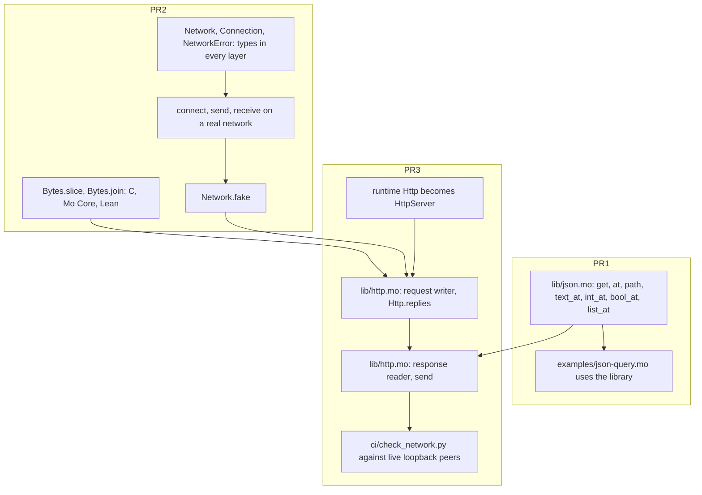
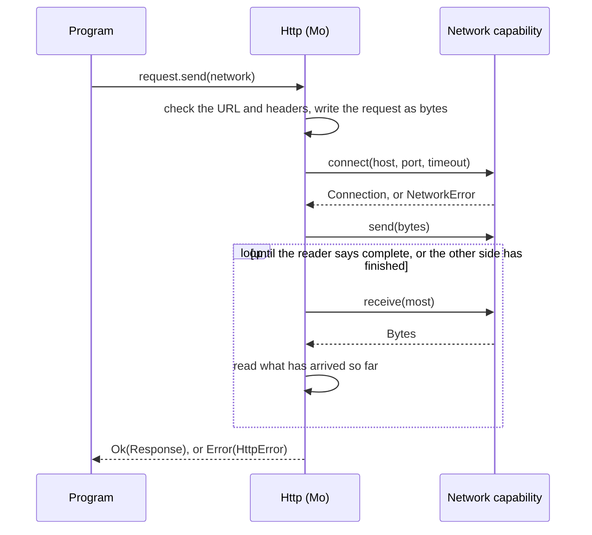
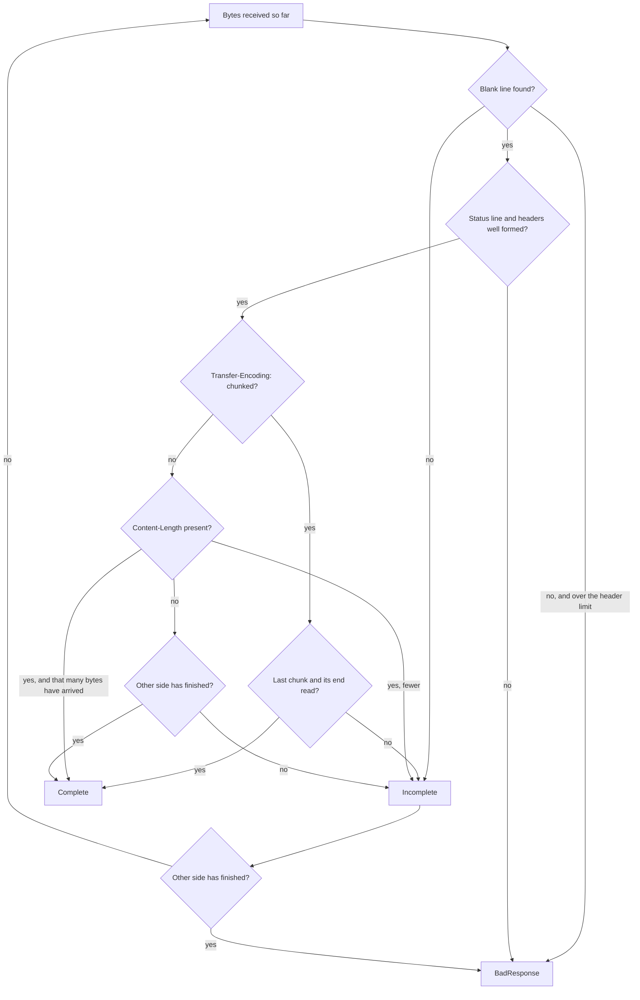

# Phase 7 M3, HTTP Without Encryption - Plan

## Goal Capsule

- **Objective:** A Mo program run with `mo run` calls an API over plain HTTP and reads the answer. Its tests run with no network. It takes values out of a JSON response by path without declaring types.
- **Means:** A `Network` capability at the level of a connection with a fake, two `Bytes` primitives, an `Http` client written in Mo in `lib/`, and lookup functions in `lib/json.mo` (KTD1, KTD4, KTD6, KTD10).
- **Authority:** `docs/design/outside-world.md` is the approved design, and this plan builds it without reopening it. Above it stand `docs/reference/README.md` and `AGENTS.md`. The phase plan named in `origin` sets the requirements. Robert approves every change to Mo's surface: reference text, commands and error codes.
- **Execution profile:** Three pull requests in a chain, PR1 to PR3, as grouped under Implementation Units. An agent builds each one. Robert reviews and merges each.
- **Stop and ask Robert when:** the nightly is red; a settled decision below cannot work; a sample's `mo check` takes more than 0.1 seconds after library code is added (Risks); a gated run of `lib/http.mo` cannot stay under 240 seconds on the sanitizer build; the 1 MiB fetch in U11 misses either figure of its bar, for either encoding; or the design and the reference disagree.
- **Who finishes:** Agents build and open each pull request. Robert merges.
- **Open blockers:** None.
- **Product Contract preservation:** The phase plan's requirements, flows and acceptance examples are unchanged. This plan carries the ones M3 covers under new local IDs, each marked with its phase ID, and adds R8 to R13 for choices the design left to this milestone.

---

## Product Contract

### Summary

Mo gains a `Network` capability that opens connections, and an `Http` library module that speaks HTTP/1.1 over one. A test builds a fake network from requests and their replies, so it never opens a socket. `Bytes` gains `slice` and `join`. `lib/json.mo` gains lookup by key, index and path, and `examples/json-query.mo` becomes a short program that uses it.

HTTPS, the Lean model of the fake network and the scanning primitives for `Json.parse` are later units of the phase.

### Problem Frame

A Mo program cannot reach the network. Its capabilities are arguments, environment, console, files, clock and random (`src/base/hostops.def`). Robert's daily work is calling APIs, so he cannot use Mo for it. The phase plan gives the full frame. This milestone is the first one a program can call an API with.

### Key Decisions

Each was settled with Robert in `docs/design/outside-world.md`, "Decisions for Robert", on 18 November 2026.

- **The capability works at the level of a connection.** (session-settled: user-approved — chosen over an HTTP request as the capability's operation, with HTTP parsed in C: the phase's safety rule puts parsing in Mo, and the level costs under 0.4% of the instructions.) Governs R1, R6.
- **The fake matches a request exactly.** (session-settled: user-approved — chosen over a fake that matches on method and URL only: that needs HTTP parsing outside Mo.) Governs R4.
- **The client's module is `Http`.** (session-settled: user-approved — chosen over `HttpClient` with the runtime's module left alone: `Http` is the name a user reaches for.) Governs R2.
- **`NetworkError`'s cases are written with `Network.` in front.** (session-settled: user-approved — chosen over cases that are always in scope, as `FileError`'s are: that would take `Refused`, `Closed`, `TimedOut` and more from every program.) Governs R1, R9.
- **An `https` URL is an error until the HTTPS milestone.** (session-settled: user-approved — chosen over TLS in this milestone: the TLS library has its own brainstorm.) Governs R3.
- **The Mo code in `lib/` passes the trust gates from its first commit.** (session-settled: user-directed — chosen over fitting it to the gates afterwards: it then never has a version that fails them.) Governs R12.

### Requirements

**Calling an API**

- R1. (phase R1) A program reaches the network only through a `Network` that `main` lists. `mo check` rejects a program that calls the client and holds none.
- R2. (phase R2) The client is the library module `Http` in `lib/http.mo`. A program uses it with nothing installed.
- R3. (phase R3) The client covers a request-and-response call as the design's section "The HTTP client" states it: method, headers, query, a body in and out, the status and a timeout. Every failure is a value.
- R4. (phase R5) `Network.fake` answers from the replies a test supplies, as the design's section "The fake" states it. Only tests, examples and promises may call it. It opens no socket and reads no clock.
- R5. (phase R6) A program takes values out of a `Json` by key, index and path, as the design's section "Looking through a response" states it. No lookup stops the program.

**Safety**

- R6. (phase R11) Mo code parses everything the network sends. The new C that reads from a socket copies bytes and inspects nothing. That C has a fuzz target with seeds, and so does the client's response parsing.
- R7. `docs/design/sandbox-properties.md` property P7 names the network as reachable only through `Network`, with the tests and fuzz targets that support it.

**Choices the design left to this milestone**

- R8. `bytes.slice(from, to)` gives the first `to` bytes with the first `from` taken off. So `from` at or past `to` gives empty `Bytes`.
- R9. `NetworkError` and `HttpError` each have a text form. A `main` that returns `Result(Unit, HttpError)` prints the error and exits with status 1.
- R10. The limit of 64 open connections counts real connections. A fake's connections do not count, as a fake's folders do not count toward the folder limit.
- R11. On a fake, a `receive` before any `send` is the error for a request with no reply, and a `send` after the first `receive` gives `Error(Network.Closed)`.

**Trust and upkeep**

- R12. `lib/json.mo` and `lib/http.mo` pass plain `mo test` with no survivor at every commit that changes them.
- R13. `mo guide` and the reference describe the capability, the client, the two `Bytes` functions and the lookup, and `guide_claims` checks what the guide says.

### Key Flows

- F1. (phase F2) A test with no network
  - **Trigger:** `mo test` runs on a program that calls an API.
  - **Steps:** The test builds a fake network with `Http.replies` from the requests it expects and their replies, passes it to the function under test, and checks the result.
  - **Covered by:** R4, R12

### Acceptance Examples

- AE1. (phase AE1) **Covers R1.** Given a program whose `main` lists only `Console`, when its code calls `request.send`, then `mo check` rejects it, because it holds no `Network` to pass.
- AE2. (phase AE3) **Covers R4.** Given a test with a fake that holds one reply, when the program makes a second, different request, then the test sees an error and no socket is opened.

### Scope Boundaries

**Deferred to Follow-Up Work**

- HTTPS and `network.connect_secure` (phase U4).
- The Lean model of the fake network (phase U8). Until it merges, a run that reaches a network operation leaves the comparison between the VM and Lean.
- Scanning primitives for `Json.parse` (phase U11).

**Considered and not built**

- Redirects, retries, cookies, proxies, compression and connection reuse. The design leaves them out, and Robert's spike shows which he misses.
- Trying the addresses of a host side by side, and a cache of lookups. One address after another is correct, and nothing has measured it as slow.
- A hand-written text form for `HttpError`. The derived form names the case and its fields. Robert's spike shows whether it reads well enough.
- A new translation of the Lean `JsonQuery` sample. It stays a translation of the example as it stood, and the documents that call it a match say so (U2).
- `lib/http.mo` inside the protocol server's image. `mo serve` does not call out.
- A text form for `Bytes`. A `Request` or a `Response` cannot be interpolated, and no requirement asks for it.
- Promise inputs of type `Connection` or `NetworkError`. A promise that takes a `Network` gets an empty fake.

### Dependencies and Assumptions

- The trust gates are on by default in `mo test` (#368 to #375).
- The nightly is green on `main` before each pull request's work starts, as the phase plan requires.
- Lean is installed on the development host at `/opt/elan`, with the toolchain `formal/lean-toolchain` names. A skipped `lean` group is not a pass.

### Sources

- `docs/design/outside-world.md`: the approved design. Its section "Where a capability is written down" lists the hand-kept places.
- `learnability/phase7/preflight/http-in-mo/`: the prototype, its bar (`bar.md`) and its loopback server (`server.py`). `proposed/fetch.mo` shows the shape of a reader on `Bytes`. It has no limits, no URL parsing and a weak chunk reader.
- `learnability/phase7/preflight/surface/`: stand-in modules that type-check the spike. `http.mo` there has the `Request`, `Response` and `HttpError` types as designed.
- `docs/solutions/best-practices/mo-code-costs-by-instruction-count-keep-hot-functions-small.md`: how to keep a parser in Mo fast.
- `docs/solutions/workflow-issues/sanitize-drivers-time-failures-are-contention-and-harness-waits.md`: a driver's wait must be at least its client's timeout, and an expected failure must name its error.
- `docs/solutions/workflow-issues/tracked-mo-programs-must-end-with-no-arguments.md`: every tracked `.mo` program with a `main` ends by itself when run with no arguments.
- `docs/status/agent-mistakes.md`: classes 1, 2, 3, 6, 8 and 9 apply here.

---

## Planning Contract

### Key Technical Decisions

- KTD1. **`Network` and `Connection` are both capability kinds, numbered 8 and 9.** The host finds `connection.send` through the capability's operation table (`src/host/host.c`, `mo_host_call`), the heap makes a native capability value only for a capability type (`src/heap/host.c`), and `tests/test_tables.c` requires each operation to take its module's capability first. The numbers follow `Simulation`, so no number in existing bytecode changes. Two places keep `Connection` out of `main`: the rule for `main`'s parameters in `src/check/program.c`, which gives E0079, and the assert in `src/vm/process.c`.
- KTD2. **`NetworkError` is a built-in type like `FileError`, and its cases resolve only with `Network.` in front.** (session-settled: user-approved — chosen over cases always in scope: `examples/rate-limit.mo` already declares a case `Refused`.) The mechanism is this plan's choice. A built-in case row gains a qualifier, and the three places that skip built-in cases under a prefix look the case up by prefix and name instead (`src/check/infer.c`, `infer-names.c`, `infer-patterns.c`, where `Simulation.` is already handled by name). The other choice was an enum declared in a `lib/` module. That would put a type a program declares into the contract between C and Lean for Mo Core, which is the most expensive place to change.
- KTD3. **The four operations are ordinary `HOSTOP` rows after `RANDOM_SEEDED`, and Mo Core IO operations.** A host operation's number is its position in `src/base/hostops.def`, so rows added at the end renumber nothing. The Core checker holds three argument types for one signature (`src/core/check.c`, `struct signature`), and `connect` takes four, so that array grows.
- KTD4. **Lean types the network operations and stops at them.** (session-settled: user-directed — chosen over modelling neither capability at any time: a later unit, phase U8, models the fake.) Each operation gets a name, a signature and an evaluation that stops with "Network is not modeled by mocore". `ci/check_host.py` gains a named set of rows that stop outside the model, and its two completeness asserts take that set into account. `Simulation` is no pattern here: it is a separate family of rows that the script never reads.
- KTD5. **The Core text version goes from 0.9 to 0.10, once, in PR2.** The version line changes in 39 files. The fixtures under `tests/core/` and `fuzz/corpus/fuzz_core_text/` are written by `formal/ExportSamples.lean` and compared byte for byte, so they are regenerated and never edited by hand. `ci/gen_core.py` holds its own copy of the version.
- KTD6. **`Bytes.slice` and `Bytes.join` are rows at the end of `src/base/prims.def`.** (session-settled: user-approved — chosen over copying bytes through lists: that takes 6.7 to 7.9 times the instructions.) Four primitive numbers are pinned in `src/prim/prim.c`, so only the end is free. Both copy into a new `Bytes`. `slice` cannot reuse `mo_text_slice`, which asserts UTF-8 boundaries. A negative index is a bug with the reason "negative index".
- KTD7. **The network operations and the two primitives merge before `lib/http.mo`.** Every program's Mo Core holds every function of every `lib/` module that is not generic, used or not. Once `lib/http.mo` exists, every sample, golden and Lean comparison contains `connect`, `send`, `receive`, `slice` and `join`. Lean must already type them, or the `lean` group fails for every program.
- KTD8. **The real network is a new file, `src/host/real-network.c`.** `src/host/host.c` is built a second time for `test_vm` with a clock that accepts only `CLOCK_REALTIME`, and a deadline needs the monotonic clock. The new file joins the fault-injection build in the `Makefile`. That build renames `clock_gettime` to a clock in `tests/test_host_faults.c` that also accepts only `CLOCK_REALTIME`, so that clock learns the monotonic one in the same change.
- KTD9. **A connection holds one deadline on the monotonic clock, and every step waits with `poll` for no longer than what is left.** `getaddrinfo` has no timeout. It runs on a helper thread that reports through a pipe, and `connect` waits on the pipe. When the deadline passes first, `connect` gives `TimedOut` and leaves the thread to end by itself. The thread's name, addresses and pipe live in one of a small fixed number of static slots, because `host` may not call `malloc` and the caller's stack is gone by then. The thread frees its slot when it ends. Each end of the pipe has one owner at any moment, under the slot's lock, so no descriptor is closed twice: a lookup that `connect` gave up on closes both ends itself. With every slot held by a lookup that has not ended, `connect` gives `Broken` with a reason that says so. Sockets are non-blocking. Addresses are tried in the order the lookup gives them. A child process for the lookup was the other choice. A killed child cancels the lookup for real, but a process that has started threads may not safely call `getaddrinfo` after `fork`, and the VM already runs on a thread of its own (`src/base/stack.c`).
- KTD10. **The client is pure functions around one function that touches the capability.** One function writes a `Request` as bytes. One reads the bytes received so far and says whether the response is complete, incomplete or malformed. It takes its size limits as an argument, as `parse_headers` in `runtime/http.mo` takes `HeaderLimits`, so a test or the fuzz target reaches a limit with a few bytes. `send` is the only function that calls `connect`, `send` and `receive`. `Http.replies` uses the same writer, so a fake's key equals what the client sends by construction. The fuzz target and phase U8's comparison both call the pure reader.
- KTD11. **The client's limits and its 30-second default are module constants.** `send` passes the limits to the reader. The gates do not mutate code outside functions. A literal inside a function is a mutant that some check must kill.
- KTD12. **An `https` URL gives `Error(Unreachable(Network.Broken(reason)))` with a reason that says HTTPS is not built yet.** (session-settled: user-approved — chosen over TLS in this milestone.) `HttpError`'s cases are fixed by the design, and this is the one that carries a sentence. The client decides this in Mo and makes no connection.
- KTD13. **Checks that need a live peer are a new driver, `ci/check_network.py`.** A golden case runs one process and cannot start a server. The driver follows the raw loopback peers in `ci/check_fetch.py`. Each wait in the driver is at least the timeout of the program it waits for, and each expected failure asserts its error by name.
- KTD14. **No new diagnostic code.** `Network.fake` outside a test is E0098, `main` listing a `Connection` is E0079, a program declaring `module Http` is E0037, and a program declaring a type `Network` is E0045. A bad port, a bad `most` and too many connections are bugs, named in the `bugs` column of their rows. Each reused code gets a new case under `tests/errors/`.
- KTD15. **Nothing a program passes can add a line to the request.** The design gives `BadHeader` for a line break in a header for this reason, and the same holds for the request line and the `Host` header. A URL whose host, path or query holds a space or an ASCII control character is `BadUrl`, which the design's "anything else is `BadUrl`" already covers. So is a port outside 1 to 65535: a URL is often outside data, and `connect` treats such a port as a bug. A method that is not ASCII letters gives `BadHeader` with the method as its name. The design names no case for a bad method, and this one keeps every failure a value without a new case. A `Content-Length` and a chunk size are read digit by digit. `Text.to_int` accepts a sign, and a negative length would reach `slice` as a negative index, which is a bug.

### High-Level Technical Design

What each pull request adds, and what it stands on.

One request through the client.

How the reader decides that a response is complete. The body limit is checked at every step, so a response past it is `TooLarge` before it is read whole.

A fake connection has three states. In `collecting` it keeps what is sent. The first `receive` looks up everything sent so far. With a reply it moves to `replying` and hands the reply out, at most `most` bytes at a time, then the end. With none it moves to `refused` and every `receive` gives the same `Broken` error. In `replying` and `refused` a `send` gives `Closed` (R11).

The real operations map the operating system's results to `NetworkError` like this.

| What happened | Result |
| --- | --- |
| The host name is empty or longer than 253 bytes, or the lookup says no such name | `UnknownHost(host)` |
| Every address refused the connection | `Refused(host, port)` |
| The deadline passed during the lookup, the connect, a send or a receive | `TimedOut` |
| The other side reset the connection, or closed it before a send finished | `Closed` |
| Anything else, a failed lookup of another kind included | `Broken(reason)` with the operating system's text |

### Assumptions

- A step of a path on an array is an index as `examples/json-query.mo` reads one today: decimal digits, counted from 0. A step with a sign or a space is no index.
- The fake's reason for a request with no reply quotes the first line sent. When a held request has the same first line, the reason also quotes the first line that differs and the line the fake expected in its place. The quoted text has a named limit.
- A promise that takes a `Network` gets a fake with no peers.
- The `lean` group runs for PR1 too. `lib/json.mo` is in every program's Mo Core, and the group is what compares those programs with Lean.

### System-Wide Impact

- **Shared contracts:** capability operations (`src/base/hostops.def`), primitives (`src/base/prims.def`), Mo Core with its Lean side, and the bytecode document's capability list. PR2 changes all four.
- **Every program's Mo Core grows** with each function added to `lib/` (KTD7). `ci/check_check_time.py` fails when a sample's `mo check` takes more than 0.1 seconds, and `examples/job-queue.mo` takes 0.077 today.
- **The protocol server's image grows** with the lookup functions, because `lib/json.mo` is one of the four library files built into `mo serve` (`Makefile`, `PROTOCOL_SOURCES`). Nothing pins its size.
- **Names taken from programs:** the types `Network`, `Connection` and `NetworkError`, and the module `Http`. The stand-ins under `learnability/phase7/preflight/surface/` declare all of them and stop checking. No check runs them, but their README says they check.
- **Threat model:** P7 in `docs/design/sandbox-properties.md` gains the network. A service still holds no capability.
- **Descriptors:** `mo_host_start` raises the descriptor limit to the folder limit plus 32 (`src/host/host.c`). 64 connections need that raised, and `tests/test_host.c` asserts the same figure.

### Risks

| Risk | What the plan does about it |
| --- | --- |
| `lib/http.mo` pushes a sample's `mo check` past 0.1 seconds. | U1 and U10 measure the samples before and after. Past the limit is a stop condition, because both ways out (a higher limit, or loading only the modules a program uses) are Robert's to choose. |
| A gated `mo test lib/http.mo` takes more than 240 seconds on the sanitizer build, where each process runs about 2.7 times slower. | U10 and U11 time the gated run on the sanitizer build. Small functions keep the mutant count down, and the reader takes its limits as an argument (KTD10), so an example at a limit is a few bytes long. |
| The `lean` group is skipped and read as a pass (class 3). With KTD7 a miss here breaks every program. | Each pull request's verification names the `lean` group and requires that it ran. |
| A check that asks a real resolver about a missing name fails on a runner with no DNS, or hangs. | No check does. The fault build stands in for the resolver's answers (U6), and the driver's case for `UnknownHost` is a name of 254 bytes, which needs no lookup. |
| The new driver adds time-limited checks to the sanitize drivers job, which went red for a week on contention. | KTD13. The job already runs two checks at a time. |
| A harness that tests nothing (class 6). | Each refusal is paired with the same request succeeding, and each test asserts which error came back. The fuzz target compares chunked bodies with a reader written in C. |
| Work on unbounded input (class 8). | Every size has a named limit: a receive, the response's headers and body, a chunk's size field, and the text a fake quotes. |
| A document left stale (class 1). | U2, U8 and U13 list the documents that describe what changes. |

### Deferred to Implementation

- The exact words of the fake's mismatch reason, within the Assumption above.
- Whether the reader keeps its position between receives or starts again. The bar in U11 decides.
- The names of the internal C functions and of the client's private Mo functions.
- How a test reaches the lookup deadline. The fault build can rename `getaddrinfo` to one that waits.

---

## Implementation Units

| Unit | Title | Main files | Depends on |
| --- | --- | --- | --- |
| U1 | Lookup in `lib/json.mo` | `lib/json.mo` | none |
| U2 | `examples/json-query.mo` uses the library | `examples/json-query.mo`, `tests/golden/sample-json-query-*` | U1 |
| U3 | Documents for the lookup | `docs/reference/README.md`, `docs/agent-guide.md` | U1 |
| U4 | `Bytes.slice` and `Bytes.join` | `src/base/prims.def`, `src/prim/text.c`, `formal/MoCore/` | none |
| U5 | The three new types | `src/heap/types.h`, `src/check/`, `src/core/`, `formal/MoCore/` | none |
| U6 | `connect`, `send` and `receive` on a real network | `src/base/hostops.def`, `src/host/real-network.c` | U5 |
| U7 | `Network.fake` | `src/host/`, `src/tools/fakes.c` | U6 |
| U8 | Documents for the capability and the primitives | `docs/reference/README.md`, `docs/design/` | U4, U7 |
| U9 | The runtime's `Http` becomes `HttpServer` | `runtime/http-server.mo`, `src/tools/protocol.c` | none |
| U10 | The request side of `lib/http.mo` | `lib/http.mo` | U4, U7, U9 |
| U11 | The response side and `send` | `lib/http.mo`, `fuzz/fuzz_http_client.c` | U10 |
| U12 | Checks against a live peer | `ci/check_network.py` | U11 |
| U13 | Documents for the client | `docs/reference/README.md`, `docs/agent-guide.md` | U11 |

### PR1: JSON lookup

Waits on: nothing.

### U1. Lookup in `lib/json.mo`

- **Goal:** A program takes a value out of a `Json` by key, index or path.
- **Requirements:** R5, R12.
- **Dependencies:** none.
- **Files:** `lib/json.mo` (the functions, their examples and tests), `tests/golden/` (one new `run` case that reads JSON on standard input and prints values by path).
- **Approach:**
  1. Add `get`, `at`, `path`, `text_at`, `int_at`, `bool_at` and `list_at` to the module and its `expose` line, as the design's table gives them.
  2. Give the empty path its own case. `"".split(".")` gives `[""]`, and the empty path must be the value itself.
  3. Give every exposed function its own example, and add examples until no mutant survives.
  4. Measure `mo check` on the samples before and after (`ci/check_check_time.py`).
- **Execution note:** Write each function's examples first, and run plain `mo test lib/json.mo` after each function.
- **Patterns to follow:** `at_path` in `examples/json-query.mo`, for the meaning of a step; the examples and tests already in `lib/json.mo`, for the form the gates accept; `tests/golden/lib-json-query/`, for a `run` case of the library.
- **Test scenarios:**
  - `get` on an object gives the field, and gives `None` for an absent key and for a value that is not an object.
  - `at` on an array gives the item at 0 and at the last index, and gives `None` one past the end and for a value that is not an array.
  - `path("items.0.user.login")` walks an object, an array and two objects.
  - `path("")` gives the value itself, and `list_at("")` gives the items of a value that is an array.
  - An object whose key is `"0"` is reached by the step `0`.
  - `text_at`, `int_at`, `bool_at` and `list_at` each give `None` when the value at the path has another kind.
  - `int_at` gives `None` for a number with a fraction.
  - Covers R12. Plain `mo test lib/json.mo` ends with no survivor.
- **Verification:** Plain `mo test lib/json.mo` passes with its `gates:` line showing no survivor. No sample's `mo check` takes more than 0.1 seconds.

### U2. `examples/json-query.mo` uses the library

- **Goal:** The example is a short program on `lib/json.mo`, with no copy of the `Json` type or the parser.
- **Requirements:** R5, R12; phase KTD7.
- **Dependencies:** U1.
- **Files:** `examples/json-query.mo`, `examples/README.md`, the seven cases `tests/golden/sample-json-query-*`, `ci/cli_runner.py` (the block that runs the example), `tests/test_check.c` (`samples`, which loads each example with no library), `formal/README.md`, `formal/TRANSLATION.md`, `formal/TEXT.md`.
- **Approach:**
  1. Rewrite the example on `Json.parse`, `path` and `pretty`. With no arguments it still prints its usage line and ends.
  2. Rewrite each golden case by hand from the reference. Two outputs change: a number prints as it was written, so `-1.50` stays `-1.50`, and a parse error gives the library's line and column.
  3. Update the checks named in `ci/cli_runner.py`, which lists functions the example no longer has.
  4. Make `tests/test_check.c` load the library for the example.
  5. Reword the three `formal/` documents that say the Lean `JsonQuery` sample matches the example. It is a translation of the example as it stood before this change.
- **Patterns to follow:** `tests/golden/lib-json-query/`.
- **Test scenarios:**
  - The path case prints the value at `items.0.n`.
  - The missing-path case prints its message and gives the exit status it gave before.
  - A truncated document and a document with text after its end each give the library's error text.
  - The usage case prints the usage line when the example runs with no argument.
  - Covers R12. Plain `mo test examples/json-query.mo` ends with no survivor.
- **Verification:** The seven golden cases pass. The example holds no `Json` type of its own. No document says the Lean sample matches the example as it is now.

### U3. Documents for the lookup

- **Goal:** The reference and the guide teach the lookup.
- **Requirements:** R13.
- **Dependencies:** U1.
- **Files:** `docs/reference/README.md` (section 14, **Json**), `tests/conformance/reference.tsv` and `tests/conformance/rules.tsv`, `docs/design/library.md` (`## Json`), `docs/status/section-14-inventory.md`, `docs/agent-guide.md`, `ci/cli_guide.py`.
- **Approach:**
  1. Add the seven functions to section 14 and to the library map.
  2. Refresh the conformance inventory with `ci/check_conformance.py --inventory`, and review `rules.tsv`.
  3. Add a sentence to the guide, with its claim in `guide_claims`.
- **Test expectation:** none beyond the checks the documents already have. `guide_claims` runs the new claim.
- **Verification:** `bash ci/check.sh drivers static` passes.

### PR2: The network capability and the `Bytes` primitives

Waits on: PR1, merge order only. Both edit section 14 of the reference, the conformance inventory and the library map.

Robert reviews every pull request, and this group is C, Mo Core and Lean across about 60 files. It is kept apart from PR1 and PR3, which are Mo, so each is a size one reviewer can read well.

### U4. `Bytes.slice` and `Bytes.join`

- **Goal:** Mo code cuts and joins `Bytes` without copying each byte through a list.
- **Requirements:** R8; KTD6.
- **Dependencies:** none.
- **Files:** `src/base/prims.def`, `src/prim/prim.c`, `src/prim/text.c`, `src/core/ops.def`, `src/core/check.c`, `src/lower/applications.c`, `formal/MoCore/Syntax.lean`, `formal/MoCore/Prim.lean`, `formal/MoCore/PrimSafety.lean`, `formal/MoCore/Text/Prim.lean`, `formal/TEXT.md`, `formal/TRANSLATION.md`, `ci/check_primitives.py`, `ci/check_core_check.py`, `tests/test_prim.c`, `tests/test_program.c`, `tests/lower-source/bytes-natives/main.mo`.
- **Approach:**
  1. Add the two rows at the end of `prims.def`, and amend the header's sentence that says the rows follow the library map type by type.
  2. Give them their own branch in `src/prim/text.c`. The existing branch for `Bytes` is a range of numbers that ends at `decode_utf8`.
  3. Add the Core operations, their typing and their lowering names.
  4. Add the Lean operations, their evaluation and their cases in `bytesOp_safe`. The reason for a negative index is the same text in C and in Lean.
  5. Add cases to `ci/check_primitives.py`. It sends every other `Bytes` row one argument, and it fails unless every row is covered.
- **Patterns to follow:** `List.take` in `formal/MoCore/Prim.lean`, for a bug on a negative count; `Text.from_chars` in `prims.def`, for a module function whose first parameter is not the module's type; `join` in `src/prim/collections.c`, for charging the heap before a copy.
- **Test scenarios:**
  - `slice(0, size)` gives the same bytes, and `slice(1, 3)` of five bytes gives the second and third.
  - `slice` with `to` past the end stops at the end, and with `from` past the end gives empty bytes.
  - Covers R8. `slice(3, 1)` gives empty bytes.
  - `slice(-1, 2)` and `slice(0, -1)` each stop the program with "negative index".
  - `Bytes.join([])` gives empty bytes, and `Bytes.join` of three parts, one of them empty, gives them in order.
  - Called with a dot, through the module and as a function value, each gives the same result (`tests/test_program.c`).
  - The VM and Lean agree on each case in `ci/check_primitives.py`, the largest `Int` as an index among them.
- **Verification:** `make formal` checks every proof with no `sorry`. `ci/check_primitives.py` covers both rows.

### U5. The three new types

- **Goal:** `Network`, `Connection` and `NetworkError` exist in every layer, a program can list `Network` on `main`, and `NetworkError`'s cases are written `Network.Refused(host, port)`.
- **Requirements:** R1, R9; KTD1, KTD2, KTD5.
- **Dependencies:** none.
- **Files:**
  - base and heap: `src/base/capabilities.h`, `src/base/capabilities.c`, `src/heap/types.h`, `src/heap/types.c`.
  - check: `src/check/modules.c`, `src/check/signatures.c`, `src/check/data.h`, `src/check/program.c`, `src/check/infer.c`, `src/check/infer-names.c`, `src/check/infer-patterns.c`, `src/check/infer-finish.c`, `src/check/abilities.c`.
  - lower, core and codegen: `src/lower/types.c`, `src/lower/applications.c`, `src/lower/abilities.c`, `src/core/core.h`, `src/core/text_schema.def`, `src/core/check.c`, `src/codegen/types.c`.
  - bytecode, vm and host: `src/bytecode/read.c`, `indexed.c`, `shorthand-type.c`, `disassemble.c`, `signature.c`, `src/vm/internal.h`, `src/vm/process.c`, `src/host/host.h`, `src/host/host.c`, `src/host/internal.h`, `src/host/types.c`.
  - tools: `src/tools/fakes.h`, `src/tools/fakes.c`, `src/tools/promises.c`.
  - Lean and the version: `formal/MoCore/Syntax.lean`, `formal/MoCore/Text/Basic.lean`, `formal/MoCore/Text/Structural.lean`, `formal/MoCore/Text/Sexp.lean`, `formal/MoCore/TextChecks.lean`, `formal/ExportSamples.lean`, `formal/TEXT.md`, `formal/README.md`, `ci/gen_core.py`, `ci/test_mocore.sh`, `ci/check_core_fixtures.sh`, `tests/core/*.core`, `fuzz/corpus/fuzz_core_text/*.core`, `tests/differential/`, `tests/test_core_text.c`, `tests/test_core_print.c`.
  - tests, fuzz and CBMC: `tests/test_tables.c`, `tests/test_heap.c`, `tests/test_opcodes.c`, `tests/test_types.c`, `tests/test_bytecode_io.c`, `tests/test_fakes.c`, `tests/heap_fixture.h`, `tests/host_fixture.h`, `tests/vm_run.h`, `tests/check/diagnostics/`, `tests/errors/`, `fuzz/fuzz_bytecode_io.c`, `cbmc/verify.c`.
- **Approach:**
  1. Add the two capability kinds after `Simulation`. Give every array sized by the last host capability, and every loop bounded by it, its new bound. `src/host/types.c` writes past its array as soon as kind 8 exists.
  2. Add `NetworkError` wherever `FileError` is: its name and cases in the checker, its tag and shape in Mo Core, its choice type in the code generator, and its structural check in the verifier.
  3. Build the qualified cases (KTD2). `Network.Refused(...)` resolves in an expression and in a pattern. Bare `Refused` stays free for a program to declare.
  4. Add `NetworkError` to the lists of built-in types that derive equality and a text form.
  5. Keep `Connection` out of `main` in the checker and in the VM (KTD1).
  6. Hand `main` a real `Network`, which holds no state, as `Clock` does.
  7. Add the capability kinds and the type to Lean, and raise the Core text version (KTD5). Regenerate the fixtures with `ExportSamples.lean`.
  8. Move the bound in `cbmc/verify.c` and the assert in `fuzz/fuzz_bytecode_io.c`, which both take `Simulation` for the last capability.
- **Patterns to follow:** `FileError` in every layer; the `Simulation` name checks in `src/check/infer.c` and `infer-names.c`, for a prefix handled by name; commit `c68fc99e`, for a Core text version change.
- **Test scenarios:**
  - A program whose `main` lists `Network` checks and runs.
  - A program whose `main` lists `Connection` is rejected with E0079.
  - `Network.TimedOut` and `Network.Refused(host: "h", port: 80)` construct, compare equal to themselves and print a text form.
  - A `case` with the patterns `Network.Refused(host, port)` and `Network.TimedOut` matches each.
  - A program that declares its own enum with a case `Refused` checks, and its bare `Refused` is its own case.
  - Bare `TimedOut`, with no enum of the program's declaring it, is rejected as an unknown name.
  - A program that declares a type named `Network` is rejected with E0045.
  - A Core text document with version 0.9 is refused, and one with 0.10 is read.
  - Lean and C print the same structural text for each `NetworkError` case.
- **Verification:** `ci/check_core_fixtures.sh` finds the fixtures equal to Lean's export. `examples/rate-limit.mo` still checks. `make formal` passes.

### U6. `connect`, `send` and `receive` on a real network

- **Goal:** A program under `mo run` opens a TCP connection, sends bytes and receives bytes, inside one deadline.
- **Requirements:** R1, R6, R10; KTD3, KTD4, KTD8, KTD9, KTD14.
- **Dependencies:** U5.
- **Files:** `src/base/hostops.def`, `src/base/limits.h`, `src/lower/applications.c`, `src/core/ops.def`, `src/core/check.c`, `src/codegen/operations.c`, `src/host/real-network.c` (new), `src/host/network.h` (new, if the handle's layout is shared with the fake), `src/host/host.h`, `src/host/host.c`, `src/host/internal.h`, `Makefile`, `formal/MoCore/Syntax.lean`, `formal/MoCore/Prim.lean`, `formal/MoCore/Text/Prim.lean`, `formal/TEXT.md`, `formal/TRANSLATION.md`, `ci/check_host.py`, `ci/check_core_check.py`, `tests/test_tables.c`, `tests/test_host.c`, `tests/test_host_faults.c`, `tests/host_fixture.h`, `fuzz/fuzz_host.c`, `fuzz/fuzz_network.c` (new) with `fuzz/corpus/fuzz_network/`.
- **Approach:**
  1. Add the three rows after `RANDOM_SEEDED`, with their bugs. A bug's reason holds no comma, so the port's reads "port outside 1 to 65535".
  2. Add the Core IO operations at the end of `MO_CORE_IO_OPS`, their typing, their lowering names and their rows in the code generator's table, which follows that order by position. Add an assert that the table has one row for each operation.
  3. Type the operations in Lean and stop at them (KTD4). Put the stopping arms before the catch-all in `evalHostIoOp`, or `hostIoOp_safe` fails.
  4. Add the named set to `ci/check_host.py`.
  5. Write the real operations (KTD8, KTD9), with the result table under High-Level Technical Design. A `Connection` owns its socket: releasing it closes the socket and lowers the count.
  6. Add the limits to `src/base/limits.h`: open connections, bytes in one receive, bytes in a host name, lookups still running and addresses kept from one lookup. Raise the descriptor limit in `mo_host_start` by the connection limit and by two descriptors for each lookup slot.
  7. Add the file to the fault build, with a case in `tests/test_host_faults.c` for each call that can fail. Make the fault build's clock accept `CLOCK_MONOTONIC` as well, with its failure and override switches applying to both clocks (KTD8).
  8. Add the fuzz target for `receive`: it writes its input to one end of a socket pair and receives from the other with a size taken from the input. Keep `fuzz/fuzz_host.c` away from the real network.
- **Execution note:** Start with a failing test in `tests/test_host.c` that connects to a listener the test opened on loopback.
- **Patterns to follow:** `src/host/real-files.c`, for a capability value that owns a descriptor, counts toward a limit and releases it; `mo_host_file_error` in `src/host/files.c`, for building an error case by name from the result type; `src/host/listener.c`, for non-blocking sockets with `poll` and a deadline; `tests/test_listener.c`, for loopback sockets in a unit test.
- **Test scenarios:**
  - Bytes sent to a loopback listener arrive as sent, and bytes the listener sends are received.
  - `receive` gives at most `most` bytes, and gives empty bytes once the listener has closed.
  - A connect to a closed loopback port gives `Refused` with that host and port.
  - A host name of 254 bytes gives `UnknownHost` with no lookup, and an empty name gives `UnknownHost`.
  - A connect to `localhost` reaches a listener bound to 127.0.0.1, whichever address the lookup gives first.
  - In the fault build, a lookup that answers "no such name" gives `UnknownHost` with the host, and one that answers "try again" gives `Broken`.
  - A listener that accepts and never answers gives `TimedOut` from `receive`, no sooner than the deadline and not long after it.
  - A listener that resets the connection gives `Closed`.
  - In the fault build, a lookup that outlasts the deadline gives `TimedOut`, and a failing `socket`, `connect`, `send` and `recv` each give an error value and leave no descriptor open.
  - In the fault build, with every lookup slot held by a lookup that has not ended, `connect` gives `Broken` with the reason for it. Once those lookups end, a `connect` succeeds and no descriptor of theirs is open.
  - A port of 0 and a port of 65536 each stop the program with the port's reason. A `most` of 0 and a `most` one past the limit each stop it with theirs.
  - Covers R10. The 65th open connection stops the program, and dropping one connection allows another.
  - Dropping the last reference to a `Connection` closes its socket, which the listener sees as the end.
  - The fuzz target runs on its seeds: an empty input, one byte, and an input larger than one receive.
  - In Lean, a run that reaches `connect` stops with "Network is not modeled by mocore", and what the run printed before it is kept.
- **Verification:** `make CC=clang`, `make sanitize CC=clang` and `make fuzz-smoke` pass. `ci/check_host.py` passes and prints how many rows it left outside the model.

### U7. `Network.fake`

- **Goal:** A test builds a network that answers from a map and never opens a socket.
- **Requirements:** R4, R11; KTD3, KTD14; AE2.
- **Dependencies:** U6.
- **Files:** `src/base/hostops.def`, `src/base/limits.h`, `src/core/ops.def`, `src/core/check.c`, `src/lower/applications.c`, `src/codegen/operations.c`, `src/host/network.c` (new, the fake), `src/host/host.h`, `src/host/host.c`, `src/host/types.c`, `src/vm/image.c`, `src/tools/fakes.c`, `src/tools/promises.c`, `formal/MoCore/Syntax.lean`, `formal/MoCore/Prim.lean`, `formal/MoCore/Text/Prim.lean`, `ci/check_host.py`, `tests/test_host.c`, `tests/test_fakes.c`, `tests/test_tables.c`, `tests/vm_run.h`, `tests/host_fixture.h`, `tests/golden/cap-network-fake/` (new), `tests/errors/e0098-network/` (new), `fuzz/fuzz_host.c`.
- **Approach:**
  1. Add the row for `Network.fake`, marked as callable only from tests, examples and promises, with its Core operation and Lean entry.
  2. Make `add()` in `src/host/types.c` build types whose parameters are not `Text`, and add the private types the fake's state needs: `Bytes`, a map from bytes to bytes, and a map from text to that map.
  3. Write the fake's three states as High-Level Technical Design gives them. A fake `Connection` holds its peer's replies, the bytes sent and a position, and no capability.
  4. Snapshot, restore and drop the fake network's state where the other fakes' are. A `Connection` is never restored, because `main` cannot list one.
  5. Give promise generation a `Network` with no peers.
- **Patterns to follow:** `Files.in_memory` in `src/host/host.c`, for a fake constructor that takes its argument and drops it; the rule for a fake's state in `docs/design/bytecode.md` section 7; `tests/golden/cap-files-fake/`, for a golden of a faked capability.
- **Test scenarios:**
  - `connect` to a key the map holds gives a `Connection`, and to a key it lacks gives `UnknownHost`.
  - Two sends followed by a receive look up the two sends joined.
  - A reply of 10 bytes received with `most` 4 arrives as 4, 4 and 2 bytes, and then empty bytes.
  - Covers AE2. With one reply held, a second connection that sends other bytes gets `Broken`, and its reason quotes the first line it sent.
  - A request that differs from a held one by one header line gets a reason that quotes that line and the line the fake expected.
  - Covers R11. A `receive` before any `send` gives the no-reply error, and a `send` after the first `receive` gives `Closed`.
  - `within` is ignored: a fake with a deadline of zero still answers.
  - Two fakes share nothing, and two connections on one fake each read their reply from its start.
  - `Network.fake` outside a test, an example or a promise is rejected with E0098.
  - A snapshot of a fake network restores to one that answers the same.
  - A promise that takes a `Network` runs, and every `connect` on its network gives `UnknownHost`.
- **Verification:** `tests/golden/cap-network-fake/` passes under plain `mo test` with its `gates:` line. No test in this unit opens a socket.

### U8. Documents for the capability and the primitives

- **Goal:** The reference, the guide and the design documents describe what PR2 built.
- **Requirements:** R7, R13.
- **Dependencies:** U4, U7.
- **Files:** `docs/reference/README.md` (3.4, 10.5, 11.1, 11.2, 12.4, 13.2, section 14 **Bytes** and a new **Network** paragraph, 15), `tests/conformance/reference.tsv`, `tests/conformance/rules.tsv`, `docs/design/library.md` (`## Bytes`, new `## Network` and `## Connection`), `docs/design/bytecode.md` (the capability names, their numbers and their count, and the fakes), `docs/design/sandbox-properties.md` (P7), `docs/design/outside-world.md` (Status and "As built"), `docs/agent-guide.md`, `ci/cli_guide.py`, `learnability/phase7/preflight/surface/`.
- **Approach:**
  1. Write the reference text from the design's tables. A network example in the reference uses a fake or is marked as a fragment, because `ci/check_reference_examples.py` runs every complete program.
  2. Record in "As built" what the design left open and this plan chose: R8 to R11, KTD1, KTD2, KTD9 and KTD15. Correct the two statements research found wrong: results that hold `Bytes` needed no new host work, and the stand-ins also took the new names.
  3. Add the lookup thread to gap 5 of `docs/design/sandbox-properties.md`, which says any new thread needs its own review: what the thread shares, who owns each descriptor, and that ThreadSanitizer does not check it.
  4. Remove the stand-in `network.mo` and reword the surface README, which says its programs check. `http.mo` and the spike programs there go in U13.
- **Test expectation:** none beyond the documents' own checks. `guide_claims` runs each new claim.
- **Verification:** `bash ci/check.sh drivers static` passes. `make library-map` passes.

### PR3: The HTTP client

Waits on: PR2, merge order only. The branch is built on PR2's.

Robert reviews every pull request. This group is the Mo client and its checks, and together with PR2's C and Lean it is more than one reviewer can read well.

### U9. The runtime's `Http` becomes `HttpServer`

- **Goal:** The name `Http` is free for the library module.
- **Requirements:** R2.
- **Dependencies:** none.
- **Files:** `runtime/http.mo` (moved to `runtime/http-server.mo`), `runtime/http-body.mo`, `runtime/http-policy.mo`, `runtime/mcp-fetch.mo`, `Makefile` (`PROTOCOL_SOURCES`), `src/tools/protocol.c`, `src/tools/protocol-server.c`, `src/tools/protocol-request.c`, `fuzz/fuzz_http.c`, `tests/test_protocol_memory.c`, `tests/test_lower.c`, `tests/runtime/http-check.mo`, `tests/runtime/http-transport-check.mo`, `docs/design/introspection.md`.
- **Approach:**
  1. Rename the module and its file, and every use of it.
  2. In `fuzz/fuzz_http.c` and `tests/test_protocol_memory.c`, replace the comparisons that hold each name's length as a number with the lookup by name the fuzz file already has.
- **Test expectation:** none new. This is a rename, and the protocol tests and the upgrade drivers cover it.
- **Verification:** No file outside `docs/plans/` and the records of earlier phases names the runtime module `Http`. `bash ci/check.sh gcc` passes, and `fuzz_http` runs on its seeds.

### U10. The request side of `lib/http.mo`

- **Goal:** A program builds a request, and a test builds the fake that answers it.
- **Requirements:** R2, R3, R4, R12; KTD10, KTD11, KTD12, KTD15.
- **Dependencies:** U4, U7, U9.
- **Files:** `lib/http.mo` (new).
- **Approach:**
  1. Declare `Request`, `Response` and `HttpError` as the design gives them, and the builders: `get`, `post`, `request`, `header`, `query`, `json`, `text` and `within`.
  2. Parse a URL into scheme, host, port, path and query, and refuse what KTD15 names.
  3. Write the pure function that turns a `Request` into bytes or an `HttpError`. The client's own headers come first in a fixed order. The program's follow, sorted by name without regard to case, and two with one name keep their order.
  4. Add `Http.reply` and `Http.replies`. `replies` writes each request with the same function.
  5. Measure `mo check` on the samples before and after.
- **Execution note:** Take the design's test "sync saves each open issue, with no network" as the first failing check, without its database lines and with its URL changed to `http://`. The design writes `https://`, which is an error until the HTTPS milestone (KTD12).
- **Patterns to follow:** `learnability/phase7/preflight/surface/http.mo`, for the types and overloads that already type-check; `lib/json.mo`, for examples inside each function and module constants for limits.
- **Test scenarios:**
  - `Http.get(url)` has the method `GET`, the 30-second timeout and an empty body, and `within` replaces the timeout.
  - `query("state", "open")` adds `?state=open`, a second query adds `&`, and a space, an `&` and a character outside ASCII in a value are percent-encoded.
  - A URL with no path sends `/`, a URL with a port sends to that port, and `http` with no port uses 80.
  - A URL with another scheme, with no host, or with a port that is not a number gives `BadUrl` with the URL.
  - A port of 0 and a port of 65536 each give `BadUrl`, and 1 and 65535 are accepted.
  - A URL whose path holds a line break, and one whose host holds a space, each give `BadUrl`, and nothing is written.
  - A method that holds a space gives `BadHeader` with the method, and nothing is written.
  - Two requests that add the same headers in a different order write the same bytes.
  - Two headers with one name keep the order the program gave them.
  - A header whose name or value holds a line break gives `BadHeader` with the name, and nothing is written.
  - `json(value)` sets the body and its content type and length, and so does `text(text)`.
  - `Http.replies` of two exchanges on one host gives one key with two entries, and of two hosts gives two keys.
  - Covers R12. Each exposed function and each overload has its own example.
- **Verification:** Plain `mo test lib/http.mo` passes with no survivor. No sample's `mo check` takes more than 0.1 seconds.

### U11. The response side and `send`

- **Goal:** `request.send(network)` gives the response or an error value, and the reader of network bytes is fuzzed.
- **Requirements:** R1, R3, R6, R12; KTD10, KTD11, KTD12, KTD15; F1; AE1, AE2.
- **Dependencies:** U10.
- **Files:** `lib/http.mo`, `fuzz/fuzz_http_client.c` (new) with `fuzz/corpus/fuzz_http_client/`, `Makefile` (only if the target needs options of its own in `fuzz-smoke`), `tests/golden/http-fake/` (new), `tests/errors/` (a new case for AE1), `learnability/phase7/preflight/http-in-mo/` (the measurement's record).
- **Approach:**
  1. Write the pure reader as the decision diagram under High-Level Technical Design gives it. Bound the chunk size field, and require the line end after each chunk's data. Read `Content-Length` and a chunk size digit by digit, with no sign (KTD15).
  2. Write `send`: check the URL, write the request, connect, send, then receive until the reader says the response is complete or the other side has finished. A `NetworkError` becomes `Unreachable`.
  3. Add `ok?`, `header`, `json` and `text` on a `Response`.
  4. Write the fuzz target. It compiles a small entry program against `lib/` once, finds the reader by name, and calls it under an instruction limit. It takes small limits from its input, so the limit branches are within reach of a short input. It asserts that no input makes the VM fail, that a complete response is within the limits, and that a chunked body equals what a reader written in C gives.
  5. Run the prototype's 1 MiB fetch with this client against `server.py`, with `Content-Length` and chunked, and record wall time and heap peak beside the bar.
- **Execution note:** Keep each function that runs once for each byte or line small, as the learning on instruction counts says, and count instructions when two versions compete.
- **Patterns to follow:** `fuzz/fuzz_mutants.c`, for compiling Mo source against `lib/` inside a fuzz target; `chunk_payload` in `fuzz/fuzz_http.c`, for an oracle written in C; `chunk_size`, `line_end` and `field` in `runtime/http-server.mo`, for parsing that already checks its limits.
- **Test scenarios:**
  - Covers F1. A function that calls an API passes its test with `Network.fake(Http.replies([...]))`.
  - Covers AE2. With one exchange held, a second, different request gives `Error(Unreachable(Network.Broken(reason)))`, and the reason quotes that request's first line. The error for an `https` URL has the same shape, so the reason is what shows the fake answered.
  - Covers AE1. `mo check` rejects a program whose `main` lists only `Console` and whose code calls `send` (a case under `tests/errors/`).
  - One fake answers two programs that add the same headers in a different order.
  - A response with `Content-Length` is read whole, and its status, headers and body come back as values.
  - A response with a chunked body is read whole, with a chunk extension and with trailers.
  - A response with neither is read to the end of the connection.
  - A status of 404 and a status of 500 are each `Ok` with that status, and `ok?` is false for both.
  - A malformed status line gives `BadResponse`, and so does a `Content-Length` that is not a number.
  - A `Content-Length` of `-5` and one of `+5` each give `BadResponse`.
  - A response cut off inside its headers, and one cut off inside its body, each give `BadResponse`.
  - Against the reader with limits a few bytes long: headers one byte over the limit give `BadResponse`, a body one byte over gives `TooLarge` with the limit, and a body at the limit is read.
  - Through `send`: a `Content-Length` one over 16 MiB gives `TooLarge` with 16 MiB before any body is read, and a reply with more than 64 KiB of headers gives `BadResponse`.
  - `header` finds a name without regard to case, and gives `None` for an absent one.
  - `response.json` gives the parsed value, and `NotJson` with the parser's error for a body that is not JSON. `response.text` gives `None` for a body that is not UTF-8.
  - An `https` URL gives the error KTD12 names, and the fake sees no connection.
  - The fuzz target runs on its seeds: a malformed status line, a chunk with an extension, a chunk size too large for an `Int`, a short `Content-Length`, a negative `Content-Length`, and line feeds with no carriage return.
  - Covers R12. Plain `mo test lib/http.mo` ends with no survivor, and the gated run takes under 240 seconds on the sanitizer build.
- **Verification:** `make fuzz-smoke` runs the new target. The 1 MiB fetch stays within the bar in `learnability/phase7/preflight/http-in-mo/bar.md`, and the record gives both figures. `tests/golden/http-fake/` passes.

### U12. Checks against a live peer

- **Goal:** The client and the real network are shown together against a server on loopback.
- **Requirements:** R3; KTD13.
- **Dependencies:** U11.
- **Files:** `ci/check_network.py` (new), `ci/check.sh` (the `drivers` group), `docs/design/architecture.md` (section 11, the list of drivers).
- **Approach:**
  1. Write the driver. It writes small programs to a temporary folder, starts a peer on a loopback port it was given, and runs each program with `mo run`.
  2. Give each program a timeout shorter than the driver's wait for it (KTD13).
- **Patterns to follow:** `bad_response` in `ci/check_fetch.py`, for a raw loopback peer that records the request and sends a fixed or cut-off reply; `ci/check_upgrade_remote.py`, for a recording handler.
- **Test scenarios:**
  - A request with a method, two headers, a query and a body arrives at the peer as written, and the program prints the status, a header and the body it got back.
  - A peer that accepts and never answers gives `Unreachable(Network.TimedOut)` after the timeout the program set, and the program ends soon after it.
  - A closed port gives `Unreachable(Network.Refused(...))` with the host and port.
  - A name of 254 bytes gives `Unreachable(Network.UnknownHost(...))`.
  - A peer that sends the headers and half the body, then closes, gives `BadResponse`.
  - A peer that answers with a chunked body is read whole.
  - A program that returns the error from `main` prints its text form and exits with status 1.
  - The same request to the same peer succeeds beside each refusal, so each failure is the peer's doing.
- **Verification:** `bash ci/check.sh drivers` runs the driver and passes on the gcc build and on the sanitizer build.

### U13. Documents for the client

- **Goal:** The reference and the guide teach the client, and no document still says it is unbuilt.
- **Requirements:** R13.
- **Dependencies:** U11.
- **Files:** `docs/reference/README.md` (10.3, a new **Http** paragraph in section 14, 15), `tests/conformance/reference.tsv`, `tests/conformance/rules.tsv`, `docs/design/library.md` (new `## Http`), `docs/status/section-14-inventory.md`, `docs/agent-guide.md`, `ci/cli_guide.py`, `docs/design/services.md`, `docs/design/outside-world.md`, `docs/design/sandbox-properties.md`, `learnability/phase7/preflight/surface/`.
- **Approach:**
  1. Add `Http` to the reserved names in 10.3 and write its paragraph in section 14 from the design's table.
  2. Add the guide's passage on calling an API and testing it with a fake, with claims in `guide_claims`. Its example uses an `http://` URL and says that `https://` is an error until the HTTPS milestone. The worked spike with SQLite waits for phase U6.
  3. Rewrite the sentence in `docs/design/services.md` that moves an HTTP client to a later phase.
  4. Correct the design's reason for the rename: the clash is `mo check` on a runtime module with the library installed, and the protocol server's image never held `lib/http.mo`.
  5. Remove the stand-in `http.mo` and the spike programs that depended on it, or reword the surface README to say they are records.
- **Test expectation:** none beyond the documents' own checks. `guide_claims` runs each new claim.
- **Verification:** `bash ci/check.sh drivers static` passes. `mo guide` describes the capability and the client.

---

## Verification Contract

| Command | When | What it shows |
| --- | --- | --- |
| `bash ci/check.sh gcc` | Before each pull request. Its last line goes in the pull request body. | The build and every unit test. |
| `bash ci/check.sh drivers static` | Once in each pull request. All three edit the reference, the guide or the library map. | Goldens, guide claims, conformance, the library map, format and fuzz seeds. |
| `bash ci/check.sh lean` | Once in each pull request. A skip is not a pass. | Mo Core in Lean matches the executables, every proof checks, and every `HOSTOP` row is modelled or in the named set. |
| Plain `mo test lib/json.mo` and `mo test examples/json-query.mo` | PR1. The last line of each goes in the pull request body. | R12. |
| `make CC=clang`, `make sanitize CC=clang`, `make fuzz-smoke` | PR2 and PR3. | Both compilers, ASan and UBSan, and each fuzz target on its seeds. |
| `bash ci/check.sh cbmc` | PR2, once. U5 edits `cbmc/verify.c`, and no other check reads it. | The verifier's proof still passes with the new capability bound. |
| Plain `mo test lib/http.mo`, on the gcc build and on the sanitizer build | PR3. The last line goes in the pull request body. | R12, and the 240-second limit. |
| The 1 MiB fetch against `learnability/phase7/preflight/http-in-mo/server.py` | PR3. | The client stays within the bar. |
| `python3 ci/check_check_time.py` on the samples | PR1 and PR3, before and after. | No sample's `mo check` takes more than 0.1 seconds. |

The nightly runs the wider groups on `main`. A red nightly is fixed before the next pull request's work starts.

---

## Definition of Done

**For the milestone**

- Robert has merged the three pull requests.
- A program calls a local HTTP server and reads the answer, its test passes with a fake network, and a value comes out of a JSON response by path (the phase plan's signal for U3).
- `lib/json.mo`, `lib/http.mo` and `examples/json-query.mo` pass plain `mo test` with no survivor.
- The reference, the guide, the library map and the design document describe what was built, and no stand-in or prototype outside `learnability/phase7/preflight/` remains.
- No abandoned attempt is left in the diff.
- The nightly is green on `main` after each merge.

**For each unit**

| Unit | Done when |
| --- | --- |
| U1 | The seven lookups are exposed, each with an example, and the gated run has no survivor. |
| U2 | The example holds no parser, and its seven golden cases pass. |
| U3 | The reference, the library map and the guide list the lookups, and `drivers static` passes. |
| U4 | Both primitives run in the VM and in Lean with the same results, and every proof checks. |
| U5 | `main` can list `Network`, cannot list `Connection`, and `Network.Refused(...)` constructs and matches. |
| U6 | A program sends to and receives from a loopback listener inside its deadline, and each failure is its own error value. |
| U7 | A fake answers from its map, and its odd cases give what R11 says. |
| U8 | The documents describe the capability and the primitives, and the design's "As built" records this plan's choices. |
| U9 | The runtime module is `HttpServer`, and the protocol checks pass. |
| U10 | A request writes the same bytes whatever the order of its headers, and `Http.replies` builds a fake's map. |
| U11 | `send` gives a response through a fake, the reader is fuzzed, and the 1 MiB fetch meets the bar. |
| U12 | The driver passes against live peers on the gcc and sanitizer builds. |
| U13 | `mo guide` teaches the client, and no document says it is unbuilt. |
